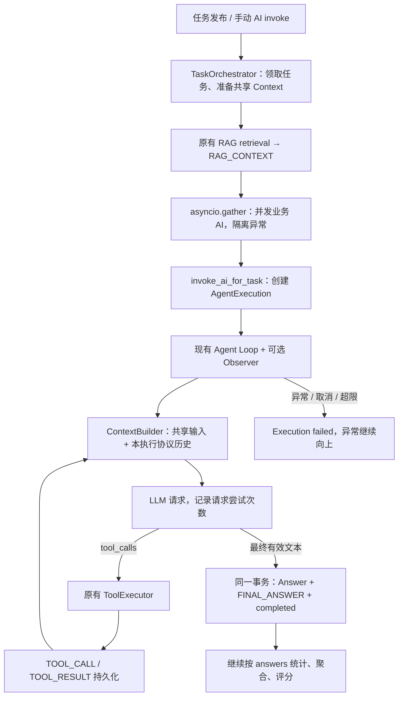

# Task、AgentExecution 与共享上下文

> 2026-10-22 路径更新：本文原 Task 持久化用例已归属 `app/modules/hcp_mad/application/task/`，原 ORM / Repository 分别位于 `hcp_mad/domain/` / `hcp_mad/infrastructure/`；公共执行与纯消息选择已抽至 Agent。普通/RAG 任务使用独立 `rag_task` 表，迁移和部署说明见 [执行层与任务隔离记录](AGENT_EXECUTION_SPLIT.md)。原有阶段行为与事务说明仍保留。

本次在原有 Tool Calling 循环外增加执行和上下文持久化，保留多个 AI 并发、失败隔离、答案统计、聚合和评分。一个业务 AI 的一次执行可以包含多次模型请求，但成功时只提交一个正式 Answer。

当前已接入 [HCP-MAD 第一阶段](HCP_MAD_STAGE_ONE.md)：两个 Worker 仍复用这里的执行链；Judge 通过同一答案事务直接完成 Task，不再调用普通聚合。下文关于 HCP 只读的说明属于此前基础设施整理记录；最新实现、测试与数据库边界以 HCP-MAD 说明为准。

## 公共入口与 Context 目录（2026-10-17）

完整类型签名、调用链、修改清单及本轮验证见 [公共执行基础设施报告](PUBLIC_EXECUTION_INFRASTRUCTURE.md)，公共能力索引见 [Module Public API](MODULE_PUBLIC_API.md)。下文原始执行实现与数据库说明作为历史设计记录保留。

- 其他业务需要完整持久化执行时调用 `TaskFacade.execute_agent`；普通生成/工具循环使用 `AgentFacade`，后者不隐式创建 Task 或 Execution。
- `TaskFacade.submit_task(payload, scheduler)` 提交后登记原后台执行；`enqueue_task` 用于已有任务。宿主可直接传 FastAPI BackgroundTasks。没有新增消息队列、消费者或崩溃恢复。
- `TaskFacade.claim_task` 公开包装原子领取，供自管编排；`process_task` 已自行领取，不能先 claim 再重复 process。人工领取仍是 `accept_task`。
- 纯构建统一放在 `task/application/context/`：builder、prompts、policies；原 `application/context_builder.py` 兼容导出同一个类，原函数和模板输出保留。
- `ContextSelectionPolicy` 只能减少既有可见输入。可通过 `build_agent_messages` 或 `execute_agent` 的 `context_policy` 传入；自定义 `system_prompt` 不替换数据库或工具流程。
- RAG 的 `format_context` / `format_task_context` 只格式化已检索结果；Task 仍检索一次并持久化共享证据。Tool 的 `get_definition` / `validate_arguments` 复用原定义及 Schema 校验。
- 原 Execution 状态、Observer 事件、序号、锁、Answer 幂等与最终原子提交均沿用。未创建第二套 Runtime、Context 或执行状态数据结构。
- HCP-MAD 源码、测试、目录及缓存以本轮开始时的哈希单独核对，不修改其中的调用或角色规则。

## 已有数据库的映射

2026-10-16 通过只读数据库元数据确认，使用下列复数表名；没有执行真实数据库的建表、改表或业务数据写入。仓库 `sql/createtable.sql` 是旧单数表草稿，本次未使用或修改。

| 表 | 已有字段 |
| --- | --- |
| `agent_executions` | `id`、`task_id`、`ai_id`、`context_id`、`status`、`current_stage`、`attempt_no`、`llm_request_count`、`started_at`、`completed_at`、`error_message`、`created_at` |
| `task_contexts` | `id`、`task_id`、`version`、`created_at`、`updated_at` |
| `task_context_items` | `id`、`context_id`、`execution_id`、`ai_id`、`item_type`、`content`、`metadata_json`、`sequence_no`、`visibility`、`created_at` |
| `answers` | 保留全部既有字段，将已有 `execution_id` 接入领域对象、Mapper 和提交链路 |

执行次数映射真实的 `attempt_no`，没有创建草稿中的 `execution_index`。数据库 `current_stage` 的默认值仍为 `running`，代码新建 Execution 时显式使用有效阶段 `thinking`，没有改动数据库默认值。

`answers.execution_id` 已有可空字段和索引；本次元数据检查未列出其指向 Execution 的物理外键，与需求中的描述存在差异。保留工作区原有 ORM 外键声明，并由应用层检查 Task、AI 和 Context 的归属；没有擅自补建数据库约束。

应用启动的 `init_db()` 现在只注册已有 ORM 映射，移除了自动 `create_all` 和 AI 补列路径。部署前需要由数据库管理流程准备好表结构。测试夹具的建表仅作用于隔离的临时或内存 SQLite。

## 完整调用链



手动 AI invoke 直接进入 `invoke_ai_for_task`，同样会确保 Context 存在，不要求必须先经过后台编排。

## 状态、事务与并发

- 状态：`waiting → running → completed`；模型、工具、持久化错误、取消或超限则进入 `failed`，保存错误摘要和结束时间，并继续抛出原异常。
- 阶段：`thinking → tool_calling → tool_executing → thinking` 可重复，收到最终答案后进入 `finalizing`。这些是协议阶段，不是模型思维链。
- 每个 Task 只有一个 Context；同 Task 的不同 AI、同 AI 的不同执行尝试都可共享它。
- `llm_request_count` 在进入模型调用前增加，记录调用尝试，失败尝试也计数；它不保证远端确实收到了 HTTP 请求。既有 usage 汇总和成功响应计数语义保持不变。
- Context 初始化、阶段、计数和事件追加均使用短事务。模型或工具执行期间不持有数据库会话。
- 统一锁顺序为 Task → Execution → Context；单纯进度记录只锁 Execution → Context。通过任务行锁分配同 Task/AI 的 `attempt_no`，通过 Context 行锁和原子版本递增分配唯一 `sequence_no`。
- 最终 Answer、对应共享 FINAL_ANSWER 和 Execution completed 在同一事务提交；其中任何一步失败均回滚，不留下半个正式结果。持锁检查保证同一次 Execution 重复提交仍只有一个 Answer。
- 创建 Execution 的线程不会因协程取消而自动回滚，因此创建步骤受保护；取消路径取得已提交的 execution_id 后补写失败状态，避免遗留 waiting 执行。

## 上下文选择与隐私

`ContextBuilder` 是纯内存规则组件，不访问 SQL、模型、RAG 或工具。

| 数据 | 可见性及使用方式 |
| --- | --- |
| USER_MESSAGE | 任务共享，使用最新问题 |
| RAG_CONTEXT | 任务共享，使用最新证据；兼容参数缺省时仍能从 Context 获取 |
| TOOL_CALL / TOOL_RESULT | 默认 private，只重放当前 execution_id 和 ai_id 的完整配对轮次 |
| AGENT_MESSAGE | 公开的模型 content，过程记录默认 private；带工具调用的公开说明仅审计，不改变原会话 |
| FINAL_ANSWER | 成功提交后 shared；普通回答阶段不读取其他 Execution 的答案 |
| REVIEW | 已提供条目类型及筛选能力，本轮不新增 Judge / Debate 执行器 |

共享存储不等于将全部条目塞进提示词：普通阶段只选择共享问题/RAG 和本次执行历史，排除其他 AI、同 AI 旧执行的私有过程。显式 aggregation/scoring 阶段可将共享最终结果和 Review 作为引用文本，不能伪装成本 Agent 的历史回答。

一个 TOOL_CALL 条目保存一次 assistant 响应中的完整 tool_calls，多个 TOOL_RESULT 通过 tool_call_id 配对。Context 全局序号可能被其他 AI 的事件交错，因此不按相邻条目配对；缺失、重复或步骤不匹配的工具组不会被重放。

只向 Observer 和业务上下文传递、保存公开 message 字段、工具调用及结果，不持久化提供商的 `reasoning_content` 等隐藏推理字段、鉴权 Header 或原始 HTTP 响应。DeepSeek 工具续轮要求的 reasoning_content 仅在当前 Loop 内存保留并恢复到同一执行的 Provider 请求，纳入最终请求预算，不作为共享资料或正式答案；不支持从数据库恢复该私有状态。`thinking` 仅为执行阶段标记。详见 [故障修复记录](HCP_FAILURE_DIAGNOSIS.md)。

RAG 仍只由原编排流程检索一次，再写入共享 Context；明确检索失败时追加空证据失效项，避免将旧资料误当作本次检索成功结果。旧 `rag_context` 参数继续兼容；手动聚合和评分未传参数时可回读已持久化证据，不重复检索。

## 三个执行示例

以下为隔离测试中使用的模拟模型行为，非真实模型服务的测量结果。

### 普通 AI

```text
Task T → Context C（USER_MESSAGE）
       → Execution E1：waiting → running / thinking
       → LLM 请求 1 → "正式答案"
       → finalizing
       → 原子提交：Answer.execution_id=E1、FINAL_ANSWER、E1.completed
```

结果：一个 Execution、一次请求、一个正式 Answer。后续对 E1 的重复最终提交返回已有 Answer，不覆盖内容。

### Tool Agent 多轮

```text
Execution E1
  LLM 1 → TOOL_CALL(call-1) → EchoTool → TOOL_RESULT(call-1)
  ContextBuilder 重建本执行历史
  LLM 2 → TOOL_CALL(call-2) → EchoTool → TOOL_RESULT(call-2)
  ContextBuilder 重建本执行历史
  LLM 3 → 最终答案 → FINAL_ANSWER + Answer(E1) + completed
```

结果：请求次数为 3，所有工具过程属于 E1，正式 Answer 只有一个。中间公开说明可以记为 AGENT_MESSAGE，但不进入 answers，也不改变原有 assistant 工具消息内容。

### RAG + Tool Agent

```text
Task T（RAG）
  检索一次 → Context C：USER_MESSAGE + RAG_CONTEXT
  并发 E1 / E2，共享 C
    E1：问题与证据 → LLM → Tool → LLM → Answer(E1)
    E2：问题与证据 → LLM → Answer(E2)
  原聚合器读取最终 answers + 已保存 RAG → 生成 Task.final_result
  原评分器写 Answer.weight → Task.completed
```

如果 E1 失败，只将 E1 标记 failed；E2 仍可成功并提交，编排器继续依据实际 answers 数量决定是否聚合。失败过程不会被伪造成最终 Answer。

## 修改文件与原因

| 文件 | 原因 |
| --- | --- |
| `app/db/session.py` | 停用启动建表和补列，只注册已有映射 |
| `app/modules/task/domain/models.py` | 映射三个真实表、状态/阶段/类型/可见性枚举及 Answer 的 execution_id |
| `app/modules/task/infrastructure/execution_repository.py` | 新增执行与 Context 仓储，集中短事务操作及并发序号分配 |
| `app/modules/task/infrastructure/repository.py` | 支持锁定 Task、答案 execution_id 写入和按执行查重 |
| `app/modules/task/infrastructure/mapper.py` | 将 execution_id 传到领域 Answer |
| `app/modules/task/application/context_builder.py` | 按执行、阶段、类型和可见性组装消息，保持工具协议配对 |
| `app/modules/task/application/execution_context.py` | 将 Loop 事件适配为执行进度与 ContextItem，管理共享输入 |
| `app/modules/task/application/ai_answers.py` | 保留原入口，在现有 Loop 外创建/结束 Execution，处理错误与取消 |
| `app/modules/task/application/answers.py` | 保留旧提交接口，新增执行归属检查及最终结果原子提交 |
| `app/modules/task/application/orchestration.py` | 在原 RAG/gather 前后准备共享 Context，不改变并发和失败隔离 |
| `app/modules/task/application/aggregation.py` | 仅补充已有 RAG Context 回读，保留答案聚合和评分实现 |
| `app/modules/agent/execution_observer.py` | 定义无数据库的可选事件和消息重建协议，限制为公开字段 |
| `app/modules/agent/tool_calling.py` | 在原循环增加可选钩子，保留默认返回值、工具执行顺序和轮数限制 |
| `tests/task/test_agent_execution.py` | 覆盖真实执行入口、多轮、RAG、多 AI、失败/取消、幂等和回滚 |
| `tests/task/test_context_builder.py` | 验证隔离、可见性、阶段、隐藏字段过滤及完整协议组选择 |
| `tests/task/test_execution_repository.py` | 验证映射、序号、attempt、计数、事务回滚和历史答案兼容 |
| `tests/test_tool_contracts.py` | 验证可选观察器、事件顺序、失败传播及无观察器兼容 |
| `tests/test_application_startup.py` | 验证独立进程完整注册八张表且启动不执行 DDL |
| `docs/AGENT_EXECUTION.md` | 记录本次实现、数据库差异和调用示例 |

## 保持不变与当前边界

- ToolExecutor、Registry、参数 JSON Schema 校验和具体工具实现未修改；没有加入新的错误修复、重试或工具调度算法。
- 普通 LLM Provider、模型配置和 usage 实现未修改；原无 observer 的调用及 Evaluation 入口继续兼容。
- 原 RAG 清洗、切片、Embedding、Milvus、Hybrid、RRF 和 Rerank 算法未修改。
- TaskOrchestrator 原有 `asyncio.gather(..., return_exceptions=True)`、AI 失败隔离、答案统计和聚合/评分顺序保留。
- 聚合/评分仍是原服务，根据正式 answers 工作；本轮没有把聚合器改为另一个工具 Agent，也没有将其最终输出追加为待评分候选答案。
- 人工、历史及手动提交的兼容接口允许 `execution_id=None`；自动 Agent 执行产生的正式答案关联 Execution。
- 保存执行轨迹不等于实现崩溃后自动续跑、后台队列或多 Agent 辩论；本轮没有新增这些能力。
- 用户已有其他工作区变更保留，旧 SQL 草稿和数据库结构未修改。

## 验证

- 完整 pytest：295 项通过，包括原任务/聚合/工具调用回归和新增执行测试。
- 新增与修改文件的 Python 编译、Ruff 检查通过；8 个核心映射及接线文件的 Mypy 检查通过。
- 新增测试只使用隔离 SQLite 与模拟模型/工具，不调用真实模型、Milvus 或业务数据库。
- 全 `app` Ruff 另发现用户已有 `hcp-mad/independent/schema.py` 的 3 个未使用导入，本次未修改该独立模块。
