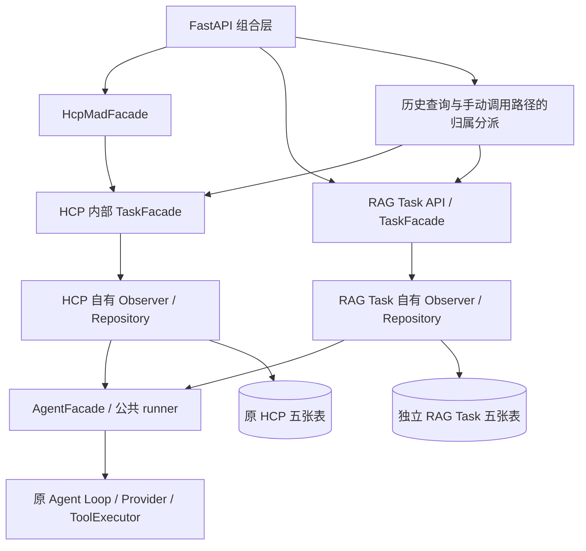

# Agent 公共执行层与任务隔离实施记录

> 本文保留第一阶段实施记录。第二阶段已增加众包生产与持久化消费者，普通 QA API 迁入 `/rag-tasks/legacy`；通用历史查询/调用现在只归属 HCP。当前部署和路由见 [第二阶段实施记录](RAG_TASK_CROWD_WORKFLOW.md)。

本轮只拆分执行能力与数据所有权，没有实现众包 RAG 的发布、参与者、聚合入库或调度消费者。
以本轮开始时的工作区为基线，保留已有未提交修改；未执行任何生产数据库操作或外部模型、Milvus 请求。

## 当前边界与调用链



- HCP 提交：`hcp_mad/api/router.py → application/facade.py → application/task/scheduling.py → application/task/orchestration.py → application/orchestration.py`。
- HCP Worker、首次 Judge、Debate、上限 Judge 继续调用本模块 `application/task/facade.py`；原领取、P、T、回执与恢复实现归属 HCP，不交给公共 Agent。
- RAG Task：原 `/users`、`/workers`、`/ais`、`/tasks` 路由的大部分仍在 `rag_task/api/`，应用用例访问自己的 ORM / Repository。
- 两套持久化执行均通过各自 `ai_answers._run_task_agent` 装配 Observer，再委托 `AgentFacade.run_observed_agent → runner.run_observed_agent → AgentFacade.run_agent → RegisteredAgentRunner.run_configured → 原 tool_calling → 原 Provider`。
- 共享层的 `complete` 只是调用方提供的回调。是否发布 AGENT_MESSAGE、创建 Answer、完成 Task，以及事务提交和回滚，仍由业务回调决定。

## 公共执行接口

- `agent/application/contracts.py`：`AgentRunner` Protocol、不可变 `AgentExecutionScope`、`AgentRequestBuilderFactory`。
- `agent/application/runner.py`：`RegisteredAgentRunner`、统一工具装配、运行生命周期回调与原错误脱敏。
- `agent/application/facade.py`：保留原 `run_agent` / `run_agent_with_usage`；新增 `run_registered_agent(agent_id, *, messages, tool_registry, tool_executor, max_steps, observer)`，返回原 `ToolCallingAgentResult`，保留 answer、usage、request_count、usage_trace。
- 已有配置需要先参与业务校验时，仍可使用 `run_agent(ai, ...)`，它与按 ID 执行共用同一 runner 和原 Loop。
- `agent/application/context/`：从旧 Task 抽出的纯内存消息选择、协议分组和可缩小策略，无业务 ORM 或状态机依赖。
- `AgentExecutionScope.task_id` 是为兼容已有构建工厂保留的关联值；公共层不据此查询任务，也不把 scope 当作权限凭证。
- 公共层不导入 HCP-MAD / RAG Task；两套业务没有互相导入，旧 `app.modules.task` 不再保留转发包。

持久化 Observer 在各自业务边界内保存私有工具过程。首次与工具返回后的请求仍经过原逐请求构建及预算检查；Provider、Loop、ToolExecutor 和参数校验未重写。

## 数据所有权

| 所有者 | 物理表 | 当前用途 |
| --- | --- | --- |
| HCP-MAD | `tasks` | 原 HCP 任务和 metadata 协调状态 |
| HCP-MAD | `answers` | 初始正式答案与终局正式答案，中间发言不进入本表 |
| HCP-MAD | `task_contexts` / `task_context_items` / `agent_executions` | 原共享资料、私有过程、执行、P/T 和回执 |
| RAG Task | `rag_tasks` / `rag_task_answers` | 独立的普通 / RAG 任务及回答 |
| RAG Task | `rag_task_contexts` / `rag_task_context_items` / `rag_task_agent_executions` | 保留既有持久化工具循环和正式提交行为所需的独立执行设施 |

RAG Task 新表均为 InnoDB / utf8mb4；外键只指向自己的表或共享 accounts，不指向 HCP 五张表。命名隔离包括 MySQL 外键和唯一约束名称。
HCP 的原表名、字段、约束映射不因移动 Python 文件改变；HCP 创建入口只接受 HCP 模式，普通任务聚合实现仅归属 RAG Task。
HCP 内部历史 `aggregate_answers` / `score_answers` / `finish_task` 保留为拒绝适配，不能执行第二套普通聚合。

原 `knowledge_curation/domain/models.py` 的 `crowd_task_participants` / `task_knowledge_ingestions` 当前未发现运行时服务或 Repository 调用；两者外键仍指向旧 tasks / answers。
已将原映射保留于 `hcp_mad/legacy_knowledge_curation/domain/models.py`，显式标记未接入用途并注册，不删除、不改名、不迁移数据，也不让新 RAG Task 使用。后续众包业务须另行设计自身模型。

## HTTP 与 Python 路径兼容

- `POST /hcp-mad/tasks` 的请求、响应和调度保持原行为。
- 原 RAG / 普通任务路由路径及请求响应字段保留。
- 原通用 `GET /users/tasks/{task_id}` 与 `POST /ais/{ai_id}/tasks/{task_id}/invoke` 移到 `app/api/task_routes.py`，由进程组合层查询各自 Facade 后分派；未将 HCP 回调或 Repository 注入 RAG Task。
- 通用路径只注册一次。查询沿用发布者权限；HCP 手动 invoke 仍由原角色工作流检查拒绝，不能借兼容层补造授权。
- 同一个 ID 在两个独立存储中同时存在时返回 409，避免混淆归属；不存在返回 404，底层读取故障不会被误判为另一种任务。
- 其余普通聚合、人工回答等路径只操作 RAG Task，不作为 HCP 终局入口。
- Python 旧 `app.modules.task` 导入已迁移。HCP 的原外层 Facade 导出及根 `orchestrator.py` 兼容类身份保留；内部持久化接口现在位于 `hcp_mad.application.task.facade`。

旧 tasks 中历史 normal/rag 数据原样保留，**未自动迁移**。新普通/RAG API 的业务用例只使用新表；通用只读查询可保留对旧任务快照的查看，但不会把旧表变成新 RAG Task 的 Repository。
需要迁移历史普通任务时，应另行确定转换与回滚方案；本轮没有数据复制或删除。

## 事务与循环依赖处理

- 原业务锁、幂等键、attempt / round / turn 区别、owner fencing、取消和未知执行暂停均保留。
- 10 个原领取 / 私有准备 P / 原子提交 T / 轮次推进函数体增加重构前 AST golden；迁移前后保持一致。
- 两个旧 Task 内部静态循环在移动后暴露：`debate_workflow ↔ debate_turns`、`debate_workflow ↔ agent_finalization`。
- 不用函数内导入掩盖循环：不可变绑定移到 `application/task/bindings.py`；终局绑定核验、完成核验与只读重试资格投影移到 `debate_workflow.py`，原 finalization 模块保留具名导出身份。
- Finalization Store 的领取、私有准备、正式提交、取消函数体不变；只读投影没有新增 commit / rollback。

## 迁移文件明细

下表以原 `app/modules/task/` 为相对根；目标以 `app/modules/` 为相对根。重复列出两个目标表示原混合文件按业务数据所有权分别保留，实现各自持久化；不复制 Agent Loop 或 Provider。

| 原文件 | 当前归属 / 目标 |
| --- | --- |
| `__init__.py` | `rag_task/__init__.py` |
| `api/__init__.py` | `rag_task/api/__init__.py`；`hcp_mad/api/__init__.py` |
| `api/ai_router.py` | `rag_task/api/ai_router.py` |
| `api/router.py` | `rag_task/api/router.py`；`hcp_mad/api/router.py` |
| `api/user_router.py` | `rag_task/api/user_router.py` |
| `api/worker_router.py` | `rag_task/api/worker_router.py` |
| `application/__init__.py` | `rag_task/application/__init__.py`；`hcp_mad/application/task/__init__.py` |
| `application/agent_finalization.py` | `hcp_mad/application/task/agent_finalization.py` |
| `application/agent_messages.py` | `hcp_mad/application/task/agent_messages.py` |
| `application/agent_results.py` | `hcp_mad/application/task/agent_results.py` |
| `application/agent_reviews.py` | `hcp_mad/application/task/agent_reviews.py` |
| `application/aggregation.py` | `rag_task/application/aggregation.py`；`hcp_mad/application/task/aggregation.py` |
| `application/ai_answers.py` | `rag_task/application/ai_answers.py`；`hcp_mad/application/task/ai_answers.py` |
| `application/answers.py` | `rag_task/application/answers.py`；`hcp_mad/application/task/answers.py` |
| `application/context/__init__.py` | `rag_task/application/context/__init__.py`；`hcp_mad/application/task/context/__init__.py` |
| `application/context/builder.py` | `rag_task/application/context/builder.py`；`hcp_mad/application/task/context/builder.py` |
| `application/context/policies.py` | `rag_task/application/context/policies.py`；`hcp_mad/application/task/context/policies.py` |
| `application/context/prompts.py` | `rag_task/application/context/prompts.py`；`hcp_mad/application/task/context/prompts.py` |
| `application/context_builder.py` | `rag_task/application/context_builder.py`；`hcp_mad/application/task/context_builder.py` |
| `application/debate_turns.py` | `hcp_mad/application/task/debate_turns.py` |
| `application/debate_workflow.py` | `hcp_mad/application/task/debate_workflow.py` |
| `application/execution_context.py` | `rag_task/application/execution_context.py`；`hcp_mad/application/task/execution_context.py` |
| `application/facade.py` | `rag_task/application/facade.py`；`hcp_mad/application/task/facade.py` |
| `application/management.py` | `rag_task/application/management.py`；`hcp_mad/application/task/management.py` |
| `application/orchestration.py` | `rag_task/application/orchestration.py`；`hcp_mad/application/task/orchestration.py` |
| `application/prepared_results.py` | `hcp_mad/application/task/prepared_results.py` |
| `application/rankings.py` | `rag_task/application/rankings.py` |
| `application/review.py` | `rag_task/application/review.py`；`hcp_mad/application/task/review.py` |
| `application/review_results.py` | `hcp_mad/application/task/review_results.py` |
| `application/review_workflow.py` | `hcp_mad/application/task/review_workflow.py` |
| `application/scheduling.py` | `rag_task/application/scheduling.py`；`hcp_mad/application/task/scheduling.py` |
| `application/service.py` | `rag_task/application/service.py` |
| `application/workflow.py` | `hcp_mad/application/task/workflow.py` |
| `domain/__init__.py` | `rag_task/domain/__init__.py`；`hcp_mad/domain/__init__.py` |
| `domain/models.py` | `rag_task/domain/models.py`；`hcp_mad/domain/models.py` |
| `infrastructure/__init__.py` | `rag_task/infrastructure/__init__.py`；`hcp_mad/infrastructure/__init__.py` |
| `infrastructure/agent_message_repository.py` | `hcp_mad/infrastructure/agent_message_repository.py` |
| `infrastructure/execution_repository.py` | `rag_task/infrastructure/execution_repository.py`；`hcp_mad/infrastructure/execution_repository.py` |
| `infrastructure/mapper.py` | `rag_task/infrastructure/mapper.py`；`hcp_mad/infrastructure/mapper.py` |
| `infrastructure/queries.py` | `rag_task/infrastructure/queries.py`；`hcp_mad/infrastructure/queries.py` |
| `infrastructure/repository.py` | `rag_task/infrastructure/repository.py`；`hcp_mad/infrastructure/repository.py` |
| `knowledge_curation/__init__.py` | `hcp_mad/legacy_knowledge_curation/__init__.py` |
| `knowledge_curation/domain/__init__.py` | `hcp_mad/legacy_knowledge_curation/domain/__init__.py` |
| `knowledge_curation/domain/models.py` | `hcp_mad/legacy_knowledge_curation/domain/models.py` |
| `schemas.py` | `rag_task/schemas.py`；`hcp_mad/schemas.py` |
| `task_utils.py` | `rag_task/task_utils.py`；`hcp_mad/task_utils.py` |

新增公共文件：`agent/application/contracts.py`、`runner.py`、`context/{__init__,builder,policies,prompts}.py`。
新增组合路由：`app/api/__init__.py`、`app/api/task_routes.py`。
新增 HCP 绑定：`hcp_mad/application/task/bindings.py`。
旧 `service.py` / `rankings.py` 只迁入 RAG Task，不在 HCP 保留重复的普通任务实现。
原 HCP 的 Facade、Context、Worker、Judge 和协议文件仅更新持久化入口引用；`app/main.py`、`app/db/session.py` 更新组合与注册。
测试按业务归属从 `tests/task/` 迁入 `tests/rag_task/` 与 `tests/hcp_mad/task/`，没有删除测试用例或放宽事务断言；普通任务兼容测试改为运行真正的 RAG Task 持久化链。
新增隔离/迁移测试见 `tests/test_execution_architecture.py`、`tests/test_task_route_composition.py`、`tests/rag_task/test_rag_task_public_facade.py`。

## 部署与 SQL

增量文件：[`sql/20261022_add_rag_task_tables.sql`](../sql/20261022_add_rag_task_tables.sql)。仅有五张新表及其索引的 CREATE；没有 DROP、ALTER 或数据迁移。
DDL 与 MySQL 方言编译的 ORM 字段、默认值、外键、唯一约束和索引逐项对照测试。表选项排列顺序不影响语义。

1. 由数据库管理者审阅并手动执行该 SQL；应用启动不创建或修改表。
2. 现有 accounts 和原 HCP 五张表继续保留；无需因 Python 路径变化改表。
3. `init_db()` 只导入注册 Account、Agent、Heritage、HCP、RAG Task 和保留的历史映射；启动检查会在新进程禁止 create_all 并确认没有 DDL。
4. 本轮未连接真实 MySQL，未实测迁移或 InnoDB 并发；上线前须在隔离 MySQL 核对现有 accounts 外键兼容性及完整回归。

## 验证记录

基线完整 pytest：**907 passed**；最终完整 pytest：**945 passed in 239.11s**，新增 38 项。

执行命令（项目根目录，使用项目 `.venv`）：

```powershell
.\.venv\Scripts\python.exe -B -u -m pytest -q -p no:cacheprovider --basetemp=.pytest_tmp/execution-split-20261022/final-tests
.\.venv\Scripts\python.exe -m ruff check app tests scripts evaluation
.\.venv\Scripts\python.exe -m mypy app/modules/agent app/modules/hcp_mad app/modules/rag_task app/api
.\.venv\Scripts\python.exe -m mypy app scripts evaluation
```

- Ruff：全部通过。
- 相关 mypy：134 个源文件通过。
- Python 语法：app / tests / scripts / evaluation 共 322 个 Python 文件编译检查通过；未写入 pyc。
- 全项目 mypy：6 个既有错误、4 个文件，与迁移前快照的错误文本一致；没有新增错误。原有位置：`rag/domain/vector_store.py:18`、`scripts/build_rag_hard_eval.py:457`、`evaluation/services/answer_variant_executor.py:227/252/260`、`evaluation/runners/rag_retrieval_runner.py:607`。
- 依赖与源码检查：无旧 Task 导入，无 HCP / RAG Task 互相导入，公共 Agent 不依赖任一业务；HCP 内部及模块间导入图无循环。
- 新进程导入隔离、启动无 DDL、路由不重复、MySQL 方言 DDL 对照、同 ID 下两套表真实 SQL 隔离、普通回答回归、公共按 ID 执行与事件记录均通过。
- HCP 全套旧事务 / 恢复测试与 10 个关键函数 AST golden 通过。HCP 完整领域 / ORM AST（排除模块说明）与迁移前一致。
- Windows 沙箱会阻塞 asyncio 的本机 socketpair；异步测试经批准在沙箱外运行，但仍使用隔离 SQLite 与 Mock 外部请求。未调用真实模型、外部工具、生产数据库或 Milvus。
- 初次回归暴露的导入循环、旧通用 API 归属、普通测试模型归属和约束命名断言均已修复；最终完整结果无失败、无跳过。


## 当前边界

未实现众包生产任务、参与者去重、可靠后台消费者、知识版本或聚合入库。现有 BackgroundTasks 仍不是持久队列。
没有历史数据搬迁，旧表中的 normal/rag 待执行任务不由新 RAG Task 自动续跑；如需继续处理，应先审阅独立的数据迁移方案。新旧数据库结构由外部管理。SQLite 事务测试与 MySQL 方言/引擎保护测试不能代替真实 MySQL 并发测试。

## 本轮相对初始工作区的文件清单

以下清单来自本轮开始时的文件快照，不把历史未提交修改计为本轮工作。旧路径的移出对应上方迁移表，不表示删除业务或测试覆盖。

新增/迁入 93 个文件，修改已有文件 46 个，移出旧路径 55 个；没有删除其他文件。

### 新增或迁入

- `app/api/__init__.py`
- `app/api/task_routes.py`
- `app/modules/agent/application/context/__init__.py`
- `app/modules/agent/application/context/builder.py`
- `app/modules/agent/application/context/policies.py`
- `app/modules/agent/application/context/prompts.py`
- `app/modules/agent/application/contracts.py`
- `app/modules/agent/application/runner.py`
- `app/modules/hcp_mad/application/task/__init__.py`
- `app/modules/hcp_mad/application/task/agent_finalization.py`
- `app/modules/hcp_mad/application/task/agent_messages.py`
- `app/modules/hcp_mad/application/task/agent_results.py`
- `app/modules/hcp_mad/application/task/agent_reviews.py`
- `app/modules/hcp_mad/application/task/aggregation.py`
- `app/modules/hcp_mad/application/task/ai_answers.py`
- `app/modules/hcp_mad/application/task/answers.py`
- `app/modules/hcp_mad/application/task/bindings.py`
- `app/modules/hcp_mad/application/task/context/__init__.py`
- `app/modules/hcp_mad/application/task/context/builder.py`
- `app/modules/hcp_mad/application/task/context/policies.py`
- `app/modules/hcp_mad/application/task/context/prompts.py`
- `app/modules/hcp_mad/application/task/context_builder.py`
- `app/modules/hcp_mad/application/task/debate_turns.py`
- `app/modules/hcp_mad/application/task/debate_workflow.py`
- `app/modules/hcp_mad/application/task/execution_context.py`
- `app/modules/hcp_mad/application/task/facade.py`
- `app/modules/hcp_mad/application/task/management.py`
- `app/modules/hcp_mad/application/task/orchestration.py`
- `app/modules/hcp_mad/application/task/prepared_results.py`
- `app/modules/hcp_mad/application/task/review.py`
- `app/modules/hcp_mad/application/task/review_results.py`
- `app/modules/hcp_mad/application/task/review_workflow.py`
- `app/modules/hcp_mad/application/task/scheduling.py`
- `app/modules/hcp_mad/application/task/workflow.py`
- `app/modules/hcp_mad/domain/__init__.py`
- `app/modules/hcp_mad/domain/models.py`
- `app/modules/hcp_mad/infrastructure/__init__.py`
- `app/modules/hcp_mad/infrastructure/agent_message_repository.py`
- `app/modules/hcp_mad/infrastructure/execution_repository.py`
- `app/modules/hcp_mad/infrastructure/mapper.py`
- `app/modules/hcp_mad/infrastructure/queries.py`
- `app/modules/hcp_mad/infrastructure/repository.py`
- `app/modules/hcp_mad/legacy_knowledge_curation/__init__.py`
- `app/modules/hcp_mad/legacy_knowledge_curation/domain/__init__.py`
- `app/modules/hcp_mad/legacy_knowledge_curation/domain/models.py`

- `app/modules/hcp_mad/schemas.py`
- `app/modules/hcp_mad/task_utils.py`
- `app/modules/rag_task/__init__.py`
- `app/modules/rag_task/api/__init__.py`
- `app/modules/rag_task/api/ai_router.py`
- `app/modules/rag_task/api/router.py`
- `app/modules/rag_task/api/user_router.py`
- `app/modules/rag_task/api/worker_router.py`
- `app/modules/rag_task/application/__init__.py`
- `app/modules/rag_task/application/aggregation.py`
- `app/modules/rag_task/application/ai_answers.py`
- `app/modules/rag_task/application/answers.py`
- `app/modules/rag_task/application/context/__init__.py`
- `app/modules/rag_task/application/context/builder.py`
- `app/modules/rag_task/application/context/policies.py`
- `app/modules/rag_task/application/context/prompts.py`
- `app/modules/rag_task/application/context_builder.py`
- `app/modules/rag_task/application/execution_context.py`
- `app/modules/rag_task/application/facade.py`
- `app/modules/rag_task/application/management.py`
- `app/modules/rag_task/application/orchestration.py`
- `app/modules/rag_task/application/rankings.py`
- `app/modules/rag_task/application/review.py`
- `app/modules/rag_task/application/scheduling.py`
- `app/modules/rag_task/application/service.py`
- `app/modules/rag_task/domain/__init__.py`
- `app/modules/rag_task/domain/models.py`
- `app/modules/rag_task/infrastructure/__init__.py`
- `app/modules/rag_task/infrastructure/execution_repository.py`
- `app/modules/rag_task/infrastructure/mapper.py`
- `app/modules/rag_task/infrastructure/queries.py`
- `app/modules/rag_task/infrastructure/repository.py`
- `app/modules/rag_task/schemas.py`
- `app/modules/rag_task/task_utils.py`
- `docs/AGENT_EXECUTION_SPLIT.md`
- `sql/20261022_add_rag_task_tables.sql`
- `tests/hcp_mad/task/test_agent_messages.py`
- `tests/hcp_mad/task/test_debate_turns.py`
- `tests/hcp_mad/task/test_task_public_facade.py`
- `tests/rag_task/test_agent_execution.py`
- `tests/rag_task/test_context_builder.py`
- `tests/rag_task/test_context_public_api.py`
- `tests/rag_task/test_execution_repository.py`
- `tests/rag_task/test_public_task_dispatch.py`
- `tests/rag_task/test_rag_task_public_facade.py`
- `tests/rag_task/test_task_orchestration.py`
- `tests/test_execution_architecture.py`
- `tests/test_task_route_composition.py`

### 修改已有文件

- `app/db/session.py`
- `app/main.py`
- `app/modules/agent/application/facade.py`
- `app/modules/hcp_mad/api/router.py`
- `app/modules/hcp_mad/application/context/debate_context_builder.py`
- `app/modules/hcp_mad/application/context/evidence.py`
- `app/modules/hcp_mad/application/context/finalization_context.py`
- `app/modules/hcp_mad/application/context/models.py`
- `app/modules/hcp_mad/application/context/prompts.py`
- `app/modules/hcp_mad/application/context/request_adapter.py`
- `app/modules/hcp_mad/application/context/source_validation.py`
- `app/modules/hcp_mad/application/context/turn_context.py`
- `app/modules/hcp_mad/application/debate_control.py`
- `app/modules/hcp_mad/application/debate_orchestration.py`
- `app/modules/hcp_mad/application/facade.py`
- `app/modules/hcp_mad/application/finalization.py`
- `app/modules/hcp_mad/application/finalization_contract.py`
- `app/modules/hcp_mad/application/judge_trigger.py`
- `app/modules/hcp_mad/application/judge_trigger_contract.py`
- `app/modules/hcp_mad/application/orchestration.py`
- `app/modules/hcp_mad/application/schemas.py`
- `app/modules/hcp_mad/application/structured_output.py`
- `app/modules/hcp_mad/independent/executor.py`
- `app/modules/hcp_mad/independent/stage_service.py`
- `app/modules/hcp_mad/judge/context.py`
- `app/modules/hcp_mad/judge/executor.py`
- `docs/AGENT_EXECUTION.md`
- `docs/AGENT_MESSAGES.md`
- `docs/DEBATE_CONTEXT.md`
- `docs/DEBATE_ORCHESTRATION_DESIGN.md`
- `docs/DEBATE_TURNS.md`
- `docs/MODULE_PUBLIC_API.md`
- `docs/PUBLIC_EXECUTION_INFRASTRUCTURE.md`
- `tests/account/test_account_permissions.py`
- `tests/hcp_mad/test_architecture_governance.py`
- `tests/hcp_mad/test_debate_context.py`
- `tests/hcp_mad/test_debate_control.py`
- `tests/hcp_mad/test_debate_orchestration.py`
- `tests/hcp_mad/test_debate_request_integration.py`
- `tests/hcp_mad/test_finalization.py`
- `tests/hcp_mad/test_judge_trigger.py`
- `tests/hcp_mad/test_retry_eligibility.py`
- `tests/hcp_mad/test_stage_pipeline.py`
- `tests/hcp_mad/test_turn_context.py`
- `tests/test_application_startup.py`
- `tests/test_module_public_api.py`

### 移出的旧路径

- `app/modules/task/__init__.py`
- `app/modules/task/api/__init__.py`
- `app/modules/task/api/ai_router.py`
- `app/modules/task/api/router.py`
- `app/modules/task/api/user_router.py`
- `app/modules/task/api/worker_router.py`
- `app/modules/task/application/__init__.py`
- `app/modules/task/application/agent_finalization.py`
- `app/modules/task/application/agent_messages.py`
- `app/modules/task/application/agent_results.py`
- `app/modules/task/application/agent_reviews.py`
- `app/modules/task/application/aggregation.py`
- `app/modules/task/application/ai_answers.py`
- `app/modules/task/application/answers.py`
- `app/modules/task/application/context/__init__.py`
- `app/modules/task/application/context/builder.py`
- `app/modules/task/application/context/policies.py`
- `app/modules/task/application/context/prompts.py`
- `app/modules/task/application/context_builder.py`
- `app/modules/task/application/debate_turns.py`
- `app/modules/task/application/debate_workflow.py`
- `app/modules/task/application/execution_context.py`
- `app/modules/task/application/facade.py`
- `app/modules/task/application/management.py`
- `app/modules/task/application/orchestration.py`
- `app/modules/task/application/prepared_results.py`
- `app/modules/task/application/rankings.py`
- `app/modules/task/application/review.py`
- `app/modules/task/application/review_results.py`
- `app/modules/task/application/review_workflow.py`
- `app/modules/task/application/scheduling.py`
- `app/modules/task/application/service.py`
- `app/modules/task/application/workflow.py`
- `app/modules/task/domain/__init__.py`
- `app/modules/task/domain/models.py`
- `app/modules/task/infrastructure/__init__.py`
- `app/modules/task/infrastructure/agent_message_repository.py`
- `app/modules/task/infrastructure/execution_repository.py`
- `app/modules/task/infrastructure/mapper.py`
- `app/modules/task/infrastructure/queries.py`
- `app/modules/task/infrastructure/repository.py`
- `app/modules/task/knowledge_curation/__init__.py`
- `app/modules/task/knowledge_curation/domain/__init__.py`
- `app/modules/task/knowledge_curation/domain/models.py`
- `app/modules/task/schemas.py`
- `app/modules/task/task_utils.py`
- `tests/task/test_agent_execution.py`
- `tests/task/test_agent_messages.py`
- `tests/task/test_context_builder.py`
- `tests/task/test_context_public_api.py`
- `tests/task/test_debate_turns.py`
- `tests/task/test_execution_repository.py`
- `tests/task/test_public_task_dispatch.py`
- `tests/task/test_task_orchestration.py`
- `tests/task/test_task_public_facade.py`

## 后续状态（2026-10-23）

以上遗留模块保留记录描述当时的抽取结果。经独立数据库审计及用户授权，两张旧表的映射、专属枚举和注册现已清理，历史路径不再存在。当前正式新库 SQL 为 `sql/mysql_schema.sql`，只含 17 张有效表；物理旧表没有自动删除。详见 [清理记录](LEGACY_TABLE_CLEANUP.md)，原迁移清单保留作历史证据。
