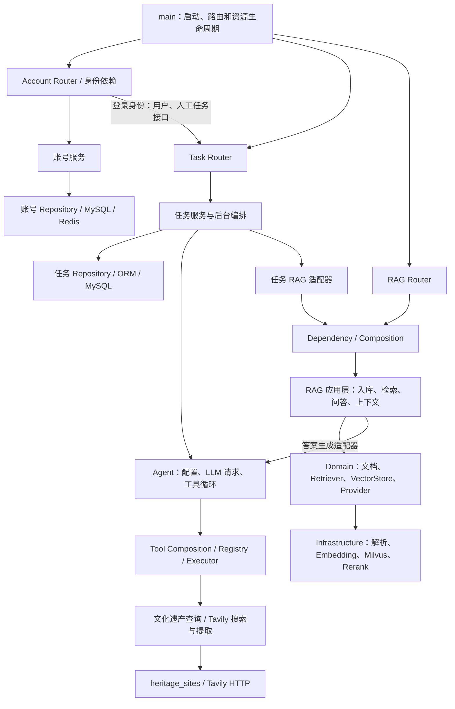

# app 模块说明

本文基于当前代码实现、导入和调用关系整理，面向开发者阅读与面试复盘。
覆盖 `app/` 下 103 个非 `__init__.py` Python 文件，按真实目录组织；不记录或修改 `__init__.py`。
上游调用方同时区分在线业务入口、脚本、评估和测试；仅声明配置或定义接口不代表已实现对应业务能力。
清晰准确的现有模块级 docstring 保留，包括原有英文说明；缺失或模糊说明补为中文。

主要目录分布（不含 `__init__.py`）：

| 目录 | 文件数 |
| --- | ---: |
| `app` | 1 |
| `app/core` | 3 |
| `app/db` | 1 |
| `app/modules/account` | 8 |
| `app/modules/agent` | 11 |
| `app/modules/heritage` | 4 |
| `app/modules/rag` | 45 |
| `app/modules/task` | 18 |
| `app/modules/tool` | 12 |

## app

### main.py

- 作用：创建 FastAPI 应用、装配业务路由和 CORS，并管理数据库初始化、Redis 探测、一次性 AI 健康检查及退出清理。
- 主要类 / 函数：`app`、`lifespan()`、`root()`、`health()`。
- 上游调用方：ASGI 服务通过 `app.main:app` 加载；客户端通过已注册路由访问，启动测试使用 `TestClient`。
- 下游依赖：`core.config/logging/redis`、`db.session`、Account / Agent / Task / RAG 的 Router、Agent 健康批量检查。
- 在完整业务流程中的位置：服务启动与 HTTP 入口；`/health` 仅表示应用存活，不代表全部依赖健康。
- 面试中可以如何解释：负责应用装配和资源生命周期，把业务路由接入统一服务入口。数据库和 Redis 初始化、自动 AI 检查属于生命周期，而非每个业务请求。

## app/core

### config.py

- 作用：统一加载应用、数据库、JWT、Redis、LLM、Embedding、Reranker、Milvus 和联网工具配置，校验部分运行约束并生成派生设置。
- 主要类 / 函数：`Settings`、`get_env_file()`、带缓存的 `get_settings()`、共享 `settings`；`cors_origins`、`database_url` 属性与 `validate_runtime_settings()`。
- 上游调用方：`main.py`、`db/session.py`、账号服务、Redis / 日志模块、Agent HTTP 与鉴权 helper、RAG / Tool composition；评估 runner 和服务检查脚本也读取它。
- 下游依赖：`pydantic-settings`、Pydantic `Field/SecretStr`、环境变量、`.env.<APP_ENV>` 或回退的 `.env`；标准库路径和 URL 编码。
- 在完整业务流程中的位置：启动时加载共享设置，装配阶段将连接和模型参数交给具体适配器；它本身不调用模型、数据库或检索服务。
- 面试中可以如何解释：负责把环境差异和凭证配置集中到一个可校验的入口，减少业务模块分散读取环境变量。当前是缓存配置对象，未实现运行中的动态配置刷新。

### logging.py

- 作用：根据 `settings.debug` 设置标准日志级别和统一输出格式。
- 主要类 / 函数：`configure_logging()`。
- 上游调用方：`main.py` 在装配应用时调用；其他模块通过标准库 `logging.getLogger()` 输出日志。
- 下游依赖：标准库 `logging.basicConfig` 和 `core/config.py` 的 `settings`。
- 在完整业务流程中的位置：应用入口导入时初始化日志；不参与任务调度、错误恢复或业务状态更新。
- 面试中可以如何解释：负责集中设置服务日志格式和级别。当前没有实现文件轮转、结构化日志、链路追踪或告警平台。

### redis.py

- 作用：为登录会话和退出黑名单提供 Redis 读写封装；非生产环境首次遇到 `RedisError` 后固定回退到进程内存，生产环境继续抛出错误。
- 主要类 / 函数：`ResilientRedis`、`InMemoryRedis`、共享 `redis_client`；`ping/get/set`、`backend_name`、内部过期清理和调用分派。
- 上游调用方：`main.lifespan()` 探测后端；`account/service.py` 写入当前 token 与黑名单；`account/dependencies.py` 读取会话；账号测试使用内存替身。
- 下游依赖：`redis-py`、`RedisError`、`core.config.settings`、标准库时间和进程内字典。
- 在完整业务流程中的位置：登录保存 token → 每次鉴权读取当前 token / 黑名单 → 登出写入黑名单；JWT 签发与验证仍在 Account 模块。
- 面试中可以如何解释：负责隔离会话存储访问和开发环境回退策略。内存回退只提供有限接口、访问时清理过期键，不持久化、不跨进程共享，也不会自动恢复到 Redis。

## app/db

### session.py

- 作用：定义 SQLAlchemy 共享基类、数据库引擎与会话工厂，初始化缺失表，并兼容旧 AI 表的部分字段。
- 主要类 / 函数：`Base`、`engine`、`SessionLocal`、`get_db()`、`init_db()`、`_ensure_ai_agent_columns()`。
- 上游调用方：`main.lifespan()` 初始化和释放引擎；业务 ORM 继承 `Base`；Account / Agent / Task Repository 和文化遗产工具使用会话工厂；任务聚合、评分路由通过 `Depends(get_db)` 获取会话。
- 下游依赖：SQLAlchemy、MySQL / PyMySQL、`core.config.settings.database_url`；`init_db()` 局部导入各业务 ORM 完成表注册。
- 在完整业务流程中的位置：基础持久化入口，供业务读写建立事务边界；独立聚合、评分接口使用 `get_db()`，其他业务调用多数使用 `with SessionLocal()` 管理会话。
- 面试中可以如何解释：负责数据库连接与会话资源，具体查询和业务状态流转分别留在 Repository 和应用服务。当前旧表兼容是少量手写 DDL，并不是完整的版本化迁移框架。

## app/modules/account

### dependencies.py

- 作用：提供受保护接口共用的登录身份解析，依次检查令牌黑名单、JWT 有效性、Redis 当前会话和账号是否存在。
- 主要类 / 函数：`auth_scheme`、`get_current_user()`。
- 上游调用方：任务 `api/user_router.py` 和 `api/worker_router.py` 通过 FastAPI 依赖注入使用；账号 `router.py` 复用 Bearer 提取器；账号权限测试直接验证。
- 下游依赖：FastAPI HTTPBearer、`core/redis.py`、账号 Repository、`service.decode_token()`、`schemas.CurrentUser`。
- 在完整业务流程中的位置：HTTP 请求进入任务接口后先解析当前账号；具体任务归属及回答者身份约束继续由路由和业务服务检查。
- 面试中可以如何解释：把登录身份核验集中为可复用依赖，避免各接口重复验证 JWT 和会话状态。它提供身份信息，不包办具体资源权限判断。

### mapper.py

- 作用：将包含密码哈希的账号 ORM 记录转换为仅含 ID、用户名和评分的公开领域对象。
- 主要类 / 函数：`account_to_domain()`。
- 上游调用方：账号 `repository.create_account()`、`service.login_service()` 和任务 `application/rankings.py`。
- 下游依赖：`account/models.py` 中的 `AccountTable` 与 `Account`。
- 在完整业务流程中的位置：数据库账号记录返回注册、登录或排行榜响应前的转换边界。
- 面试中可以如何解释：通过显式字段映射区分持久化记录和公开业务数据，避免密码哈希进入响应对象。

### models.py

- 作用：定义统一普通账号的公开数据结构及 `accounts` 表映射；同一账号可在任务中充当发布者或人工回答者。
- 主要类 / 函数：`Account`、`AccountTable`。
- 上游调用方：账号 Mapper、Repository、Schema，任务管理、回答、审核、排行榜及任务 Schema；`db/session.init_db()` 导入 ORM 完成表注册；账号与编排测试使用内存数据库。
- 下游依赖：Pydantic、SQLAlchemy 和 `db/session.Base`。
- 在完整业务流程中的位置：为账号持久化、公开响应与任务参与者查询提供共用模型。
- 面试中可以如何解释：用公开模型承载账号业务信息，用 ORM 模型保存密码哈希等持久化字段。两类模型目前放在同一文件，尚未完全拆开领域与基础设施依赖。

### repository.py

- 作用：查询账号、创建新账号并返回公开模型，为任务业务提供复用现有事务的账号查询与评分排序。
- 主要类 / 函数：`get_accounts_by_username()`、`get_account_by_id()`、`create_account()`、`get_account_row()`、`list_account_rows_by_score()`。
- 上游调用方：账号 `service.py`、`dependencies.py`，任务 `application/management.py`、`answers.py`、`review.py`、`rankings.py`；账号权限测试直接验证。
- 下游依赖：SQLAlchemy、`db/session.SessionLocal`、账号 ORM 和 Mapper。
- 在完整业务流程中的位置：注册与登录的数据库访问边界，以及任务校验参与账号和调整信誉分时的记录入口。
- 面试中可以如何解释：把账号数据库查询集中起来，同时区分自管理会话的账号接口和复用任务事务的查询接口。新账号使用 `account-N` ID，保留历史账号 ID。

### router.py

- 作用：暴露 `/users/register`、`/users/login` 和 `/users/logout`，将请求模型交给账号服务并组装响应。
- 主要类 / 函数：`router`、`register_api()`、`login()`、`logout()`。
- 上游调用方：`app/main.py` 注册路由；HTTP 客户端请求；账号权限测试直接调用。
- 下游依赖：FastAPI、账号 Schema、账号服务和 `dependencies.auth_scheme`。
- 在完整业务流程中的位置：账号认证功能的 HTTP 入口；注册和登录执行实际业务，登出提取 Bearer 令牌后记录黑名单。
- 面试中可以如何解释：让路由承担输入输出适配，注册、密码验证和会话更新留在服务层。当前登出只复用令牌提取器，不运行完整的 `get_current_user()` 核验。

### schemas.py

- 作用：定义账号注册、登录及当前登录用户的数据契约，并约束用户名和密码的请求长度。
- 主要类 / 函数：`RegisterRequest`、`RegisterResponse`、`LoginRequest`、`LoginResponse`、`CurrentUser`。
- 上游调用方：账号路由和身份解析依赖；任务路由通过 `CurrentUser` 消费身份信息；账号权限及任务编排测试构造请求或身份。
- 下游依赖：Pydantic 和公开账号模型 `Account`。
- 在完整业务流程中的位置：HTTP 输入验证、认证结果输出及认证依赖向业务接口传递身份的边界。
- 面试中可以如何解释：把接口数据契约集中为可校验模型，使密码输入、公开账号响应和已验证身份各自有明确结构。

### security.py

- 作用：集中配置 bcrypt 密码哈希，并为注册和登录提供生成与核验函数。
- 主要类 / 函数：`pwd_context`、`get_password_hash()`、`verify_password()`。
- 上游调用方：`account/service.py` 的注册与登录流程；账号权限测试通过注册、登录链路间接调用。
- 下游依赖：Passlib `CryptContext` 及其 bcrypt 后端。
- 在完整业务流程中的位置：注册落库之前生成哈希，登录签发令牌之前验证明文密码。
- 面试中可以如何解释：集中管理密码处理方式，服务层使用小型函数接口调用哈希库。该模块不处理 JWT、数据库或权限策略。

### service.py

- 作用：组织账号注册、登录、登出，以及 JWT 编码和解码；登录保存当前令牌，登出写入令牌黑名单。
- 主要类 / 函数：`create_access_token()`、`decode_token()`、`register_service()`、`login_service()`、`logout_service()`。
- 上游调用方：账号路由；`dependencies.get_current_user()` 调用 JWT 解码；账号权限测试验证认证与会话行为。
- 下游依赖：账号 Repository、Mapper、密码工具、`core/config.py`、`core/redis.py`、python-jose 和 FastAPI HTTPException。
- 在完整业务流程中的位置：连接认证 HTTP 入口与数据库、密码哈希、JWT 和 Redis 会话；同一账号只保存一个当前登录令牌。
- 面试中可以如何解释：把密码验证、令牌签发和会话存储组织为业务流程；签名有效的 JWT 还需通过 Redis 当前会话核验，才能被受保护接口接受。

## app/modules/agent

### health.py

- 作用：以最小 Chat Completions 请求检查已注册 AI，将可用状态、检查时间和错误写回数据库；网络和数据库工作移到线程中，批量检查允许单个失败。
- 主要类 / 函数：`check_ai_health`、`check_and_store_ai_health`、`check_enabled_ai_agents`、`_post_health_request`。
- 上游调用方：`app/main.py` 的启动后台任务、`agent/router.py` 的手动健康接口；启动和请求配置测试也直接调用。
- 下游依赖：Agent Repository、`request_config`、`get_settings`、`urllib`、`asyncio.to_thread`。
- 在完整业务流程中的位置：注册后的可用性检测环节。复用统一鉴权与 model 配置，校验生成配置但不应用正式生成参数，保留 `max_tokens=1`；当前仅要求响应有非空 `choices` 列表。
- 面试中可以如何解释：把外部模型可用性检测与状态持久化组织在一起，让前端与业务读取最近检测结果；批量检测不会因单个模型失败整体中断。

### llm_provider.py

- 作用：统一访问 Agent 的 OpenAI 兼容对话接口，提供普通文本回答和 Tool Calling 两种返回格式，并处理连接错误与响应解析。
- 主要类 / 函数：`request_local_ai_raw`、`request_local_ai_with_tools`、`_post_json`、`_request_tool_calling_sync`、`_extract_answer`、`_parse_tool_calling_response`。
- 上游调用方：Task 的 `ai_answers.py`、`aggregation.py`，Agent 的 `tool_calling.py`，RAG 的 `AgentAnswerGenerator`；评测执行器和人工调试脚本也调用。
- 下游依赖：`AiAgent`、`request_config`、`LlmToolCall/LlmToolResponse`、配置与 `urllib`；同步 HTTP 调用通过线程执行。
- 在完整业务流程中的位置：业务提示词或工具会话转为外部模型请求的出口。校验 enabled/api_url，读取统一配置，普通响应解析文本，工具响应解析调用列表；并不执行工具或选择任务。
- 面试中可以如何解释：统一 Agent 的模型通信入口，使 RAG、聚合、评分和工具循环共享请求配置；协议解析与具体业务编排分开。

### mapper.py

- 作用：将数据库 `AiAgentTable` 记录转换为业务与响应使用的 `AiAgent`。
- 主要类 / 函数：`ai_to_domain`。
- 上游调用方：Agent Repository、Task 的 `rankings.py` 和 `aggregation.py`；持久化测试与工具调试脚本也使用。
- 下游依赖：`AiAgent`、`AiAgentTable`、`AiType`。
- 在完整业务流程中的位置：AI 配置、健康结果和评分从数据库进入业务层的转换边界；`metadata_json` 映射为 metadata，`generation_config_json` 映射为 generation_config，空 auth_type 读取为 none，不改写原记录。
- 面试中可以如何解释：集中处理存储字段与业务字段的差异，减少数据库 JSON 命名和历史空值规则向上层传播。

### models.py

- 作用：定义 Agent 的业务角色枚举、可传递的配置模型及 `ai_agents` ORM 表结构；同时承载评分、启用状态、最近健康结果、鉴权引用和生成配置。
- 主要类 / 函数：`AiType`、`AiAgent`、`AiAgentTable`。
- 上游调用方：Agent 的 Schema、Repository、Mapper、健康与请求模块；Task 的 Schema、回答、聚合、排名模块；`db/session.py` 导入 ORM 注册元数据。
- 下游依赖：Pydantic、SQLAlchemy、`app/db/session.py` 的 Base。
- 在完整业务流程中的位置：AI 注册、配置读取、模型请求和结果评分共享的数据表示；本文件定义字段，不发送网络请求，也不解析 credential_ref。
- 面试中可以如何解释：分别用 Pydantic 和 ORM 表达可传递的 Agent 配置与数据库记录，并保留旧 local 配置默认值；当前两种模型仍集中在同一文件。

### repository.py

- 作用：封装 AI 注册、单条与列表查询、按评分取记录以及健康状态更新；部分函数拥有独立会话，部分接受调用方会话。
- 主要类 / 函数：`register_ai_agent`、`get_ai_agent`、`list_ai_agents`、`list_enabled_ai_agents`、`update_ai_health`、`get_ai_row`、`find_missing_ai_ids`、`list_ai_rows_by_score`。
- 上游调用方：Agent Router/健康服务、Task 的管理/回答/审核/排名/AI 调用模块、RAG 的答案生成适配器；持久化测试与调试脚本。
- 下游依赖：SessionLocal、SQLAlchemy Session/select、Agent ORM/Mapper/注册 Schema；不存在记录时直接抛 FastAPI HTTPException。
- 在完整业务流程中的位置：注册请求写表、调用前读取配置、任务创建校验 AI ID、完成后的评分访问与健康检查结果回写。
- 面试中可以如何解释：把数据库查询和提交从请求入口及业务编排中集中出来；当前 Repository 仍依赖 API 请求模型与 HTTP 错误类型，分层并非完全独立。

### request_config.py

- 作用：为普通生成、工具调用和健康检查统一处理请求 Header、model 覆盖、生成参数校验以及凭证脱敏。
- 主要类 / 函数：`LlmRequestConfigurationError`、`build_auth_headers`、`build_llm_payload`、`redact_request_error`。
- 上游调用方：`llm_provider.py` 与 `health.py`；`tests/test_llm_request_config.py` 验证三条请求路径。
- 下游依赖：`AiAgent`、`get_settings` 中的 DeepSeek SecretStr；不读取 Repository、不发请求。
- 在完整业务流程中的位置：HTTP 请求发送前的配置检查。none 不添加鉴权，bearer 仅支持 DEEPSEEK_API_KEY 引用；model_name 为空沿用调用方 model，生成白名单不能覆盖 messages/tools；reasoning_effort 限 none/low/high/max，后三者与 temperature、两个 penalty 冲突。
- 面试中可以如何解释：把重复请求配置规则集中为轻量 helper，在发请求前发现配置错误，并对远端错误中回显的 Bearer 凭证脱敏；没有实现通用凭证系统。

### router.py

- 作用：提供 `/ais` 注册和列表接口，以及单个 AI 的手动健康检查接口。
- 主要类 / 函数：`router`、`register_ai`、`list_ais`、`health_check`。
- 上游调用方：`app/main.py` 注册 Router；外部 HTTP 客户端通过对应端点调用，启动测试覆盖手动入口。
- 下游依赖：Agent Repository、`check_and_store_ai_health`、AiAgent 和注册/健康响应 Schema。
- 在完整业务流程中的位置：把输入转为 Agent 配置记录并暴露检测结果；注册本身不立即发送模型请求，手动检查负责检测后持久化并返回状态。
- 面试中可以如何解释：将 Agent 配置管理和手动健康检测暴露为稳定 API，入口复用 Repository 和健康服务，避免重复实现模型通信。

### schemas.py

- 作用：定义 AI 注册输入与注册、健康检查输出的数据契约，限制名称、URL、初始评分及新增配置字段。
- 主要类 / 函数：`AiRegisterRequest`、`AiRegisterResponse`、`AiHealthResponse`。
- 上游调用方：Agent Router 与 Repository；持久化测试。
- 下游依赖：Pydantic BaseModel/Field/HttpUrl、`AiAgent`、`AiType`。
- 在完整业务流程中的位置：注册数据进入数据库前的输入校验，以及注册和健康结果返回客户端时的序列化；生成参数内容由 request_config 在请求前校验。
- 面试中可以如何解释：用显式接口模型约束输入与输出，在配置录入阶段校验基本格式；模型请求的参数冲突规则另由统一请求 helper 处理。

### tool_calling.py

- 作用：组织有步数上限的模型—工具循环，解析模型参数、执行工具并将结果补回会话，直到获得最终文本或超过上限。
- 主要类 / 函数：`run_tool_calling_agent`、`execute_tool_call`、`build_assistant_tool_call_message`、`build_tool_message`、`_parse_tool_arguments`。
- 上游调用方：Task 的 `ai_answers.py` 为业务 AI 生成答案；评测的 AnswerVariantExecutor、工具协议测试和人工循环脚本也调用。
- 下游依赖：`request_local_ai_with_tools`、`LlmToolCall`、ToolRegistry、ToolExecutor、tool_schema。
- 在完整业务流程中的位置：任务提示词准备后进入 Agent 执行阶段，按轮向 LLM 提供已注册工具；同一响应中的工具按顺序执行，结果转为 tool messages 后继续请求，最终文本由上层持久化。
- 面试中可以如何解释：把模型提出的工具调用落实为受统一执行器约束的调用，并维护完整会话；当前是串行工具循环，不包含规划器或多 Agent 调度。

### tool_models.py

- 作用：用不可变 dataclass 表达模型返回的一条工具调用和一次模型响应，保留调用 ID、工具名、JSON 字符串参数与可选文本。
- 主要类 / 函数：`LlmToolCall`、`LlmToolResponse`。
- 上游调用方：llm_provider 的协议解析与 tool_calling 的执行循环；工具协议和请求测试、人工脚本。
- 下游依赖：标准库 dataclasses；不依赖具体 Tool 实现。
- 在完整业务流程中的位置：外部 Chat Completions 响应解析后、参数 JSON 校验及真实工具执行前的内部协议数据。
- 面试中可以如何解释：用小型数据对象隔离外部模型响应与工具业务实现，让通信层和执行循环共享明确的协议结构。

### tool_schema.py

- 作用：把内部 ToolDefinition 的名称、说明和参数 Schema 转成 OpenAI 兼容 function tool 结构。
- 主要类 / 函数：`tool_definition_to_openai_schema`、`tool_definitions_to_openai_schemas`。
- 上游调用方：`tool_calling.py`；工具 Schema/LLM 调试脚本也调用。
- 下游依赖：`tool/domain/models.py` 的 ToolDefinition。
- 在完整业务流程中的位置：工具注册完成后、LLM 请求发送前，将内部工具定义适配成 payload 中的 tools 列表；不执行工具，也不负责参数运行时校验。
- 面试中可以如何解释：将项目内部工具定义与外部 Function Calling 格式解耦，业务工具无需直接维护完整的模型请求结构。

## app/modules/heritage

### domain.py

- 作用：定义数据库访问层返回给文化遗产详情工具的不可变业务对象，承载名称、别名、地域、类别和历史描述。
- 主要类 / 函数：`HeritageSite`。
- 上游调用方：`heritage/mapper.py` 构造对象，`repository.py` 以它声明返回值；`HeritageDetailTool` 消费查询结果字段。
- 下游依赖：标准库 `dataclasses`。
- 在完整业务流程中的位置：SQLAlchemy 表记录转换后、详情工具组装工具结果之前的数据传递结构。
- 面试中可以如何解释：用独立的不可变数据对象承接遗产详情查询结果，让工具层无需操作 ORM 记录。

### mapper.py

- 作用：将遗产 ORM 记录转换为领域对象，将数据库中可空的别名统一为列表，并复制列表。
- 主要类 / 函数：`heritage_site_to_domain()`。
- 上游调用方：`heritage/repository.find_by_name()`。
- 下游依赖：`HeritageSiteTable` 和 `HeritageSite`。
- 在完整业务流程中的位置：遗产精确查询命中后，移交工具层之前的数据库到领域转换。
- 面试中可以如何解释：把数据库允许的 NULL 及 ORM 字段转换集中到 Mapper，给工具层提供更稳定的领域结构。

### models.py

- 作用：声明 `heritage_sites` 表的 SQLAlchemy 映射，保存名称、别名、地域、年代、简介和时间字段。
- 主要类 / 函数：`HeritageSiteTable`。
- 上游调用方：遗产 Repository 和 Mapper；`db/session.init_db()` 导入以注册表；启动测试检查 ORM 表注册，遗产工具手动检查脚本通过查询链路间接使用。
- 下游依赖：SQLAlchemy 和 `db/session.Base`。
- 在完整业务流程中的位置：结构化遗产资料持久化与查询的表模型；当前模块未提供遗产增删改 HTTP 接口。
- 面试中可以如何解释：用 ORM 表达遗产结构化资料的持久化约束，公开工具结果由另一个领域模型承接。

### repository.py

- 作用：清理输入名称空白后按正式名称精确查询，命中返回领域对象，否则返回 `None`；当前没有别名或模糊匹配。
- 主要类 / 函数：`find_by_name()`。
- 上游调用方：`tool/infrastructure/heritage/heritage_detail_tool.py` 的详情查询；`scripts/test_heritage_detail_tool.py` 通过工具执行链路间接调用。
- 下游依赖：SQLAlchemy、遗产 ORM 与 Mapper；数据库会话由调用方提供。
- 在完整业务流程中的位置：模型请求调用遗产详情工具后，由工具打开短会话并执行该精确数据库查询。
- 面试中可以如何解释：把具体 SQL 查询和领域转换藏在 Repository 后面，工具层只关心查到的遗产信息或未命中结果。

## app/modules/rag

### composition.py

- 作用：RAG 的组合入口，集中读取配置并连接预处理、Embedding、Milvus、检索、重排和答案生成组件。默认在线策略明确为 Hybrid（Dense + Milvus BM25，使用 RRF 融合）再 Rerank，HTTP 与任务共用该策略。
- 主要类 / 函数：`build_preprocessing_service`、`build_embedding_provider/service`、`build_vector_store`、`build_dense/bm25/hybrid/rag_retriever`、`build_reranker`、`build_indexing_service`、`build_rag_answer_service`、`build_temporary_rag_service`、`build_combined_retriever`、`build_rag_context_service`。
- 上游调用方：`rag/api/dependencies.py`、`rag/task_context.py`；离线调用还包括 `evaluation/runners/rag_retrieval_runner.py` 和 RAG 入库、检索、Embedding、Rerank 调试脚本。
- 下游依赖：`core/config.py`、RAG application/domain 接口，以及 ParserFactory、OpenAICompatibleEmbeddingProvider、MilvusVectorStore、VllmReranker、AgentAnswerGenerator 等基础设施实现。
- 在完整业务流程中的位置：API 或任务适配器获取资源后组装服务的边界；本文件选择组件与默认策略，具体解析、检索和生成由被组装对象完成。Dense/BM25 工厂为显式基线，Combined 工厂用于任务临时资料支路。
- 面试中可以如何解释：负责把领域接口与具体基础设施连接起来，并集中管理在线检索策略，避免 HTTP 和后台任务各自维护不同默认链路。

### task_context.py

- 作用：把 Task 的问题和上传附件适配为 RAG 上下文；创建本次调用的 HTTP 客户端与向量存储，完成检索后关闭资源。空问题直接返回 `None`。
- 主要类 / 函数：`retrieve_task_rag_context`。
- 上游调用方：`task/application/orchestration.py` 中的 TaskOrchestrator 默认上下文加载器；`scripts/test_combined_retriever.py` 和组合测试也会调用。
- 下游依赖：`composition.build_vector_store/build_rag_context_service`、`temporary_storage.get_task_document_paths`、`get_settings`、httpx、asyncio。
- 在完整业务流程中的位置：RAG 模式任务领取后、各 AI 回答前生成共享参考文本；公共检索及附件处理交给 RagContextService，失败降级由上游 TaskOrchestrator 决定。
- 面试中可以如何解释：负责将任务上下文接入共享 RAG 服务，并管理这次调用使用的客户端生命周期；任务状态和答案编排仍由 Task 模块负责。

## app/modules/rag/api

### admin_router.py

- 作用：提供 `POST /admin/rag/documents` 公共知识库入库入口；限制 TXT/PDF/DOCX、20 MiB 和非空文件，流式写入临时目录后提交索引。
- 主要类 / 函数：`router`、`index_document`。
- 上游调用方：`app/main.py` 注册 Router，外部 multipart 文件上传请求。
- 下游依赖：UploadFile、TemporaryDirectory、`get_indexing_service`、IndexingService、RagDocumentIndexResponse。
- 在完整业务流程中的位置：公共文档入库链路的 HTTP 边界，随后执行解析→清洗→切片→Embedding→Milvus upsert；临时上传目录离开作用域即删除。当前未声明管理员认证依赖，路径名称不代表已实现权限控制。
- 面试中可以如何解释：把文件上传校验与索引服务衔接起来，使 HTTP 接口只处理输入输出与临时文件生命周期；索引算法和存储交给下层。

### dependencies.py

- 作用：管理请求范围的 HTTP 客户端与向量存储生命周期，并将检索器、问答和索引服务的构造委托给 composition。
- 主要类 / 函数：`get_rag_http_client`、`get_rag_vector_store`、`get_rag_retriever`、`get_rag_answer_service`、`get_indexing_service`。
- 上游调用方：RAG 检索/问答 Router 和公共入库 Router 的 Depends；组合与架构测试检查装配关系。
- 下游依赖：httpx.AsyncClient、VectorStore、RAG composition、配置；向量库创建与 close 在线程中运行。
- 在完整业务流程中的位置：每次请求到应用服务之间的依赖装配和资源收尾边界。依赖 yield 后在 finally 关闭客户端与向量库，不自行选择另一套检索策略。
- 面试中可以如何解释：用依赖注入控制请求资源的创建和释放，并把服务装配集中到 composition，使 API 与任务入口复用同一检索政策。

### router.py

- 作用：提供 `POST /rag/retrieve` 与 `POST /rag/answer`，将应用层结果转换为命中列表或答案与来源响应。
- 主要类 / 函数：`router`、`retrieve`、`answer`。
- 上游调用方：`app/main.py` 注册 Router，外部 RAG HTTP 请求。
- 下游依赖：RagRetrieve/RagAnswer API Schema、get_rag_retriever/get_rag_answer_service、Retrieval 与 RagAnswerService。
- 在完整业务流程中的位置：检索入口只调用 Retriever，问答入口执行检索后交给指定 AI 生成；默认检索策略由 composition 提供，接口不直接访问 Milvus 或 HTTP Provider。
- 面试中可以如何解释：保持 API 层只适配输入输出，将“只检索”和“检索后生成”分为两个清晰入口，同时共享底层检索装配。

### schemas.py

- 作用：定义检索、问答与公共文档入库的 HTTP 数据契约，包括查询、指定 AI、文档过滤、命中、来源和索引结果。
- 主要类 / 函数：RagRetrieveRequest/Hit/Response、RagAnswerRequest/Source/Response、RagDocumentIndexResponse。
- 上游调用方：`rag/api/router.py` 与 `admin_router.py`。
- 下游依赖：Pydantic BaseModel/Field；不依赖应用服务或基础设施。
- 在完整业务流程中的位置：请求前验证非空查询/AI ID 与 1～20 的 TopK，响应后规范可见字段；score 保留原检索分数，重排顺序不表示该字段变成 reranker relevance。
- 面试中可以如何解释：将 HTTP 契约与内部检索对象区分，明确客户端可提交和可获得的数据；数据模型不承担检索与生成执行。

## app/modules/rag/application

### bm25_retriever.py

- 作用：实现只使用关键词 BM25 的检索策略，校验查询和 TopK，在线程中调用向量存储的 sparse search，不生成查询 Embedding。
- 主要类 / 函数：`BM25Retriever`、`retrieve`。
- 上游调用方：`composition.build_bm25_retriever`；实际使用者是离线 `rag_retrieval_runner.py` 的 BM25 评估分支。当前未发现 API 或任务默认选择该单独策略。
- 下游依赖：领域 `Retrieval`、`VectorStore.bm25_search`、`VectorSearchHit`、asyncio。
- 在完整业务流程中的位置：检索方案对照评估中的关键词基线；默认 Hybrid 内部的 BM25 由存储后端执行，并不是通过本类串联。
- 面试中可以如何解释：负责把关键词检索封装成与其他策略一致的接口，使评估能替换检索器而不改变评估流程。

### combined_retriever.py

- 作用：分别获得公共知识库命中与任务临时文档命中，返回按来源分组的结果。公共部分调用注入检索器；临时部分有切片时才另行生成查询向量并做内存余弦检索，不跨来源融合分数。
- 主要类 / 函数：`CombinedRetriever`、`retrieve`。
- 上游调用方：`composition.build_combined_retriever` 组装，`RagContextService.retrieve_context` 在任务携带附件时调用；pipeline contract 测试覆盖该路径。
- 下游依赖：`Retrieval`、`EmbeddingService`、`TemporaryRetriever`、`EmbeddedChunk`、`CombinedRetrievalResult`。
- 在完整业务流程中的位置：附件完成临时向量化之后，将公共命中与附件命中交给上下文构造器；默认公共部分仍是 Hybrid + Rerank。
- 面试中可以如何解释：负责组合两种资料来源并保留来源边界，让任务既能使用公共知识库也能使用本次上传内容；当前没有实现跨来源统一重排。

### context_builder.py

- 作用：把检索命中格式化为参考资料文本，包含内容和来源；联合场景分别标注“公共知识库”与“用户本次上传资料”，无命中时返回空字符串。
- 主要类 / 函数：`build_rag_context`、`build_combined_rag_context`。
- 上游调用方：`RagAnswerService`、`RagContextService`；离线 `evaluation/services/answer_variant_executor.py` 也用普通上下文构造函数。
- 下游依赖：`VectorSearchHit`、`CombinedRetrievalResult`，不依赖外部服务。
- 在完整业务流程中的位置：检索结果与生成提示词之间的文本转换环节，不决定召回、排序或模型调用。
- 面试中可以如何解释：负责把检索层的数据结构转成模型可读的参考资料，并保留不同来源的标记，避免检索服务承担提示词排版职责。

### dense_retriever.py

- 作用：使用 EmbeddingService 生成查询向量，再在线程中调用 VectorStore.dense_search，支持 TopK 和文档过滤。
- 主要类 / 函数：`DenseRetriever`、`retrieve`。
- 上游调用方：`composition.build_dense_retriever`；`evaluation/runners/rag_retrieval_runner.py` 的 dense 分支及 `scripts/test_dense_retriever.py`。当前未发现默认 HTTP 或任务链路选用它。
- 下游依赖：`EmbeddingService`、`RetrievalConfig`、`VectorStore`、`VectorSearchHit`、asyncio。
- 在完整业务流程中的位置：显式实验与评估的语义检索基线；默认 Hybrid 使用独立策略对象，不通过本类执行。
- 面试中可以如何解释：负责把“查询向量化 + 稠密搜索”作为可替换策略封装起来，与混合检索进行对照；它不直接依赖 Milvus SDK。

### embedding_service.py

- 作用：按配置批次将 RagChunk 向量化，检查返回向量数量并绑定原切片与模型信息；同时提供查询向量化入口，不写入数据库。
- 主要类 / 函数：`EmbeddingService`、`embed_chunks`、`embed_query`。
- 上游调用方：`IndexingService`、`TemporaryRagService`、`DenseRetriever`、`HybridRetriever`、`CombinedRetriever`；组合工厂负责注入 provider，临时检索脚本也直接使用。
- 下游依赖：`EmbeddingProvider`、`RagChunk`、`EmbeddedChunk`。
- 在完整业务流程中的位置：入库时位于切片和存储之间，检索时位于用户问题和搜索之间；两端共用 provider，查询指令由 provider 处理。
- 面试中可以如何解释：负责批量组织向量请求并维护切片与向量的对应关系，应用层通过抽象接口使用模型，不处理 HTTP 格式。

### hybrid_retriever.py

- 作用：生成查询向量，将自然语言问题与向量一起交给 VectorStore.hybrid_search；候选数量至少满足请求 TopK，允许文档过滤。
- 主要类 / 函数：`HybridRetriever`、`retrieve`。
- 上游调用方：`composition.build_hybrid_retriever`；默认 `build_rag_retriever` 将它包装为 RerankedRetriever，离线 runner 也直接用于 hybrid 评估。
- 下游依赖：`EmbeddingService`、`Retrieval`、`VectorStore.hybrid_search`、`VectorSearchHit`、asyncio。
- 在完整业务流程中的位置：默认在线策略的候选召回阶段；实际 Dense、Milvus BM25 和 RRF 融合由存储实现执行，之后候选进入 Rerank。
- 面试中可以如何解释：负责协调混合召回输入和候选规模，将模型向量与原始关键词查询交给后端；应用层没有重复实现 BM25 或 RRF 算法。

### indexing_service.py

- 作用：编排公共知识库入库：预处理一次、向量化一次，校验数量及切片顺序，将 EmbeddedChunk 转成 VectorRecord 后 upsert，返回稳定文档 ID。
- 主要类 / 函数：`IndexingService`、`index_document`。
- 上游调用方：`rag/api/admin_router.py` 的文档上传接口经 dependencies 注入；`scripts/index_rag_eval_documents.py` 也通过 composition 组装使用。
- 下游依赖：`PreprocessingService`、`EmbeddingService`、`VectorStore.upsert`、`VectorRecord`、asyncio。
- 在完整业务流程中的位置：上传文件暂存之后，到公共 Milvus 知识库写入之前；同步解析及存储访问放入工作线程，模型请求保持异步。
- 面试中可以如何解释：负责入库流程编排和阶段间一致性检查，把预处理、模型调用与持久化分离；具体存储由 VectorStore 实现承担。

### preprocessing_service.py

- 作用：使用注入的 parser resolver 解析文件，按文件内容 SHA-256 统一 document_id，再清理文本并切片；无解析结果或无有效切片时明确失败。
- 主要类 / 函数：`PreprocessingService`、`process`、`_build_document_id`。
- 上游调用方：`IndexingService`、`TemporaryRagService`；`composition.build_preprocessing_service` 负责组装，`scripts/inspect_document.py` 用于检查处理结果。
- 下游依赖：`DocumentParser`、`DocumentCleaner`、`DocumentSplitter`、`SplitterConfig`、`RagChunk`、标准库 hashlib/pathlib。
- 在完整业务流程中的位置：公共入库和任务临时资料向量化之前的共用预处理入口；默认切片参数为 800 字符、120 重叠、边界搜索最小 100 字符。
- 面试中可以如何解释：负责把多格式解析、确定性清理和切片串成统一流程，并用内容标识统一同一文件的切片归属；向量化和存储是后续职责。

### rag_answer_service.py

- 作用：先验证所选 AI 可用，再检索参考资料；无命中时返回固定资料不足提示，有命中时组织文化遗产问答提示词并调用注入的答案生成器。
- 主要类 / 函数：`RagAnswerService`、`answer`。
- 上游调用方：`rag/api/router.py` 的 `POST /rag/answer` 经 dependencies 注入；`scripts/test_rag_answer.py` 和架构测试也会调用。
- 下游依赖：`Retrieval`、`AnswerGenerator`、`build_rag_context`、`RagAnswerResult`。
- 在完整业务流程中的位置：独立 RAG 问答接口的应用编排层，连接“所选 AI 校验 → 检索 → 参考提示词 → 答案”；多 AI Task 的并行回答由 Task 模块另行编排。
- 面试中可以如何解释：负责依据检索证据组织单次 RAG 问答，通过接口隔离检索和模型实现；提示词要求依据资料回答，但当前没有额外的事实核验步骤。

### rag_context_service.py

- 作用：为 Task 生成参考上下文。无附件时使用默认公共检索；有附件时预处理并向量化临时文件，再最多取公共 3 条、临时 2 条结果构造分组文本。
- 主要类 / 函数：`RagContextService`、`retrieve_context`。
- 上游调用方：`task_context.retrieve_task_rag_context`；`composition.build_rag_context_service` 负责组装，pipeline/composition 测试覆盖分支。
- 下游依赖：`Retrieval`、`TemporaryRagService`、`CombinedRetriever`、两种 `context_builder` 函数。
- 在完整业务流程中的位置：RAG 模式任务的 AI 调用之前，产出供多个回答及聚合共享的文本；不直接生成答案或修改任务状态。
- 面试中可以如何解释：负责按是否有附件选择上下文获取路径，把任务参考资料准备与多 AI 回答编排分开。

### reranked_retriever.py

- 作用：包装已有检索器扩大候选召回，再调用 Reranker 校验返回索引、重复与有限分数，按重排分数排序并截取最终 TopK；将重排分数加入命中 metadata。
- 主要类 / 函数：`RerankedRetriever`、`retrieve`、`_build_rerank_document`。
- 上游调用方：`composition.build_rag_retriever` 的默认 HTTP/Task 策略；离线 retrieval runner 与重排调试脚本。评估可开启 trace 或来源/标题增强，默认两项均关闭。
- 下游依赖：`Retrieval`、`Reranker`、`VectorSearchHit`、dataclasses、math。
- 在完整业务流程中的位置：Hybrid 候选召回之后、上下文生成之前；默认只请求最终数量的重排结果，trace 模式请求所有候选以观察排名变化。
- 面试中可以如何解释：负责在统一检索接口外添加重排能力，并区分候选召回规模与最终输出规模；对模型返回结果做边界校验，避免直接信任响应顺序和索引。

### retrieval_config.py

- 作用：定义 DenseRetriever 默认 TopK 的不可变配置，并在构造时校验为正数。
- 主要类 / 函数：`RetrievalConfig`、`__post_init__`。
- 上游调用方：`DenseRetriever` 默认使用，以及 `composition.build_dense_retriever` 按项目配置注入。
- 下游依赖：标准库 dataclasses，不依赖外部服务。
- 在完整业务流程中的位置：显式稠密检索基线的参数边界；它不统一管理 Hybrid 或 Rerank 的候选数量。
- 面试中可以如何解释：负责把稠密检索的参数和合法性校验收敛为一个值对象，当前范围仅包含 TopK。

### temporary_rag_service.py

- 作用：按顺序处理当前任务上传的文件，在线程中解析、清理和切片，再异步生成 EmbeddedChunk；返回向量列表，不写入公共向量库、不删除附件。
- 主要类 / 函数：`TemporaryRagService`、`prepare_documents`。
- 上游调用方：`RagContextService`；`composition.build_temporary_rag_service` 组装，临时向量化/检索调试脚本也调用。
- 下游依赖：`PreprocessingService`、`EmbeddingService`、`EmbeddedChunk`、asyncio。
- 在完整业务流程中的位置：任务附件落盘之后、CombinedRetriever 的内存检索之前；向量只在本次 Python 调用内存中使用，没有建立持久化临时向量集合。
- 面试中可以如何解释：负责复用公共预处理与向量化能力准备任务临时资料，避免把一次性附件混入公共知识库。

### temporary_retriever.py

- 作用：对已生成的临时文档向量执行内存线性扫描，以余弦相似度排序并取 TopK；检查查询非空、非零及维度一致，跳过零向量切片。
- 主要类 / 函数：`TemporaryRetriever`、`retrieve`、`_vector_norm`、`_cosine_similarity`。
- 上游调用方：`CombinedRetriever`、`scripts/test_temporary_retriever.py` 及 pipeline contract 测试；由 composition 创建。
- 下游依赖：`EmbeddedChunk`、`VectorSearchHit`、标准库 math。
- 在完整业务流程中的位置：任务临时资料支路的检索执行层，输入是已生成的查询向量与切片向量，结果标记 score kind 为 cosine。
- 面试中可以如何解释：负责小规模任务附件的直接内存相似度检索，不依赖 Milvus；当前为线性扫描，没有实现索引或持久化缓存。

## app/modules/rag/application/preprocessing

### cleaner.py

- 作用：对 RagDocument 做确定性格式清理：Unicode NFC、换行、空白与不可见字符规范化，限制连续空行，过滤正文字符不足的文档，并在复制后的元数据中记录统计。
- 主要类 / 函数：`DocumentCleaner`、`clean`、`_clean_text`、`_collapse_blank_lines`、`_count_visible_chars`。
- 上游调用方：`PreprocessingService`，`tests/rag/test_clean_pipeline.py` 对清理行为做独立验证。
- 下游依赖：`CleanerConfig`、`RagDocument`、标准库 re/unicodedata/dataclasses。
- 在完整业务流程中的位置：文件解析之后、文档切片之前；创建新的领域对象，保留原解析对象。
- 面试中可以如何解释：负责过滤确定性文本噪声并保留来源与处理统计；当前没有语义改写、OCR 校正或去重算法。

### cleaner_config.py

- 作用：定义不可变的最小有效正文字符数和连续空行上限，创建时校验参数范围。
- 主要类 / 函数：`CleanerConfig`、`__post_init__`。
- 上游调用方：`DocumentCleaner`、清理 pipeline 测试。
- 下游依赖：标准库 dataclasses。
- 在完整业务流程中的位置：预处理清理环节的参数对象；清理规则执行仍由 DocumentCleaner 完成。
- 面试中可以如何解释：负责把清理阈值与清理实现分开，并在使用前校验配置，当前只覆盖正文长度和空行数量。

### splitter.py

- 作用：使用带重叠的字符窗口切分文档，在窗口尾部优先寻找配置的自然边界，否则按长度切割；修正首尾空白对应的字符位置，生成稳定 chunk_id 与切片元数据。
- 主要类 / 函数：`DocumentSplitter`、`_TextSlice`、`split`、`_split_text`、`_find_best_boundary`、`_trim_slice`、`_build_chunk_id`。
- 上游调用方：`PreprocessingService`；document splitter、preprocessing service 及 pipeline tests 验证切片行为。
- 下游依赖：`SplitterConfig`、`RagDocument`、`RagChunk`、标准库 hashlib/dataclasses。
- 在完整业务流程中的位置：清理后的文档转换为可向量化最小单元，记录其在清理后正文中的字符位置；根据 document_id、顺序、字符位置和内容计算切片哈希。
- 面试中可以如何解释：负责兼顾窗口大小、重叠和自然文本边界，并保留切片在清理后正文中的位置；当前以字符计量，未实现 token 或语义切片。

### splitter_config.py

- 作用：定义窗口长度、重叠长度、边界搜索最小长度与比例、分隔符优先级，并校验参数间的约束。
- 主要类 / 函数：`SplitterConfig`、`__post_init__`。
- 上游调用方：`DocumentSplitter`、`PreprocessingService`；预处理及切片测试注入配置。
- 下游依赖：标准库 dataclasses。
- 在完整业务流程中的位置：预处理切片阶段的配置边界；默认参数由预处理服务显式构造。
- 面试中可以如何解释：负责把切片策略参数化并校验窗口与重叠关系，使测试或组合入口能调整参数而不改算法。

## app/modules/rag/domain

### answer_generator.py

- 作用：定义对已注册业务 AI 的可用性校验和答案生成抽象接口，输入使用 AI 标识及 system/user prompt，不依赖 HTTP 或 ORM。
- 主要类 / 函数：`AnswerGenerator`、`ensure_available`、`generate`。
- 上游调用方：`RagAnswerService` 使用接口，`AgentAnswerGenerator` 实现接口；composition 负责连接二者。
- 下游依赖：标准库 abc。
- 在完整业务流程中的位置：RAG 问答应用层与 Agent 模型调用适配器之间的边界。
- 面试中可以如何解释：负责将 RAG 问答编排与已注册 Agent 的数据库查询、模型调用方式隔离，使应用服务只依赖生成契约。

### answer_models.py

- 作用：定义包含生成答案、实际检索命中和 AI 标识的 RAG 问答结果。
- 主要类 / 函数：`RagAnswerResult`。
- 上游调用方：`RagAnswerService` 构造；`rag/api/router.py` 消费结果并转成回答与来源响应。
- 下游依赖：`VectorSearchHit`、标准库 dataclasses。
- 在完整业务流程中的位置：问答应用服务与 HTTP 响应转换之间的数据边界，不直接规定 JSON 接口格式。
- 面试中可以如何解释：负责把最终文本与本次使用的证据一起返回，让接口层展示来源；它没有实现引用正确性核验。

### embedding_provider.py

- 作用：约定文档批量向量化与查询向量化方法，以及模型名称、维度、归一化属性。
- 主要类 / 函数：`EmbeddingProvider`、`embed_documents`、`embed_query` 及三个抽象属性。
- 上游调用方：`EmbeddingService` 使用；`composition.build_embedding_provider` 返回该接口，`OpenAICompatibleEmbeddingProvider` 实现。
- 下游依赖：标准库 abc。
- 在完整业务流程中的位置：应用向量服务与基础设施 HTTP 模型请求之间的契约。
- 面试中可以如何解释：负责隔离向量化服务与具体模型服务协议，同时声明与建库一致性相关的维度和模型信息；归一化标记并不代表本接口执行归一化。

### models.py

- 作用：定义解析文档、文档切片和向量化切片的数据结构，承载来源、类型、字符位置、处理元数据及向量模型信息。
- 主要类 / 函数：`RagDocument`、`RagChunk`、`EmbeddedChunk`。
- 上游调用方：TXT/PDF/DOCX parser、预处理、DocumentCleaner/Splitter、EmbeddingService、IndexingService、TemporaryRagService/TemporaryRetriever/CombinedRetriever；相应测试使用这些数据结构。
- 下游依赖：标准库 dataclasses、typing。
- 在完整业务流程中的位置：贯穿“解析 → 清理 → 切片 → 向量化”的通用数据契约，之后再转换为向量存储记录或检索结果。
- 面试中可以如何解释：负责统一文档处理各阶段的输入输出，让解析和模型调用不用共享各自内部格式；这些是数据对象，未实现自动持久化。

### parser.py

- 作用：定义从文件路径解析出 RagDocument 列表的统一抽象方法。
- 主要类 / 函数：`DocumentParser`、`parse`。
- 上游调用方：`PreprocessingService` 通过注入 resolver 获取接口；`ParserFactory` 选择实现，`TextParser`、`PdfParser`、`DocxParser` 继承实现。
- 下游依赖：`RagDocument`、pathlib、abc。
- 在完整业务流程中的位置：预处理入口与各文件格式解析器之间的接口边界，后续清理和切片不依赖文件格式。
- 面试中可以如何解释：负责统一多格式文件解析结果，避免预处理编排直接依赖 TXT、PDF 或 DOCX 库。

### reranker.py

- 作用：以结构化协议声明候选文本重排方法，并用输入候选索引和相关性分数描述返回结果。
- 主要类 / 函数：`Reranker`、`RerankResult`、`rerank`。
- 上游调用方：`RerankedRetriever`、`composition.build_reranker`；`VllmReranker` 实现协议，pipeline tests 使用结果模型。
- 下游依赖：标准库 typing.Protocol/Sequence、dataclasses。
- 在完整业务流程中的位置：候选检索装饰器与具体 Rerank HTTP 适配器之间的数据及调用契约。
- 面试中可以如何解释：负责把模型相关性排序与原始候选位置关联起来，使上层能恢复来源和切片信息，而不绑定模型响应 JSON。

### retrieval_models.py

- 作用：保存公共与临时资料各自的命中列表，保持来源分组，不融合或归一化不同来源的分数。
- 主要类 / 函数：`CombinedRetrievalResult`。
- 上游调用方：`CombinedRetriever` 构造，`context_builder.build_combined_rag_context` 消费。
- 下游依赖：`VectorSearchHit`、标准库 dataclasses。
- 在完整业务流程中的位置：任务附件支路的联合检索与参考资料文本构造之间。
- 面试中可以如何解释：负责保留公共知识与本次上传内容的来源边界，当前联合结果是分组返回而非跨来源排序。

### retriever.py

- 作用：定义异步检索接口，统一查询文本、TopK、可选文档 ID 过滤和 VectorSearchHit 返回形式。
- 主要类 / 函数：`Retrieval`、`retrieve`。
- 上游调用方：`RagAnswerService`、`RagContextService`、`CombinedRetriever`、RAG API/dependencies/composition，以及离线评估服务；Dense、BM25、Hybrid、RerankedRetriever 实现。
- 下游依赖：`VectorSearchHit`、标准库 abc。
- 在完整业务流程中的位置：问答和上下文应用编排与检索策略之间的接口。CombinedRetriever 的分组结果形态不同，未继承本接口。
- 面试中可以如何解释：负责使上层流程复用同一检索契约，具体召回和重排策略可通过组合入口替换，而不用改问答服务。

### vector_models.py

- 作用：定义待写入向量存储的 VectorRecord 以及统一检索命中 VectorSearchHit，包含切片标识、内容、来源与元数据，分别承载向量和检索分数。
- 主要类 / 函数：`VectorRecord`、`VectorSearchHit`。
- 上游调用方：IndexingService、VectorStore/MilvusVectorStore，各检索器、RAG 结果与上下文构造器，离线评估 runner，以及相应测试。
- 下游依赖：标准库 dataclasses、typing。
- 在完整业务流程中的位置：切片向量化结果进入持久化接口，以及公共/临时检索结果返回上层的公共数据结构。
- 面试中可以如何解释：负责把存储厂商返回格式转成统一命中结构，内存检索也能复用；score 的含义由实际策略决定，不能默认所有分数都是余弦相似度。

### vector_store.py

- 作用：声明同步向量存储契约，覆盖集合准备、upsert、Dense/BM25/Hybrid 检索、按文档删除和关闭连接。
- 主要类 / 函数：`VectorStore`、`ensure_collection`、`upsert`、`dense_search`、`bm25_search`、`hybrid_search`、`delete_by_document`、`close`。
- 上游调用方：IndexingService、Dense/BM25/HybridRetriever，以及 RAG composition/API dependencies；`MilvusVectorStore` 提供实际实现。
- 下游依赖：`VectorRecord`、`VectorSearchHit`、标准库 abc。
- 在完整业务流程中的位置：应用服务与向量数据库 SDK 之间的同步接口边界，异步调用方通常通过 `asyncio.to_thread` 执行。当前 `dense_search` 与其余方法不同，没有 `abstractmethod` 且基类方法只有说明文本。
- 面试中可以如何解释：负责让入库和检索服务面向存储契约，而不直接耦合 Milvus SDK；接口本身不管理线程，线程切换由调用方负责。

## app/modules/rag/infrastructure

### agent_answer_generator.py

- 作用：实现 AnswerGenerator，把 RAG 生成阶段桥接到现有已注册 Agent 的配置查询和普通模型调用。
- 主要类 / 函数：`AgentAnswerGenerator`、`ensure_available`、`generate`。
- 上游调用方：composition 构造并注入 RagAnswerService；组合测试替换其 Agent 查询与模型出口。
- 下游依赖：AnswerGenerator 抽象、Agent Repository 的 get_ai_agent、request_local_ai_raw、asyncio.to_thread、FastAPI HTTPException。
- 在完整业务流程中的位置：问答服务先检查 AI 最近可用状态，再根据检索证据生成提示词，最终通过本适配器读 Agent 配置并发送请求；不是新建独立模型连接实现。
- 面试中可以如何解释：用领域接口承接 RAG 生成需求，并适配项目已有 Agent 调用层，减少两套模型通信逻辑。

### temporary_storage.py

- 作用：将用户临时 RAG 附件保存到 `data/temporary_rag/<task_id>`，限制格式、大小和非空文件，提供查询与目录删除。
- 主要类 / 函数：`save_task_document`、`get_task_document_paths`、`delete_task_documents`；TEMPORARY_RAG_ROOT、ALLOWED_EXTENSIONS、MAX_FILE_SIZE。
- 上游调用方：Task 的 `api/user_router.py` 保存附件及失败清理，`rag/task_context.py` 查询任务文件；临时检索和 Embedding 调试脚本也读取。
- 下游依赖：FastAPI UploadFile、pathlib、shutil；不访问 Milvus 或模型。
- 在完整业务流程中的位置：创建临时 RAG 任务前保存附件，后台构造任务上下文时读取。保存中途失败和创建任务失败会清理；当前未发现任务成功完成后的自动清理或定时过期机制。
- 面试中可以如何解释：用 task_id 隔离附件目录并以流式写入限制内存占用，失败时清理残缺文件；当前只负责本地附件生命周期的一部分。

## app/modules/rag/infrastructure/embedding

### openai_compatible_provider.py

- 作用：实现 EmbeddingProvider，通过 `/v1/embeddings` 请求生成文档与查询向量，并严格校验返回数据。
- 主要类 / 函数：`OpenAICompatibleEmbeddingProvider`、`embed_documents`、`embed_query`、`_request_embeddings`、`_validate_and_order_vectors`。
- 上游调用方：composition 创建后注入 EmbeddingService，供公共入库、公共检索和临时 RAG 使用。
- 下游依赖：httpx.AsyncClient、EmbeddingApiResponse、EmbeddingProvider、Pydantic、math；可选配置的 Bearer Header。
- 在完整业务流程中的位置：入库时切片正文直接向量化，检索时 query 添加 Instruct/Query 指令；响应按 index 排序并检查数量、连续索引、维度和有限数值。normalized 属性仅声明配置，没有本地执行归一化。
- 面试中可以如何解释：将应用层向量需求适配到外部服务协议，通过完整响应校验防止错误向量进入索引或检索；区分文档和查询的输入格式。

### schemas.py

- 作用：描述 OpenAI 兼容 Embedding 响应的单条向量和整体数据结构。
- 主要类 / 函数：`EmbeddingDataItem`、`EmbeddingApiResponse`。
- 上游调用方：OpenAICompatibleEmbeddingProvider 解析 HTTP JSON。
- 下游依赖：Pydantic BaseModel。
- 在完整业务流程中的位置：外部 Embedding 响应转换为结构化对象，再由 Provider 检查向量数量、顺序、维度和有限值。
- 面试中可以如何解释：显式定义外部服务响应契约，使协议结构校验与应用层向量业务分离；更严格的语义检查留在适配器。

## app/modules/rag/infrastructure/ingestion

### docx_parser.py

- 作用：用 python-docx 提取 DOCX 中的非空段落正文，返回一个 RagDocument，并记录文件路径与段落数量。
- 主要类 / 函数：`DocxParser`、`parse`。
- 上游调用方：ParserFactory 按扩展名选择，经 composition 注入 PreprocessingService。
- 下游依赖：python-docx Document、DocumentParser、RagDocument、pathlib、uuid。
- 在完整业务流程中的位置：公共和临时文档处理的解析环节；后续清洗、统一内容哈希 document_id 与切片由预处理服务完成。当前不抽取表格、图片或版面结构。
- 面试中可以如何解释：把 Word 格式读取封装为统一解析接口，让后续清洗与切片不依赖 DOCX 库；明确当前只支持段落文本提取。

### parser_factory.py

- 作用：根据文件扩展名创建 TXT、DOCX 或 PDF 解析器，并对其他格式抛出明确错误。
- 主要类 / 函数：`ParserFactory`、`get_parser`、`_parser_classes`。
- 上游调用方：composition 的 build_preprocessing_service；预处理测试直接使用。
- 下游依赖：DocumentParser、TextParser、DocxParser、PdfParser。
- 在完整业务流程中的位置：预处理服务收到文件后选择基础设施解析实现；工厂使用解析器默认配置，因此默认 PDF OCR 关闭。
- 面试中可以如何解释：集中管理支持的输入格式，将文件类型判断与预处理编排分开；服务仅接收解析器选择函数。

### pdf_parser.py

- 作用：校验 PDF 文件、处理可选密码并按页提取文本，保留页码、文件哈希、文档属性和提取质量信息。
- 主要类 / 函数：`PdfParser`、`parse`、`_validate_file`、`_authenticate_if_needed`、`_extract_page`、`_get_ocr_blocks`。
- 上游调用方：ParserFactory，经 PreprocessingService 进入公共和临时入库链路。
- 下游依赖：PyMuPDF、DocumentParser、RagDocument、hashlib/re/logging；显式启用 OCR 时依赖 Tesseract 语言数据。
- 在完整业务流程中的位置：将页面文本转为领域文档，跳过空页，关闭 PDF 资源；默认读取文本层，只有启用 OCR 且页面含图片、可见文本稀少时才尝试 OCR。页级 ID 在后续预处理阶段统一为文件内容哈希。
- 面试中可以如何解释：把 PDF 文件校验、按页提取和资源释放放在格式适配器中，保留来源追溯信息；OCR 是可选能力，默认业务工厂未启用。

### text_parser.py

- 作用：以 UTF-8 读取非空文本文件并生成一个 RagDocument，保留文件来源、扩展名和路径。
- 主要类 / 函数：`TextParser`、`parse`。
- 上游调用方：ParserFactory，经 PreprocessingService 进入公共和临时文档处理。
- 下游依赖：DocumentParser、RagDocument、pathlib、uuid。
- 在完整业务流程中的位置：文本文件解析入口，只完成原文读取与包装；后续预处理覆盖临时 UUID，使用内容哈希生成稳定文档标识。
- 面试中可以如何解释：将最简单的文本读取也适配为统一文档契约，让各类输入可以共用清洗、切片和向量流程。

## app/modules/rag/infrastructure/reranking

### vllm_reranker.py

- 作用：实现 Reranker，通过 vLLM 兼容 `/v1/rerank` 为 query 与候选正文获取相关性分数。
- 主要类 / 函数：`VllmReranker`、`rerank`。
- 上游调用方：composition 创建并注入 RerankedRetriever；基础设施协议测试直接调用。
- 下游依赖：httpx.AsyncClient、Reranker/RerankResult、math。
- 在完整业务流程中的位置：Hybrid 初召回后、最终 TopK 输出前；校验返回索引范围、重复索引和有限分数，再按 relevance_score 降序取结果。不负责向量检索，也未实现独立鉴权配置。
- 面试中可以如何解释：把重排服务通信及结果合法性检查封装在适配器中，检索应用层只依赖“候选位置与相关性”的抽象结果。

## app/modules/rag/infrastructure/vectorstore

### config.py

- 作用：用不可变数据对象承载 Milvus URI、collection、向量维度、度量类型和可选 token。
- 主要类 / 函数：`MilvusConfig`。
- 上游调用方：composition 的 build_vector_store，以及 Milvus 基础设施测试；MilvusVectorStore 接收该对象。
- 下游依赖：标准库 dataclasses；不直接读取环境或创建连接。
- 在完整业务流程中的位置：全局 Settings 到 Milvus 适配器构造参数之间的边界，连接由 composition 装配后交给基础设施。
- 面试中可以如何解释：用显式构造配置让向量存储实现避免自行读取全局环境，便于测试时传入不同连接参数。

### milvus_vector_store.py

- 作用：实现 VectorStore，管理 Milvus collection、写入与删除切片，提供 dense、BM25 和 Hybrid 检索及连接关闭。
- 主要类 / 函数：`MilvusVectorStore`、`ensure_collection`、`upsert`、`dense_search`、`bm25_search`、`hybrid_search`、`delete_by_document`、`close`。
- 上游调用方：composition 创建后注入 IndexingService、DenseRetriever、BM25Retriever、HybridRetriever；API dependencies 和 task_context 负责资源生命周期，测试使用替代客户端。
- 下游依赖：pymilvus MilvusClient/AnnSearchRequest/RRFRanker/Function、MilvusConfig、VectorStore、VectorRecord/VectorSearchHit。
- 在完整业务流程中的位置：入库将文本和 dense embedding upsert/flush；Milvus 侧以 jieba 分析文本生成 BM25 sparse，dense 使用 HNSW，Hybrid 通过 RRF 融合候选排名。已存在 collection 的混合结构不兼容时抛错，不自动删库重建；可按 document_id 过滤。当前 upsert 不持久化 VectorRecord.metadata，因此 PDF 页码等解析元信息未完整进入向量库。
- 面试中可以如何解释：把索引结构、Milvus 查询协议和结果映射封装为领域存储接口，让应用层复用 dense/BM25/Hybrid 能力；RRF 分数表示排名融合，不能当作余弦或重排相关性分数。

## app/modules/task

### schemas.py

- 作用：定义任务创建、接单、答案提交、最终审核、详情、大厅、消息、排行榜及聚合处理的接口数据结构。
- 主要类 / 函数：`TaskCreateRequest`、`TaskCreateWithDocumentPayload`、`TaskAcceptRequest`、`TaskAnswerRequest`、`FinalReviewRequest`、`TaskSummary`、各响应模型。
- 上游调用方：任务 `api/` 下路由和 `application/management.py`；账号权限及任务编排测试构造请求。
- 下游依赖：Pydantic、任务领域模型、公开 `Account` 与 `AiAgent`。
- 在完整业务流程中的位置：普通 JSON 请求、RAG 表单内 JSON 校验以及任务各阶段的 HTTP 响应边界。
- 面试中可以如何解释：将不同任务操作的数据契约集中定义，区分完整任务详情与大厅摘要，并约束回答内容、工人数和奖惩幅度等输入。

### task_utils.py

- 作用：共用任务记录存在性检查、大厅摘要转换和信誉分上下界限制；记录检查会访问数据库，并非全部是纯函数。
- 主要类 / 函数：`require_task_row()`、`summarize_task()`、`clamp_score()`。
- 上游调用方：任务管理、回答、审核及 `infrastructure/queries.py`；`application/service.py` 重导出摘要与评分工具，工人路由使用摘要。
- 下游依赖：任务 Repository、任务模型、SQLAlchemy Session 和 FastAPI HTTPException。
- 在完整业务流程中的位置：多个任务服务的共用检查与数据整理；审核时把信誉分限制在 0.1～10.0。
- 面试中可以如何解释：集中复用简单校验与转换，减少各任务服务重复处理不存在记录和评分边界。该文件目前混合数据库检查与纯计算工具。

## app/modules/task/api

### ai_router.py

- 作用：提供 AI 排行榜、按任务调用 AI 并保存答案，以及手动保存 AI 答案的接口。
- 主要类 / 函数：`router`、`scores()`、`invoke_ai()`、`answer_task()`。
- 上游调用方：任务总路由注册；HTTP 客户端请求。
- 下游依赖：FastAPI、任务 Schema、`application.ai_answers.invoke_ai_for_task()` 和公开服务中的答案提交、AI 排行榜查询。
- 在完整业务流程中的位置：自动 AI 调用的显式 HTTP 入口及外部调度手动入库入口；回答服务仍检查 AI 是否被任务指定。
- 面试中可以如何解释：为 AI 执行和人工调试提供接口适配，实际模型调用与答案持久化复用任务业务服务。当前这些路由没有声明登录依赖。

### router.py

- 作用：汇总用户、人工回答者及 AI 子路由，并提供独立聚合、独立评分和完整完成流程的接口。
- 主要类 / 函数：`router`、`process_router`、`aggregate_task()`、`score_task()`、`finish_task_api()`。
- 上游调用方：`app/main.py` 注册总路由；HTTP 客户端请求。
- 下游依赖：三个任务子路由、FastAPI 数据库会话依赖、任务聚合服务、查询服务和处理响应 Schema。
- 在完整业务流程中的位置：装配任务 HTTP 能力；`/tasks/{task_id}/aggregate` 与 `score` 拆开步骤用于调试，`finish` 执行聚合、评分和完成。
- 面试中可以如何解释：让接口层显式适配业务步骤和统一响应，同时保留完整处理入口。当前这三个处理接口没有声明登录依赖。

### user_router.py

- 作用：处理普通与 RAG 任务发布、临时文件准备、本人任务消息和详情查询，以及最终结果审核。
- 主要类 / 函数：`submit_task()`、`submit_rag_task()`、`get_user_messages()`、`get_user_task()`、`final_review()`。
- 上游调用方：任务总路由和 HTTP 客户端；账号权限测试验证发布者身份，任务编排测试验证任务创建后的后台任务注册顺序。
- 下游依赖：当前账号依赖、任务 Schema、公开任务服务、`task_orchestrator`、FastAPI BackgroundTasks，以及 RAG 临时文件保存和删除函数。
- 在完整业务流程中的位置：以登录账号作为发布者，保存文件与任务后安排后台 AI 执行；后续消息、详情和审核只允许发布者访问。
- 面试中可以如何解释：在 HTTP 边界核对资源归属，并把文件准备、数据库创建与后台触发的顺序组织清楚。后台处理使用 FastAPI 本进程任务，当前没有持久化消息队列。

### worker_router.py

- 作用：向已登录普通账号开放任务大厅、人工信誉排行榜、接单、提交答案和任务详情。
- 主要类 / 函数：`task_hall()`、`scores()`、`accept()`、`answer_task()`、`get_worker_task()`、`_require_current_account()`。
- 上游调用方：任务总路由和 HTTP 客户端；账号权限测试验证同一账号的双重业务能力与防冒充。
- 下游依赖：当前账号依赖、任务公开服务、请求与响应 Schema、FastAPI。
- 在完整业务流程中的位置：登录后发现任务、领取名额并提交人工回答；请求体中的回答者 ID 必须匹配当前账号。
- 面试中可以如何解释：把人工参与任务的接口与发布者接口分开，同时复用统一账号身份。路由防止冒充他人，服务再检查名额和是否已接单。

## app/modules/task/application

### aggregation.py

- 作用：用 ID 排序后的首个已启用聚合 AI 合成最终结果，并由该 AI 对原始回答评分；保存质量分到 `Answer.weight`，完整流程最终标记任务完成。
- 主要类 / 函数：`build_aggregation_prompt()`、`build_scoring_prompt()`、`parse_score_result()`、`aggregate_task_answers()`、`score_task_answers()`、`finish_task_process()`、`finish_task()`。
- 上游调用方：任务处理路由和 `TaskOrchestrator`；任务编排测试替换模型调用并验证处理行为。
- 下游依赖：任务 Repository、Mapper、ORM，Agent ORM 和 Mapper、统一 LLM 请求函数、数据库会话、JSON 解析与数值检查。
- 在完整业务流程中的位置：收集原始回答之后，生成最终答案，再校验评分完整性、未知 ID、重复 ID 和有限数值并保存；失败时记录任务失败状态。
- 面试中可以如何解释：把模型聚合输出转化为可持久化业务结果，并校验评分是否完整覆盖每条回答。单条回答的质量权重和回答者长期信誉分是两套独立数据。

### ai_answers.py

- 作用：加载任务和指定 AI，组织问题、格式与可选 RAG 证据提示词，执行 Tool Calling 并将成功答案写入独立事务。
- 主要类 / 函数：`invoke_ai_for_task()`、`_build_task_prompts()`、`request_local_ai()`。
- 上游调用方：任务 AI 路由和 `TaskOrchestrator` 使用 `invoke_ai_for_task()`；`request_local_ai()` 当前未发现实际调用方，可能属于预留/遗留的直接生成入口，保留。
- 下游依赖：Agent Repository、Tool Calling 循环、Tool 组合工厂、LLM Provider、任务公开查询与答案提交服务。
- 在完整业务流程中的位置：后台并发调用或手动触发 AI 后，从任务提示词进入工具循环，最终内容返回后另开会话提交答案；模型请求期间不复用查询事务。
- 面试中可以如何解释：负责把任务上下文适配到 Agent 执行入口，再把模型结果交回统一的答案提交流程。RAG 内容作为证据放入提示词，具体检索在上游完成。

### answers.py

- 作用：校验人工已接单或 AI 已分配到任务，阻止重复提交，保存原始回答及提交时的信誉分快照。
- 主要类 / 函数：`add_worker_answer()`、`add_ai_answer()`、`_add_answer()`、`maybe_complete_task()`。
- 上游调用方：公开服务重导出，人工与 AI 路由调用；AI 执行服务保存生成结果；账号权限测试验证参与资格与身份约束。
- 下游依赖：账号与 Agent Repository、任务 Repository 和 Mapper、SQLAlchemy Session、任务模型和共用记录检查。
- 在完整业务流程中的位置：任一回答形成后落库并保持任务为回答中；虽然函数名叫 `maybe_complete_task()`，它目前只更新回答中状态，不计算权重或生成最终答案。
- 面试中可以如何解释：让人工和模型回答共用提交校验与持久化流程，把原始回答保存和最终聚合分开，避免提交答案时隐式生成最终结果。

### management.py

- 作用：校验发布账号与全部指定 AI 后创建任务；人工接单时检查账号、任务状态和人数上限并保存参与者。
- 主要类 / 函数：`create_task()`、`accept_task()`。
- 上游调用方：公开服务，用户与人工路由；账号权限和任务编排测试。
- 下游依赖：账号、Agent 与任务 Repository、任务 Mapper、数据库会话、创建 Schema、任务枚举及记录检查。
- 在完整业务流程中的位置：普通或 RAG 任务的数据库创建阶段，以及人工回答之前的接单阶段；RAG 路由可预先传入任务 ID 和模式。
- 面试中可以如何解释：在业务服务中集中校验参与者与接单约束，并明确数据库提交边界。接单人数检查当前通过读取列表后更新实现，不等同于数据库原子抢占。

### orchestration.py

- 作用：原子领取等待任务，按 RAG 模式加载共享证据，并发执行指定 AI，隔离单个失败后根据已保存回答调用聚合完成流程。
- 主要类 / 函数：`TaskOrchestrator`、`process_task()`、`_claim_task()`、`_run_single_ai()`、`_answer_count()`、`_mark_failed()`、`task_orchestrator`。
- 上游调用方：用户发布路由通过 FastAPI BackgroundTasks 安排 `process_task()`；任务编排测试通过构造函数注入会话、AI 执行器和完成函数。
- 下游依赖：任务 Repository 和数据库会话、任务模型、RAG 任务上下文加载、AI 执行服务和聚合完成服务。
- 在完整业务流程中的位置：任务提交后的本进程后台协调者；无 AI 时跳过，RAG 检索失败退回无证据回答，无可用答案或处理异常标记失败。
- 面试中可以如何解释：把任务状态领取、并发模型执行和最终聚合组织成可替换依赖的协调流程。当前自动流程等待指定 AI 完成后聚合已有回答，没有持久化队列或等待所有人工名额回答的机制。

### rankings.py

- 作用：按长期信誉分降序查询普通账号与 AI，并转为公开领域对象。
- 主要类 / 函数：`worker_scoreboard()`、`ai_scoreboard()`。
- 上游调用方：公开服务重导出，人工与 AI 排行榜路由使用。
- 下游依赖：账号、Agent Repository 与 Mapper、数据库会话、公开账号及 AI 模型。
- 在完整业务流程中的位置：用户或 AI 经最终审核更新信誉分后，排行榜读取当前持久化分数；不在本模块计算奖惩或答案质量分。
- 面试中可以如何解释：把排行榜读模型与评分更新分离，复用按分数排序的数据库接口，并在返回时移除 ORM 细节。

### review.py

- 作用：保存发布者确认或替换的最终结果，以文本相似度和奖惩幅度更新每个回答者的信誉分，并记录 AI 奖惩元信息。
- 主要类 / 函数：`review_final_result()`。
- 上游调用方：公开服务重导出，用户最终审核路由在检查任务归属后调用。
- 下游依赖：任务、账号、Agent Repository、数据库会话、`SequenceMatcher`、评分截断工具和任务枚举。
- 在完整业务流程中的位置：发布者反馈阶段；在同一事务中更新最终结果、回答者评分、AI 元信息和完成状态。
- 面试中可以如何解释：把发布者反馈落为可追踪的信誉分变化。当前用的是文本相似度规则，不是语义事实评估或已执行的模型训练。

### service.py

- 作用：集中重导出任务管理、回答提交、查询、审核、排行榜和公共工具，提供稳定的任务服务导入入口。
- 主要类 / 函数：`__all__` 中的 `create_task`、`accept_task`、`add_ai_answer`、`add_worker_answer`、`get_task`、`tasks_for_user`、`review_final_result`、排行榜和摘要等函数。
- 上游调用方：任务用户、人工与 AI 路由，任务处理总路由和 `ai_answers.py`。
- 下游依赖：任务管理、回答、审核、排行榜实现，`infrastructure/queries.py` 和 `task_utils.py`。
- 在完整业务流程中的位置：HTTP 层与常用任务实现之间的导入门面；自身没有额外业务执行逻辑，聚合和编排仍由调用方直接导入。
- 面试中可以如何解释：通过集中导出常用任务能力，降低路由对实现文件位置的依赖；它是导入门面，而不是新的任务调度层。

## app/modules/task/domain

### models.py

- 作用：定义任务模式、生命周期、回答来源、公开任务与回答对象，同时映射 `tasks` 和 `answers` 数据库表。
- 主要类 / 函数：`TaskStatus`、`TaskMode`、`AnswerSource`、`Task`、`Answer`、`TaskTable`、`AnswerTable`。
- 上游调用方：任务 Schema、Repository、Mapper、查询与业务服务、路由；`db/session.init_db()` 导入注册表；任务与账号权限测试构造任务记录。
- 下游依赖：Pydantic、SQLAlchemy、`db/session.Base`、标准库枚举。
- 在完整业务流程中的位置：贯穿任务创建、参与者列表、原始回答、聚合结果与响应；信誉分快照和质量权重分别保存在回答记录中。
- 面试中可以如何解释：统一表达任务状态和回答来源，让各阶段共享一致的数据结构。当前 `domain` 文件同时引入 ORM，尚未形成与数据库完全隔离的领域层。

## app/modules/task/infrastructure

### mapper.py

- 作用：将回答 ORM 记录转换为回答模型，将任务记录与已加载的回答列表组装为完整任务模型。
- 主要类 / 函数：`answer_to_domain()`、`task_to_domain()`。
- 上游调用方：任务 Repository、管理、回答和聚合服务。
- 下游依赖：任务 ORM、公开模型及状态、模式、来源枚举。
- 在完整业务流程中的位置：数据库查询或更新后向业务层、HTTP 响应交付任务快照的转换边界；可空 JSON 列统一为列表或字典。
- 面试中可以如何解释：集中处理持久化字段与业务数据结构的转换，避免各服务分别拼装任务和回答响应。

### queries.py

- 作用：管理只读查询会话，返回完整任务详情、尚有人工名额的大厅任务及某发布者的任务列表。
- 主要类 / 函数：`get_task()`、`available_hall_tasks()`、`tasks_for_user()`、`completed_tasks_for_user()`。
- 上游调用方：任务公开服务重导出，随后由用户、人工路由及 AI 执行服务使用；`completed_tasks_for_user()` 当前只被导出，未发现实际调用方，可能属于预留/遗留入口，保留。
- 下游依赖：数据库会话、任务 Repository、任务模型和 `require_task_row()`。
- 在完整业务流程中的位置：任务发布与执行后的读取侧；大厅先按状态筛选再按剩余人工名额过滤，每个任务再加载回答。
- 面试中可以如何解释：把查询任务视图与修改任务状态分开，复用 Repository 组装领域结果。当前它位于 infrastructure，但同时承担面向业务的查询服务职责。

### repository.py

- 作用：提供任务和回答 ORM 查询、创建、任务列表筛选、回答组装，以及按等待状态条件更新的原子领取操作。
- 主要类 / 函数：`get_task_row()`、`create_task_row()`、`claim_waiting_task()`、`find_answer()`、`create_answer_row()`、`list_answers()`、任务列表查询和 `task_with_answers()`。
- 上游调用方：任务管理、回答、聚合、审核、编排、查询服务及共用记录检查。
- 下游依赖：调用方传入的 SQLAlchemy Session、任务与回答 ORM、任务 Mapper。
- 在完整业务流程中的位置：任务创建、回答写入和常用读取的共用数据库接口；`claim_waiting_task()` 用条件 UPDATE 的受影响行数判定是否成功领取，提交和回滚由上层控制。部分状态和评分更新仍由应用服务直接修改 ORM。
- 面试中可以如何解释：封装数据库读写细节并保留上层事务控制权；用数据库条件更新防止同一等待任务被重复启动执行。

## app/modules/tool

### composition.py

- 作用：创建工具注册表与执行器，默认注册文化遗产查询；有 Tavily Key 时才注册联网搜索和网页读取工具。
- 主要类 / 函数：`build_tool_registry()`、`build_tool_executor()`。
- 上游调用方：`task/application/ai_answers.py`；工具 schema、工具调用和联网检查脚本；回答评估执行器接收其装配的工具对象。
- 下游依赖：`ToolRegistry`、`ToolExecutor`、`HeritageDetailTool`、`TavilyWebProvider`、两个联网工具和 `core.config.get_settings()`。
- 在完整业务流程中的位置：业务 AI 请求前装配允许使用的工具集合，再交给 Agent Tool Calling 循环；不直接决定模型选择哪个工具。
- 面试中可以如何解释：负责集中装配工具和外部能力，把注册策略与具体执行过程分开。联网能力是否可用由配置决定，未配置时不会向模型暴露对应工具。

## app/modules/tool/application

### argument_validator.py

- 作用：按工具声明的 JSON Schema 检查模型传入参数，对不合法对象返回包含字段路径的参数异常。
- 主要类 / 函数：`ToolArgumentValidator.validate()`。
- 上游调用方：`ToolExecutor.execute()`；工具契约测试。
- 下游依赖：`jsonschema.Draft202012Validator`、`SchemaError`、`ToolDefinition`、`ToolArgumentValidationError`。
- 在完整业务流程中的位置：工具名称解析之后、真正执行工具之前；先检查 Schema 本身有效，再校验参数。
- 面试中可以如何解释：负责在模型输出与真实工具执行之间建立参数约束，避免把未经校验的输入直接交给数据库或外部服务。此处校验结构，不负责业务授权。

### executor.py

- 作用：按名称取得工具，校验参数后调用异步 `execute()`，记录执行日志并包装结果；异常记录后原样抛出。
- 主要类 / 函数：`ToolExecutor.execute()`。
- 上游调用方：`agent/tool_calling.py`、工具检查脚本、回答评估的记录包装器；工具契约测试。
- 下游依赖：`ToolRegistry`、`ToolArgumentValidator`、`ToolExecutionResult`、具体 `Tool.execute()`、标准日志。
- 在完整业务流程中的位置：Agent 解析 `tool_calls` → Executor 校验并执行 → 结果转成 tool message 再交回模型。
- 面试中可以如何解释：负责统一工具执行入口，避免 Agent 循环直接依赖每个工具的实现。当前没有额外的超时、重试、并发调度或沙箱执行机制。

### registry.py

- 作用：维护工具名到实例的映射，拒绝空名称和重复注册，提供工具查询与描述列表。
- 主要类 / 函数：`ToolRegistry.register_tool/get_tool/list_definitions/has_tool`、`__len__()`。
- 上游调用方：Tool composition、`ToolExecutor`、Agent 工具循环、工具检查脚本和回答评估。
- 下游依赖：`Tool` 协议、`ToolDefinition`、进程内字典。
- 在完整业务流程中的位置：装配时注册工具，发送 LLM 请求时取描述，执行模型选择的工具时按名称查询。
- 面试中可以如何解释：负责工具能力的注册和发现，不承担执行和参数校验。目前缺失工具抛出 `ValueError`，尚未使用领域中定义的 `ToolNotFoundError`。

## app/modules/tool/domain

### errors.py

- 作用：定义工具错误码和异常载体；实际参数校验路径使用 `ToolArgumentValidationError`。
- 主要类 / 函数：`ToolErrorCode`、`ToolError`、`ToolArgumentValidationError`、`ToolNotFoundError`。
- 上游调用方：`ToolArgumentValidator` 和工具契约测试；`ToolNotFoundError` 及 TIMEOUT / PROVIDER_ERROR 等部分错误码当前未发现实际调用方，可能属于预留代码。
- 下游依赖：标准库枚举、异常与类型标注；不依赖 FastAPI 或具体 Provider。
- 在完整业务流程中的位置：工具参数校验失败时携带工具名、字段路径和错误详情向上抛出；当前没有统一 HTTP 错误转换。
- 面试中可以如何解释：负责定义工具内部可识别的失败信息。应区分已经被调用的异常与预留错误码，不能据此宣称已经实现统一容错系统。

### models.py

- 作用：定义不可变工具描述和执行结果，作为 Tool 与 Agent 之间的数据载体。
- 主要类 / 函数：`ToolDefinition`、`ToolExecutionResult`。
- 上游调用方：工具实现、Registry、Validator、Executor、Agent schema 转换、评估记录器和契约测试。
- 下游依赖：标准库 `dataclasses` 和类型标注。
- 在完整业务流程中的位置：工具定义转为 LLM 的 tools Schema；实际执行结果包装后转回模型的 tool message。
- 面试中可以如何解释：负责稳定工具系统内部的数据约定，使描述信息与执行输出在模块之间一致传递。它不执行工具，也不解析具体供应商响应。

### tool.py

- 作用：用结构化类型协议约定工具需要提供描述属性与异步执行方法。
- 主要类 / 函数：`Tool`、`definition` 属性、`execute()` 协议方法。
- 上游调用方：`ToolRegistry` 使用其类型约束；文化遗产和联网工具按该约定提供实现。
- 下游依赖：`typing.Protocol`、`ToolDefinition`。
- 在完整业务流程中的位置：连接工具注册 / 执行应用层与各个具体工具实现；本身不是运行中的工具实例。
- 面试中可以如何解释：负责将工具应用层与具体基础设施能力解耦，通过共同协议扩展工具。当前采用结构化协议，而非运行时插件加载或动态发现机制。

## app/modules/tool/infrastructure/heritage

### heritage_detail_tool.py

- 作用：实现按文化遗产正式名称查询结构化详情的工具，返回 found 状态及城市、年代、类别、简介等字段。
- 主要类 / 函数：`HeritageDetailTool`、`definition`、`execute()`、`_query_heritage_site()`、`SessionFactory` 类型别名。
- 上游调用方：Tool composition 注册实例，Agent 经 `ToolExecutor` 执行；文化遗产工具检查脚本。
- 下游依赖：`db.session.SessionLocal`、`heritage.repository.find_by_name()`、`ToolDefinition`、SQLAlchemy、`asyncio.to_thread()`。
- 在完整业务流程中的位置：模型发出 `get_heritage_detail` → 参数校验 → 在线程内建立短会话查询 MySQL → 返回 tool message。
- 面试中可以如何解释：负责把数据库查询封装为可供 Agent 调用的工具，并限制数据库会话只存在于一次查询。它查结构化资料，不承担 RAG 向量检索。

## app/modules/tool/infrastructure/web

### web_provider.py

- 作用：定义联网搜索和指定网页正文提取的抽象能力，使联网工具不直接依赖 Tavily HTTP 细节。
- 主要类 / 函数：`WebProvider.search()`、`WebProvider.extract()`。
- 上游调用方：`WebSearchTool`、`WebPageFetchTool`、Tool composition；`TavilyWebProvider` 实现该接口。
- 下游依赖：标准库抽象基类和类型标注；没有实际外部服务调用。
- 在完整业务流程中的位置：联网工具与具体 HTTP Provider 之间的能力边界。
- 面试中可以如何解释：负责将联网工具与外部搜索供应商解耦。目前实际实现只有 Tavily，不能据此宣称已经支持多个搜索供应商。

### tavily_web_provider.py

- 作用：通过 Tavily 的 search / extract HTTP API 获取公开信息；整理搜索结果、限制结果数，并截断提取正文到约 12000 字符。
- 主要类 / 函数：`TavilyWebProvider`、`_headers()`、`search()`、`extract()`。
- 上游调用方：Tool composition 创建实例，由 `WebSearchTool` / `WebPageFetchTool` 调用；联网检查脚本。
- 下游依赖：`httpx.AsyncClient`、Tavily HTTP API、`WebProvider`。
- 在完整业务流程中的位置：工具已确认需要联网后发送 HTTP 请求，将供应商响应转换为上层工具消费的字典。
- 面试中可以如何解释：负责外部服务协议适配和结果整理，让业务工具不处理供应商响应细节。当前每次调用创建 HTTP 客户端，未实现请求缓存或失败重试。

### web_search_tool.py

- 作用：声明 `web_search` 工具的用途和参数，并委托 Provider 搜索，返回查询、结果数及标题 / URL / 摘要列表。
- 主要类 / 函数：`WebSearchTool.definition`、`execute()`。
- 上游调用方：配置 Tavily Key 时由 Tool composition 注册；Agent 经 `ToolExecutor` 调用；联网检查脚本。
- 下游依赖：`ToolDefinition`、`WebProvider.search()`。
- 在完整业务流程中的位置：模型选择联网搜索 → 参数校验 → Provider 搜索 → 摘要回到模型，可继续选择网页提取工具。
- 面试中可以如何解释：负责将联网搜索能力封装成模型可选择的工具，并把执行参数交给抽象 Provider。它不是网页全文检索或 RAG 入库服务。

### webpage_fetch_tool.py

- 作用：声明 `fetch_webpage` 工具，校验 URL 参数后委托 Provider 获取指定公开网页内容。
- 主要类 / 函数：`WebPageFetchTool.definition`、`execute()`。
- 上游调用方：配置 Tavily Key 时由 Tool composition 注册；Agent 经 `ToolExecutor` 调用；联网检查脚本。
- 下游依赖：`ToolDefinition`、`WebProvider.extract()`。
- 在完整业务流程中的位置：模型取得或指定 URL → 网页正文提取 → 内容作为 tool message 回到模型。
- 面试中可以如何解释：负责把读取单个网页与搜索网页分成两个工具，便于模型按资料需求选择。代码中的提示约束不等于已经实现完整的网页内容安全过滤或提示注入防护。

## app 模块之间的关系

下图表示业务调用与接口适配的高层关系，不是逐函数依赖图；工具结果回到 Agent 的会话循环不等于 Python 循环导入。

领域接口到基础设施的箭头表示实现适配关系；实际对象由 composition 注入应用服务。`core` 提供配置、日志和会话缓存，`db` 提供各业务模块共用的数据库连接与会话资源。

- **任务创建与执行**：用户路由校验身份 → 创建并提交任务 → 注册 FastAPI `BackgroundTasks` → `TaskOrchestrator` 条件领取 WAITING 任务 → 准备可选 RAG 上下文 → 并发执行已分配业务 AI → 各成功结果独立提交 → 聚合、评分和完成。RAG 失败可降级为空证据，单个 AI 失败被隔离；当前使用进程内后台任务，没有持久化消息队列，也不会自动等待全部人工回答。
- **Agent / Tool Calling**：Task 的 AI 服务组织提示词 → Tool composition 装配遗产工具和可选联网工具 → Agent 按 `max_steps` 进行模型—工具循环 → Registry 查找工具 → JSON Schema 校验 → Executor 执行 → 结果作为 tool message 回给模型 → 最终文本交回任务答案服务。单轮多个工具按顺序执行；普通 LLM 请求、工具请求和健康检查共用鉴权/模型配置 helper，健康检查仍是独立的最小请求。
- **RAG 公共入库**：上传校验和临时文件 → TXT/DOCX/PDF parser → Cleaner → 按字符窗口 Splitter → 批量 Embedding → IndexingService → Milvus upsert。预处理使用文件内容哈希与切片哈希提供稳定标识；默认 PDF 工厂未开启 OCR，DOCX 当前只读段落。
- **RAG 检索与生成**：默认公共检索由 composition 选择 Hybrid（dense + Milvus BM25，以 RRF 融合）→ Rerank → TopK。任务附件另走本地文件预处理、Embedding 和内存余弦检索，CombinedRetriever 分别保留公共与临时结果，再由上下文服务限制数量和长度；没有实现跨来源统一分数融合。`/rag/answer` 先检查指定 AI 可用状态，再检索，命中后通过 AgentAnswerGenerator 调用普通 LLM；无命中不调用生成。独立 Dense/BM25 检索器也有脚本和评估调用，属于基线能力。
- **用户鉴权**：注册时哈希密码；登录核验密码后签发 JWT，并在 Redis 保存该账号当前 token。任务用户/人工接口通过依赖检查黑名单、JWT、当前会话和账号存在性，再检查任务归属。登出提取 Bearer token 后写黑名单；AI 管理、任务处理及 RAG 管理路由当前未统一使用该身份依赖。
- **聚合与评分**：聚合服务选择按 ID 排序的首个已启用 judge 类型 AI，生成最终答案，再要求其为原始回答评分；校验回答 ID 覆盖、重复 ID、未知 ID 及有限数值后写入 `Answer.weight`。最终人工审核用文本相似度和有界奖惩更新账号/AI 长期信誉分；它不是语义事实核验或模型训练。

## 可选的结构优化建议

以下仅记录现状与后续方向，本次未执行任何重构。

- **未使用与预留成员**：未发现整个文件完全没有实际调用方；`task/application/ai_answers.py::request_local_ai()`、`task/infrastructure/queries.py::completed_tasks_for_user()`（经服务重导出但未发现实际消费）、`ToolNotFoundError` 及部分工具错误码当前未发现实际调用方，可能属于预留、实验或遗留代码。`core/config.py` 的 `deepseek_base_url` 未被当前 LLM 调用层使用，应复核是否继续保留。不能因某个成员未使用便把整个模块认定为废弃。
- **职责与层次边界**：Account / Agent 的 models 同时放公开业务模型和 ORM；Agent Repository 依赖 API Schema / HTTPException；任务聚合直接访问 Agent ORM，部分任务状态与分数直接在应用服务中修改；`task_utils.py` 混合数据库记录检查和纯转换。后续可明确领域、HTTP、数据库之间的数据转换和事务边界。
- **重复职责**：普通、工具和健康 LLM 路径共用请求配置，但 HTTP 发送与错误整理仍有重复；公共与临时文件上传重复格式、大小和写入校验；聚合的 `_require_task()` 与 `task_utils.require_task_row()` 都执行任务存在检查。后续可统一这些边界实现，保留各调用场景的差异。
- **契约与来源信息**：`VectorStore.dense_search()` 只有说明、未声明抽象方法，而其他存储操作均声明；Milvus upsert 未持久化 `VectorRecord.metadata`，PDF 页码等信息尚未完整进入公共向量库。后续宜补齐接口约束和来源信息保存，并明确 dense、BM25、RRF、rerank 的不同分数含义。
- **业务入口和资源生命周期**：`/admin/rag/documents` 当前没有管理员认证依赖；部分 AI/任务处理入口也未接入账号依赖。临时 RAG 附件只在失败时清理，任务完成后未见自动清理；后台任务属于进程内执行。后续可按实际部署需求完善权限、附件保留和失败恢复边界。
- **循环依赖与历史说明**：静态导入分析及现有架构测试未发现顶层导入环；`init_db()` 通过局部导入完成 ORM 注册，应保持启动顺序清晰。少量函数/类说明仍保留旧 Dense、Ollama 或“纯工具”等措辞，属于后续文档维护候选；本轮仅允许修改模块顶部说明，因此未改动这些内部说明。

## 本次说明修改清单

共分析 103 个文件，保留 63 个文件的既有模块级说明；新增 34 个、补充或校正 6 个模块级 docstring。除下列文件顶部说明及本文件外，本次没有修改其他源代码；28 个 `__init__.py` 均未改动。

### 新增模块级 docstring（34 个）

- `app/core/redis.py`
- `app/modules/account/dependencies.py`
- `app/modules/account/security.py`
- `app/modules/account/service.py`
- `app/modules/heritage/domain.py`
- `app/modules/heritage/repository.py`
- `app/modules/rag/api/admin_router.py`
- `app/modules/rag/api/router.py`
- `app/modules/rag/api/schemas.py`
- `app/modules/rag/application/context_builder.py`
- `app/modules/rag/application/dense_retriever.py`
- `app/modules/rag/application/embedding_service.py`
- `app/modules/rag/application/preprocessing/cleaner.py`
- `app/modules/rag/application/preprocessing/cleaner_config.py`
- `app/modules/rag/application/preprocessing/splitter.py`
- `app/modules/rag/application/preprocessing/splitter_config.py`
- `app/modules/rag/application/preprocessing_service.py`
- `app/modules/rag/application/retrieval_config.py`
- `app/modules/rag/domain/answer_models.py`
- `app/modules/rag/domain/embedding_provider.py`
- `app/modules/rag/domain/models.py`
- `app/modules/rag/domain/parser.py`
- `app/modules/rag/domain/reranker.py`
- `app/modules/rag/domain/retriever.py`
- `app/modules/rag/domain/vector_models.py`
- `app/modules/rag/infrastructure/embedding/openai_compatible_provider.py`
- `app/modules/rag/infrastructure/embedding/schemas.py`
- `app/modules/rag/infrastructure/ingestion/docx_parser.py`
- `app/modules/rag/infrastructure/ingestion/parser_factory.py`
- `app/modules/rag/infrastructure/ingestion/pdf_parser.py`
- `app/modules/rag/infrastructure/ingestion/text_parser.py`
- `app/modules/tool/domain/errors.py`
- `app/modules/tool/domain/models.py`
- `app/modules/tool/domain/tool.py`

### 补充或校正模块级 docstring（6 个）

- `app/modules/account/repository.py`
- `app/modules/agent/request_config.py`
- `app/modules/rag/domain/retrieval_models.py`
- `app/modules/task/application/answers.py`
- `app/modules/task/infrastructure/repository.py`
- `app/modules/task/task_utils.py`

### 新增说明文档

- `docs/APP_MODULES.md`
