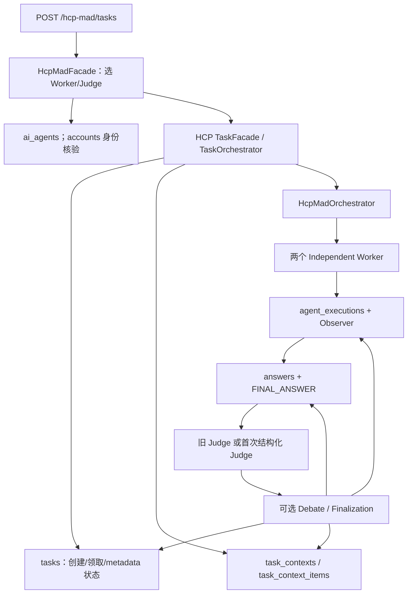
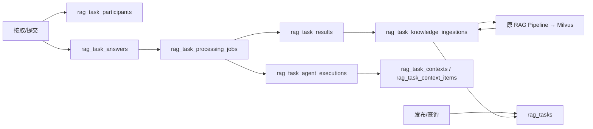

# 数据库表使用情况与冗余表审计

审计日期：2026-10-23，Asia/Shanghai。本轮只新增本报告；不修改业务代码、测试、配置或 SQL，不执行迁移、建表、删除、业务写入，不启动消费者或调用真实模型/Milvus。

## 1. 结论与证据等级

当前真实 MySQL、用户提供的建表 SQL、ORM 都有 **19 张表**：公共基础 3 张、HCP-MAD 5 张、RAG Task 9 张、旧知识整理映射 2 张。**建议保留前 17 张；仅两张旧表进入候选清理，不建议为了减少数量合并两个业务域的执行/上下文表。**

| 疑似旧表 | 本轮最终结论（按指定四选一） | 依据 |
| --- | --- | --- |
| task_knowledge_ingestions | **候选清理：生产代码已不再使用，但需要确认历史数据和数据库依赖。** | 无业务读写入口；当前库 0 行；可见范围无入向外键/数据库内部对象使用；仍有 ORM 注册、SQL 导出和测试元数据依赖，其他部署和外部客户端未验证 |
| crowd_task_participants | **候选清理：生产代码已不再使用，但需要确认历史数据和数据库依赖。** | 同样无业务读写入口、当前库 0 行、未发现其他表引用；自身仍向 tasks/answers/accounts 建外键，不能误写成“没有任何外键” |

“候选清理”不表示发现了当前仍有效的业务依赖，也不表示允许本轮删除。新表已承接**当前众包生产链路**，但不是按旧 task_id/字段一一迁移后的同一张表，不能自动推断其他环境的历史数据已迁完。

本报告使用以下证据等级：

- **[静态]**：实现、import、调用点、ORM/原生 SQL、脚本和测试源代码已检查。
- **[装配]**：在数据库引擎替身下实际导入应用、生成 OpenAPI、检查注册 handler；证明入口注册可达，**没有启动 lifespan 或执行业务请求**，不冒充完整线上流量跟踪。
- **[MySQL]**：对真实 aijiu_dev 执行只读事务、information_schema、SHOW CREATE TABLE、精确 COUNT、关联完整性统计。
- **[未验证]**：外部项目/旧版本进程、BI/ETL、其他部署/备份库及当前账号不可见的数据库内部对象，未断言不存在。

## 2. 输入、范围与只读方法

### 2.1 三方结构核对

1. 用户本轮提供的 [建表 SQL](<C:/Users/17708/.codex/attachments/ac0e648a-644d-491b-b544-dbcbf33096fe/已粘贴的文本.txt>)：19 张表。
2. [sql/createtable.sql:23](<C:/Code/culture-project/Cultural heritage ai/sql/createtable.sql:23>)：19 张表；逐个 CREATE TABLE 表体归一化后与用户附件一致。
3. 真实 MySQL 的 SHOW CREATE TABLE、列/索引/外键清单：19 张 InnoDB 表，全部 utf8mb4_unicode_ci。
4. 直接导入七个 Models 模块取得 Base.metadata：19 张映射，无额外/缺少表；列名、MySQL 编译字段类型和 nullable 全部对应。不是声称默认值和约束完全无差异，见第 9 节。

仓库导出 SQL 文本 SHA-256：`2b0d281419417eed7a9e0a9962e3406d9518bbca51e036fb15534ed897f5dffa`。没有执行此文件；它包含 CREATE DATABASE/CREATE TABLE 以及恢复外键检查的语句，仅作为结构证据读取。

### 2.2 检查范围

扫描 app/、scripts/、evaluation/、tests/、migrations/、sql/ 以及实际运行组合入口。排除 .venv、Git、IDE/缓存、tmp 和 .pytest_tmp 历史快照；快照中保留旧代码不等于当前生产依赖。项目根目录没有适用的 AGENTS.md 额外操作要求。

- 全局检查表名、模型类/状态枚举引用、ForeignKey、relationship、select/get/add/update/delete、text/exec_driver_sql、动态表名、反射/初始化入口。
- 两张旧表的当前 Python 引用只找到：[app/db/session.py:49](<C:/Code/culture-project/Cultural heritage ai/app/db/session.py:49>) 的 import、[app/modules/hcp_mad/legacy_knowledge_curation/domain/models.py:45](<C:/Code/culture-project/Cultural heritage ai/app/modules/hcp_mad/legacy_knowledge_curation/domain/models.py:45>) / [app/modules/hcp_mad/legacy_knowledge_curation/domain/models.py:126](<C:/Code/culture-project/Cultural heritage ai/app/modules/hcp_mad/legacy_knowledge_curation/domain/models.py:126>) 的定义；测试另有注册集合断言。未找到别名导入、运行时查询、动态反射或后台业务调用。
- ORM 注册不等于数据库访问。源代码 [init_db()](<C:/Code/culture-project/Cultural heritage ai/app/db/session.py:41>) 仅导入模型，没有 create_all；本轮仍未调用此函数。初次包含该函数的命令被自动审批拒绝，未执行；随后改为直接 PyMySQL 只读事务。应用装配使用 create_engine 替身，不连接数据库。
- 本轮没有运行 pytest：它会创建隔离测试数据库/临时文件；仅阅读测试并检查无副作用的装配，不把此前测试结果当作本轮执行。

### 2.3 真实库快照

主快照时间：**2026-10-23 05:58:15 UTC，即北京时间 13:58:15**。使用 START TRANSACTION WITH CONSISTENT SNAPSHOT, READ ONLY，结束时 rollback/关闭连接。记录数是该快照的精确 COUNT，不是 information_schema 的 InnoDB 估算。

| 表名 | 精确记录数 | 归属 |
| --- | ---: | --- |
| accounts | 10 | 公共账号 |
| ai_agents | 4 | 公共模型配置 |
| heritage_sites | 17 | 文化遗产详情工具 |
| tasks | 23 | HCP 任务及历史问答 |
| answers | 48 | HCP 正式答案 |
| task_contexts | 7 | HCP 共享上下文 |
| task_context_items | 106 | HCP 事件/证据/发言/P |
| agent_executions | 19 | HCP 每次执行 |
| rag_tasks | 4 | 众包任务及旧 normal/rag |
| rag_task_answers | 6 | 众包原始人工提交 |
| rag_task_participants | 7 | 众包任务参与关系 |
| rag_task_agent_executions | 6 | 众包聚合的真实执行 |
| rag_task_contexts | 3 | 众包执行上下文 |
| rag_task_context_items | 15 | 众包执行的公开协议事件 |
| rag_task_results | 2 | 正式聚合知识 |
| rag_task_knowledge_ingestions | 2 | 众包 RAG 入库回执/计划 |
| rag_task_processing_jobs | 4 | 持久聚合/入库 Job |
| crowd_task_participants | 0 | 旧知识整理预留 |
| task_knowledge_ingestions | 0 | 旧任务知识入库预留 |

可见数据库内部对象：views=0、triggers=0、routines=0、events=0。没有发现跨表入向外键指向两张旧表。当前账号的 SHOW GRANTS 未显示全局 ALL PRIVILEGES，故这些“0/无引用”限定为**当前权限可见范围**，未来正式清理前需要 DBA 复核，不能据此排除外部程序或所有跨库依赖。

## 3. 每张表的实际使用矩阵

以下读写仅将**当前有效生产调用**计为正常使用；历史 Python 兼容用例和测试单独说明。方法链接可定位具体源码。未发现当前生产删除这些业务记录的常规入口；不因此把有真实读写的表判为冗余。

| 表名 | 所属业务 | ORM 位置 | 生产代码读取 | 生产代码写入 | 运行时可达 | 当前是否必需 | 建议 |
| --- | --- | --- | --- | --- | --- | --- | --- |
| accounts | 公共账号 | [account/models.py:18 AccountTable](<C:/Code/culture-project/Cultural heritage ai/app/modules/account/models.py:18>) | [account/repository.py::get_accounts_by_username()](<C:/Code/culture-project/Cultural heritage ai/app/modules/account/repository.py:17>)；[account/repository.py::get_account_by_id()](<C:/Code/culture-project/Cultural heritage ai/app/modules/account/repository.py:24>) | [account/repository.py::create_account()](<C:/Code/culture-project/Cultural heritage ai/app/modules/account/repository.py:30>) | 注册/登录、JWT 依赖；两工作流账号核验 | 当前正常业务必需 | 保留 |
| ai_agents | 公共模型配置 | [agent/models.py:51 AiAgentTable](<C:/Code/culture-project/Cultural heritage ai/app/modules/agent/models.py:51>) | [agent/repository.py::get_ai_agent()](<C:/Code/culture-project/Cultural heritage ai/app/modules/agent/repository.py:43>)；[agent/repository.py::list_ai_rows_by_score()](<C:/Code/culture-project/Cultural heritage ai/app/modules/agent/repository.py:98>) | [agent/repository.py::register_ai_agent()](<C:/Code/culture-project/Cultural heritage ai/app/modules/agent/repository.py:17>)；[agent/repository.py::update_ai_health()](<C:/Code/culture-project/Cultural heritage ai/app/modules/agent/repository.py:68>) | Agent API、健康检查、HCP 选人、众包聚合 | 当前正常业务必需 | 保留 |
| heritage_sites | 文化遗产详情工具 | [heritage/models.py:23 HeritageSiteTable](<C:/Code/culture-project/Cultural heritage ai/app/modules/heritage/models.py:23>) | [heritage/repository.py::find_by_name()](<C:/Code/culture-project/Cultural heritage ai/app/modules/heritage/repository.py:25>) | 未发现生产 INSERT/UPDATE/DELETE；资料预置/维护属于应用外部 | 已注册 HeritageDetailTool；模型选择该工具时可达 | 有效可选工具数据；17 行不能因无管理 API 删除 | 保留 |
| tasks | HCP 任务及历史问答 | [hcp_mad/domain/models.py:117 TaskTable](<C:/Code/culture-project/Cultural heritage ai/app/modules/hcp_mad/domain/models.py:117>) | [hcp_mad/infrastructure/repository.py::get_task_row()](<C:/Code/culture-project/Cultural heritage ai/app/modules/hcp_mad/infrastructure/repository.py:17>)；[hcp_mad/infrastructure/queries.py::get_task()](<C:/Code/culture-project/Cultural heritage ai/app/modules/hcp_mad/infrastructure/queries.py:9>) | [hcp_mad/infrastructure/repository.py::create_task_row()](<C:/Code/culture-project/Cultural heritage ai/app/modules/hcp_mad/infrastructure/repository.py:27>)；[hcp_mad/infrastructure/repository.py::claim_waiting_task()](<C:/Code/culture-project/Cultural heritage ai/app/modules/hcp_mad/infrastructure/repository.py:56>)；[hcp_mad/application/task/debate_turns.py::_DebateTurnStore._commit()](<C:/Code/culture-project/Cultural heritage ai/app/modules/hcp_mad/application/task/debate_turns.py:246>) | POST /hcp-mad/tasks、历史 GET、注册 HCP handler | 当前正常业务 + 历史兼容必需 | 保留 |
| answers | HCP 正式答案 | [hcp_mad/domain/models.py:140 AnswerTable](<C:/Code/culture-project/Cultural heritage ai/app/modules/hcp_mad/domain/models.py:140>) | [hcp_mad/infrastructure/repository.py::list_answers()](<C:/Code/culture-project/Cultural heritage ai/app/modules/hcp_mad/infrastructure/repository.py:119>)；[hcp_mad/infrastructure/repository.py::find_answer_by_execution()](<C:/Code/culture-project/Cultural heritage ai/app/modules/hcp_mad/infrastructure/repository.py:114>) | [hcp_mad/infrastructure/repository.py::create_answer_row()](<C:/Code/culture-project/Cultural heritage ai/app/modules/hcp_mad/infrastructure/repository.py:88>)；[hcp_mad/application/task/answers.py::_add_answer()](<C:/Code/culture-project/Cultural heritage ai/app/modules/hcp_mad/application/task/answers.py:105>) | 初始 Worker、旧 Judge、新评估终局、Debate 终局 | 当前正常业务必需；中间发言不进入此表 | 保留 |
| task_contexts | HCP 共享上下文 | [hcp_mad/domain/models.py:161 TaskContextTable](<C:/Code/culture-project/Cultural heritage ai/app/modules/hcp_mad/domain/models.py:161>) | [hcp_mad/infrastructure/execution_repository.py::get_task_context()](<C:/Code/culture-project/Cultural heritage ai/app/modules/hcp_mad/infrastructure/execution_repository.py:57>)；[hcp_mad/infrastructure/execution_repository.py::get_task_context_by_id()](<C:/Code/culture-project/Cultural heritage ai/app/modules/hcp_mad/infrastructure/execution_repository.py:62>) | [hcp_mad/infrastructure/execution_repository.py::create_task_context()](<C:/Code/culture-project/Cultural heritage ai/app/modules/hcp_mad/infrastructure/execution_repository.py:40>)；append_context_item() 递增 version | HCP 准备、Observer、Debate ContextBuilder | 当前正常业务必需 | 保留 |
| task_context_items | HCP 事件/证据/发言/P | [hcp_mad/domain/models.py:222 TaskContextItemTable](<C:/Code/culture-project/Cultural heritage ai/app/modules/hcp_mad/domain/models.py:222>) | [hcp_mad/infrastructure/execution_repository.py::list_context_items()](<C:/Code/culture-project/Cultural heritage ai/app/modules/hcp_mad/infrastructure/execution_repository.py:219>)；[hcp_mad/application/task/prepared_results.py::_PreparedResultStore._prepared_result()](<C:/Code/culture-project/Cultural heritage ai/app/modules/hcp_mad/application/task/prepared_results.py:78>) | [hcp_mad/infrastructure/execution_repository.py::append_context_item()](<C:/Code/culture-project/Cultural heritage ai/app/modules/hcp_mad/infrastructure/execution_repository.py:164>)；[hcp_mad/application/task/prepared_results.py::_PreparedResultStore._prepare()](<C:/Code/culture-project/Cultural heritage ai/app/modules/hcp_mad/application/task/prepared_results.py:58>) | 请求事件、工具、RAG、REVIEW、AGENT_MESSAGE、FINAL_ANSWER | 当前正常业务及恢复必需 | 保留 |
| agent_executions | HCP 每次执行 | [hcp_mad/domain/models.py:185 AgentExecutionTable](<C:/Code/culture-project/Cultural heritage ai/app/modules/hcp_mad/domain/models.py:185>) | [hcp_mad/infrastructure/execution_repository.py::get_agent_execution()](<C:/Code/culture-project/Cultural heritage ai/app/modules/hcp_mad/infrastructure/execution_repository.py:100>) | [hcp_mad/infrastructure/execution_repository.py::create_agent_execution()](<C:/Code/culture-project/Cultural heritage ai/app/modules/hcp_mad/infrastructure/execution_repository.py:67>)；[hcp_mad/infrastructure/execution_repository.py::update_agent_execution_status()](<C:/Code/culture-project/Cultural heritage ai/app/modules/hcp_mad/infrastructure/execution_repository.py:117>)；increment_llm_request_count() | Worker/Judge/Debate 执行、失败和恢复 | 当前正常业务必需 | 保留 |
| rag_tasks | 众包任务及旧 normal/rag | [rag_task/domain/models.py:119 TaskTable](<C:/Code/culture-project/Cultural heritage ai/app/modules/rag_task/domain/models.py:119>) | [rag_task/infrastructure/crowd_queries.py::task_detail()](<C:/Code/culture-project/Cultural heritage ai/app/modules/rag_task/infrastructure/crowd_queries.py:136>)；[rag_task/infrastructure/crowd_repository.py::lock_task()](<C:/Code/culture-project/Cultural heritage ai/app/modules/rag_task/infrastructure/crowd_repository.py:79>) | [rag_task/application/crowd_service.py::CrowdService.publish()](<C:/Code/culture-project/Cultural heritage ai/app/modules/rag_task/application/crowd_service.py:37>)；[rag_task/infrastructure/processing_repository.py::ProcessingRepository.claim()](<C:/Code/culture-project/Cultural heritage ai/app/modules/rag_task/infrastructure/processing_repository.py:63>)；commit_ingestion() | 众包发布/列表/接取/提交/消费者 | 当前正常业务 + 历史数据必需 | 保留 |
| rag_task_answers | 众包原始人工提交 | [rag_task/domain/models.py:143 AnswerTable](<C:/Code/culture-project/Cultural heritage ai/app/modules/rag_task/domain/models.py:143>) | [rag_task/infrastructure/crowd_repository.py::worker_answers()](<C:/Code/culture-project/Cultural heritage ai/app/modules/rag_task/infrastructure/crowd_repository.py:91>)；[rag_task/infrastructure/crowd_queries.py::projection()](<C:/Code/culture-project/Cultural heritage ai/app/modules/rag_task/infrastructure/crowd_queries.py:22>) | [rag_task/application/crowd_service.py::CrowdService.submit()](<C:/Code/culture-project/Cultural heritage ai/app/modules/rag_task/application/crowd_service.py:113>)；旧 Python QA add_ai_answer() 另见兼容分析 | POST /rag-tasks/{id}/answers → submit；查询/冻结输入 | 当前正常业务必需；聚合结果不是这些原始答案 | 保留 |
| rag_task_participants | 众包任务参与关系 | [rag_task/domain/crowd_models.py:31 ParticipantTable](<C:/Code/culture-project/Cultural heritage ai/app/modules/rag_task/domain/crowd_models.py:31>) | [rag_task/infrastructure/crowd_queries.py::projection()](<C:/Code/culture-project/Cultural heritage ai/app/modules/rag_task/infrastructure/crowd_queries.py:22>)；[rag_task/application/crowd_service.py::CrowdService.submit()](<C:/Code/culture-project/Cultural heritage ai/app/modules/rag_task/application/crowd_service.py:113>) | [rag_task/application/crowd_service.py::CrowdService.accept()](<C:/Code/culture-project/Cultural heritage ai/app/modules/rag_task/application/crowd_service.py:80>)；CrowdService.submit() 更新 submitted | 接取、容量、身份、有效人数和本人状态 | 当前正常业务必需；旧参与表的当前替代 | 保留 |
| rag_task_agent_executions | 众包聚合的真实执行 | [rag_task/domain/models.py:197 AgentExecutionTable](<C:/Code/culture-project/Cultural heritage ai/app/modules/rag_task/domain/models.py:197>) | [rag_task/infrastructure/execution_repository.py::get_agent_execution()](<C:/Code/culture-project/Cultural heritage ai/app/modules/rag_task/infrastructure/execution_repository.py:100>)；[rag_task/infrastructure/processing_repository.py::ProcessingRepository.claim()](<C:/Code/culture-project/Cultural heritage ai/app/modules/rag_task/infrastructure/processing_repository.py:63>) | [rag_task/infrastructure/processing_repository.py::ProcessingRepository._start_aggregation_execution()](<C:/Code/culture-project/Cultural heritage ai/app/modules/rag_task/infrastructure/processing_repository.py:226>)；[rag_task/infrastructure/execution_repository.py::update_agent_execution_status()](<C:/Code/culture-project/Cultural heritage ai/app/modules/rag_task/infrastructure/execution_repository.py:117>) | 消费者 claim/bind → Agent Observer → 结果提交/失败 | 当前正常业务必需；不是 HCP Execution 的重复副本 | 保留 |
| rag_task_contexts | 众包执行上下文 | [rag_task/domain/models.py:172 TaskContextTable](<C:/Code/culture-project/Cultural heritage ai/app/modules/rag_task/domain/models.py:172>) | [rag_task/infrastructure/execution_repository.py::get_task_context()](<C:/Code/culture-project/Cultural heritage ai/app/modules/rag_task/infrastructure/execution_repository.py:57>)；[rag_task/application/execution_context.py::TaskExecutionContext.load()](<C:/Code/culture-project/Cultural heritage ai/app/modules/rag_task/application/execution_context.py:108>) | [rag_task/infrastructure/execution_repository.py::create_task_context()](<C:/Code/culture-project/Cultural heritage ai/app/modules/rag_task/infrastructure/execution_repository.py:40>)；append_context_item() 更新版本 | 聚合执行创建和事件记录；旧 QA 兼容 | 当前正常业务必需 | 保留 |
| rag_task_context_items | 众包执行的公开协议事件 | [rag_task/domain/models.py:235 TaskContextItemTable](<C:/Code/culture-project/Cultural heritage ai/app/modules/rag_task/domain/models.py:235>) | [rag_task/infrastructure/execution_repository.py::list_context_items()](<C:/Code/culture-project/Cultural heritage ai/app/modules/rag_task/infrastructure/execution_repository.py:219>)；TaskExecutionContext.load() | [rag_task/infrastructure/execution_repository.py::append_context_item()](<C:/Code/culture-project/Cultural heritage ai/app/modules/rag_task/infrastructure/execution_repository.py:164>)；[rag_task/application/execution_context.py::TaskExecutionContext.record()](<C:/Code/culture-project/Cultural heritage ai/app/modules/rag_task/application/execution_context.py:151>) | 聚合 Observer、原有工具事件/旧 QA；只存本执行数据 | 当前执行与历史兼容必需 | 保留 |
| rag_task_results | 正式聚合知识 | [rag_task/domain/crowd_models.py:54 KnowledgeResultTable](<C:/Code/culture-project/Cultural heritage ai/app/modules/rag_task/domain/crowd_models.py:54>) | [rag_task/infrastructure/crowd_queries.py::projection()](<C:/Code/culture-project/Cultural heritage ai/app/modules/rag_task/infrastructure/crowd_queries.py:22>)；[rag_task/infrastructure/processing_repository.py::ProcessingRepository.ingestion_input()](<C:/Code/culture-project/Cultural heritage ai/app/modules/rag_task/infrastructure/processing_repository.py:306>) | [rag_task/infrastructure/processing_repository.py::ProcessingRepository.commit_aggregation()](<C:/Code/culture-project/Cultural heritage ai/app/modules/rag_task/infrastructure/processing_repository.py:260>) | 聚合 T、结果查询、后续 ingest 输入 | 当前正常业务必需；每任务一个正式版本 | 保留 |
| rag_task_knowledge_ingestions | 众包 RAG 入库回执/计划 | [rag_task/domain/crowd_models.py:78 KnowledgeIngestionTable](<C:/Code/culture-project/Cultural heritage ai/app/modules/rag_task/domain/crowd_models.py:78>) | [rag_task/infrastructure/processing_repository.py::ProcessingRepository.ingestion_input()](<C:/Code/culture-project/Cultural heritage ai/app/modules/rag_task/infrastructure/processing_repository.py:306>)；[rag_task/infrastructure/crowd_queries.py::projection()](<C:/Code/culture-project/Cultural heritage ai/app/modules/rag_task/infrastructure/crowd_queries.py:22>) | [rag_task/infrastructure/processing_repository.py::ProcessingRepository.commit_aggregation()](<C:/Code/culture-project/Cultural heritage ai/app/modules/rag_task/infrastructure/processing_repository.py:260>)；[rag_task/infrastructure/processing_repository.py::ProcessingRepository.save_plan()](<C:/Code/culture-project/Cultural heritage ai/app/modules/rag_task/infrastructure/processing_repository.py:324>)；commit_ingestion()/fail() | ingest Job → RAG Pipeline → 回执；失败恢复 | 当前正常业务及固定切片重放必需 | 保留 |
| rag_task_processing_jobs | 持久聚合/入库 Job | [rag_task/domain/crowd_models.py:116 ProcessingJobTable](<C:/Code/culture-project/Cultural heritage ai/app/modules/rag_task/domain/crowd_models.py:116>) | [rag_task/infrastructure/processing_repository.py::ProcessingRepository.claim()](<C:/Code/culture-project/Cultural heritage ai/app/modules/rag_task/infrastructure/processing_repository.py:63>)；[rag_task/infrastructure/processing_repository.py::ProcessingRepository._owned()](<C:/Code/culture-project/Cultural heritage ai/app/modules/rag_task/infrastructure/processing_repository.py:188>) | [rag_task/application/crowd_service.py::CrowdService.submit()](<C:/Code/culture-project/Cultural heritage ai/app/modules/rag_task/application/crowd_service.py:113>)；[rag_task/infrastructure/processing_repository.py::ProcessingRepository.prepare_aggregation()](<C:/Code/culture-project/Cultural heritage ai/app/modules/rag_task/infrastructure/processing_repository.py:251>)；commit_aggregation()/heartbeat()/fail() | lifespan 消费者、重试、租约/围栏和准备 P | 当前正常业务必需；不是内存 BackgroundTasks 的重复 | 保留 |
| crowd_task_participants | 旧知识整理预留 | [hcp_mad/legacy_knowledge_curation/domain/models.py:45 CrowdTaskParticipantTable](<C:/Code/culture-project/Cultural heritage ai/app/modules/hcp_mad/legacy_knowledge_curation/domain/models.py:45>) | 未发现生产 DML 查询；仅 ORM 注册/外键元数据 | 未发现生产 INSERT/UPDATE/DELETE | 启动可导入映射；未找到有效业务读写入口 | 当前业务不必需；仍有元数据、SQL、测试残留 | 候选清理 |
| task_knowledge_ingestions | 旧任务知识入库预留 | [hcp_mad/legacy_knowledge_curation/domain/models.py:126 TaskKnowledgeIngestionTable](<C:/Code/culture-project/Cultural heritage ai/app/modules/hcp_mad/legacy_knowledge_curation/domain/models.py:126>) | 未发现生产 DML 查询；仅 ORM 注册/外键元数据 | 未发现生产 INSERT/UPDATE/DELETE | 启动可导入映射；未找到有效业务读写入口 | 当前业务不必需；仍有元数据、SQL、测试残留 | 候选清理 |

矩阵中的“保留”指当前业务使用，不是保证每个历史字段/索引均最优。账号、AI 的旧 review_result() 中还存在评分写入，但该审核 HTTP 路由已不在当前注册集合；不将它冒充当前 HCP/Crowd 自动链的评分步骤。

## 4. 运行时注册与条件功能

在引擎替身下实际生成的 OpenAPI 有 **22 个路径、24 个 HTTP 操作**。关键证据为 [注册工作流与 include_router](<C:/Code/culture-project/Cultural heritage ai/app/main.py:79>)、[RAG Router 只重导出 crowd_router](<C:/Code/culture-project/Cultural heritage ai/app/modules/rag_task/api/router.py:3>)、[resolve_task() 只解析 HCP 存储](<C:/Code/culture-project/Cultural heritage ai/app/api/task_routes.py:30>)。

| 注册入口/条件 | 当前实际职责 | 相关表 |
| --- | --- | --- |
| /users/register、/users/login、/users/logout | 账号/JWT；登出黑名单走 Redis，不另有 MySQL token 表 | accounts |
| GET/POST /ais、POST /ais/{id}/health-check | 配置读取/注册/健康状态写回 | ai_agents |
| /rag-tasks 及 mine、accept、answers、status、result、retry | 当前完整众包知识生产 API | 九张 rag_task 表中的对应部分 |
| POST /hcp-mad/tasks | 创建并调度 HCP，不接受普通账号固定 role 或通用 agent_id 选择 | HCP 五表，accounts、ai_agents；可选 Heritage 工具 |
| GET /users/tasks/{id} | 账号拥有的 HCP 存储历史任务；不按 ID 回退 RAG Task | tasks、answers |
| POST /ais/{ai}/tasks/{id}/invoke | 仍注册的兼容路由；直接执行仍受 HCP 工作流角色/阶段授权约束，不是任意绕过入口 | HCP 五表/ai_agents |
| /rag/retrieve、/rag/answer、/admin/rag/documents | 向量检索、证据回答、上传索引；不会调用旧 TaskKnowledgeIngestion ORM | Milvus/文件；answer 读取 ai_agents |
| lifespan 的 CrowdConsumer | 开关 RAG_TASK_CONSUMER_ENABLED 控制；当前读取配置为 **true** | 仅 RAG Task 工作流表及 ai_agents |
| HCP Debate | 创建 Task 时冻结 HCP_MAD_DEBATE_ENABLED；当前 Settings 为 **false**，代码可选分支仍注册可达，既有任务按各自 metadata 恢复 | 同一 HCP 五表，绝不使用两张旧表 |
| AI_HEALTH_CHECK_ON_STARTUP | 仅启用时启动一次健康检查；不能只 import main 就执行 | ai_agents |
| TAVILY_API_KEY | 有值时注册 Web 工具；无 MySQL 任务表读写 | 外部网络；HeritageDetailTool 单独读取 heritage_sites |

当前没有 /rag-tasks/legacy 路由；不能照旧文档把它算作生产入口。HCP 只注册 TaskMode.HCP_MAD → HcpMadFacade.run_claimed_task。两张旧表也没有独立消费者或配置开关。

## 5. HCP-MAD 数据库调用链



| 阶段 | 实际方法与证据 | 读 | 写 |
| --- | --- | --- | --- |
| 创建/选人 | [hcp_mad/application/facade.py::HcpMadFacade.submit_task()](<C:/Code/culture-project/Cultural heritage ai/app/modules/hcp_mad/application/facade.py:70>)；[hcp_mad/application/task/management.py::create_task()](<C:/Code/culture-project/Cultural heritage ai/app/modules/hcp_mad/application/task/management.py:17>) | accounts、ai_agents | tasks，冻结参与者和 Debate 策略 |
| 任务领取 | [hcp_mad/application/task/orchestration.py::TaskOrchestrator._claim_task()](<C:/Code/culture-project/Cultural heritage ai/app/modules/hcp_mad/application/task/orchestration.py:68>) | tasks | tasks.status 条件更新 |
| 共享问题/证据 | [hcp_mad/application/task/execution_context.py::TaskExecutionContext.prepare()](<C:/Code/culture-project/Cultural heritage ai/app/modules/hcp_mad/application/task/execution_context.py:42>) / invalidate_rag() | tasks、task_contexts、task_context_items；检索本身走 Milvus | task_contexts、task_context_items |
| Worker 执行 | [hcp_mad/application/task/ai_answers.py::invoke_ai_for_task()](<C:/Code/culture-project/Cultural heritage ai/app/modules/hcp_mad/application/task/ai_answers.py:40>) → [hcp_mad/application/task/execution_context.py::TaskExecutionContext.create_execution()](<C:/Code/culture-project/Cultural heritage ai/app/modules/hcp_mad/application/task/execution_context.py:70>) | tasks、ai_agents、上下文、既有 Execution | agent_executions、Context 事件 |
| Worker 初始正式答案 | [hcp_mad/application/task/answers.py::_add_answer()](<C:/Code/culture-project/Cultural heritage ai/app/modules/hcp_mad/application/task/answers.py:105>) | tasks/answers/Execution/ai_agents | answers、FINAL_ANSWER、Execution completed；保留 Task 阶段 |
| Debate 关闭的旧 Judge | [hcp_mad/judge/executor.py::JudgeExecutor.run()](<C:/Code/culture-project/Cultural heritage ai/app/modules/hcp_mad/judge/executor.py:16>) → _add_answer(finalize_task=True) | 两 Worker 正式 Answer、Execution、任务上下文 | Judge Answer/FINAL_ANSWER、Execution、tasks.final_result/终态同事务 |
| 首次 Judge 评估 | [hcp_mad/application/task/agent_reviews.py::_ReviewStore._commit()](<C:/Code/culture-project/Cultural heritage ai/app/modules/hcp_mad/application/task/agent_reviews.py:178>) | 初始 answers、绑定/已有 Execution、当前证据 | REVIEW 或正式终局 Answer；tasks.metadata_json；Execution |
| P 准备 | [hcp_mad/application/task/prepared_results.py::_PreparedResultStore._prepare()](<C:/Code/culture-project/Cultural heritage ai/app/modules/hcp_mad/application/task/prepared_results.py:58>) | 当前 tasks/Execution/幂等 journal | 私有 REVIEW + tasks.metadata_json 的 prepared 回执 |
| 中间发言/轮次 | [hcp_mad/application/task/agent_messages.py::_MessageStore.complete()](<C:/Code/culture-project/Cultural heritage ai/app/modules/hcp_mad/application/task/agent_messages.py:247>)；[hcp_mad/application/task/debate_turns.py::_DebateTurnStore._commit()](<C:/Code/culture-project/Cultural heritage ai/app/modules/hcp_mad/application/task/debate_turns.py:246>) | 本业务绑定/当前与已完成发言 | 共享 AGENT_MESSAGE、Execution、tasks.metadata_json；continue 不建 Answer |
| Worker 主动终局 | 同 _DebateTurnStore._commit() 的 finish 分支 | 任务/Execution/AI 角色校验 | 正式 answers、FINAL_ANSWER、Task/轮次回执/Execution 同事务 |
| 上限终局 Judge | [hcp_mad/application/finalization.py::FinalizationExecutor.run()](<C:/Code/culture-project/Cultural heritage ai/app/modules/hcp_mad/application/finalization.py:60>) → [hcp_mad/application/task/agent_finalization.py::_FinalizationStore._commit()](<C:/Code/culture-project/Cultural heritage ai/app/modules/hcp_mad/application/task/agent_finalization.py:169>) | 全部已提交发言/初始答案/绑定 | answers、FINAL_ANSWER、Task 终态和 Execution 同事务 |
| 重试/取消/恢复 | _MessageStore、_PreparedResultStore、debate_turns、agent_finalization、workflow | 同一 HCP 五表中的执行绑定与回执 | 同一 HCP 五表；不读写 RAG Task 或旧知识表 |

HCP 的旧 [aggregate_task_answers()/score_task_answers()/finish_task()](<C:/Code/culture-project/Cultural heritage ai/app/modules/hcp_mad/application/task/aggregation.py:18>) 当前直接返回 409，是拒绝兼容适配，不进行普通问答聚合/评分。不能据这些名称推断它在使用旧知识入库表。

完整静态路径没有引用 CrowdTaskParticipantTable/TaskKnowledgeIngestionTable。人类接单旧方法即使直接调用，也通过 tasks.accepted_worker_ids 和 answers 工作，不访问 crowd_task_participants；当前 HCP 提交固定 worker_count=0，人类接单也不是此主链。

## 6. RAG 众包数据库调用链



| 业务步骤 | 方法/入口 | 真实数据库行为 |
| --- | --- | --- |
| 发布 | [rag_task/application/crowd_service.py::CrowdService.publish()](<C:/Code/culture-project/Cultural heritage ai/app/modules/rag_task/application/crowd_service.py:37>) | 创建 rag_tasks(mode=crowd)，保存目标人数；不触碰 tasks |
| 公共/个人查询 | [rag_task/infrastructure/crowd_queries.py::projection()](<C:/Code/culture-project/Cultural heritage ai/app/modules/rag_task/infrastructure/crowd_queries.py:22>)、list_tasks()/task_detail() | JOIN rag_tasks、participants、answers、results、ingestions、aggregate/ingest jobs，按账号可见性投影 |
| 接取 | [rag_task/application/crowd_service.py::CrowdService.accept()](<C:/Code/culture-project/Cultural heritage ai/app/modules/rag_task/application/crowd_service.py:80>) | 锁 rag_tasks，查唯一参与记录/容量，插入 rag_task_participants |
| 回答提交 | [rag_task/application/crowd_service.py::CrowdService.submit()](<C:/Code/culture-project/Cultural heritage ai/app/modules/rag_task/application/crowd_service.py:113>) | 同事务插入 rag_task_answers，更新 rag_task_participants=submitted；作者必须匹配参与者 |
| 有效人数 | [rag_task/infrastructure/crowd_repository.py::worker_answers()](<C:/Code/culture-project/Cultural heritage ai/app/modules/rag_task/infrastructure/crowd_repository.py:91>) | Answer.participant_id JOIN Participant.id；task 一致、submitted、source=worker、作者一致，不按接取数/AI 数凑人数 |
| 达到门槛 | CrowdService.submit() | rag_tasks=aggregating + 唯一 aggregate Job 同事务；Job.payload_json 冻结原答案，不同步调用模型 |
| 扫描/领取 | [rag_task/application/crowd_processing.py::CrowdConsumer._run()](<C:/Code/culture-project/Cultural heritage ai/app/modules/rag_task/application/crowd_processing.py:261>) → [rag_task/infrastructure/processing_repository.py::ProcessingRepository.claim()](<C:/Code/culture-project/Cultural heritage ai/app/modules/rag_task/infrastructure/processing_repository.py:63>) | pending/retry 到期扫描，按 Task→Job 短事务锁定；owner/generation/租约/次数检查 |
| AI 绑定与执行 | bind_aggregation_agent() / _start_aggregation_execution() → [rag_task/application/crowd_processing.py::CrowdProcessor._process()](<C:/Code/culture-project/Cultural heritage ai/app/modules/rag_task/application/crowd_processing.py:170>) | 读 ai_agents；创建 rag_task_contexts、真实 rag_task_agent_executions，Observer 写本执行事件；不创建 HCP Execution |
| 聚合准备 P | prepare_aggregation() | 将公开输出准备到 rag_task_processing_jobs.prepared_text，不提前当正式知识发布 |
| 聚合发布 T | [rag_task/infrastructure/processing_repository.py::ProcessingRepository.commit_aggregation()](<C:/Code/culture-project/Cultural heritage ai/app/modules/rag_task/infrastructure/processing_repository.py:260>) | 新增单条 Result、入库回执、唯一 ingest Job，同时 Execution completed / Task ingesting / aggregate succeeded |
| 入库 | ingestion_input()/save_plan() → RagFacade.prepare_text_ingestion()/index_prepared_text() | 读 rag_task_results，写新入库表 plan_json；原清洗/切片/Embedding/Milvus；不使用旧 TaskKnowledgeIngestion |
| 成功/失败 | commit_ingestion()、fail()、_fail_locked() | 写新入库表状态/文档 ID/错误及任务/Job；失败保留 Result，固定计划只重放 ingest |
| 人工恢复 | [rag_task/application/crowd_service.py::CrowdService.retry()](<C:/Code/culture-project/Cultural heritage ai/app/modules/rag_task/application/crowd_service.py:254>) | 仅发布者；锁原 Task/Job，检查旧回执；更新原 Job/新入库表，未开始的空绑定可补绑定；不重建工人答案 |

**双写/错表结论 [静态]**：当前众包生产方法全部导入 RAG Task 自身 ORM/Repository，未发现同一事件向新旧参与表或新旧入库表双写；未发现查询新表却更新旧表。两张旧表既不在消费者 import 链，也不在 [九表引擎检查 TABLES](<C:/Code/culture-project/Cultural heritage ai/app/modules/rag_task/infrastructure/crowd_repository.py:20>) 中。

**真实数据 [MySQL]**：3 条 crowd 主任务中 2 条 completed、1 条 collecting；2 条 aggregate Job 与 2 条 ingest Job 均 succeeded；2 条 Result 均关联所属 task 的真实 Execution，缺失关联计数为 0。这说明新表存在实际业务记录，但本轮未重新执行模型或向量入库，也没有把库中 succeeded 回执当作本轮的外部服务验收。

## 7. 公共 Agent、Tool、Provider 与 RAG 入库边界

- [agent/application/runner.py::RegisteredAgentRunner.run()](<C:/Code/culture-project/Cultural heritage ai/app/modules/agent/application/runner.py:41>) 从 ai_agents 加载配置；run_with_usage()/run_configured() 复用公共 Loop，不选择任何业务 Task/Execution 表。
- [agent/application/runner.py::run_observed_agent()](<C:/Code/culture-project/Cultural heritage ai/app/modules/agent/application/runner.py:104>) 的 prepare/submit/fail 都是业务方显式传入回调；Observer 同样由调用方提供。Agent 自身没有默认 RAG Task 或旧知识库持久化实现。
- [公共 ContextBuilder](<C:/Code/culture-project/Cultural heritage ai/app/modules/agent/application/context/builder.py:100>) 仅处理传入快照，没有 Session/ORM 查询。
- HCP Observer → hcp_mad.infrastructure.execution_repository → 原五表；RAG Observer → rag_task.infrastructure.execution_repository → 自有表。相同类名/Runner 不表示共用表。
- [tool/composition.py::build_tool_registry()](<C:/Code/culture-project/Cultural heritage ai/app/modules/tool/composition.py:14>) 始终注册 HeritageDetailTool；[heritage/application/facade.py::HeritageFacade.find_detail_by_name()](<C:/Code/culture-project/Cultural heritage ai/app/modules/heritage/application/facade.py:22>) → find_by_name() 查询 heritage_sites。Web 工具只访问其外部服务。
- [rag/application/facade.py::RagFacade.index_prepared_text()](<C:/Code/culture-project/Cultural heritage ai/app/modules/rag/application/facade.py:98>) → [rag/application/indexing_service.py::IndexingService.index_chunks()](<C:/Code/culture-project/Cultural heritage ai/app/modules/rag/application/indexing_service.py:31>) → EmbeddingService/VectorStore，文档和切片写 Milvus，不写 task_knowledge_ingestions。众包调用者负责维护新入库回执。
- 直接 /admin/rag/documents 上传调用 IndexingService，不创建任何 Task 入库回执；它是另一个有效管理入口，不能据此认定新入库表也多余。
- 当前库没有 MySQL 的 tools、documents、embeddings 或向量表；不要将 Milvus collection、Redis 登录失效标记或文件缓存误算为漏掉的 MySQL 业务表。

## 8. 两组新旧表的最终判断

### 8.1 task_knowledge_ingestions

**最终结论：候选清理：生产代码已不再使用，但需要确认历史数据和数据库依赖。**

旧 [TaskKnowledgeIngestionTable](<C:/Code/culture-project/Cultural heritage ai/app/modules/hcp_mad/legacy_knowledge_curation/domain/models.py:126>) 表达“旧 tasks 聚合知识入库状态”：task_id、status、document_id、chunk_count、attempt_count、last_error、metadata_json、indexed_at；是旧知识整理设计留下的映射。当前没有证据证明它曾形成可运行完整旧生产链，不能仅凭该结构宣称完成过历史迁移。

| 对照 | task_knowledge_ingestions | rag_task_knowledge_ingestions |
| --- | --- | --- |
| 父任务 | tasks.id | rag_tasks.id |
| 正式知识关联 | 无独立 Result 外键 | result_id → rag_task_results.id |
| 状态/恢复 | 旧 enum pending/processing/succeeded/failed；metadata/indexed_at | 实际 claim/ingest 更新 pending/running/succeeded/failed；plan_json 保存固定切片计划 |
| 业务唯一性 | task_id 唯一 | task_id、result_id 各唯一 |
| 来源/幂等依据 | 旧表无固定 source_id/plan 字段 | source_id、document_id、plan_json 配合 ingest Job 重放 |
| 当前实际行数 | 0 | 2 |
| 有效业务调用 | 未发现 | Processor/ProcessingRepository/查询/retry 可达 |
| 外键 | 向外引用 tasks；可见范围无人引用它 | 向外引用 rag_tasks、rag_task_results；消费者维护 |

新表与 Result/Job 的组合已完整承接**当前**众包入库职责；这不是旧表更名，也不是旧 tasks 主键可原封不动塞入 rag_tasks。当前库无需迁移该空表的行；其他环境若有数据，必须先查明旧 task/answer/document 的归属和引用，再决定只归档还是显式迁移。

当前 HCP 历史 GET 和完成/恢复路径均不读取它，删除旧表本身不会按当前代码丢失 HCP 正式答案。但必须先处理残留映射/结构导出/测试注册依赖，不能本轮直接 DROP。

### 8.2 crowd_task_participants

**最终结论：候选清理：生产代码已不再使用，但需要确认历史数据和数据库依赖。**

旧 [CrowdTaskParticipantTable](<C:/Code/culture-project/Cultural heritage ai/app/modules/hcp_mad/legacy_knowledge_curation/domain/models.py:45>) 记录旧 tasks 的工人参与与可选 answers 关联；当前无 Repository/Facade/Router/消费者使用。普通 Task 的遗留 accept_task() 使用 accepted_worker_ids JSON，也没有访问该表。

| 对照 | crowd_task_participants | rag_task_participants |
| --- | --- | --- |
| 主键 | id VARCHAR(64) | id VARCHAR(64) |
| 父任务 | tasks.id | rag_tasks.id |
| 人工身份 | worker_id → accounts.id | worker_id → accounts.id |
| Answer 关系 | 旧参与表.answer_id → answers.id，answer_id 唯一 | rag_task_answers.participant_id → 新参与表.id，participant_id 唯一；关系方向相反 |
| 参与唯一性 | task_id + worker_id 唯一 | task_id + worker_id 唯一 |
| 状态/时间 | accepted/submitted/withdrawn（旧 enum）；created/submitted/updated | 当前 accept/submit 维护 accepted/submitted、accepted_at/submitted_at |
| 当前数据 | 0 行 | 7 行 |
| 当前业务入口 | 无 | 接取、提交、本人参与查询、有效人数与权限检查 |

真实向外外键共三条：fk_crowd_participant_task → tasks.id、fk_crowd_participant_worker → accounts.id、fk_crowd_participant_answer → answers.id；**没有可见入向外键**。这是“旧表引用别人”，不是“别人还必须依赖旧表”。两张新表与旧表不应共用外键或双写。

仍存在的代码引用只有定义/启动 import，以及测试和 SQL 导出。当前库无历史参与行需要直接丢弃；不能把这一事实推及所有旧部署/备份或推断该表从未有过数据。

## 9. 其他冗余与结构差异

### 9.1 没有发现第三张可按同样证据列为冗余的实际表

- heritage_sites 虽无当前在线写入 API，工具真实注册且查询可达，不能因“只读/资料预置”列为废弃。
- HCP 与 RAG 各自 Task、Answer、Execution、Context、ContextItem 虽结构相似，承担独立事务、历史、权限和恢复语义；**不是重复表，不建议合并**。
- rag_task_results、rag_task_processing_jobs、rag_task_knowledge_ingestions 分别承担正式知识、执行租约/P、外部存储回执/固定计划，不能因为含相似内容/状态就合并。
- 当前 19 表在 ORM/用户 SQL/真实数据库中都存在；没有发现本库“仅 SQL 定义但没有 ORM”的额外业务表。

### 9.2 遗留代码不等于额外废弃表

旧 RAG Task 的 TaskFacade、management、answers、普通 orchestration/aggregation/review 仍保留 Python 方法和测试，但 /rag-tasks/legacy API 已退役，当前 crowd handler 不调用普通 finish_task() 或评分。HCP 的旧聚合方法是拒绝适配。可以将这些**代码入口**作为另一次兼容性治理候选，不能借此删除九张仍被众包使用的表。

真实 tasks 有 7 条 hcp_mad、16 条 normal/rag 历史主任务；rag_tasks 另有 1 条旧 normal 任务。历史记录不是两张旧知识表的数据，未来删除旧映射也不得连带清除这些 Task/Answer/Context。

### 9.3 ORM/SQL/真实库差异

1. **缺失物理外键 [MySQL + 静态]**：[AnswerTable.execution_id](<C:/Code/culture-project/Cultural heritage ai/app/modules/hcp_mad/domain/models.py:151>) 声明引用 agent_executions.id；用户 SQL 和真实库只有 execution_id 普通索引，没有对应外键。另一个 RAG Answer 表实际具备其 execution 外键。这不是旧表冗余，也不是本轮改表理由；当前 15 条非空 HCP Answer.execution_id 的孤儿计数为 0，未来若加约束仍需重新验证和独立迁移审查。
2. **默认值边界**：heritage_sites.created_at/updated_at 在真实库有 CURRENT_TIMESTAMP，但 ORM 无 server_default；tasks.mode 在真实库默认 normal，ORM 是 Python 侧 default，没有 server_default。当前 HCP 创建明确传 hcp_mad，不据此推断其流程错误；不应宣称 ORM 自动建库会得到字节级相同结构。
3. **索引语义**：按字段顺序和 unique 属性比较，未发现 ORM 要求的业务索引/唯一键缺失；heritage_sites.name 的数据库唯一键名与 ORM unique Index 名称不同，约束含义相同，不是重复表或额外删除建议。
4. **不完整逻辑外键**：执行/ContextItem 的 ai_id、context_id、execution_id 等部分关联本来只有索引，没有物理 FK；回答者 ID 还具有账号/AI 多态语义。不能把所有“逻辑指向”画成真实数据库外键，也不能因没有 FK 就认定不被使用。
5. **旧表会被重新创建**：[旧参与表 CREATE](<C:/Code/culture-project/Cultural heritage ai/sql/createtable.sql:102>) / [旧入库表 CREATE](<C:/Code/culture-project/Cultural heritage ai/sql/createtable.sql:377>) 仍存在；将来仅删线上表却继续采用这个完整导出，会再次建出旧表。当前 init_db 不会自动建表，但测试的 Base.metadata.create_all() 会创建所有已注册映射。

### 9.4 原生 SQL、脚本和迁移核对

- [lock_message_task()](<C:/Code/culture-project/Cultural heritage ai/app/modules/hcp_mad/infrastructure/agent_message_repository.py:15>) 的拼接 SQL 只检查 HCP 五表的 InnoDB；不涉及旧知识表。
- [transaction()](<C:/Code/culture-project/Cultural heritage ai/app/modules/rag_task/infrastructure/crowd_repository.py:45>) 的动态表名来自固定九表 TABLES，仅查引擎；不是将旧表隐藏在动态反射中。
- [check_crowd_environment.main()](<C:/Code/culture-project/Cultural heritage ai/scripts/check_crowd_environment.py:16>) 读取 rag_task% 元数据、ai_agents 并调用新 CrowdService 列表，不使用旧表。它还有外部探测，本轮没有运行整个脚本。
- scripts/ 中的遗产工具、模型和 RAG 检查脚本使用公共 Agent、Heritage 或向量能力；evaluation/ 使用 Agent/Tool/RAG 能力，不导入旧模型。它们不是常驻应用消费者。
- [sql/insectdata.sql:1](<C:/Code/culture-project/Cultural heritage ai/sql/insectdata.sql:1>) 仅向 ai_agents 插入种子配置，无 CREATE 或旧表写入，本轮只读取语句目标，未执行。
- [migrations/20260817_drop_accounts_role.sql:1](<C:/Code/culture-project/Cultural heritage ai/migrations/20260817_drop_accounts_role.sql:1>) 与 [migrations/20261009_add_ai_agent_provider_fields.sql:1](<C:/Code/culture-project/Cultural heritage ai/migrations/20261009_add_ai_agent_provider_fields.sql:1>) 是账号角色/模型配置的历史 DDL，不是旧表活跃业务调用，本轮未执行。
- 当前缺少此前文档/测试引用的 sql/20261022_add_rag_task_tables.sql 和 sql/20261022_add_rag_task_crowd_workflow.sql；不能因此声称历史迁移没执行，也不能把测试的缺文件问题当作生产数据库缺表。实际九表均在。

## 10. 候选清理方案（仅供未来人工审查）

两张表均按**独立清理项**处理；本轮不生成可直接误执行的 DROP 脚本。

| 事项 | task_knowledge_ingestions | crowd_task_participants |
| --- | --- | --- |
| 当前数据量 | 0，真实只读查询 | 0，真实只读查询 |
| 当前替代 | 新 Ingestion + Result + ProcessingJob | 新 Participant + Answer.participant_id |
| 当前库是否需要搬行 | 不需要搬迁空表；上线前重查 | 不需要搬迁空表；上线前重查 |
| 外键清理边界 | 仅本表向 tasks 的 FK，当前无可见入向 FK | 本表向 tasks/accounts/answers 的 FK，当前无可见入向 FK |
| 残留代码 | 旧 ORM、init_db 注册、启动映射测试 | 同左 |
| SQL/部署残留 | 完整导出会重建它；需确认所有部署工具 | 同左 |
| 其他环境若有数据 | 先备份并追溯任务/文档；选择归档或审查迁移 | 先备份并追溯 task/worker/answer；不能直接复制到新父域 |
| 回滚 | 从备份恢复原 DDL/FK/数据与兼容代码版本 | 同左 |

删除前必须完成：

1. DBA 使用足够权限复查所有入向外键、视图、触发器、routine/event；当前可见对象清单不代表管理员全集。
2. 确认部署中没有旧实例、脚本、外部服务、报表/ETL 依赖；必要时观察一段完整业务周期的 SQL 审计，不仅看最近 count。
3. 在停写/维护窗口重查 COUNT；保存两表 SHOW CREATE TABLE、完整逻辑备份（即使空表也备份结构）、数据和恢复命令，并验证恢复到隔离库可用。
4. 后续独立代码变更审查移除旧模型 import/元数据映射和相应契约断言，更新当前有效的新库创建流程；**不是本轮修改，也不是简单删除测试来掩盖仍有调用**。
5. 检查 SQLAlchemy relationship/外部反射（当前未发现旧表 relationship）及所有正式部署入口，保证旧表不再被重新创建。
6. 若其他环境有旧行，先完成基于业务 ID 和父任务域的明确归档/迁移决策，不自行把 tasks 当作 rag_tasks。
7. 隔离环境先验证去掉两表后启动与 OpenAPI、注册/登录、HCP 初始 Worker/Judge/Debate/P-T/取消/恢复、众包三人门槛/聚合/失败恢复/固定计划入库、历史 Task 查询、Heritage 工具。
8. 真实 MySQL 隔离库验证行锁/并发领取和 FK；SQLite 只能覆盖自身事务语义。可参考下节现有测试，但清理后必须实际重新运行，不能引用以前通过数量。
9. 将来任何删除 SQL 必须单独评审并在备份/回滚演练后执行；本轮没有 DROP/TRUNCATE/DELETE/ALTER/UPDATE 或数据迁移。

## 11. 后续清理的回归范围

本轮只读阅读以下测试，不报告它们为本轮通过：

| 范围 | 已有测试源代码 |
| --- | --- |
| ORM 注册不应自动 DDL、模型集合 | [test_init_db_registers_all_models_in_a_fresh_process](<C:/Code/culture-project/Cultural heritage ai/tests/test_application_startup.py:18>)；其字符串内明确包含两张旧表，未来移除映射需同步审查该契约 |
| 双工作流同 ID 的真实 SQL 隔离 | [test_same_task_id_executes_with_separate_observers_answers_and_failure_states](<C:/Code/culture-project/Cultural heritage ai/tests/test_execution_architecture.py:220>) |
| 众包只能访问本域 | [test_all_crowd_sql_uses_only_owned_business_tables](<C:/Code/culture-project/Cultural heritage ai/tests/rag_task/test_crowd_workflow.py:528>) |
| 三人触发/真实 Observer/旧 pending 恢复 | [tests/rag_task/test_crowd_auto_recovery.py:99](<C:/Code/culture-project/Cultural heritage ai/tests/rag_task/test_crowd_auto_recovery.py:99>) |
| HCP SQL 边界和失败状态 | [test_full_hcp_tool_pipeline_never_reads_or_writes_rag_task_tables](<C:/Code/culture-project/Cultural heritage ai/tests/hcp_mad/test_failure_diagnostics.py:81>) |
| HCP 初始链、首次 Judge、turn 与终局 | tests/hcp_mad/test_stage_pipeline.py、test_judge_trigger.py、test_debate_orchestration.py、test_finalization.py、task/test_debate_turns.py |
| 账号/JWT 与资源权限 | tests/account/test_account_identity_api.py、test_account_permissions.py |
| RAG Facade/切片/入库 | tests/rag/test_public_facade.py、test_pipeline_contracts.py；与众包 ingest 重试联合验证 |

未来应额外增加“去掉旧映射/表后全链路仍可运行”和“SQL 监听禁止访问旧表”的针对性回归；本轮没有修改或新增测试。

## 12. 推荐的最终结构与验证边界

完成后续清理审查后，推荐的业务结构是 **17 张 MySQL 表 + 现有 Milvus/Redis**：

```text
公共基础（3）
  accounts
  ai_agents
  heritage_sites
HCP-MAD（5）
  tasks → answers / task_contexts → task_context_items
        → agent_executions
  Debate 状态与幂等回执继续在既有 metadata / Context 项中
RAG 众包（9）
  rag_tasks → rag_task_participants → rag_task_answers
            → rag_task_agent_executions
            → rag_task_contexts → rag_task_context_items
            → rag_task_processing_jobs
            → rag_task_results → rag_task_knowledge_ingestions
外部存储
  Milvus：文档切片/向量
  Redis：账号 Token 失效等已有临时状态
```

上图箭头表达业务关系，不冒充全部物理 ForeignKey。本轮实际数据库仍保留 19 张表。

- **已证实**：19 表结构/当前数据量、ORM 及实际入口装配；旧表无当前业务 DML 路径；新表承接众包参与/入库；当前权限可见的旧表入向 FK/内部数据库对象为空。
- **未发现**：新旧参与/入库双写、读新写旧、公共 Agent 默认访问旧表、HCP 间接调用旧知识表。
- **未验证**：所有生产实例的真实 SQL 流量、其他库/外部程序/管理员全集、删表后的运行行为、真实并发/模型/向量执行。本报告不是删除许可，也没有做删除后的验收。
- **本轮范围**：只新增 docs/DATABASE_TABLE_AUDIT.md；没有修改或执行用户给出的 SQL，没有通过应用启动触发模型、消费者或建表。

## 13. 后续代码清理记录（2026-10-23）

在上述审计完成后，用户另行授权清理两张候选旧表的代码。现已删除旧 ORM 模型及专属枚举/遗留模块，移除 `app/db/session.py` 注册，当前元数据为公共 3 + HCP 5 + RAG 9 = 17 表。正式新库入口改为 `sql/mysql_schema.sql`；原始 `sql/createtable.sql` 仍作为 19 表历史导出保留，不用于新部署。

原有章节的 19 表、数据量、源码路径和“候选清理”结论保留为审计当时的事实；其中已删除文件的链接是历史定位。后续变更及重新运行的测试见 [LEGACY_TABLE_CLEANUP.md](LEGACY_TABLE_CLEANUP.md)。本次清理没有连接真实 MySQL、执行 DDL 或删除数据，物理旧表仍由用户备份、核查依赖后手动清理。

