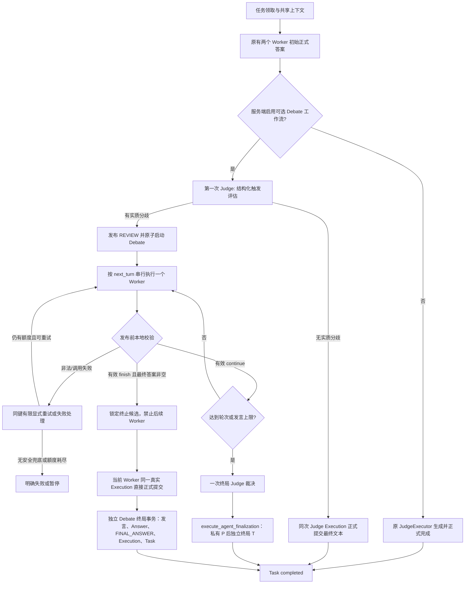
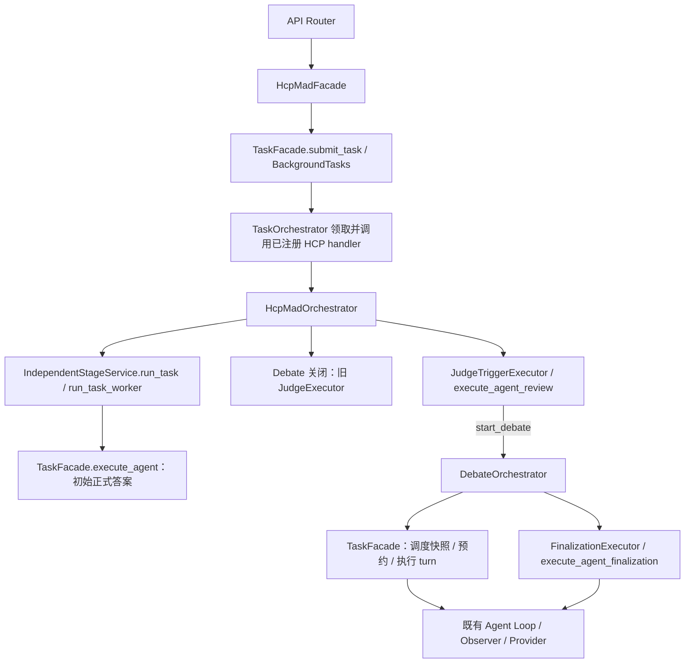
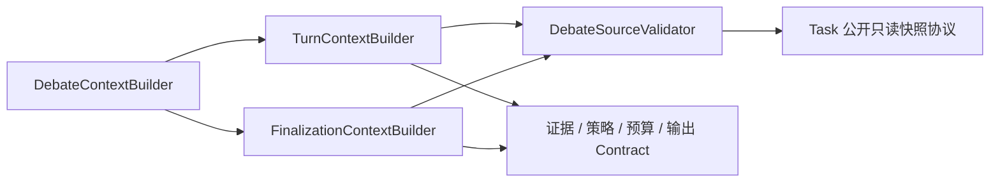

# HCP-MAD Debate 状态机与编排接口设计

> 2026-10-22 路径更新：本文原 Task 持久化用例已归属 `app/modules/hcp_mad/application/task/`，原 ORM / Repository 分别位于 `hcp_mad/domain/` / `hcp_mad/infrastructure/`；公共执行与纯消息选择已抽至 Agent。普通/RAG 任务使用独立 `rag_task` 表，迁移和部署说明见 [执行层与任务隔离记录](AGENT_EXECUTION_SPLIT.md)。原有阶段行为与事务说明仍保留。

> 状态：**阶段 1～5 已实现**（2026-10-20）。阶段 5 消费原上限终局预约，由固定 Judge 使用全部已提交讨论给出结构化终局，先私有准备，再原子正式提交及恢复，详见第 16 节。Worker 主动 finish 仍直接完成，不调用终局 Judge。阶段 1～4 的交付记录保留当时范围与测试数量；未知执行和取消中的外部调用不自动接管。原证据索引行号是初次审查位置。2026-10-22 的架构治理、当前公开重试契约和实测结果见第 17 节；第 12～16 节保留各阶段历史记录，历史测试数不代表当前基线。

## 1. 当前真实执行链与已有能力

### 1.1 代码证据索引

下列位置为本轮检查时的行号；路径相对仓库根目录。

| 位置 | 实际行为 |
| --- | --- |
| `app/modules/hcp_mad/api/router.py:14`，`submit_task()` | 鉴权后调用 HCP Facade，使用进程内 BackgroundTasks 调度。 |
| `app/modules/hcp_mad/application/facade.py:52`，`HcpMadFacade.submit_task()` | 固定两个 Worker 和一个 Judge；构造 `metadata.hcp_mad={worker_ids,judge_id,use_rag,stage:'queued',status:'waiting'}`。现在由 Settings 固化 debate.enabled/policy_version/schema_version/phase，覆盖客户端 hcp_mad metadata。 |
| `app/main.py:64` | 注册 HCP workflow handler，其他模式仍使用原 TaskOrchestrator。 |
| `app/modules/task/application/orchestration.py:49,138`，`process_task()` / `_claim_task()` | waiting 条件更新为 answering；准备 Context；HCP 分支调用 handler 后直接 return，不继续普通聚合/评分。重复 `process_task()` 不能恢复已运行任务。 |
| `app/modules/hcp_mad/application/orchestration.py:34`，`run_claimed_task()` | preparing → 单次共享 RAG → 两个 Worker；未启用仍走旧 Judge，启用则冻结初始结果并执行 JudgeTriggerExecutor。已登记评估失败/准备结果可显式恢复；有效 start_debate 后进入 DebateOrchestrator；已开始的 Debate/终局直接分流恢复。 |
| `app/modules/hcp_mad/independent/stage_service.py:55`，`run_task()` | `asyncio.gather(..., return_exceptions=True)` 并发两个初始 Worker，要求两份成功的持久化结果。 |
| `app/modules/hcp_mad/independent/executor.py:37`，`run_task_worker()` | 调用 `TaskFacade.execute_agent()`；返回正式 `answer_id`、`execution_id`、回答文本。不要与无 Task 的 `run_worker()` 混淆。 |
| `app/modules/hcp_mad/judge/context.py:11`，`build_judge_policy()` | 核对两份 Worker Answer 与共享 FINAL_ANSWER 完全匹配；只引用这两次 Execution 的 FINAL_ANSWER，不读取 Worker 私有工具历史。 |
| `app/modules/hcp_mad/judge/executor.py:16`，`JudgeExecutor.run()` | `execute_agent(..., context_stage='aggregation', finalize_task=True)`，成功就是终局，不是可继续的评估入口。 |
| `app/modules/hcp_mad/prompts.py:15`，`JUDGE_SYSTEM_PROMPT` | 明确要求面向用户的综合答案，明确不输出 Debate 决定或控制 JSON。没有可复用的结构化触发判定。 |
| `app/modules/task/application/facade.py:155,176` | 正式执行与中间发言的两个独立入口；后者不自动参与当前 HCP 编排。 |
| `app/modules/task/application/ai_answers.py:39,96`，`invoke_ai_for_task()` / `_run_task_agent()` | 校验阶段、创建 Execution；共用 start、ToolFacade、Observer、request builder 和 Agent Loop；最终通过显式 submit 策略提交。当前 Loop 上限为 5。 |
| `app/modules/task/application/agent_messages.py:103,140,207,240` | `_validate_participant()`、`claim()`、`complete()`、`fail()`：Task 锁下领取，最终共享消息与 Execution 完成原子提交；业务键最多三次尝试。 |
| `app/modules/task/application/execution_context.py:163,222` | `record()` 持久化私有工具协议；`final_answer` 事件只更新执行阶段，不保存最终文本。默认 `build_messages()` 重建普通上下文；配置自定义 builder 时不走该默认重建。 |
| `app/modules/agent/tool_calling.py:92,154` | 每次请求使用可选构建器，验证完整工具协议并复核预算；无 tool_calls 的非空 content 直接结束 Loop，不校验业务 JSON。 |
| `app/modules/agent/llm_provider.py:185,260` | 解析实际 model/tools/生成参数后发送；仅提取 content/tool_calls/usage，不解析 Debate 控制信号，不提取 reasoning_content。 |
| `app/modules/agent/request_config.py:13,56` | 生成参数白名单没有 response_format/json_schema；不能将这些字段放进 generation_config 就声称已发送。 |
| `app/modules/hcp_mad/application/context/debate_context_builder.py:97,214,249` | `build()`、`_positions()`、`_history()` 的实际规则，见第 1.3、6 节。 |
| `app/modules/hcp_mad/application/context/request_adapter.py:35,48,63,75` | 绑定真实 Scope，按实际请求的模型、tools、max_tokens 逐请求构建和预算复核。工厂没有 turn、输出校验或工作流推进能力。 |
| `app/modules/task/application/answers.py:57,101,192` | `add_ai_answer()` → `_add_answer()` → `_complete_hcp_task()`：正式 Answer、共享 FINAL_ANSWER、Execution completed 和 HCP Task 完成在原事务内提交。 |
| `app/modules/task/application/aggregation.py:58,139,205,218` | 普通 `finish_task()` 依次聚合、评分、完成。聚合和评分入口均明确拒绝 HCP-MAD。 |
| `app/modules/task/application/review.py:13`，`review_final_result()` | 人工最终审核另行更新 Account/AiAgent.score；与模型评分写 Answer.weight 不同。目前不是一次性审核幂等接口。 |

### 1.2 当前调用顺序

```text
POST /hcp-mad/tasks → HcpMadFacade.submit_task
→ 固定两个 Worker 和 Judge，固化服务端策略/上限
→ TaskFacade.submit_task → BackgroundTasks → TaskOrchestrator.process_task
→ 原子领取、准备 Context → 注册的 HCP handler
→ HcpMadOrchestrator.run_claimed_task
  → 共享 RAG 一次 → IndependentStageService.run_task
  → 两个 run_task_worker → TaskFacade.execute_agent
  → 两份初始正式 Answer + shared FINAL_ANSWER + completed Execution
  → 未启用：JudgeExecutor.run → execute_agent(finalize_task=True) → 旧终局
  → 已启用：JudgeTriggerExecutor.run → prepare/execute_agent_review
     → no_debate：同次 Judge 原子正式完成
     → start_debate：共享 REVIEW + start_receipt → DebateOrchestrator.run_or_resume
        → get_debate_schedule → reserve_debate_turn → execute_debate_turn
        → continue：P 后同一 T 发布发言、完成 Execution、推进 turn
        → finish：P 后同一 T 正式完成，停止后续 Worker
        → 上限：FinalizationExecutor → prepare/execute_agent_finalization
           → 私有 P → 独立 T 正式完成
```

普通 normal/rag 仍走原并发回答、finish_task、聚合与评分分支。HCP handler 返回后不进入普通 finish_task，不补调用聚合或评分。恢复入口是 Python Application API，不代表已有重启扫描器或 HTTP 恢复接口。

### 1.3 集成边界：已解决事项与保留约束

1. **初始答案已可安全引用。** `_add_answer()` 为初始 Worker 创建共享 FINAL_ANSWER，包含 answer_id 和真实 Execution；两者原子完成。直接以该 ContextItem ID 作为初始 `DebatePosition`，显式关联 round=0；无需复制文本、重新执行 Worker、补造 AGENT_MESSAGE 或补建 Answer。核对 Answer、Item、Execution 的任务/AI/文本及 completed 状态。
2. **第一次旧 Judge 已经终局。** 不能先调用旧 `JudgeExecutor.run()` 再解析是否 Debate：它的提示词没有决策 JSON，成功后 Task 已 completed。阶段 2 已新增独立 JudgeTriggerExecutor + execute_agent_review，可选择完成或启动讨论；旧 Judge 原入口保留。
3. **阶段不能直接倒退。** `workflow.record_progress()` 只允许 queued→preparing→workers→judging。普通 Worker 中间发言只允许 workers/answering，Judge COMMENT 只允许 judging/aggregating。阶段 2 专用 START_DEBATE 事务合法迁移到 debating/answering，不倒退 record_progress。`stage='debate'` 这个发言参数只是幂等维度，不会改变工作流权限。
4. **原 round 模式不能表示同轮先后。** 旧 `_history()` 仍选择 `floor <= ref.round_no < state.round_no` 以保留兼容；阶段 3 显式 turn 模式已修复 B 读取 A 同轮发言，并将该输入标为必需。
5. **原 positions 不能代替冻结初始答案。** 阶段 3 已新增独立 initial_positions 校验两份正式初始来源；当前 positions 可更新，两组相同则去重正文并保留双重语义。只在旧 round 模式保留原 superseded 规则。
6. **普通消息不能承载控制信号。** `_MessageStore.complete()` 直接发布 Loop 的完整最终文本；没有输出 Schema 校验/字段投影。若等普通消息返回后才解析会太晚；阶段 1 的 execute_debate_turn 和阶段 2 的 execute_agent_review 均先校验、私有准备，再原子提交，不能用普通消息入口替代。
7. **completed 消息不能补交正式答案。** `_add_answer()` 找不到既有 Answer 时要求 Execution 仍 running。中间发言完成后，不能对同一 Execution 调 `submit_ai_answer()` 来“提升”。
8. **Worker 不能按旧规则直接完成 HCP。** `_complete_hcp_task()` 要求固定 Judge 为 responder，且恰有两条来自固定 Worker 的正式 AI Answer。再加一条 Worker 终局 Answer 会破坏该前置条件。现有 AnswerSource.WORKER 表示人工回答，不是 AiType.WORKER，不能借此绕过。
9. **单消息幂等不等于整场串行。** 阶段 4 新增 Task 锁下的预约和原子推进，并在发送/提交前复核绑定；不能仅因每键幂等就声称外部调用 exactly-once。未知执行仍暂停，不基于时间接管。
10. **模型响应不是已持久化结果。** Observer 的 final_answer 事件仍不保存最终 content；阶段 1、2 只有成功落库的私有准备记录才可无模型恢复，准备前崩溃仍有明确限制。

## 2. 目标流程与兼容选择

建议增加**服务端默认关闭的可选 Debate 工作流**，在 Task 创建时固化配置和 policy_version；不以用户任意 metadata 作为执行权限。当前提交 Facade 会覆盖 hcp_mad namespace，新配置需由服务端白名单构造。

- 未启用：完整保留当前 HcpMadOrchestrator 和 JudgeExecutor 的路径、提示词与提交语义。
- 已启用但无实质分歧：新“第一次 Judge 评估”在同一次 Judge Execution 中给出触发决定和最终文本，直接调用原正式提交；不额外再生成一次 Judge 答案、不启动任何 Debate Worker。
- 已启用且有实质分歧：第一次 Judge 只发布有效 REVIEW，完成其评估 Execution，并进入 debating；不创建 Judge Answer，不写 final_result。两个初始 Worker Answer 保持原样。
- Debate 期间不逐轮调用 Judge。任一 Worker 的有效 finish_with_answer 都可触发终止，**这表示单方主动结束，不代表已验证双方达成共识或答案事实正确**。



**已确定并实现方案 B：Worker 直接终止。** 新增独立 Task 用例 execute_debate_turn，不放宽旧 _complete_hcp_task 的 Judge 校验。两份初始 Answer 保留，当前 Worker 以真实 Execution 新增第三份正式 AI Answer；不使用 Judge Execution，也不调用额外 Judge。阶段 5 已实现“达到轮数仍 continue”的固定 Judge 裁决，使用独立 execute_agent_finalization，不放宽旧 Judge 的完成前置条件。

## 3. 状态机与持久化布局

### 3.1 使用现有 TaskStatus + metadata

沿用现有 TaskStatus，把协调状态保存在 tasks.metadata_json.hcp_mad.debate，顶层 agent_message_runs 保存执行登记。以下是当前主要 JSON 契约，不是新增数据库列：

```text
enabled, schema_version, policy_version, phase, revision, debate_id, review_key
initial_answers[{ai_id, answer_id, execution_id, item_id}]
start_receipt{key, execution_id, review_item_id, debate_id, policy_version, initial_answers}
worker_order[2], max_rounds, max_turns, next_turn_no, completed_turns, positions
active_turn{turn_no, round_no, ai_id, key, stage, owner_token, generation,
            expected_revision, execution_id, turn_goal, base_shared_digest, status}
turns[{turn_no, round_no, ai_id, execution_id, item_id, key, decision, binding, base_shared_digest}]
review{key, status, execution_id, item_id, decision, answer_id, debate_id}
finalization{key, status, reason, last_turn_no, source_execution_id, source_item_id,
             execution_id, generation, attempt_count, answer_id, item_id}
recoverable_error{code, resume_phase, execution_id}
agent_message_runs[key]{binding, execution_ids, execution_id, status, fingerprint,
                        prepared_item_id, prepared_digest, ...}
```

Task 行锁保护 namespace 的读改写；revision 不是 Context.version。正文保存在 ContextItem，P 的引用和摘要保存在执行登记，成功终局回执还核对其 prepared_item_id/prepared_digest。字段随阶段存在，不以伪造空引用代替真实结果。

| Debate phase | Task.status | hcp_mad.stage | 含义 |
| --- | --- | --- | --- |
| awaiting_initial_answers | answering | workers | 等待原有两份正式初始答案 |
| awaiting_first_judge | aggregating | judging | 已核对初始引用，等待第一次评估领取 |
| judge_running | aggregating | judging | 第一次 Judge 的真实 Execution 运行中 |
| no_debate | aggregating | judging | 已校验无实质分歧，保存了正式候选；短暂过渡状态 |
| debating | answering | **debating（新增 metadata 阶段）** | 单个 active_turn 驱动 Worker 轮流发言 |
| finalizing | answering | finalizing | 上限预约由独立终局 Judge 用例消费；禁止再领取 Worker；不套用旧 judging/aggregating 完成条件 |
| completed | completed | completed | 原正式事务已完成，Debate 投影已对齐 |
| recoverable_failure | 保持原运行状态 | 保留对应阶段 | 存在明确重试/恢复点，不调用 fail_task |
| terminal_failure | failed | failed | 无法安全恢复或策略终止，调用既有 fail_task |

no_debate 可以很快经过 finalizing 后完成，但要保留明确的 review.decision，不与“Debate 后达成一致”混为一谈。现有 `hcp_mad.status` 仍按原含义保存 running/completed/failed，恢复暂停的细分含义来自 debate.phase。

### 3.2 Task 级状态转移表

事务标记：**T**=Task 行锁短事务；**M**=原子消息发布/Execution 完成事务的有界扩展；**P**=有效输出准备记录事务；**A**=原 add_ai_answer 正式事务；**R**=完成后核对投影事务。任何事务均不跨模型/工具网络调用。

| 转移 | 事件与前置条件 | 状态修改 | 事务 | 失败/重试 | 业务幂等键 |
| --- | --- | --- | --- | --- | --- |
| 进入 awaiting_initial_answers | 启用的已领取 HCP 任务，固定参与者合法 | 固化策略、初始阶段 | T | 只允许同策略恢复，不重新选择 AI | Task ID + policy_version |
| awaiting_initial_answers → awaiting_first_judge | 两份正式 Answer 与 FINAL_ANSWER、completed Execution 一致，且没有额外 Worker Answer | 冻结两份引用；workers→judging、answering→aggregating | T | 未完成则等待；不一致终止，不能复制生成答案修补 | review_key |
| awaiting_first_judge → judge_running | 无已成功/活动的同 key 评估，调用者持有合法 claim | 登记评估键及真实 Execution | T | 失败显式重试；claimed 不自动抢占 | review_key |
| judge_running → no_debate → finalizing | 有效 no_debate + 非空 final_answer | 固化 decision、候选、当前 Judge Execution 和正式提交键 | P/T | 输出非法不完成、不发布；最多三次评估尝试 | review_key / final_key |
| judge_running → debating | 有效 start_debate + 非空实质分歧；两初始引用仍有效 | REVIEW + Judge Execution completed；记录 start_key/debate_id/order；next_turn=1，stage=debating，status=answering | 同一 M/T | 整体回滚；成功重放不再启动第二场 | start_key |
| debating → debating | 当前 turn 的有效 continue，actor/key/token/revision/snapshot 全匹配，未达上限 | AGENT_MESSAGE + Execution completed + turn receipt；next_turn+1；更新当前立场 | 同一 M/T | 发布失败整体回滚；不得先推进后补消息 | message_key |
| debating → completed（主动终止，阶段 1） | 当前 turn 的有效 finish + 非空 final_answer，真实绑定有效 | 当前 Worker 的消息、正式 Answer、FINAL_ANSWER、Execution completed、Task 和终局登记一次提交；不调用 Judge | 私有准备 P + 同一终局 M/T | M 失败恢复原 prepared/Execution，不重跑模型；成功后只返回同一结果 | 原 message_key 同时作为本阶段终局 key |
| debating → finalizing（上限） | 最后允许的 turn 有效 continue | 消息和 receipt 完成；记录 limit_reached，预约一次终局 Judge | 同一 M/T | 不创建下一 turn；只重试该终局步骤 | message_key + final_key |
| 任一运行阶段 → recoverable_failure | 已知调用/格式失败或已准备结果提交失败，重试仍有额度 | 保存失败码、resume_phase、Execution/候选引用 | T；必要时执行失败登记事务 | 新编排器捕获并返回暂停结果；不能冒泡进旧 handler 的统一 fail_task | 原步骤键，禁止换 stage 绕过重试上限 |
| recoverable_failure → 原阶段 | 明确恢复命令、有效 owner/fence，已核对持久化结果 | 继续同一步骤；失败执行重试才分配新 Execution | T | 未确认旧执行停止时保持暂停 | 原步骤键 |
| finalizing → completed | 原正式结果提交成功且与预留执行一致 | Answer/FINAL_ANSWER/Task/Execution 由 A 完成；Debate 投影随后 R 对齐 | A + R，见第 8 节 | 只重试数据库提交/对账，不重跑已完成 turn | final_key / 固定 execution_id |
| 任一非终局 → terminal_failure | 无安全恢复点、取消按现有终止策略处理、必要上下文不可构建或终局失败耗尽 | 原 fail_task 标记失败；保存失败阶段 | T | 默认不允许在已 failed Task 上直接重启；需要单独批准恢复契约 | phase + failure code + active key |

不得调用 `record_workflow_progress(task, 'workers')` 将 judging 倒退伪装成独立回答阶段。当前由 start_debate 和 complete_debate_turn 等封闭转换校验阶段、revision 和来源；不公开任意 metadata setter。

### 3.3 单次发言状态

| 逻辑 turn 状态 | 当前/拟用持久化依据 | 转移事务与重试 |
| --- | --- | --- |
| ready | next_turn 已确定、无 active Execution | T 领取为 claimed；不能让 A/B 同时 ready 并运行 |
| claimed | turn binding + agent_message_runs.claimed + Execution.waiting | 创建、登记和真实 ID 绑定同一 T；无模型调用前的查询竞态 |
| executing | 登记仍 claimed，但 Execution.running | 原 start 短事务即足以派生 executing，不强求再维护一份 running JSON |
| completed | shared AGENT_MESSAGE、Execution.completed、turn receipt | 同一 M；continue 才允许下一 turn，finish 则锁定终局 |
| failed_retryable | Execution.failed + message key failed，尝试数未满 | 同 key 显式 retry_failed，新 Execution；turn_no/round_no 不变 |
| failed_exhausted | 同键最多三次失败，或不可重试错误 | 进入可解释的终局 Judge 兜底或 terminal_failure，不能跳过 actor 假装 turn 成功 |

ExecutionStage 仍使用 thinking/tool_calling/tool_executing/finalizing，不新增“debate round”协议阶段。逻辑 turn 的历史关联使用独立 round_no/turn_no。

上述每个转移统一使用第 8.1 节的 message_key：ready→claimed 由合法 turn 领取触发；claimed→executing 由仍拥有 claim 的 waiting Execution 启动触发；executing→completed 仅由通过本地校验的最终输出触发；调用、校验或取消失败进入 failed。retry 不改变 turn/round，也不能重启已 completed 的 Execution。

## 4. 逐个 Agent 发言协议

### 4.1 顺序和上限

推荐默认以 Task 中固定 worker_ids 的顺序为 A、B，不让模型选择、更不依据网络完成先后排序。顺序只在启动事务固定一次；公平性或可配置先手可后续单独引入。

- 初始正式答案属于 round_no=0，不占 Debate turn。
- Debate 的 turn_no 从 1 连续递增；`round_no=(turn_no+1)//2`。
- 奇数 turn 是 A，偶数 turn 是 B；一轮最多 A、B 各一次，任何一方 finish 时允许该轮只完成一次发言。
- max_rounds 当前限制为 1～16，默认 3；max_turns 必须等于 2×max_rounds，默认六次发言。创建时固化，恢复时不能调大或另设较小值绕过一致性校验。
- 尝试次数不算新 turn。现有同键最多三次显式尝试；任务总 deadline 和跨执行总请求上限尚未实现。当前每次 Agent Loop 最多 5 次请求；这些上限与 max_rounds 分开。

| round_no | turn_no | actor | 必须可见的共享输入 |
| --- | --- | --- | --- |
| 0 | 不占 turn | A、B 初始回答 | 原问题、当前有效 RAG，各自工具过程私有 |
| 1 | 1 | A | 双方初始答案、第一次 Judge 分歧与目标 |
| 1 | 2 | B | 上述内容 + **已提交的 A/turn=1**，不能因同轮被过滤 |
| 2 | 3 | A | 双方初始答案、当前立场、已提交 turn=1/2 中相关内容 |

### 4.2 单次输入和输出概念

服务端输入应包含：task_id、debate_id、turn_no、round_no、actor_ai_id、固定参与者、owner_token/generation、expected_revision、初始答案引用、当前立场引用、已提交历史引用、RAG 快照引用、turn_goal、policy/schema version、预算和本次错误反馈。身份、轮次、键和 Execution ID 都由服务端赋值，模型不能通过返回这些字段改变执行范围。

DebateWorker 输出使用第 5 节控制信封。推荐每次 message 是公开的完整当前立场及简短反驳依据，因此该用例固定使用 REVISED_POSITION；不会根据模型自然语言临时更换已领取 key 的 message_kind。通用 REBUTTAL/COMMENT 仍是其他普通中间发言的语义，不自动冒充当前立场。

发布后的内容是 `content=envelope.message`，不是整段原始 JSON。metadata 保留控制版本、decision、round_no、turn_no、debate_id、execution_id、ai_id、输入快照摘要和业务键；finish 的已校验 final_answer 用私有 prepared 记录/终止候选引用保存，避免重复存储大段内容。共享 message 可以表达已提出结束，但不能在校验前驱动状态机。

### 4.3 串行与输入冻结

1. 编排器在 Task 锁内检查 expected_revision、当前 phase、上一 turn receipt、next_turn 和 actor，领取唯一 active_turn；不同 message key 也不能绕过 active_turn。
2. 消息用例在同一 Task 锁内验证 binding，创建真实 Execution、登记 message key、把 Execution ID 绑定到 active_turn，然后释放事务再运行模型。
3. 输入快照由**显式条目 ID 和显式业务归属**构成：两个初始答案、双方当前 position、允许的历史、有效 RAG、已提交 turn head。下一 turn 只能在上一 turn 的消息/完成/receipt 原子提交后领取。
4. 同一 turn 的每次模型请求使用同一份共享快照和目标，但重新读取**当前 Execution 自己**增长的完整工具历史，并重新计预算。不把 Context.version 固定成首次版本——私有工具写入也会增加它。
5. 若 RAG、当前立场或工作流 revision 出现不符合该快照的外部修改，失败关闭或显式重新领取快照，不能悄悄切换输入。禁止为了通过版本检查改用另一 Agent 的私有快照。
6. 全局 sequence_no 只可用来稳定排序/水位校验，不能推断 round 或 turn；业务归属来自持久化 metadata 和 receipt。

失败重试保留同一个 turn 和基础共享快照，只加本次局部格式反馈；不得把失败 Execution 的私有工具历史转移到新 Execution。若模型/外部工具已产生副作用，重复尝试并非“恰好一次”。

## 5. 终止信号与 JSON Schema

### 5.1 本地契约

采用 Pydantic v2 的两个严格模型，以 Literal decision 为鉴别字段，禁止额外字段；`TypeAdapter(Annotated[ContinueDebate | FinishWithAnswer, Field(discriminator='decision')])` 负责本地校验。字符串需要 strip 后非空；不把 bool/数字/对象强转为文本。Schema 由同一份模型生成，避免提示词、测试、本地解析各自维护不同定义。

以下仅为 Schema 示意；实际由 DebateOutputContract 的 Pydantic 鉴别联合生成，公开 message 上限 12000 字符，final_answer 上限 20000 字符：

```json
{
  "type": "object",
  "additionalProperties": false,
  "required": ["decision", "message", "final_answer"],
  "properties": {
    "decision": {"enum": ["continue_debate", "finish_with_answer"]},
    "message": {"type": "string", "minLength": 1, "maxLength": 12000, "pattern": "\\S"},
    "final_answer": {"type": ["string", "null"]}
  },
  "oneOf": [
    {
      "properties": {
        "decision": {"const": "continue_debate"},
        "final_answer": {"type": "null"}
      }
    },
    {
      "properties": {
        "decision": {"const": "finish_with_answer"},
        "final_answer": {"type": "string", "minLength": 1, "maxLength": 20000, "pattern": "\\S"}
      }
    }
  ]
}
```

continue 必须 final_answer=null；finish 必须非空 final_answer。未知 decision、缺字段、空白文本、额外字段、重复 JSON key、非对象根、非有限数值、代码围栏/尾随散文都不能被当作成功。优先严格解析一个 JSON 对象，不用正则抽取第一对花括号，也不从自然语言中的“已经一致”推断结束。

第一次 Judge 使用另一份独立鉴别契约：

- `no_debate`：公开判断说明 + 空的 substantive_disagreements + 非空 final_answer。
- `start_debate`：公开说明 + 至少一个 `{id, description, evidence_refs}` 的实质分歧 + final_answer=null。
- 实质分歧指关键事实、时序、来源可靠性或会改变回答结论的冲突；措辞风格、同义表达和可合并的互补信息不触发。引用只能指向输入中的证据；本地校验验证结构和归属，不能证明 Judge 的语义判断一定正确。

### 5.2 当前 Provider 能力与最小选择

当前仅有工具参数 Schema：`tool_schema.py` 输出 function.parameters，没有 strict=true；Provider 用 tool_choice=auto。工具参数校验不能约束最终 content 的 JSON 形状。`generation_config` 不接受 response_format；请求构建钩子只能替换 messages，不能借修改 AgentRequestInput.options 启用服务端严格输出。

**推荐最小落地：** 请求中明确输出 Schema + 本地严格校验 + 发布前拒绝非法结果。Schema、turn_goal 和修复反馈必须作为 builder 的必需内容块，使用真实 tools/model/max_tokens 预算；只改 Task 的 system_prompt 会被自定义 Builder 的固定 system/instruction 取代，不足以实现控制输出。

以后若确需服务端结构化输出，增加显式、可选、能力可验证的请求选项，沿原 Provider 构建链传到真实 payload，再纳入预算；对不支持的本地模型报明确能力错误，不能静默假设支持。没有必要为了本阶段重写 Provider、增加“终止工具”或依赖强制 tool_choice。仅把 finish 设计成普通 Tool 会被原 Loop 当作工具继续执行，也不能直接安全结束。

### 5.3 格式错误、有限修复与隐私

建议第一版把格式修复实现为**同业务键的有界新 Execution 重试**，复用现有最多三次尝试，而不新增一套同 Execution Agent Loop：第一次非法结果不发布，Execution failed；至多两次修复/调用重试共享这个总额度。持续格式错误后终止或进入一次明确终局 Judge 兜底，不无限循环，也不把 continue 当默认决策。

错误反馈只包含错误码、字段路径、允许值和当前 Schema，例如“decision 只能为两个枚举值；finish 必须提供非空 final_answer”。通过新 builder 的必需反馈块传入，保持已领取的 system_prompt 不变，否则当前 fingerprint 会返回 409。反馈本身计入 Token 预算。必要上下文超限不是格式错误，不应用相同输入反复修复。

不要直接让 Pydantic ValidationError 的原始字符串进入既有 format_execution_error：它可能包含 input_value。应启用隐藏输入的错误配置，用不含 input/context 的白名单错误字段构造安全业务异常，抑制携带原文的异常链；不把“凭证脱敏”等同于“已隐藏所有模型输出”。

必须先增加**提交前输出契约**，不能在共享发布后解析。已失败的原始文本不进入共享 Context，不记录完整 provider 响应或隐藏字段；日志保留 task/turn/execution、错误码、脱敏摘要和响应摘要 hash。只接收 provider 的公开 content，并通过白名单选取 message/final_answer；不要求或转发 chain_of_thought、reasoning_content。无法自动识别模型主动写入公开 message 的所有秘密，仍需约束提示词及工具数据的共享边界。

当前 Loop 没有最终响应的本地修复钩子。不要假装向初始 messages 追加一条错误提示就会在自定义重建后保留，也不要在同一 running Execution 中盲目再调用一个全新 Loop：持久化工具组与新的 conversation 起点可能违反已有协议完整性检查。后续若设计同 Execution 修复，应单独提供可选的 final-response 校验/反馈事件并持续计入同一请求上限；不是本提案最小第一版。

## 6. DebateContextBuilder 的契约调整（阶段 3 已实现）

现有默认 build 行为继续保留；严格 turn 模式通过可选的新输入启用。

| 已调整（实际名称见第 14 节） | 原因与边界 |
| --- | --- |
| `DebateState` 区分 immutable initial_positions 与 mutable positions | 初始引用只接受冻结的两份正式 FINAL_ANSWER，并核对 answer_id/Execution；它们不能套用“必须最新立场”的 superseded 检查。当前 positions 仍要求最新有效立场。两组重合时只渲染一份正文并标明双重角色，避免浪费预算。 |
| `DebateExecutionRef` 可显式携带 turn_no/debate_id/item_id，或等价的 `DebateTurnRef` | round_no 不足以表达同轮顺序。旧 ref 保持兼容；新编排模式必须提供完整归属，与持久化 metadata、receipt 一致。初始 Answer 单独标记 round=0，不伪造 turn。 |
| 可选 `DebateInputSnapshot` | 包含 run/turn/round、已提交 head、允许的共享条目、初始/当前引用、RAG 引用、业务 revision/digest；每次请求冻结共享部分，动态读取本 Execution 工具历史。不能把全局 Context.version 当长期冻结的业务版本。 |
| 严格 turn 支持同轮早先发言 | 通过显式 DebateTurnRef 和 completed 发布回执核对历史；同轮前序发言为必需，拒绝未来或未提交来源。旧 `_history()` 保留 round 模式，不改变兼容选择规则。 |
| 必需 `turn_goal`、输出 Schema/契约版本和 feedback 内容块 | 当前 round_instruction 只有固定泛化目标，不能保证模型看到本次 decision 契约。不能靠追加未绑定 other_inputs 或只改 Task system_prompt。 |
| 当前轮前一 turn、双方初始/当前立场属于必需块 | 默认共享历史是可选块，可能因预算被删除；业务要求 B 必须看到 A，因此至少当前轮前一 turn 不能压缩。旧历史仅在显式标记相关时保留，必要内容超限则拒绝发送。 |
| IncludedHistory/结果诊断反映 turn 与快照摘要 | 便于验证真正进入 payload 的来源与业务归属，不用 message 相邻位置猜测。 |

每次请求仍依次执行构建、工具协议完整性检查、最终请求预算复核。自己的 assistant tool_calls 及全部 tool 结果成组保留；其他 Execution 的私有历史即使来自同一 AI 也禁止重放。共享对方发言继续以 user 引用资料出现，不伪装为当前 Agent 的 assistant 历史。

## 7. 当前编排接口与模块边界

| 所属层 | 实际入口 | 职责 |
| --- | --- | --- |
| HCP | HcpMadFacade.submit_task / run_claimed_task | 固定角色、策略和组合；不操作 Session |
| HCP | HcpMadOrchestrator.run_claimed_task | 初始 Worker、旧 Judge 或首次评估和 Debate 分流 |
| HCP | JudgeTriggerExecutor.run | 固定首次评估输入和证据白名单 |
| HCP | DebateOrchestrator.run_or_resume | 消费 Task 调度/重试快照，串行执行，不自行写轮次 |
| HCP | FinalizationExecutor.run | 消费已有 final_key，装配终局 Contract 和逐请求 Builder |
| Task | prepare/execute_agent_review | 冻结真实初始引用、领取评估、P/T 及分支原子提交 |
| Task | get_debate_schedule / reserve_debate_turn | 只读动作资格、Task 锁/CAS 预约及旧 owner fencing |
| Task | execute_debate_turn | P 后同事务发布、推进以及可选 Worker 正式终局 |
| Task | prepare/execute_agent_finalization | 固定 Judge 与来源，P 后独立 T 原子提交终局 |

Task 知道 HCP_MAD 的持久化阶段规则，但不导入 HCP 具体实现；通过公共结果/Builder 协议依赖倒置。HCP 的模型可见资料校验和 Task 的写入合法性校验同时保留。

## 8. 幂等、事务、并发与恢复

### 8.1 各层业务键

| 层级 | 当前 key 内容 | 去重语义 |
| --- | --- | --- |
| 初始回答 | Task + ai_id + initial-answer；绑定首次真实 Execution/已存在 Answer | 原 execute_agent 没有模型前业务幂等；初始阶段恢复先核对已提交结果，未知活动执行必须 fence，不能无条件重跑 IndependentStageService 产生第三份 Worker Answer。必要时只为可选模式增加执行预约。 |
| 第一次 Judge | digest([task_id, policy_version, 有序的两个 answer_id]) | 同一次评估的显式失败尝试共用 key；有效 decision 只接受一次；不能用新 Execution ID 当业务 key。 |
| Debate 启动 | 复用 review_key 的 start_receipt，不另造启动键 | Task 锁内创建一次 debate_id，重放取原值；只有有效 start_debate 能激活，不在 Worker 初始阶段默认启动。 |
| 单次发言 | 原机制 hash([task_id, round_no, ai_id, stage])；stage 可为 `debate_{32位debate_id}_t{turn_no}` | 带 turn/run 的稳定 stage 长度不超过现有 64；新 metadata 同时显式记录 turn_no 和 debate_id。重试沿用 stage、kind、system_prompt，不能每次生成新 key。 |
| 上限终局 | digest([task_id, debate_id, "finalization"]) | 来源引用、候选摘要在独立绑定/准备记录中核对；固定 journal，数据库提交重试沿用同一 execution_id，不重跑模型。 |

基础消息 fingerprint 包含 kind/system_prompt；review、turn 和 finalization 用例已进一步结合各自绑定/业务身份和 Schema，并独立核对持久化快照、schema/policy version。格式反馈是有界的私有 attempt 数据，不应导致基本快照或 system_prompt 变化。

### 8.2 发布与推进必须原子

普通 `_MessageStore.complete()` 只原子保证消息和 Execution。阶段 4 已在 execute_debate_turn 的发布事务内调用 complete_debate_turn，原子推进 next_turn；以下是当前串行编排必须维持的事务目标。在相同 Task→Execution→Context 锁序的事务中完成：

1. 检查 phase/turn/actor/owner_token/generation/revision 和 message claim；
2. 从已经本地校验的结果生成唯一共享消息和控制 metadata；
3. 更新 Execution completed、message key completed、turn receipt；
4. continue 时推进 next_turn，或 finish/limit 时固定 finalization 并禁止新 Worker；
5. 一次 commit。

finish 的私有候选准备记录也在上述事务保存，不能只持有内存文本后先完成 Worker Execution。阶段切换后，现有 message claim 会先做参与者/阶段校验，旧 key 的重复调用可能返回 409；恢复应读取已提交 receipt/结果快照，而不是强行再调用旧阶段的 execute_agent_message 来读取结果。

不能使用“先返回消息给 Orchestrator，再单独增加 round”的无保护流程。若暂时不能同事务扩展，至少必须让下一 turn 的领取先在 Task 锁内对账上一完成消息，并以其 decision 决定是否推进；但推荐直接采用上述同事务方案，避免已 finish 后仍领取下一 Worker 的窗口。

### 8.3 正式提交的明确边界

阶段 1 Worker 直接终局和阶段 2 no_debate 均采用 **私有准备 P + 原子终局 T**，没有“Answer 已提交后再单独补 review 投影”的窗口：

- **P**：有效结果按白名单投影写 private REVIEW，include_in_prompt=false，登记 prepared_item_id/digest；Execution 仍 running。
- **T（阶段 1）**：Worker AGENT_MESSAGE、正式 Answer、FINAL_ANSWER、Execution、Task 和终局回执一起提交。
- **T（阶段 2 no_debate）**：同一 Judge Execution 的正式 Answer、FINAL_ANSWER、completed Execution、旧 _complete_hcp_task 校验和 Task 完成字段、review completed 回执一起提交。
- **T（阶段 2 start_debate）**：共享 REVIEW、completed Execution、START_DEBATE、唯一 debate_id、阶段/策略/冻结引用和启动回执一起提交；没有正式 Judge Answer。

结果准备/恢复实现在 task/application/prepared_results.py，由 Worker、首次评估和阶段 5 终局用例复用。模型/格式失败要求同键显式重试，准备后的数据库失败保留原 running Execution。P 未可靠提交时不声称可恢复文本，也不自动重调模型。阶段 5 使用单一正式事务 T，不照搬早期 A/R 分离设想。

人工审核若已改变 final_result，新评估重放会核对完成回执和真实结果，有冲突则拒绝；本阶段不自动覆盖人工结果或重复评分。

### 8.4 崩溃矩阵

| 崩溃/失败点 | 可见数据 | 恢复方式 |
| --- | --- | --- |
| 未领取 turn | 只有 next_turn | 正常领取同 turn |
| active_turn 已预约、Execution 尚未创建 | 有 owner/binding，无 execution_id | 暂停 execution_state_unknown；即使 retry_failed=True 也不自动接管或继续创建 |
| Execution waiting/running，尚无有效输出 | claimed + 私有轨迹 | 当前基础没有自动恢复；确认旧进程停止，Task 锁内增加 generation、将旧 Execution/claim 置 failed 后，同键显式新尝试 |
| 模型返回后、准备记录前 | 可能只有计数/工具记录 | 文本不能无损恢复；claimed/running 失败关闭，不自动重调模型。可信人工恢复/证明旧执行停止仍是后续边界 |
| turn 发布事务未 commit | 无正式共享发言或 receipt | 整体回滚，失败登记后重试当前 turn |
| turn commit 成功，编排器尚未读取返回 | 消息+completed+receipt+next/final 已存在 | 以 receipt 重建状态，不重跑 turn；已 finish 时直接恢复 finalization |
| prepared 成功，A 前或 A 回滚 | 有候选，Execution 仍 running | 仅恢复数据库提交，禁止重新辩论或重选候选 |
| T 成功但响应丢失 | 正式结果与 journal 同事务完成 | 返回原回执，不重复模型、发布、聚合或评分 |
| 失败登记本身失败 | claimed 可能长期残留 | 失败关闭，人工或可信恢复流程处理，不能凭时间到了直接抢占 |

现有 BackgroundTasks 没有持久化消费者或跨进程存活证明。推荐第一版不自动接管超时 claimed；显式恢复必须先确认旧执行已停止，再在锁内 fencing。owner_token/generation 必须在发布和每次请求准备时验证，旧 Execution 改为 failed 后不能提交正式结果。超时不等于旧 HTTP/工具副作用已消失，不能宣称外部调用恰好一次。

新 Orchestrator 对可恢复错误应返回暂停结果而非把普通异常交给旧 HCP handler/TaskOrchestrator 的统一失败路径。阶段 2 的取消继续传播 CancelledError；已登记首次评估时，HCP 和外层 TaskOrchestrator 不销毁恢复点。模型取消登记 failed，已准备/已提交取消保留 prepared/completed。尚未登记评估的取消仍走旧失败策略，不吞取消伪装成功。

### 8.5 metadata 方案是否足够

在轮次有界、所有写入者通过统一 Task 父行锁、InnoDB 事务有效且单场只允许一个 active_turn 的条件下，现有 JSON namespace 足够实现状态机和协调，不需要立即加表/列。现有 lock_message_task 已检查四个参与表的 InnoDB，并用 SELECT FOR UPDATE；SQLite 使用 BEGIN IMMEDIATE，不能作为 MySQL 行锁证明。

边界：没有数据库唯一的 debate/turn/final key；任意绕过统一锁的写入者、直接改 JSON、未协调的旧正式入口都会破坏保证。Task 行锁只能保护实际按同一锁协议执行的事务，不能代替持久化任务队列或活动进程检测。本文未连接 MySQL，不能声称已验证线上并发。

若后续必须支持独立写入者、数据库级唯一约束和大规模扫描恢复，最小结构方向是独立 step/execution claim 表：唯一 `(task_id, run_id, step_kind, turn_no, ai_id)`，保存 owner/generation/status/execution_id/prepared_ref；可再评估 Answer.execution_id 的非空唯一约束，先审计历史数据。它们是需要单独批准的迁移方案，本轮不执行，也不把 MySQL JSON 键当成已有唯一索引。

## 9. 最大轮数兜底与正式提交

### 9.1 主动终止

方案 B 已确定并实现：有效 finish 在当前 Worker 的真实 Execution 仍 running 时保存私有准备结果，再在一个事务中发布 AGENT_MESSAGE、正式 Answer、FINAL_ANSWER，完成该 Execution、Task 和 Debate 登记。没有第二个发布 Execution，没有额外 Judge 调用。

Answer.responder_id 为终止 Worker，source=AI；score_snapshot 从同一事务中的真实 AI 评分获取，weight 和 ID 创建规则复用原答案底层能力。初始两份 Answer 不变，总计三份；原旧 Judge 的“恰有两份 Worker 初始答案”校验只约束旧完成路径，未全局放宽。

新路径写入 final_execution_id/final_responder_id/completion_mode=debate_worker，不把 Worker ID 写入 judge_execution_id。中间消息只存 message，正式 Answer/FINAL_ANSWER/Task.final_result 只存已校验 final_answer。当前 Execution 在终局事务中完成，不能先 completed 再补交。

### 9.2 达到上限仍 continue

在最后允许 turn 的提交事务设置 finalizing/reason=limit_reached，调用一次固定 Judge 的终局裁决：输入双方初始答案、最新完整立场、必要证据、未解决分歧和相关已提交历史，允许明确保留不确定性。不得为了形成确定答案而删除冲突证据。

复用 `TaskFacade.execute_agent_finalization` 和原 Agent Loop/Provider，先私有准备 P，再由 `_FinalizationStore._commit()` 在独立 T 中提交全部终局事实。**不直接复用旧 JudgeExecutor.run 的整段上下文政策**，因为其 build_judge_policy 固定只引用初始两个 FINAL_ANSWER；应复用其下层正式执行能力，以新的终局上下文适配器提供 Debate 内容，旧 Judge 类和提示词保持原样。

终局 Judge 不再输出是否继续 Debate；它产生最终正文，保存 prepared 记录后提交。失败只重试该终局 key，不重新运行已完成 turn；无可安全提交的文本、证据/预算不足或尝试耗尽时明确 terminal_failure，不把最后一条反驳冒充正式答案。

### 9.3 完成和评分

- 无 Debate：第一 Judge 的有效 final_answer 来自其同一次 Execution，走原 A，不再跑第二次 Judge。
- 有 Debate：continue 不增加 Answer；有效 finish 由终止 Worker 新增一条 Answer，仍保留初始两份。第一次触发 Judge 已在阶段 2 实现。阶段 5 的轮数兜底 Judge 已实现为另一个显式终局策略。
- 旧 `_complete_hcp_task()` 仍设置其原字段；新 Worker 用例设置独立终局字段，不写 judge_execution_id。两条路径都不新增普通聚合调用。
- `finish_task()`、普通 aggregate/score 都拒绝 HCP，不执行它们，也没有“重复评分”步骤。中间消息不在 answers 表，自然不参与正式统计。
- 原人工 final-review 的信誉更新是另外一条用户行为，当前非幂等；本设计不自动调用、不重试该接口、不宣称它已具备一次性奖励保证。当前接口也未强制只审核已完成任务，运行中人工审核造成 Task 提前 completed 是需验证的外部边界，不能擅自在本轮改掉。

## 10. 分阶段最小修改范围与验收

阶段 1～5 已实际实现并补充测试；下表保留阶段划分，实际公开接口与边界见第 12～16 节。

| 阶段 | 最小文件/责任范围 | 验收标准 |
| --- | --- | --- |
| 1. 固化控制与提交契约（已实现） | 新 HCP 控制模型/解析文件；`task/application/agent_messages.py`、`ai_answers.py`、`facade.py` 增加可选结果契约/绑定；Task 内部准备记录服务 | 非法信封不发布、不终止；普通默认路径不变；真实 Execution ID 绑定；三次总尝试与私有反馈预算明确。先确定第 9.1 的发布选择。 |
| 2. 第一 Judge 分支与状态持久化（已实现） | 新 JudgeTriggerExecutor；Task `workflow.py` 或专用 discussion workflow 服务及 Task Facade；HCP Facade/配置在服务端默认关闭 | feature off 保持旧路径；no_debate 仅同次 Judge 正式完成；start_debate 原子发布 REVIEW、完成评估、切换阶段，仍只有两份 Worker Answer；重复触发不启动两场。 |
| 3. turn 快照与上下文（已实现，只读摘要与逐请求检查） | `hcp_mad/application/context/debate_state.py`、`debate_context_builder.py`、`request_adapter.py`、`prompts.py`，必要时 policy/诊断类型 | B 真正收到 A 的同轮发言；初始答案始终存在；当前/未来 turn 隔离；必需历史不会被预算删掉；工具后续请求仍完整；默认旧 Builder 输入兼容。 |
| 4. 串行编排与失败恢复（已实现） | DebateOrchestrator；Task debate_workflow 封闭事件；原发言提交内同步写 receipt/推进 | 多驱动最多一个 active_turn；相同/不同 key 不能越过轮次；finish 后无新 Worker；失败同 turn 三次总尝试；未知或取消执行暂停；上限只预约阶段 5。 |
| 5. 上限终局与恢复（已实现） | FinalizationExecutor/专用 Builder/输出契约，Task execute_agent_finalization，原 P/T 机制 | 原 final_key 模型前领取；完整资料逐请求验证；T 回滚仅恢复准备记录；成功重放无重复 Answer/FINAL_ANSWER；未知执行暂停；不调用普通聚合/评分，不放宽旧 Judge。 |

不复制 LLM Provider、ToolExecutor 或参数验证，不让 HCP 直接导入 Task ORM/Repository，不把 Task 变成对 HCP 具体 Builder/模型的反向依赖。旧 `answers.py`、`aggregation.py`、`judge/executor.py` 的提交/终局/评分规则应保持不变；真正必要的新行为通过独立用例和默认关闭的可选协议进入。

建议验证分层：

1. **纯单元**：控制 Schema 各错误、Judge 语义门槛的结构条件、turn→round/actor 映射、transition/revision/fencing、预算必需块与历史选择。
2. **隔离 SQLite + Mock Provider**：保留真实 Facade/Loop/Observer/Repository；两初始 Answer→Judge 双分支、同轮顺序、工具协议、私有隔离、终止后无新 turn、提交各故障点与幂等恢复。不能只 Mock execute_agent 后宣称完成接入。
3. **专用 MySQL/InnoDB**：多连接/多进程争抢同/不同 turn key、终止与下一 turn 领取竞态、死锁/超时、旧 owner 晚提交、A/R 间崩溃。事务测试不能以 SQLite 结果替代。
4. **旧流程回归**：feature off；feature on/no_debate 的三个正式 Answer；normal/rag、Tool Calling、HCP 旧 Judge、普通聚合/评分的原行为。不使用生产库、真实模型或外部工具进行该类确定性测试。

## 11. 尚需确定的决策与边界

1. **已确定：不增加 Worker 终止后的 Judge 调用。** 独立终局提交已在阶段 1 实现；尚待决定的是未来轮数耗尽的兜底，不能再将该产品选择视为未决定。
2. 阶段 4 已确定默认三轮、固定 Worker 顺序、每键最多三次总尝试；deadline 和失败后是否转 Judge 仍待设计，当前不自动兜底。
3. message 是否承诺完整当前立场：本设计建议是，因此使用 REVISED_POSITION。若只输出局部反驳，需独立字段/类型表达当前立场，不能把局部文本标成完整 position。
4. 第一次 Judge 的实质分歧判断质量需要离线评估；结构合法不证明触发正确、输出正确或真正共识。Worker 单方终止按本业务规则接受，不再要求双方 agree。
5. 可选模式的所有正式执行入口、Task metadata 写入者和人工审核是否都遵守协调协议；未收口前不能宣称全场强幂等。
6. 当前 Context 全局 version 的多次读取仍可能被其他私有事件干扰；默认保留显式版本冲突报错，turn 快照不得以降低私有隔离检查换取“成功”。
7. prepared 记录和失败输出的大小、隐私、保留周期；建议私有 REVIEW + metadata 引用，不把隐藏推理或完整 HTTP 响应作为修复材料。
8. 进程崩溃恢复由谁触发、如何证明旧执行已停止；BackgroundTasks 不提供这些能力。第一版只支持明确的显式恢复，不以超时自动接管冒险重发。
9. 真实 MySQL 隔离级别、表引擎和锁等待行为需专用环境验证。数据库结果可原子，模型/工具外部副作用仍非 exactly-once。
10. 人工审核覆盖 final_result 与终局投影对账的关系需要确定；不得自动覆盖人工修改、重复奖励或为保持候选一致而回写旧文本。

最初设计阶段只进行了只读检查；阶段 1、2 后来已实际修改代码并新增测试。各阶段验证范围分开记录：第 12 节为阶段 1，第 13 节为阶段 2。

本轮概念 JSON Schema 已通过本地 Schema 检查及 10 组有效/无效样例校验；这仅验证文档中的信封约束，不代表 Pydantic 业务模型、状态机、事务或 MySQL 并发已经实现或通过测试。

## 12. 阶段 1 实际实现

- HCP `application/debate_control.py` 提供严格鉴别联合和 DebateOutputContract；运行时提示词和测试使用同一个 json_schema()，第 5 节手写 JSON 仅是设计示意，不是另一份运行时校验器。
- Task `application/agent_results.py` 定义通用结果协议与安全错误；Task 不导入 HCP 模型。
- Task `application/debate_turns.py` 提供 execute_debate_turn、持久化绑定校验、逐请求控制/反馈块、私有结果准备与 Worker 直接终局。
- 复用原 agent_messages 的业务键、领取、取消处理、失败重试和三次尝试上限；阶段/键由 binding 派生，不能靠 caller 改 stage 绕过额度。
- answers.py 只提取共享底层创建规则，新增内部 Debate AI 创建帮助函数；旧 _add_answer、_complete_hcp_task 的阶段与终局校验保持不变。
- 阶段 1 当时没有首次 Judge 触发和自动编排，后由阶段 2～5 补齐；自动接管未知 claimed 仍未实现，没有真实 active_turn 预约仍不能执行 Worker。
- 有 prepared 记录的提交失败保留 running Execution，同键重放仅重试数据库提交；若连私有准备记录都无法持久化，保持 claimed/running 并阻塞，不能声称可自动恢复，也不会偷偷再调用模型。
- 单独的本阶段 API、字段、事务、边界和验证记录见 [DEBATE_TURNS.md](DEBATE_TURNS.md)。
- 阶段 1 最终验证：新增 65 项通过，完整 pytest 639 项通过；261 个 Python 文件语法通过、Ruff 通过、相关 mypy 40 个源文件通过。全量 mypy 仍有 6 个既有错误，真实 MySQL 并发未实测，详见实施记录。

## 13. 阶段 2 实际实现：首次 Judge 分支与状态持久化

### 13.1 服务端配置及冻结

Settings 新增 `HCP_MAD_DEBATE_ENABLED`（默认 false）和 `HCP_MAD_DEBATE_POLICY_VERSION`（默认 judge-trigger-v1）。HcpMadFacade.submit_task 覆盖客户端 hcp_mad namespace，固化 enabled、policy_version、schema_version=1、phase。启用时 phase=awaiting_initial_answers，关闭时 phase=disabled。客户端没有启用参数；任意 metadata 不能切换流程。

新任务只在创建时读取 Settings。后续运行/恢复仅使用 Task 持久化策略，当前配置变化不影响它。没有 debate 配置的老 Task 保留旧流程。初始两个 Worker 仍由 IndependentStageService 并发调用原 execute_agent，创建原正式 AI Answer 和共享 FINAL_ANSWER。

`TaskFacade.prepare_agent_review(task_id, initial_answer_ids=None)` 是封闭的冻结用例：父 Task 锁内要求 HCP 已启用、workers/answering、固定两个不同 Worker 与独立 Judge；按固定顺序核对恰有两份正式 AI Answer，对应唯一 shared FINAL_ANSWER、相同文本/answer_id、同 Task/AI/Context 的 completed Execution。缺失、重复、不一致均拒绝并回滚。冻结 `initial_answers[{ai_id,worker_id,answer_id,execution_id,item_id}]`、worker_order 和 review_key，同时正向进入 judging/aggregating、awaiting_first_judge。重放核对原冻结内容，不重新生成或复制答案。

review_key = SHA256(规范 JSON `[task_id, policy_version, [按固定 Worker 顺序的两个 answer_id]]`)。后续声明的 binding 必须与服务端重算结果完全一致。创建/执行/冻结/提交都是 Task Application 用例；HCP 不接触 Task ORM、Repository 或 Session。

### 13.2 真实调用链

```text
共同：HcpMadFacade.submit_task → TaskFacade.submit_task → TaskOrchestrator.process_task
 → 原子领取 → HcpMadOrchestrator.run_claimed_task
 → 共享 RAG（或失效旧资料）→ IndependentStageService.run_task
 → 两个 execute_agent → 原 _run_task_agent / Observer / Loop / Provider
 → 原 Answer + shared FINAL_ANSWER + Execution completed

未启用：record_workflow_progress(judging)
 → 原 JudgeExecutor.run / build_judge_policy
 → execute_agent(finalize_task=True) → 原 Loop / Provider
 → 原 add_ai_answer / _complete_hcp_task → Task completed

启用：JudgeTriggerExecutor.run → prepare_agent_review（冻结/合法进入评估）
 → TaskFacade.execute_agent_review → _MessageStore.claim（复用，绑定 review_key）
 → 真实 AgentExecutionScope → 原 _run_task_agent / PersistentAgentObserver
 → AgentFacade.run_agent / 原 Agent Loop / 原 Provider / 原 ToolExecutor
 → _ReviewRequestBuilder → _JudgeReviewBuilder → 原 DebateRequestBuilder
 → 原 DebateContextBuilder.build → 同源 Schema/分支指令/证据白名单/安全反馈
 → 原适配器 validate_request（最终实际消息、工具、model、max_tokens）
 → 记录实际证据白名单 → Provider 发送；工具后每次请求重复上述过程
 → JudgeTriggerContract.parse_public_content → 私有结果准备 P → 原子提交 T
```

enabled 不调用旧 JudgeExecutor；初始 Worker 之后只有一次结构化 Judge 执行（格式/调用失败可显式同键重试）。HCP handler 返回后，TaskOrchestrator 的 HCP 分支直接 return，不落入普通 finish_task。

HcpMadFacade / HcpMadOrchestrator.run_claimed_task 在新评估成功时返回已提交 AgentReviewResult（start 分支包含真实 debate_id/REVIEW ID），暂停或旧路径仍返回 None；后台宿主只等待 handler，不能把 None 当作“Debate 已启动”。重放返回相同回执并标记 reused。未完成启动事务时没有成功回执。

### 13.3 同源输出与实际证据契约

`judge_trigger_contract.py` 的严格 Pydantic v2 鉴别联合 NoDebate / StartDebate 是唯一 Schema 来源，和 Worker 的 continue/finish 是不同协议。Worker 与 Judge 仅共用安全 JSON 读取（大小上限 262144 UTF-8 字节、重复键/非对象/非有限常量/围栏/尾随文本拒绝）。所有模型 forbid extra、strict、hide_input_in_errors；只解析公开 content，不提取 reasoning_content。

- no_debate：非空 reason，空 substantive_disagreements，非空 final_answer。
- start_debate：非空 reason，1～32 个分歧，唯一非空 id、非空 description、显式 evidence_refs 数组，final_answer=null。
- reason/description 最多 4000 字符，final_answer 最多 20000 字符；引用 item_id/label 和分歧 ID 最多 128 字符，每个分歧最多 32 个引用。
- evidence_refs 为 `{item_id,label}`。两初始答案引用其真实 FINAL_ANSWER ID，label=initial_answer；RAG 引用保留构建器选中的原始标签（资料1、公共知识库资料1、raw 等）。空引用数组合法，不等于证明分歧正确。
- 白名单取自实际 build 的两份初始答案和 `last_result.evidence`，因此预算删除的可选 RAG 块不被授权。最终预算通过后，在发送前将白名单登记到当前 Execution 的 claim；工具多轮累计该 Execution 实际收到的允许引用。新失败尝试不继承旧尝试的私有历史/白名单。
- 解析时仅接受该登记范围内的 item_id+label；不接受任务中任意 ContextItem、其他 Execution 的工具结果、被删掉的标签或模型自造 ID。Task 再核对引用的 shared RAG 归属；HCP 适配器是受信的“实际选择”提供者，任意自定义空校验器不能构成预算或来源保证。

提示词明确：关键事实/时间/主体/不可兼容结论才是实质冲突；同义、措辞、详略、互补信息不算。结构合法、引用存在均不证明语义判断正确，触发质量仍需离线标注评估。

预算沿用既有 TokenBudget；显式请求 max_tokens 必须为正，预留取配置和实际值的较大者，有效 model 需一致。最终复核包含全部新增指令/Schema/白名单/反馈及实际 tools/options，不复制 Provider、不静默截断必要资料。默认 UTF-8 代理和注入词表计数仍是估算，不能当作准确 token 数或账单。复杂/长答案可能需要部署侧注入匹配模型容量的 TokenBudget；预算不足明确阻止发送。

### 13.4 状态、事务和提交

| 事件 | 前置与事务 | 持久化结果 |
| --- | --- | --- |
| FREEZE_INITIAL_ANSWERS | 父 Task 锁，启用且 workers/answering，真实两份答案校验 | 冻结引用/key/order，awaiting_first_judge；judging/aggregating |
| CLAIM_REVIEW | 同 key 无活动/成功执行，或确认 failed 且显式重试未达三次 | 创建真实 Execution，登记 claimed、first_execution_id/当前 execution_id；phase=judge_running |
| MODEL / FORMAT FAILED | 复用执行失败路径，独立短事务 | Execution/claim failed，phase=review_failed；保留 Task aggregating，等待显式重试 |
| PREPARE_RESULT（P） | 当前真实 running Execution 所有权和绑定仍有效 | private REVIEW 白名单候选、digest、prepared_item_id，claim prepared；Execution 仍 running |
| NO_DEBATE（T） | P 已持久化，锁内重新核对冻结结果/评估所有权 | 同一 Judge 的 AI Answer + shared FINAL_ANSWER + completed Execution + 原 _complete_hcp_task + Task.final_result/completed + review completed 一次 commit |
| START_DEBATE（T） | P 已持久化、start_debate 有效、无终局/启动记录，策略/键/初始引用/真实 running Judge 匹配 | 一条 shared REVIEW + completed Execution + 唯一 debate_id + start_receipt/review receipt + debating/answering 一次 commit |

P 和 T 明确是两个事务。P 中的 REVIEW 是 private/include_in_prompt=false 恢复材料，绝不是对外发布结果。T 的所有写入回滚后仍可保留 P，不出现已发布一半的 REVIEW 或已 completed 却没有 Answer 的终局。

no_debate：`answers._create_review_judge_answer` 复用 `_create_answer_record`、原 Repository ID/source/score_snapshot/weight 规则，真实 AI 评分在本提交事务读取；仍调用未放宽的 `_complete_hcp_task`（固定 Judge、恰有两份初始 Worker AI Answer、相关执行 completed）。final_answer 作为答案正文，整个 JSON 不作为正式答案；不再调用旧 Judge、不跑普通聚合/评分。

start_debate：共享 REVIEW 正文仅 `{reason,substantive_disagreements}`；metadata 保存 schema/policy_version、decision、真实 execution_id、review_key、initial_answers、disagreement_ids、allowed_evidence_refs。`review_workflow.start_debate()` 是封闭 START_DEBATE 事件，不能用 record_progress('workers') 倒退。debate 保存固定 worker_order、policy、冻结引用、review_item_id、唯一 debate_id、revision=0、start_receipt；Task 不完成，final_result 保持 null，正式 Answer 仍恰好两份。不创建 active_turn、不预约首个 Worker、不调用 execute_debate_turn。

### 13.5 幂等、恢复与并发边界

- review_key 直接复用 agent_message_runs 中的业务键，fingerprint 还绑定固定阶段、system_prompt、完整 binding 和 Schema。模型前锁 Task 创建唯一有效 claim；最多三次显式总尝试，同 key 保留首次真实 Judge Execution 和全部 execution_ids，不换键重置额度。
- claimed/未知活动 Execution：重放 409，不接管、不自动重调。failed：retry_failed=True 且旧 Execution 真正 failed 才可新尝试。
- prepared：读取相同私有候选，只重试 T，不调用模型、不创建新 Execution、不消耗模型尝试次数。
- T 成功但响应丢失：校验已提交条目/Answer/Execution/Task/回执，返回原 AgentReviewResult，reused=true。不会创建第二个 Debate、REVIEW、Answer 或 FINAL_ANSWER。
- P 没有可靠落库：保留 claimed/running，记录安全持久化错误并阻塞；**不保证能无模型恢复丢失文本**，需要后续可信人工恢复，不能自动抢占。
- HCP handler 对已登记评估失败/准备提交错误返回暂停，Task 状态才是事实；未冻结成功或缺少有效恢复点仍按原失败策略终止。取消继续向上传播；外层仅对已登记的新评估恢复点保护，旧任务取消语义保留。
- 已到评估阶段的 HCP 显式恢复入口是 `run_claimed_task(get_task(id))` 或 `JudgeTriggerExecutor.run(id, retry_failed=...)`；process_task 仍只领取 waiting，不提供扫描/持久化调度。停在 Workers 已完成而未冻结时先冻结，不重跑 Workers；初始结果不足则拒绝，不自动填补。
- 五个写入表 tasks/task_contexts/agent_executions/task_context_items/answers 需 InnoDB；复用 SELECT FOR UPDATE 父行锁，短事务不跨模型/工具请求。SQLite 使用 BEGIN IMMEDIATE，测试只验证其自身的多连接串行结果。没有数据库唯一 review_key 索引，保证依赖统一用例/锁和受控 metadata 写入者；**真实 MySQL 多进程并发未实测**。
- 错误持久化只有安全类别/字段路径、业务键和执行 ID；不保存原始非法 JSON 或 Provider 错误正文。有效候选只保留公开白名单字段，reason/description 仍要求模型提供公开摘要，不能自动识别其自由文本是否包含语义上的隐藏推理。

### 13.6 本阶段边界与后续验收

已实现阶段 1：单个已预约 Worker 的 continue/finish 协议、消息与可选正式终局。已实现阶段 2：服务端可选首次 Judge、冻结引用、分支原子提交与显式恢复。

阶段 2 交付时缺少的上下文能力已由阶段 3 补齐（第 14 节），串行预约/推进由阶段 4 补齐（第 15 节），上限终局 Judge 由阶段 5 补齐（第 16 节）。阶段 2 当时未改 Builder；新 turn 模式不改变旧 round 模式，两者都不从 sequence_no/attempt_no 推断业务轮次。

下一阶段必须先约定 round/turn 语义和不可变输入快照，再用受控 Task 用例创建 active_turn，验证同轮可见性、私有隔离和原子推进；不能在本阶段看到 debating 就直接调用 execute_debate_turn 或声称已支持自动讨论。后续还需专用 InnoDB 压测、真实模型容量/预算配置及离线分歧判断质量评估；不使用生产库做确定性回归。

### 13.7 实际文件清单

本阶段新增 8 个、修改 14 个文件，无删除、无 DDL、无新增依赖。未改旧 Judge 的 prompt/executor/context、Provider、Agent Loop、ToolExecutor、数据库模型或 Builder 历史选择规则。

| 文件 | 原因 |
| --- | --- |
| app/core/config.py | 服务端默认关闭开关与策略版本 |
| app/modules/hcp_mad/application/facade.py | 创建时固化策略、导出首次 Judge 契约/执行器，返回已提交新评估回执 |
| app/modules/hcp_mad/application/orchestration.py | 依据持久化开关分支，恢复不重跑 Workers，保护明确恢复点/传播取消 |
| app/modules/hcp_mad/application/judge_trigger.py（新增） | 独立首次评估适配、真实选择的证据白名单、复用逐请求预算 |
| app/modules/hcp_mad/application/judge_trigger_contract.py（新增） | 独立严格 Pydantic 分支、同源 Schema、证据引用校验 |
| app/modules/hcp_mad/application/structured_output.py（新增） | Worker/Judge 共用安全 JSON 对象读取 |
| app/modules/hcp_mad/application/debate_control.py | 改用上述公共读取函数，原 Worker Schema/语义不变 |
| app/modules/task/application/review_results.py（新增） | 通用评估绑定、结果、引用与构建协议，Task 不依赖 HCP 实现 |
| app/modules/task/application/review_workflow.py（新增） | 冻结真实初始结果和封闭 START_DEBATE 事件 |
| app/modules/task/application/agent_reviews.py（新增） | 评估领取、实际输入登记、两分支原子事务、回执/恢复 |
| app/modules/task/application/prepared_results.py（新增） | 从阶段 1 提取共用私有准备/提交恢复流程，无独立模型执行循环 |
| app/modules/task/application/debate_turns.py | 使用共用准备服务，保留方案 B 终局语义 |
| app/modules/task/application/agent_messages.py | 内部领取回执抽象兼容评估结果，普通消息仍断言返回 AgentMessageResult |
| app/modules/task/application/agent_results.py | 安全错误路径增加 reason/disagreements/evidence_refs 白名单 |
| app/modules/task/application/answers.py | 新评估内部复用原 AI 答案 ID/source/评分规则，旧 _complete_hcp_task 未放宽 |
| app/modules/task/application/facade.py | 公开 prepare_agent_review、execute_agent_review 和通用类型，不导出任意 metadata setter |
| app/modules/task/application/workflow.py | 仅外层取消路径可保护已登记评估恢复点，普通 fail_task 默认语义不变 |
| app/modules/task/application/orchestration.py | 允许扩展 handler 返回回执但不做额外终局；取消不销毁新评估恢复点 |
| tests/hcp_mad/test_judge_trigger.py（新增） | 严格解析、真实 Loop/Observer/Repository、隔离事务/并发/恢复与主流程验证 |
| tests/task/test_task_public_facade.py | 约束新增公开用例和类型清单，仍禁止仓储/任意状态修改导出 |
| docs/DEBATE_ORCHESTRATION_DESIGN.md | 区分历史设计、阶段 1/2 实施和未实现的 3/4/5，记录本次边界与结果 |
| docs/MODULE_PUBLIC_API.md | 更新公开 API、配置、回执、两分支语义和实际实现范围 |

### 13.8 实际验证结果（2026-10-19）

| 检查 | 结果 |
| --- | --- |
| 新增测试 | 75 项通过，11.37 秒；28 项纯协议，47 项隔离 SQLite；最终全量再次覆盖 |
| Task/HCP-MAD/公共边界回归 | 450 项通过，72.48 秒；补齐取消/返回回执后的定向回归 123 项通过，37.22 秒 |
| 最终完整 pytest | **714 项通过，35.60 秒**，覆盖 normal/rag、Agent Tool Calling、中间发言、方案 B Worker 终局及旧 Judge |
| Python 内存语法检查 | app/tests/scripts/evaluation 共 269 个文件通过，不生成 pyc |
| Ruff | app/tests/scripts/evaluation 全部通过 |
| 相关 mypy | 49 个源文件通过 |
| 全量 mypy（额外检查） | 232 个源文件检查，4 个未修改文件的 6 个既有错误 |
| 真实 MySQL 并发 | 未连接、未实测；SQLite 并发/事务测试不能替代 InnoDB 多进程验证 |

新增测试覆盖两种分支、客户端配置隔离/服务端策略固化、冻结前后真实归属、非法 Schema/重复键/伪造引用、预算筛选后的实际证据白名单、最终真实 model/tools/max_tokens、首次和工具后续预算阻断、Worker 私有工具隔离、关键写入故障整体回滚、提交前其他连接不可见、同键争抢、并发 prepared 恢复、响应丢失、三次显式重试、安全错误、取消传播及外层恢复点保护、Workers 已完成但未冻结时恢复。

只在 Provider 网络发送处替换模型，保留真实 Facade/Loop/Observer/Repository/事务；工具为内存测试工具，临时 SQLite 开启外键，fixture 显式拒绝生产数据库/真实模型连接。受限环境的数据库测试停滞后已终止，以上 pytest 在正常本机权限下以相同隔离方式完成。

实际主要命令（PowerShell）：

```powershell
.\.venv\Scripts\python.exe -B -m pytest tests/hcp_mad/test_judge_trigger.py -x -q -p no:cacheprovider --basetemp tmp/pytest-judge-review-cancel-20261019
.\.venv\Scripts\python.exe -B -m pytest tests/task tests/hcp_mad tests/test_module_public_api.py tests/test_agent_tool_facades.py -q -p no:cacheprovider --basetemp tmp/pytest-judge-review-target-20261019
.\.venv\Scripts\python.exe -B -m pytest tests/hcp_mad/test_judge_trigger.py tests/hcp_mad/test_stage_pipeline.py tests/task/test_task_orchestration.py tests/test_module_public_api.py -q -p no:cacheprovider --basetemp tmp/pytest-judge-review-receipts-20261019
.\.venv\Scripts\python.exe -B -m pytest -q -p no:cacheprovider --basetemp tmp/pytest-judge-review-final-full-20261019
.\.venv\Scripts\python.exe -B -m ruff check app tests scripts evaluation
.\.venv\Scripts\python.exe -B -m mypy app/modules/hcp_mad app/modules/task/application/agent_results.py app/modules/task/application/review_results.py app/modules/task/application/agent_reviews.py app/modules/task/application/review_workflow.py app/modules/task/application/prepared_results.py app/modules/task/application/debate_turns.py app/modules/task/application/agent_messages.py app/modules/task/application/ai_answers.py app/modules/task/application/answers.py app/modules/task/application/execution_context.py app/modules/task/application/facade.py app/modules/task/application/workflow.py app/modules/task/application/orchestration.py app/modules/task/infrastructure/agent_message_repository.py app/modules/agent/execution_observer.py app/modules/agent/tool_calling.py app/modules/agent/llm_provider.py app/modules/agent/application/facade.py
.\.venv\Scripts\python.exe -B -m mypy app scripts evaluation
```

全量 mypy 既有错误：rag/domain/vector_store.py:18 缺返回；scripts/build_rag_hard_eval.py:457 缺类型注解；evaluation/services/answer_variant_executor.py:227、252、260 的 usage 类型混用；evaluation/runners/rag_retrieval_runner.py:607 检索器赋值类型不兼容。未为本阶段改动这些文件。

## 14. 阶段 3 实际实现：turn 上下文（2026-10-20）

### 14.1 新契约与兼容选择

`DebateContextBuilder.build` 保留原 round 调用，新增可选 turn_binding / turn_history / shared_snapshot。严格 turn 模式复用 Task.DebateTurnBinding，不增加另一套轮次编号；需要真实 claimed Execution 和服务端 active_turn。`DebateState.initial_positions` 默认 None 保留旧语义，严格模式要求显式给出冻结的两初始正式答案，不能用当前 positions 猜初始答案。

`DebateTurnRef` 明确携带 debate_id/turn_no/round_no/ai_id/execution_id/item_id/message_kind；`round_no=(turn_no+1)//2`，固定 worker_order 的 A 为奇数 turn、B 为偶数 turn；初始答案 round 0 没有虚构 turn。完整历史清单必须覆盖全部已提交前序 turn，核对 ContextItem metadata、Execution.completed 和 completed 发布回执后再选择历史。拒绝缺口、重复、未来/当前/其他 Debate 引用，不从 sequence_no/attempt_no 推断业务归属。

当前 positions 只能是本 Debate 最新的 revised_position，或尚无修订时的初始答案。comment/rebuttal 保留历史语义，不自动替换立场。初始和当前引用相同时只渲染一份正文，roles 标注 initial_position/current_position；原正式 JSON 答案保留完整正文，不误认为 Provider 聊天协议后截取 content。

结果继续为 DebateContextResult，追加可选 turn_no/debate_id/shared_snapshot，IncludedHistory 追加可选 turn_no/debate_id。新只读类型 `DebateInputSnapshot` 与 `DebateTurnRef` 经 HCP Facade 公开；Task Facade、Execution 绑定和正式 Answer 提交 API 没有变化。

### 14.2 实际构建与逐请求调用链

```text
已有合法单次执行（没有新增调度）
 → Task execute_debate_turn 创建真实 Scope 并装配 PersistentAgentObserver
 → 原 Agent Loop / Provider 的逐请求准备钩子
 → 原 Task 控制包装（权限、Schema、目标、安全反馈）
 → DebateRequestBuilderFactory(turn_binding, turn_history) / DebateRequestBuilder
 → DebateContextBuilder.build
    → 未配置 turn_binding：原 round 路径保持兼容
    → 显式 turn_binding：TurnContextBuilder
       → TaskFacade.get_task / get_context / get_execution_result（只读）
       → 核对当前预约、冻结初始答案、最新立场、历史发布回执、首次 Judge REVIEW
       → 验证 REVIEW 引用属于实际评估白名单且在本 turn 可见
       → 必需共享输入 + 可选旧历史/RAG + 本 Execution 动态私有完整工具组
       → 同源 Worker Schema / 真实 turn 目标 → TokenBudgetManager.fit
 → 原完整工具协议检查 → 最终实际 messages/tools/options 预算复核
 → check_turn_snapshot（预算后再次只读复核）
 → 原 Provider；工具结果持久化后下一请求重复上述过程
```

独立 `build` 仅生成一次请求。直接连续调用者需传回 shared_snapshot；正式适配器自动保存/复用。没有只在执行启动前构建一次 messages 后依赖默认 Observer 的问题，也不让 Task 导入 HCP 的具体 Builder/Prompt/模型。

### 14.3 A、B 与后续轮次的实际输入

| 场景 | 必需内容与历史选择 |
| --- | --- |
| A turn 1 / round 1 | 问题/格式、两份冻结初始答案、双方当前立场、有效首次 Judge REVIEW/分歧、当前 RAG、真实目标、现有 Worker 控制 Schema；历史清单为空 |
| B turn 2 / round 1 | 上述内容 + A turn 1 的真实共享发言/Execution/item/轮次；同轮前序发言即使 recent_rounds=0 或 relevance 排除也必须保留 |
| A turn 3 / round 2 | 两初始答案保持可见，双方最新观点可替换，前序 turn 按明确 turn_no 排序；较旧历史可以经策略/预算整块筛选 |
| 工具中的后续请求 | 共享业务源保持同一快照摘要，本 Execution 自己的完整私有工具组逐次增长，其他 Worker 或同一 AI 旧 Execution 的私有工具过程均不重放 |

`required_turn_nos` 可声明较旧但必需的前序发言；当前/未来编号拒绝。Builder 识别合法 comment/rebuttal 历史但本阶段不新增其 debating 发布用例，所有原阶段权限仍由 Task 执行入口约束。

### 14.4 共享快照与证据验证边界

摘要包含 Task 业务数据/metadata、共享可见条目及完成来源摘要，排除全局 Context.version 和当前 Execution 的请求计数/协议阶段。构建前后、后续构建和最终预算后复核一致性；共享 RAG/立场/历史/目标/预约/来源执行改变则失败关闭。允许私有工具事件增长导致 Context.version 变化，不以旧全局版本锁死一个合法 Execution。

自己的工具历史仍由原 Task ContextBuilder 完整配对；额外检查所有本执行工具记录均进入完整组，不能悄悄忽略孤立/缺失/重复/step 冲突的结果，也不能用过滤策略拆除必需组。当前尚未提交的共享发言不能作为自己的 assistant 历史。原 Agent Loop 的完整工具协议复核和 Provider 参数链保留。

首次 REVIEW 必须关联阶段 2 的真实 completed Judge Execution（无正式 Answer）、review/start 回执、策略、初始引用和重算 review_key。正文按同源 JudgeTriggerContract 校验，分歧引用同时核对评估实际输入白名单和当前初始答案/最新有效共享 RAG。被失效/替换的旧资料、私有/跨 Task/Context 资料、伪造 ID 都不能仅凭 JSON 获得授权。

RAG 继续复用已有选择/解析/去重，最新失败或空失效项不回退旧版，use_rag=false 不读证据，重复正文保留来源与别名。被分歧或结构化状态引用的关键证据必须保留。

这个摘要是当前适配器内的只读一致性契约，**没有新增持久化输入预约、数据库原子长快照或跨进程接管机制**。最终复核仍是乐观读取，不能替代后续 Task 行锁下的串行预约/推进；本阶段也没有真实 MySQL 并发实测。

### 14.5 预算、改动范围与未实现事项

必需块为 system/task/positions/review/turn_control/state、当前轮前序或 required_turn_nos 标记的 turn、必需证据、当前执行完整 own 工具组。可选块为较旧历史、非必需摘要、已解决议题和非关键 RAG。每删一个完整可选块重新计数，仍超限则抛 TokenBudgetExceeded（report/required_block_ids），不截断 JSON、工具组、证据或消息。

Schema 来自 DebateOutputContract，Task 原控制包装仍追加自己的 Schema/目标/反馈；最后按完整实际请求复核预算，不能只看内层 build 报告。真实工具 Schema、有效 model、生成参数和输出预留仍来自原请求链，UTF-8 或词表代理明确是估算。

新增 3 个文件、修改 11 个文件（具体验证结果见下节）：

| 文件 | 实际修改原因 |
| --- | --- |
| app/modules/hcp_mad/application/context/turn_context.py（新增） | 严格 turn 的真实归属/回执验证、初始与当前立场、同轮历史、共享摘要、动态私有工具与预算块选择 |
| app/modules/hcp_mad/application/context/models.py（新增） | 共用只读结果/读取协议与诊断，保留从旧 builder 导入的别名，避免两个构建路径循环依赖 |
| tests/hcp_mad/test_turn_context.py（新增） | 复用真实阶段 2 启动 fixture，验证新上下文和真实 Loop/Observer/Provider 输入；模拟的 active_turn 只存在于隔离测试 |
| app/modules/hcp_mad/application/context/debate_state.py | initial_positions、DebateTurnRef、DebateInputSnapshot |
| app/modules/hcp_mad/application/context/debate_context_policy.py | 可选 required_turn_nos，当前轮历史不可过滤 |
| app/modules/hcp_mad/application/context/debate_context_builder.py | 可选严格模式分派、共享摘要复核；原 round 路径保留 |
| app/modules/hcp_mad/application/context/evidence.py | 提取已有最新有效 RAG 选择函数，两个构建路径共用，不改变旧解析/去重规则 |
| app/modules/hcp_mad/application/context/request_adapter.py | 显式 turn 输入、每 Scope 共享摘要及逐请求预算后复核 |
| app/modules/hcp_mad/application/context/prompts.py | 真实 turn/round/目标与同源 Worker Schema 的必需指令 |
| app/modules/hcp_mad/application/context/__init__.py | 导出新只读类型 |
| app/modules/hcp_mad/application/facade.py | HCP 公共入口重新导出新契约 |
| docs/DEBATE_CONTEXT.md | 完整调用/兼容/必需块/共享快照及实际边界 |
| docs/DEBATE_ORCHESTRATION_DESIGN.md | 区分阶段 1/2/3 实施与未来 4/5，记录本次真实行为 |
| docs/MODULE_PUBLIC_API.md | 新公共上下文类型/参数/结果字段，Task API 不变 |

未修改 Task Application/Repository、Answer 正式事务、数据库结构、旧 Judge 终局、LLM Provider、ToolExecutor 或参数校验。未实现 DebateOrchestrator、自动 A/B 发言、active_turn 预约、轮次推进、最大轮数裁决、自动重试或崩溃接管。阶段 2 的 start_debate 依然只提供可讨论状态，不能因阶段 3 能构建输入就认为系统已经自动讨论。

### 14.6 实际验证结果与命令

| 检查 | 最终结果 |
| --- | --- |
| 新增 tests/hcp_mad/test_turn_context.py | **68 项通过，38.44 秒**；4 项纯引用契约，64 项隔离 SQLite。真实阶段 2 启动/单次执行/Loop/Observer/Repository，模型仅替换 Provider 网络发送 |
| 原上下文/逐请求接入/首次 Judge/Worker 终局兼容 | 197 项通过，86.19 秒 |
| Task/HCP-MAD/公共边界定向回归 | 521 项通过，142.41 秒；此后补充的边界由最终新增/全量覆盖 |
| 最终完整 pytest | **782 项通过，152.92 秒**；包含 normal/rag、旧 Judge、方案 B、首次 Judge 双分支和新 turn 场景 |
| Python 语法 | app/tests/scripts/evaluation 共 **272** 个文件内存编译通过，不生成 pyc |
| Ruff | app/tests/scripts/evaluation 全部通过 |
| 相关 mypy | **51** 个源文件通过 |
| 全量 mypy（额外检查） | 234 个文件检查，4 个未修改文件的 6 个既有错误 |
| MySQL 并发 | 未连接、未实测；SQLite 结果不作为真实 InnoDB 并发证明 |

新增测试覆盖三种 Worker 场景、冻结来源一致性、立场替换/正文去重、合法业务 JSON 完整保留、同轮必需历史、显式排序不依赖 sequence/attempt、当前/未来/重复/其他 Debate/未提交引用拒绝、REVIEW 与实际可见证据交叉核对、RAG 失效/伪造/跨 Task/Context 拒绝、别名去重、必需块超限、完整多工具协议和异常配对、同 Worker 旧执行隔离、私有版本增长、发送前共享冲突、快照头篡改、无序 Answer 查询稳定性、元数据异常、最终真实 model/tools/max_tokens 预算，以及方案 B 正式终局兼容。

隔离 fixture 只在测试库手工预约下一阶段 active_turn，生产没有新的预约/调度入口。测试只访问临时 SQLite、Mock Provider 和内存工具，拒绝真实模型/生产数据库连接。pytest 沿用正常本机权限下运行离线隔离测试的方式，未执行生产 SQL 或迁移。

实际命令（PowerShell）：

```powershell
.\.venv\Scripts\python.exe -B -m pytest tests/hcp_mad/test_debate_context.py tests/hcp_mad/test_debate_request_integration.py tests/hcp_mad/test_judge_trigger.py tests/task/test_debate_turns.py -q -p no:cacheprovider --basetemp tmp/pytest-turn-context-compat-20261020
.\.venv\Scripts\python.exe -B -m pytest tests/task tests/hcp_mad tests/test_module_public_api.py tests/test_agent_tool_facades.py -q -p no:cacheprovider --basetemp tmp/pytest-turn-context-target-20261020
.\.venv\Scripts\python.exe -B -m pytest tests/hcp_mad/test_turn_context.py -q -p no:cacheprovider --basetemp tmp/pytest-turn-context-new-verified-20261020
.\.venv\Scripts\python.exe -B -m pytest -q -p no:cacheprovider --basetemp tmp/pytest-turn-context-verified-full-20261020
.\.venv\Scripts\python.exe -B -m ruff check app tests scripts evaluation
.\.venv\Scripts\python.exe -B -m mypy app/modules/hcp_mad app/modules/task/application/agent_results.py app/modules/task/application/review_results.py app/modules/task/application/agent_reviews.py app/modules/task/application/review_workflow.py app/modules/task/application/prepared_results.py app/modules/task/application/debate_turns.py app/modules/task/application/agent_messages.py app/modules/task/application/ai_answers.py app/modules/task/application/answers.py app/modules/task/application/execution_context.py app/modules/task/application/facade.py app/modules/task/application/workflow.py app/modules/task/application/orchestration.py app/modules/task/infrastructure/agent_message_repository.py app/modules/agent/execution_observer.py app/modules/agent/tool_calling.py app/modules/agent/llm_provider.py app/modules/agent/application/facade.py
.\.venv\Scripts\python.exe -B -m mypy app scripts evaluation
```

语法检查使用的实际内存编译命令：

```powershell
@'
from pathlib import Path
count=0
for root in ['app','tests','scripts','evaluation']:
 for path in Path(root).rglob('*.py'):
  compile(path.read_bytes(),str(path),'exec');count+=1
print(f'{count} Python files: syntax OK')
'@ | .\.venv\Scripts\python.exe -B -
```

全量 mypy 既有问题仍为 vector_store.py:18、build_rag_hard_eval.py:457、answer_variant_executor.py:227/252/260、rag_retrieval_runner.py:607（具体原因同第 13.8 节）。内容摘要核对确认本轮未修改这些文件，也未修改 Task/Agent/Tool 代码或旧 Judge。没有为了检查通过而调整无关业务。

## 15. 阶段 4 实际实现：串行编排、原子推进与恢复

本节保留阶段 4 交付时的实现与测试记录；上限预约的消费方现已由阶段 5 实现，见第 16 节。

### 15.1 真实调用链和兼容分支

```text
TaskOrchestrator.process_task → 领取 waiting Task → HcpMadFacade.run_claimed_task
 → HcpMadOrchestrator：初始两个 Worker（原并发正式 Answer）
 → JudgeTriggerExecutor → prepare_agent_review → execute_agent_review
    ├ no_debate：同次 Judge 原子正式完成，返回 AgentReviewResult
    └ start_debate：原 START_DEBATE 事务提交 REVIEW/Execution/唯一 debate_id
       → DebateOrchestrator.run_or_resume
          → TaskFacade.get_debate_schedule：核对原 start_receipt，初始化缺少的调度投影
          → TaskFacade.reserve_debate_turn：Task 锁下 CAS 预约固定 A/B
          → 读取冻结初始引用、positions、完整 turns 引用 → 严格 RequestBuilderFactory
          → TaskFacade.execute_debate_turn → 原 _MessageStore.claim 事务创建并绑定真实 Execution
          → ai_answers._run_task_agent → PersistentAgentObserver → AgentFacade → 原 Loop
          → 每次模型前：所有权检查 → 严格 turn Builder → 完整工具组 → 最终预算/共享快照检查
          → 原 Provider / ToolExecutor（工具历史只属于本 Execution）
          → DebateOutputContract → 私有准备 P → 原发布事务 T + COMPLETE_DEBATE_TURN
          → T 成功才重新读取 schedule，执行下一位或返回终局/阶段 5 预约
```

显式调用 HCP run_claimed_task 恢复 debating/finalizing 时，直接进入 DebateOrchestrator，不再运行初始 Worker、首次 Judge 或 START_DEBATE。completed 的串行 Debate 只读取已提交状态。未启用的任务完全走旧 IndependentStageService/JudgeExecutor；普通 normal/rag 仍由原 TaskOrchestrator 处理。HCP 不调用普通 finish_task、聚合或模型评分，不把 Worker execution 写进 judge_execution_id。

### 15.2 配置、初始化与受控接口

- `HCP_MAD_DEBATE_ENABLED=false` 保持默认；`HCP_MAD_DEBATE_MAX_ROUNDS=3`，合法范围 1～16，max_turns 固定为两倍。上限保证 Task JSON 的 turn 引用/尝试数量有界，不复制工具正文。
- HcpMadFacade 创建已启用任务时固化 max_rounds/max_turns；整个 hcp_mad namespace 覆盖客户端输入。配置变化不改已有任务。
- Task `get_debate_schedule` 先核对真实初始 Answer/FINAL_ANSWER/completed Execution、原 review_key/policy/schema/worker_order、已完成的首次 Judge 和共享 REVIEW/start_receipt。阶段 2 已有 Debate 缺调度字段时，仅首次合法事务初始化 orchestration_version=1、next_turn_no=1、completed_turns=0、turns=[]、positions=初始引用、active_turn={}。缺上限则一次性使用服务端默认值。没有重新生成 debate_id 或评估记录。
- 对已经存在手工 active_turn、未登记共享发言或部分调度字段的旧数据失败关闭；不把阶段 1 的手工预约当作可自动迁移的生产调度。旧单次模式仍保留其执行/提交路径，不自动推进。
- `TaskFacade.reserve_debate_turn(task_id, debate_id, expected_turn_no, expected_revision, retry_failed=False)` 只提供封闭业务预约，不接受任意 metadata patch。
- `DebateOrchestrator(tasks, builder=None, budget=None).run_or_resume(task_id, retry_failed=False)` 只驱动已启动 Debate。返回 DebateRunResult：status、已完成数量、下一 turn、安全 reason、可选最后结果和正式 Answer ID。没有新增 HTTP 重试端点或后台扫描器。

### 15.3 active_turn 预约、绑定和 fencing

预约在 `lock_message_task(..., include_answers=True)` 的父 Task 锁内核对：Task answering/stage=debating、phase=debating、无正式终局/候选、真实冻结身份、next_turn/revision/上限和不存在其他 active_turn。奇数 turn 固定 worker_order[0]，偶数固定 [1]，round=(turn+1)//2，初始正式答案仍为 round 0。

成功预约递增 revision，保存 debate_id、turn/round、ai_id、派生 stage、稳定 key/message_key、随机 owner_token、generation、expected_revision、服务端 turn_goal、base_shared_digest、status=ready。此时**没有伪造 execution_id**。

随后原 execute_debate_turn 的领取事务在同一 Task 锁协议下创建真实 AgentExecution、登记 agent_message_runs，并把 scope.execution_id 原子绑定到 active_turn，status=claimed。模型与工具网络调用位于所有这些短事务之外。预约成功、尚未绑定就崩溃会保留 ready 预约并返回 paused，而不是根据时间回收。

每次请求及 P/T 提交重新核对当前 owner/generation/revision、actor/turn 和真实 Execution。旧 owner、旧 generation/revision、不同 turn/key 不可发布或绕过当前预约。已完成 turn 则按归档 binding 和 receipt 校验重放，不要求当前 active_turn 仍指向它；不会因后续 revision 增长重跑旧模型。

### 15.4 原子发布与推进

P 沿用现有 `_PreparedResultStore`：只保存已校验的 private REVIEW/摘要，不发布共享记录，Execution 仍 running。

T 在原 `_DebateTurnStore._commit` 中追加调用封闭 `complete_debate_turn`，**没有另起推进事务**。同一 commit 包含：

1. 复核当前绑定、准备结果和业务输入锚点。
2. 唯一 shared AGENT_MESSAGE（content 只取合法 message）。
3. Execution completed、agent_message_runs key completed。
4. turns receipt：turn/round/actor/key、真实 execution/item ID、decision、原 binding、基础共享摘要。
5. completed_turns+1、next_turn_no+1、positions 更新、revision+1、active_turn 清空。
6. continue 保持 debating；最后允许 turn 的 continue 原子预约 finalizing；finish 复用原方案 B 正式完成。

所有必要写入后才 commit，任一步异常全部回滚。Orchestrator 只读提交后的投影，不直接写 next_turn，不先发布后补推进。回执核对真实 completed Execution、共享条目和登记；重放读取原结果，不创建第二条消息。

| decision | 实际结果 |
| --- | --- |
| continue，未达上限 | 一条共享 revised_position、一个 completed Execution/receipt、下一 turn 可预约；仍只有两份初始 Answer |
| finish | 原事务同时创建共享发言、真实 Worker AI Answer、共享 FINAL_ANSWER，完成 Execution/Task/终局和 turn receipt；保留初始两份，共三份正式 Answer；绝不再调下一 Worker/额外 Judge |
| 最后允许 turn 仍 continue | 原子提交最后发言/receipt/推进，phase 与 hcp stage=finalizing，reason=limit_reached，finalization.status=reserved；返回 needs_finalization，Task.status 仍 answering、final_result 为空、Answer 仍两份 |

终局预约 key=hash([task_id,debate_id,"finalization"])，保存最后真实 Execution/item 引用；本阶段不实现其消费方，不自动回落旧 Judge，也不假装 completed。

### 15.5 输入快照、重试、暂停与取消

`base_shared_digest` 是 Task 锁内创建的**重试业务输入锚点**：原问题/格式、固定参与者、上下文 ID、RAG 开关、策略/schema/上限、初始引用/start_receipt、当前立场、目标和全部共享来源正文/metadata。排除 owner、generation、尝试登记及所有私有事件；不因失败 Execution 的工具轨迹增长而改变。每次请求/P/T 及显式重试重新核对，改变共享 RAG/目标等会失败关闭，不自动切换新证据。

它与阶段 3 每个适配器的 DebateInputSnapshot 分工不同：后者在首次请求后固定本 Execution 更完整的 Task/来源摘要，后续工具请求和发送前继续复核。新 Execution 不复用失败执行的适配器或私有工具组；双方初始观点、最新 positions、完整 turns 清单由持久化状态显式传入。B 的同轮 A 发言是必需内容。实际 messages/tools/model/max_tokens/options 的最终预算仍由原适配器检查，UTF-8 计数是估算，不是精确 token 或 Provider usage。

| 失败点 | 行为与恢复边界 |
| --- | --- |
| 格式/模型调用失败 | 不发布、不推进；Execution/journal/active failed，记录安全 recoverable_error 和 resume_phase=debating；默认返回 needs_retry，不自动重试 |
| 显式 retry_failed=True | 必须是登记和真实 Execution 都 failed，最多三次总尝试；同 turn/key/actor/round/共享锚点，Task 锁下换 owner、generation+1、revision+1，再绑定新 Execution；旧响应 fence，新执行不读旧私有工具历史 |
| 三次耗尽 | paused/attempts_exhausted，保留状态；换 key/stage 不可绕过当前 active_turn |
| P 已提交，T 失败 | prepared 保留；run_or_resume 只恢复 T，不请求模型、不新增 Execution、不消耗模型尝试。并发恢复由原 Task 锁和 completed 回执对账 |
| T 成功但响应丢失 | 同 binding/key 仅读原 receipt/结果；再次 run_or_resume 从持久化 next_turn 继续或返回 completed，不回退旧 turn |
| claimed/running 或仅 ready，宿主状态未知 | paused/execution_state_unknown，保留 active_turn；retry_failed=True 也不接管，不根据超时认定旧进程停止 |
| Worker 执行期间 CancelledError | 通过共用执行核新增的可选 typed on_cancel 回调，记录 Execution 失败但 active_turn=paused；不把 DB failed 当成外部线程/工具已停止的证明。取消继续向上传播，不能返回伪成功；准备结果已存在时仍可安全恢复纯数据库提交 |
| P 未可靠持久化 | 维持 claimed/running 恢复限制，不能保证找回文本，不重新请求模型来掩盖丢失结果 |

只有已有的可靠失败收尾可显式重试；未知/取消执行没有可信的跨进程停止证明和恢复 API，因此本轮不提供人工一句“已停止”就接管的接口。未来若需要恢复，须先建立可验证的执行终止机制，再通过 Task 锁更新 fencing，不应增加时间租约冒充证明。BackgroundTasks 不具备持久化投递或重启自动恢复能力。

HCP handler 对已登记评估/Debate 恢复点不会走旧统一 fail_task。外层 TaskOrchestrator 取消保留 finalizing 恢复点；显式 fail_task 行为未被全局禁止，Task 查询仍是状态依据。

### 15.6 实际文件清单

新增 3 个、修改 14 个文件；无删除、无数据库迁移、无新增依赖。

| 文件 | 原因 |
| --- | --- |
| `app/modules/hcp_mad/application/debate_orchestration.py`（新增） | 真实串行 run_or_resume、严格状态/历史工厂、暂停和 prepared 恢复 |
| `app/modules/task/application/debate_workflow.py`（新增） | 父 Task 锁下初始化/CAS 预约、输入锚点、封闭原子推进及回执核对 |
| `tests/hcp_mad/test_debate_orchestration.py`（新增） | 真实 Facade/Loop/Builder/Observer/SQLite 事务验证 |
| `app/core/config.py`、`.env.example` | 服务端默认三轮及 1～16 上限示例，保持开关默认关闭 |
| `app/modules/hcp_mad/application/facade.py` | 固化服务端限制，导出 DebateOrchestrator/DebateRunResult，更新返回类型 |
| `app/modules/hcp_mad/application/orchestration.py` | start_debate 后分派；直接恢复 debating/finalizing；保留恢复点 |
| `app/modules/task/application/facade.py` | 两个封闭调度用例和 DebateSchedule，无 metadata setter |
| `app/modules/task/application/debate_turns.py` | 同事务推进、归档重放、稳定业务指纹、取消暂停回调 |
| `app/modules/task/application/ai_answers.py` | 共用执行核可选 typed on_cancel，默认仍调用原失败处理，不改变普通提交事务 |
| `app/modules/task/application/workflow.py` | 宿主取消时保留 finalizing 的已登记恢复点 |
| `tests/hcp_mad/test_judge_trigger.py` | 三处旧“开启后不执行 Worker”断言改为当前阶段 4 调度行为，保留旧/无 Debate 分支检查 |
| `tests/task/test_task_public_facade.py` | 显式允许新公共类型与两个受控用例 |
| `docs/DEBATE_ORCHESTRATION_DESIGN.md`、`docs/DEBATE_TURNS.md` | 当前实现、调用链、事务/恢复与阶段 5 边界 |
| `docs/MODULE_PUBLIC_API.md`、`docs/DEBATE_CONTEXT.md` | 当前公共契约及严格上下文的生产调用说明 |

原 Provider、Agent Loop、ToolExecutor、工具参数校验、旧 Judge、answers 正式事务、聚合/评分、数据库模型均未改动。Task 不导入 HCP 具体类；HCP 不直接操作 Task ORM/Repository/Session。

### 15.7 验证与尚未实现的边界

新增测试使用真实 Facade、Orchestrator、Agent Loop、Observer、严格 Builder 和短事务；只 Mock Provider 网络发送，工具为内存替身。覆盖首次真实分派、A/B/第二轮上下文、同/不同键竞争、完整回滚、响应丢失、prepared 并发恢复、终止后无下一 Worker、格式错误/三次重试、迟到响应、未知执行拒绝接管、历史初始化、RAG、工具私有隔离、最终请求计数和取消传播。

SQLite `BEGIN IMMEDIATE` 多连接验证通过，只能描述 SQLite 行为。MySQL 路径继续依赖五表 InnoDB 检查、父 Task SELECT FOR UPDATE、Execution/Context 锁和所有写入方遵守相同协议。**未连接真实 MySQL，也未执行 InnoDB 多进程竞争、死锁、隔离级别或故障切换验证**，不能用 SQLite 宣称验证了 MySQL 并发或外部副作用 exactly-once。

阶段 4 交付时尚无上限预约消费方，阶段 5 现已实现专用 Judge 请求、提交和恢复（第 16 节）。旧 Judge 的“恰好两份初始答案且处于 judging/aggregating”规则继续不变。未知执行的可信停止证明、重启扫描、deadline/队列、模型正确性评估仍不在当前能力内。

最终实际检查结果（2026-10-20）：

| 检查 | 结果 |
| --- | --- |
| 新增 DebateOrchestrator 测试 | **41 passed，31.68 秒**；全部使用隔离 SQLite，含多连接竞争，非真实 MySQL |
| Task/HCP-MAD、公共 API、启动定向回归 | **551 passed，174.37 秒** |
| 最终完整 pytest | **823 passed，213.03 秒** |
| 内存 Python 语法检查 | app/tests/scripts/evaluation 共 **275 文件通过**，不生成 pyc |
| Ruff | `app tests scripts evaluation` 全部通过 |
| 相关 mypy | **53 源文件通过** |
| 全仓库 mypy | 检查 **236** 源文件；4 个未修改文件的 **6 个既有错误**，没有新增错误 |
| 真实 MySQL/InnoDB 并发 | **未验证**；未连接生产库或隔离 MySQL，无 DDL |

全量 mypy 的现有错误：`app/modules/rag/domain/vector_store.py:18` 缺少返回实现；`scripts/build_rag_hard_eval.py:457` 缺少 categories 注解；`evaluation/services/answer_variant_executor.py:227,252,260` 的 usage 类型；`evaluation/runners/rag_retrieval_runner.py:607` 的 Retriever 赋值类型。未为通过检查修改这些文件。

实际最终命令：

```powershell
.\.venv\Scripts\python.exe -B -m pytest tests/hcp_mad/test_debate_orchestration.py -q -p no:cacheprovider --basetemp tmp/pytest-debate-orch-new-final-20261020
.\.venv\Scripts\python.exe -B -m pytest tests/hcp_mad tests/task tests/test_module_public_api.py tests/test_application_startup.py -q -p no:cacheprovider --basetemp tmp/pytest-debate-orch-target-final-20261020
.\.venv\Scripts\python.exe -B -m pytest -q -p no:cacheprovider --basetemp tmp/pytest-debate-orch-full-final-20261020
.\.venv\Scripts\python.exe -B -m ruff check app tests scripts evaluation
.\.venv\Scripts\python.exe -B -m mypy app/modules/hcp_mad app/modules/task/application/agent_results.py app/modules/task/application/review_results.py app/modules/task/application/agent_reviews.py app/modules/task/application/review_workflow.py app/modules/task/application/prepared_results.py app/modules/task/application/debate_turns.py app/modules/task/application/debate_workflow.py app/modules/task/application/agent_messages.py app/modules/task/application/ai_answers.py app/modules/task/application/answers.py app/modules/task/application/execution_context.py app/modules/task/application/facade.py app/modules/task/application/workflow.py app/modules/task/application/orchestration.py app/modules/task/infrastructure/agent_message_repository.py app/modules/agent/execution_observer.py app/modules/agent/tool_calling.py app/modules/agent/llm_provider.py app/modules/agent/application/facade.py
.\.venv\Scripts\python.exe -B -m mypy app scripts evaluation
@'
import pathlib
paths=[p for root in ('app','tests','scripts','evaluation') for p in pathlib.Path(root).rglob('*.py')]
for p in paths: compile(p.read_bytes(),str(p),'exec')
print(f'Syntax OK: {len(paths)} files')
'@ | .\.venv\Scripts\python.exe -B -
```

最终内容摘要比对：没有删除 app/tests/docs/scripts/evaluation 文件；上述 4 个 mypy 问题文件、Agent/Tool/Provider、旧 Judge、正式 answers/聚合/评分及数据库模型保持本轮开始时的内容。现有工作区的其他修改没有被重置或清理。

## 16. 阶段 5 实际实现：终局 Judge、原子提交与恢复

本节记录当前源码与实际验证；前面阶段 1～4 的测试数字和未实现项保留为当时的交付记录。

### 16.1 真实入口和调用链

阶段 4 写入的终局业务键实际叫 `metadata.hcp_mad.debate.finalization.key`，不是另一个 final_key 字段。阶段 5 公开绑定把它命名为 final_key，值不变，不创建第二场 Debate 或新的业务键。

```text
TaskOrchestrator → HcpMadOrchestrator → 首次 Judge start_debate → DebateOrchestrator
 → 原 Worker turn 预约/执行/原子发布
    ├ finish_with_answer：原方案 B 正式完成 → 返回；绝不调用终局 Judge
    └ 最后允许 turn 仍 continue：原 T 写 finalizing/limit_reached/原 finalization 预约
       → get_debate_schedule.status=needs_finalization
       → DebateOrchestrator._finalize → FinalizationExecutor.run
       → TaskFacade.prepare_agent_finalization（只核验原预约/来源，返回固定 Judge 绑定）
       → TaskFacade.execute_agent_finalization
       → 原 _MessageStore.claim：Task 锁内登记原 final_key、真实 Execution/尝试/generation
       → ai_answers._run_task_agent → PersistentAgentObserver → AgentFacade → 原 Agent Loop
       → 每次请求：Task 所有权 → build_finalization → 完整工具组 → 最终预算/快照/所有权复查
       → 原 Provider / ToolExecutor（仅当前 Execution 的私有过程）
       → FinalizationOutputContract 校验公开 content
       → 原 _PreparedResultStore 的 private P → 独立终局 T
       → Answer + shared FINAL_ANSWER + Judge Execution completed + Task completed + 终局回执
```

HCP 已处于 finalizing 时直接恢复编排，不重跑初始两 Worker、首次 Judge、START_DEBATE 或任何 completed turn。未启用开关仍走原 JudgeExecutor；no_debate 仍由首次 Judge 同一次 Execution 正式完成；Worker 主动 finish（包括最后允许 turn）仍只走方案 B。

### 16.2 封闭 Task 用例与预约校验

新增公共契约：

- `AgentFinalizationBinding`：task_id、debate_id、final_key、固定 Judge ai_id、policy_version/schema_version、revision、last_turn_no、source_execution_id/source_item_id。字段为真实服务端引用，校验非空文本、64 位十六进制 key 和整数版本/轮次；不是修改状态的凭证。
- `TaskFacade.prepare_agent_finalization(task_id)`：Task 锁内核对原 START_DEBATE、两初始正式结果、全部 turn 回执、max_turns、来源和终局预约，只返回绑定，不分配模型执行或新 key。
- `TaskFacade.execute_agent_finalization(task_id, ai_id, binding=..., result_contract=..., request_builder_factory=..., system_prompt=..., retry_failed=False)`：只消费该预约，返回 AgentFinalizationResult。
- `AgentFinalizationResult` 包含 task/debate/final_key、真实终局 Execution、共享 FINAL_ANSWER item_id、正式 Answer 和 reused；`AgentFinalizationCommitError` 表示有效结果持久化未完成，不能单凭异常就声称 P 可恢复。

只接受 Task answering、hcp stage/phase=finalizing、reason=limit_reached、无 active_turn、恰好 max_turns 条真实 completed/continue 回执和 next_turn=max_turns+1。finalization.key 必须等于原 hash([task_id,debate_id,"finalization"])，最后 turn/source item/execution 与原预约一致；Task.final_result 为空、无已有正式终局字段，未被人工修改。

复用原 Task 锁和 agent_message_runs：generic request 的实际 key 被固定为原 final_key，stage 固定派生为 `final_{key前32位}`，不开放更换 stage 参数。fingerprint 绑定提示词、Schema 和完整终局业务绑定。领取事务原子创建真实 Judge Execution、登记执行尝试、finalization.status=claimed/执行 ID/generation/attempt_count，并固化基础共享输入摘要。generation 随真实尝试递增，旧 Execution 的迟到响应无法通过同键所有权检查；Debate revision 保持最后 turn 的真实绑定值。

所有模型/工具调用均在短事务结束之后。未知 claimed 执行不会因重复调用、超时或 retry_failed 自动替换；失败重试也必须通过原三次尝试限制。Task 不导入 HCP 具体 Builder/Schema，HCP 不访问 Task ORM/Repository/Session，没有任意 metadata setter。

### 16.3 终局上下文与本地输出契约

`DebateContextBuilder.build_finalization()` 使用独立 FinalizationContextBuilder，复用阶段 3 的 Frame、初始答案、首次 REVIEW、证据核验、完整历史和私有工具组。通用读取函数 `_committed_turns` 接受显式 Debate ID、可读 turn 上界和真实当前 Execution；原 Worker `_turns` 保留原绑定校验包装。终局没有构造假的 Worker turn、active_turn 或观点。

全部内容作为必需块进入请求：原问题/回答格式，两份冻结 Answer，双方最新有效立场，按真实 turn_no 排序的所有已提交发言，首次 Judge 分歧及来源，终局目标/Schema，当前有效共享 RAG 的全部证据/来源/引用别名，本 Execution 的完整工具组。每条发言匹配真实 ContextItem/completed Execution/消息登记/turn receipt；未登记、未来、跨 Task 发言拒绝，其他 Debate 不选取。首次评估与其他 Worker/失败执行的私有历史均不进入。

现有 Worker 控制协议没有机器可验证的“某分歧已解决”字段，因此终局保守保留全部首次分歧，并明确标注为尚无结构化解决凭证。不会凭自然语言删掉反对证据；Judge 可在正文保留冲突和不确定性。这是当前实现，不宣称自动完成了语义共识评估。

每个真实 Scope 有独立 FinalizationInputSnapshot，固定共享 Frame、请求契约及 completed 来源摘要；不把 Context.version 当作唯一版本。每次工具返回后重新读取当前执行的完整私有工具组，最终预算按原 Provider 实际解析的 messages/tools/model/max_tokens/options 校验，再复查快照和 Task 所有权。必要内容超预算明确失败，不能压缩完整发言或相反证据。默认容量仍为可注入 TokenBudget；UTF-8 字节代理/词表计数是估算，非精确 token 或 usage。

FinalizationOutputContract 的 Schema 直接来自原 `FinishWithAnswer` 模型，复用原严格公开 JSON 解析及安全错误。唯一合法 decision 为 finish_with_answer，不允许 continue_debate；message 为公开裁决摘要，final_answer 去空白后非空。重复字段、额外字段、代码围栏、缺字段等仍拒绝。正式答案仅取通过校验的 final_answer，不含内部控制 JSON；不读取 Provider reasoning_content。Schema 校验不证明模型判断或答案事实正确。

### 16.4 P 与 T 的事务边界

**领取 C**：五表 InnoDB 检查/父 Task 锁 → 校验原预约和参与者 → 创建真实 Execution/同 key 尝试记录 → 绑定 finalization。单一短事务，不调用网络。

**私有准备 P**：复用 `_PreparedResultStore._prepare`，所有权/来源复查后，以 private REVIEW 保存合法 decision/message/final_answer，真实 Execution ID 由记录的外键与条目字段关联；metadata.kind=validated_finalization_result、key=原 final_key、include_in_prompt=false，登记 prepared_item_id/digest 和 prepared 状态。仅保存允许提交的数据，不复制完整 Provider 响应或工具 transcript。P 不共享、不完成 Task/Execution；写入失败时不能声称文本可恢复。

**正式提交 T**：再次持有 Task 锁，核对固定 Judge、绑定、generation、真实 running Execution、基础共享输入摘要及 P 的归属/内容摘要，然后在同一个 commit 中：

1. 通过原 `_create_review_judge_answer`/`_create_answer_record` 创建真实 AI Answer；source=ai、responder=真实固定 Judge、score_snapshot 读取事务内真实 AI.score、weight/ID 沿原规则。
2. 创建共享 FINAL_ANSWER，content 仅为 final_answer，关联 answer_id/final_key/debate_id 及最后 Worker 来源引用。
3. 当前真实 Judge Execution finalizing/completed。
4. Task.final_result/completed；hcp stage/status/completed_at/final_answer_id、judge_execution_id/final_execution_id/final_responder_id，completion_mode=debate_judge。
5. 保留原 finalization.key/reason/最后 turn/source，设置 finalization.status=completed、真实 Execution/generation/Answer/item/P 摘要回执，消息登记 completed。

任何一步失败整体回滚；P 可独立保留供恢复。两份初始 Answer 不改，共三份正式答案；中间 AGENT_MESSAGE 不进入 answers。没有单独补完成事务，没有普通 finish_task、聚合、评分或人工奖励调用。旧 `_complete_hcp_task()` 及其 judging/aggregating 前置条件完全保留，不用改状态来套用它。

### 16.5 恢复、并发与取消

| 情况 | 实际行为 |
| --- | --- |
| 模型失败或格式非法 | 不发布 FINAL_ANSWER、不完成 Task；Execution/登记/finalization 标 failed，返回 needs_retry；安全反馈加入下一次真实请求并计预算 |
| 显式 retry_failed=True | 原 final_key 不变，最多三次总尝试；旧执行须为可靠 failed；新真实 Execution/generation，基础共享输入不变，不继承旧私有工具历史 |
| 尝试耗尽 | paused/finalization_attempts_exhausted，不换 key、stage 或新建预约来绕过 |
| P 未可靠提交 | claimed/未知状态，暂停不重调模型；flush 后回滚的私有记录不算恢复点 |
| P 成功、T 失败 | 同键重放只读原准备候选、恢复 T，不新建 Execution、不重跑模型；并发恢复由 Task 锁和完成回执串行对账 |
| T 成功、响应丢失 | 按 completed 回执及 Answer/FINAL_ANSWER/Execution/Task/P 摘要恢复原结果，不重复发布或评分 |
| 未知 claimed/崩溃 | 保留预约暂停，不按时间或 retry_failed 抢占，不声称 BackgroundTasks 可自动恢复 |
| 模型/工具等待被取消 | 原 typed on_cancel 回调记录失败并将终局预约 paused，取消继续向上传播；DB failed 不是外部线程/工具已停止的证明 |
| 已有 P 后取消 | P 保持 prepared，只允许恢复数据库 T；不重新选择候选或调用模型 |
| 来源、共享证据、问题或业务绑定改变 | 失败关闭；重试也不能静默改用新的基础资料，需显式分析冲突 |

终局幂等针对受控数据库发布/完成回执，不代表模型请求或外部工具副作用 exactly-once。已完成 Worker/首次 Judge 不会为了重试终局而重新运行。

### 16.6 人工审核冲突与数据库验证边界

实际旧 `review_final_result` 原先直接读 Task、覆盖 final_result/completed 并更新 Account/AiAgent.score，没有父 Task 行锁，也不限制运行阶段；因此不能只在 Judge T 中检查一次就声称不存在竞争。

本轮对审核增加父 Task SELECT FOR UPDATE（SQLite 先 BEGIN IMMEDIATE）。仅 HCP phase=finalizing 时返回 409，发生在结果替换/奖励循环之前，避免与 C/P/T 竞争覆盖或发奖。normal/rag 和其他既有审核语义、计算与奖励规则保留；正式完成后的显式人工审核仍可按原规则改结果。其后终局重放发现 Task.final_result 与原正式 Answer/回执不一致时报告冲突，不恢复覆盖人工结果、不自动调用审核或重复奖励。绕过受控入口直接改库的冲突也会在 P/T 或完成对账中被检测，但不能承诺阻止任意外部 SQL。

并发测试仅使用隔离 SQLite：同 key 模型前领取、prepared 并发恢复、人工审核与真实模型等待竞争均通过。MySQL 继续依赖原五表 InnoDB 检查、Task 行锁和所有受控写入方遵守锁协议；**本轮未连接真实 MySQL，未验证多进程、死锁/超时、隔离级别或故障切换**，不能把 SQLite 结果当作 InnoDB 并发证据。未修改表/列/索引或依赖，未执行生产 SQL/DDL。

### 16.7 实际新增和修改文件

新增 5 个、修改 14 个文件；没有删除文件或清理既有工作区修改。

| 文件 | 原因 |
| --- | --- |
| `app/modules/task/application/agent_finalization.py`（新增） | 固定预约绑定、同键领取、原 P、独立正式 T、恢复/取消和完成回执 |
| `app/modules/hcp_mad/application/finalization.py`（新增） | FinalizationExecutor 和真实 Scope 的逐请求适配器 |
| `app/modules/hcp_mad/application/finalization_contract.py`（新增） | 复用原 FinishWithAnswer 的单一终局契约，拒绝 continue |
| `app/modules/hcp_mad/application/context/finalization_context.py`（新增） | 独立终局上下文、完整必需历史/证据与共享快照 |
| `tests/hcp_mad/test_finalization.py`（新增） | 协议、真实链路、隔离事务故障/并发/恢复验证 |
| `app/modules/task/application/facade.py` | 两个封闭终局用例及三个公开数据/异常契约 |
| `app/modules/task/application/debate_workflow.py` | 完成状态能识别并核对独立 Judge 终局，Worker 规则不放宽 |
| `app/modules/task/application/review.py` | 父锁和 finalizing 审核冲突检查，避免覆盖/奖励竞争 |
| `app/modules/hcp_mad/application/debate_orchestration.py` | 消费 needs_finalization，返回真实终局/重试/暂停结果 |
| `app/modules/hcp_mad/application/facade.py` | 导出终局 Executor/适配器/契约及快照结果 |
| `app/modules/hcp_mad/application/context/debate_context_builder.py` | 明确 build_finalization/check_finalization_snapshot 路径 |
| `app/modules/hcp_mad/application/context/turn_context.py` | 提取已有安全历史与私有工具组读取，原 Worker 包装入口保留 |
| `app/modules/hcp_mad/application/context/request_adapter.py` | 提取同一 Provider 真实模型/输出预算绑定函数，Worker 行为不变 |
| `tests/hcp_mad/test_debate_orchestration.py` | 原“上限只预约”测试增加真实 Judge 消费，仍核对原子预约/无额外 Worker |
| `tests/task/test_task_public_facade.py` | 维护明确的新公开类型/用例允许清单 |
| `docs/DEBATE_ORCHESTRATION_DESIGN.md` | 真实调用链、P/T、恢复、风险、文件与实际测试报告 |
| `docs/DEBATE_TURNS.md`、`docs/DEBATE_CONTEXT.md`、`docs/MODULE_PUBLIC_API.md` | 当前终局行为、上下文及公共接口，区分历史交付范围 |

原 Agent Loop、LLM Provider、ToolExecutor/参数校验、Task ai_answers 执行核、PreparedResultStore、旧 JudgeExecutor、answers 正式创建/旧完成逻辑、普通聚合/评分、数据库模型、配置和 .env.example 均保持本轮开始时的内容。没有为消除历史 mypy 问题改动无关文件。

### 16.8 实际验证结果与命令

| 检查 | 结果 |
| --- | --- |
| 新增终局测试 | **55 passed，43.96 秒**；10 项纯契约、45 项隔离 SQLite/离线真实执行 |
| 阶段 3/4 + Task 公开接口/模块依赖首轮兼容 | **125 passed，85.82 秒** |
| 最终 Task/HCP-MAD、公共 API、启动定向回归 | **606 passed，168.07 秒** |
| 最终完整 pytest | **878 passed，93.83 秒** |
| Python 内存语法检查 | app/tests/scripts/evaluation **280 文件通过**，不生成 pyc |
| Ruff | `app tests scripts evaluation` 全部通过 |
| 相关 mypy | **58 个源文件通过** |
| 全仓库 mypy | **240** 个源文件，仍为 4 个未修改文件的 **6 个既有错误** |
| 真实 MySQL/InnoDB | **未验证**；生产数据库、模型和外部工具均未调用 |

测试保留真实 Task/HCP Facade、编排、Loop、Observer、上下文和 Repository，只替换 Provider 网络发送并使用内存工具。覆盖终局消费/来源拒绝、完整立场/发言/正反 RAG、跨 Task/未提交/未来/其他 Debate/私有内容隔离、实际请求预算、非法输出、模型失败/三次尝试、C 竞争、P 写入回滚、T 四类故障回滚、prepared 并发恢复、成功响应丢失、取消/未知执行、人工审核及普通流程回归。没有仅 Mock DebateOrchestrator 就宣称完成集成。

全量 mypy 既有问题保持：`app/modules/rag/domain/vector_store.py:18` 缺少返回实现；`scripts/build_rag_hard_eval.py:457` 缺少 categories 注解；`evaluation/services/answer_variant_executor.py:227,252,260` 的 usage 类型；`evaluation/runners/rag_retrieval_runner.py:607` 的 Retriever 赋值类型。本轮未修改这些文件。

实际主要命令：

```powershell
.\.venv\Scripts\python.exe -B -m pytest tests/hcp_mad/test_finalization.py -q -p no:cacheprovider --basetemp tmp/pytest-finalization-expanded2-20261020
.\.venv\Scripts\python.exe -B -m pytest tests/hcp_mad/test_turn_context.py tests/hcp_mad/test_debate_orchestration.py tests/task/test_task_public_facade.py tests/test_module_public_api.py -q -p no:cacheprovider --basetemp tmp/pytest-finalization-compat-first-20261020
.\.venv\Scripts\python.exe -B -m pytest tests/hcp_mad tests/task tests/test_module_public_api.py tests/test_application_startup.py -q -p no:cacheprovider --basetemp tmp/pytest-finalization-target-20261020
.\.venv\Scripts\python.exe -B -m pytest -q -p no:cacheprovider --basetemp tmp/pytest-finalization-full-20261020
.\.venv\Scripts\python.exe -B -m ruff check app tests scripts evaluation
.\.venv\Scripts\python.exe -B -m mypy app/modules/hcp_mad app/modules/task/application/agent_results.py app/modules/task/application/review_results.py app/modules/task/application/agent_reviews.py app/modules/task/application/review_workflow.py app/modules/task/application/prepared_results.py app/modules/task/application/debate_turns.py app/modules/task/application/debate_workflow.py app/modules/task/application/agent_finalization.py app/modules/task/application/agent_messages.py app/modules/task/application/ai_answers.py app/modules/task/application/answers.py app/modules/task/application/execution_context.py app/modules/task/application/facade.py app/modules/task/application/workflow.py app/modules/task/application/orchestration.py app/modules/task/application/review.py app/modules/task/infrastructure/agent_message_repository.py app/modules/agent/execution_observer.py app/modules/agent/tool_calling.py app/modules/agent/llm_provider.py app/modules/agent/application/facade.py
.\.venv\Scripts\python.exe -B -m mypy app scripts evaluation
@'
import pathlib
paths=[p for root in ('app','tests','scripts','evaluation') for p in pathlib.Path(root).rglob('*.py')]
for p in paths: compile(p.read_bytes(),str(p),'exec')
print(f'Syntax OK: {len(paths)} files')
'@ | .\.venv\Scripts\python.exe -B -
```

### 16.9 未实现或未验证事项

- 未验证真实 InnoDB 多进程并发、故障切换与外部副作用 exactly-once。
- 没有未知/取消执行的可信停止证明与自动接管；BackgroundTasks 没有重启扫描/持久化重投递。
- P 未可靠落库时不承诺恢复模型文本；共享资料变化不提供自动重建候选或切换快照。
- 没有语义共识识别、自动证明分歧已解决或模型裁决正确性的离线评估；结构和事务测试不能替代这些评估。
- 人工审核自身的历史奖励幂等/权限规则未重构；仅增加与终局的互斥和冲突检查，不自动审核/发奖。

本轮实现止于阶段 5，没有自动进入后续阶段。

## 17. 架构治理实际实现（2026-10-22）

本节描述阶段 1～5 之后的兼容性治理。没有迁移业务目录、删除入口、修改数据库结构、改变终局/评分规则或增加自动恢复调度器。Git HEAD 为 `b788201`，但工作区已有大量阶段实现和其他未提交修改，因此验证基线采用修改前文件快照，不能只用 HEAD 代表当前代码。

### 17.1 实际调用关系与职责



- `application/orchestration.py` 负责整体分流；`application/debate_orchestration.py` 只推进已启动讨论；根目录 `orchestrator.py` 是同一类的兼容导出。
- `independent.run_task()` 使用固定参与者和 Task 持久化用例；上层统一检索，Loop 参数来自 Task，当前上限 5。`run()`/`run_worker()` 是旧无 Task 路径，后者仍有直接测试；其 top_k/max_steps/tool_facade_factory 不控制正式 Task 路径。
- 旧 Judge 返回普通终稿；首次 Judge 返回 no_debate/start_debate；上限 Judge 只能 finish_with_answer。三者的指令和 Contract 不合并。
- 空 `debate/` 包、旧 `JudgeResult` 和旧无 Task 入口保留。它们不驱动当前 Debate 状态机，不为了目录完整迁入实现。
- HCP Facade 与 Context 包原有导出保持不变，新增身份/名称测试；Task Facade 仅新增一个不可变数据类型导出，没有新增任意状态修改入口。

### 17.2 共享只读来源校验

新增 `application/context/source_validation.py`：

- `DebateSourceValidator.read_frame()`：读取 Task/共享 Context，核对原问题并生成原格式摘要。
- `initial_answers()`：核对两份冻结 Answer、FINAL_ANSWER 和 completed Execution。
- `committed_turns()`：核对完整前序 turn、真实发布回执、journal 和所属 Execution。
- `review()`：核对首次 Judge REVIEW/start_receipt 和实际可见证据引用。
- `private_history()`：仅投影当前真实 Execution 的完整私有工具协议组。
- `source_digest()`/`execution_digest()`/`require_mapping()`：保持旧摘要和错误契约。



终局 Builder 不再导入 Turn Builder 或调用它的私有方法。Turn 旧私有入口保留为兼容委托，但新组件间使用明确接口。两种 Builder 各自的阶段、角色、预约和 Scope 授权校验仍独立；没有把 Finalization 伪装成 Worker active_turn。新组件不直接访问数据库、不写状态、不创建事务。

固定样例由治理前快照取得，覆盖共享 frame、执行摘要、UTF-8 JSON 序列化、message/review/final key、stage、prompt fingerprint 和三个输出 Schema 摘要。原有来源损坏、证据别名、同轮可见性和私有工具测试继续保留。

### 17.3 Task 的公开重试资格

`TaskFacade.get_debate_schedule()` 返回的 `DebateSchedule` 新增可选 `retry: AgentRetryEligibility`。该字段只在内存中生成，不写入 metadata，也不改变原字段和位置参数。资格在现有 Task 锁内计算；最终领取和提交仍重新校验绑定、共享输入及 owner，查询结果不是接管凭证。

| action | Task 核对后的含义 | HCP 行为 |
| --- | --- | --- |
| start | 尚无有效执行的既有预约 | 请求原用例领取 |
| retry | journal 和 Execution 明确 failed，普通失败次数未耗尽 | 只有显式 retry_failed=True 才申请重试 |
| resume_commit | 存在属于当前真实 Execution 的持久化 P | 只恢复原 T，不重调模型 |
| reuse | 已正式完成并核对回执 | 复用结果 |
| pause | claimed/running/取消未知、登记不一致、P 缺失或次数耗尽 | 暂停，不接管 |

`attempt_count` 来自同业务键的 execution_ids；`exhausted` 明确报告次数耗尽。普通失败同键上限仍为 Task 的三次，HCP 不再读 attempt_count 或硬编码 3 作资格判断。上限终局的资格由 `agent_finalization.finalization_retry_eligibility()` 在现有查询事务内投影，既有领取/提交校验仍是最终权威。

兼容细节：共享输入变化后，明确失败仍可报告 needs_retry，但显式申请会被原领取事务的输入摘要校验拒绝，不创建新 Execution 或发出请求。这保留原有返回语义，不能将资格快照解释成输入变化后的执行授权。

### 17.4 P/T、业务键与取消保护

- P 仍为私有 REVIEW，带 include_in_prompt=False、业务键和 prepared_digest，独立持久化。
- T 仍由 Task 原用例持有；共享发言、Execution 完成、回执、立场和下一 turn 同事务提交。
- Worker/上限 Judge 终局的 Answer、FINAL_ANSWER、Execution、Task 和终局回执保持原子性。
- 关键领取、P/T、取消及推进共 10 个现有函数的 AST 与修改前快照一致；新增资格查询不替代这些函数。
- owner_token、generation、revision、真实 Execution 绑定、初始引用和各自业务键不变；不新增数据库列或迁移。
- P 不可靠落库时不宣称可恢复；claimed/running/取消未知不自动重跑。成功响应丢失只读原回执。
- Task 的写入合法性校验与 HCP 的模型资料可见性校验均保留，不能因相似而删掉任一层。

### 17.5 实际 Schema 与预算检查：确认后保留

真实 Provider payload 测试确认：严格 Worker 请求有两处相同输出 Schema（Context 的 turn 指令及 Task 控制包装）；上限终局请求有两处（Context 系统指令及 Task 的 output_schema）；首次 Judge 只有一处。

本轮没有强行去重。公开 Builder 的返回内容已经包含协议，内部 fit 又依赖其预算；Task 在外层补充实际 Contract、反馈、证据白名单后再做完整预算检查。只删除内层 Schema 会改变公开输出和可选资料的预算选择，只删除外层则削弱 Task 对传入 Contract 的独立控制。未引入兼容版本下的“外层必需块预算”契约前，无法证明对既有恢复输入无影响，故保留原 payload。

新增集成测试固定出现次数和位置，确认最终计数 messages/tools/max_tokens 与真实发送 payload 一致；首次和工具后的逐请求重建、协议完整性和最终快照检查继续由现有集成测试验证。UTF-8 和注入词表计数仍明确是估算，不冒充真实 tokenizer 或 Provider usage。

### 17.6 架构门禁与变更边界

新增 AST 测试检查 HCP 内部显式 import 图无环、HCP 仅通过 Task Facade/公开契约访问 Task、无 ORM/Session/Repository 及 commit/rollback、Task 不反向导入 HCP 具体实现、终局不再调用 Turn 私有能力。保留原有业务模块级门禁，没有增加例外白名单绕过检查。

本轮新增三个文件：共享来源校验组件及两个治理测试文件；修改七个既有 Python 实现文件、一个 Task Facade 测试和本文档；没有删除文件。Task Facade 导出测试仍使用精确集合，只明确增加只读资格类型并校验其不可变性、无事务能力。

### 17.7 验证记录

使用项目虚拟环境 Python 3.11.8、pytest 9.1.1、Ruff 0.16.10、mypy 2.4.0。

- 修改前实际收集并在快照中完整执行：878 项通过。历史记录的 823 来自第 15 节阶段 4；第 16.8 节明确记录阶段 5 新增 55 项终局测试并达到 878。该差异来自阶段测试范围变化，不是本轮删减测试；本轮没有重新执行历史阶段 4，仅独立实测了当前修改前的 878。
- 本轮新增 29 个收集测试项，修改后共 907 项。
- 相关治理/恢复/Task Facade：42 项通过。全量 Ruff 通过；HCP/Task/Agent 的 mypy：98 个文件通过。
- 共享工作区最终 HCP/Task 回归：622 项通过；最终 Python 源码语法检查 286 个文件通过；本轮 12 个文件的增量空白检查通过。
- 修改前全量 mypy（app/scripts/evaluation）：4 个文件共 6 个既有错误；app 单独检查为 RAG vector_store.py:18 的一个既有错误。
- 共享工作区完整 pytest 的一次执行为 906 通过、1 失败：本轮运行期间新增的 crowd_rag 发布文件越过 Task 公共入口。同期全量 mypy 在该并发文件新增 TaskMode.CROWD_RAG 错误。未修改该并发功能或放宽架构门禁。
- 为区分归因，另对“修改前工作区快照 + 本轮 12 个明确变更”的副本执行：完整 pytest **907 项通过**（380.07 秒）；全量 mypy 仍为 **4 个文件共 6 个既有错误**（249 个源码文件），逐条错误文本与修改前一致。代码哈希与共享工作区本轮实现相同；只有文档收尾在验证后更新。
- 并发编辑继续后，单独重跑共享工作区公共 API 架构测试：**3 项通过**；随后对最新共享工作区再次完整执行 pytest：**907 项通过**（194.94 秒）。最新全量 mypy 为 **244 个源码文件、相同 6 个既有错误**，并发文件的一度新增错误已不再出现。本轮没有修改 crowd_rag；文件数量随其他工作变化，最终本轮代码哈希保持一致。

| 全量 mypy 既有错误位置 | 错误 |
| --- | --- |
| app/modules/rag/domain/vector_store.py:18 | empty-body：缺少返回实现 |
| scripts/build_rag_hard_eval.py:457 | var-annotated：categories 缺少类型标注 |
| evaluation/services/answer_variant_executor.py:227、252 | assignment：LlmUsage 与 LlmRequestUsage 不一致 |
| evaluation/services/answer_variant_executor.py:260 | arg-type：from_usage 参数类型不一致 |
| evaluation/runners/rag_retrieval_runner.py:607 | assignment：Retrieval 与 BM25Retriever 不一致 |

主要执行命令（仓库根目录，验证副本使用相同命令与独立 basetemp）：

```powershell
.\.venv\Scripts\python.exe -B -m pytest --collect-only -q -p no:cacheprovider
.\.venv\Scripts\python.exe -B -u -m pytest tests/hcp_mad tests/task -q -p no:cacheprovider --basetemp .pytest_tmp/hcp-governance-9fa2625e/final-hcp-task
.\.venv\Scripts\python.exe -B -u -m pytest tests/hcp_mad/test_architecture_governance.py tests/hcp_mad/test_retry_eligibility.py tests/task/test_task_public_facade.py -q -p no:cacheprovider --basetemp .pytest_tmp/hcp-governance-9fa2625e/governance-regression
.\.venv\Scripts\python.exe -B -u -m pytest -q -p no:cacheprovider --basetemp .pytest_tmp/hcp-governance-9fa2625e/latest-workspace-pytest
.\.venv\Scripts\python.exe -m ruff check app tests scripts evaluation
.\.venv\Scripts\python.exe -m mypy app/modules/hcp_mad app/modules/task app/modules/agent --no-incremental
.\.venv\Scripts\python.exe -m mypy app --no-incremental
.\.venv\Scripts\python.exe -m mypy app scripts evaluation --no-incremental
```

语法检查使用 compile() 读取 app/tests/scripts/evaluation 下每个 Python 文件，不导入应用、不生成 pyc；架构/公共 API 检查包含在上述 pytest 中。基线和验证副本的命令仅改变工作目录与 basetemp；临时副本、测试数据库及日志在收尾时删除，不保留配置副本。

环境与已修复的验证失败：沙箱内 asyncio 在 socketpair 初始化挂起，已中断后在获准的沙箱外执行离线测试；首次基线副本漏复制 .env.example，补齐后完整重跑 878 通过。提取时的摘要函数名称和一次资格投影返回差异已修复；Task 新只读导出通过精确白名单及增强断言验证。原测试未删除、跳过或放宽状态约束。

初次 Context/Finalization 回归为 122 通过、1 失败（资格投影改变 needs_retry 的既有表现），初次 HCP/Task 为 621 通过、1 失败（公开导出精确集合未加入新数据类型）；修复后由 42 项定向、622 项相关及 907 项隔离全量重新覆盖，不把这些早期失败报告为最终通过。

### 17.8 未验证及保留事项

没有配置可明确识别为隔离用途的 MySQL 测试连接，本轮未连接 MySQL，也未实测 InnoDB 多进程并发。SQLite、MySQL 方言/引擎保护测试不能代替该验证。没有调用真实模型、外部工具或 Milvus，没有证明外部调用 exactly-once。

重复 Schema、未知执行的可信停止证明、自动重启调度及真实模型预算容量仍属于明确边界。旧无 Task 路径、空包和遗留类型保留兼容；与本任务无关的既有 mypy 错误及并发 crowd_rag 工作不在此次修复范围。
