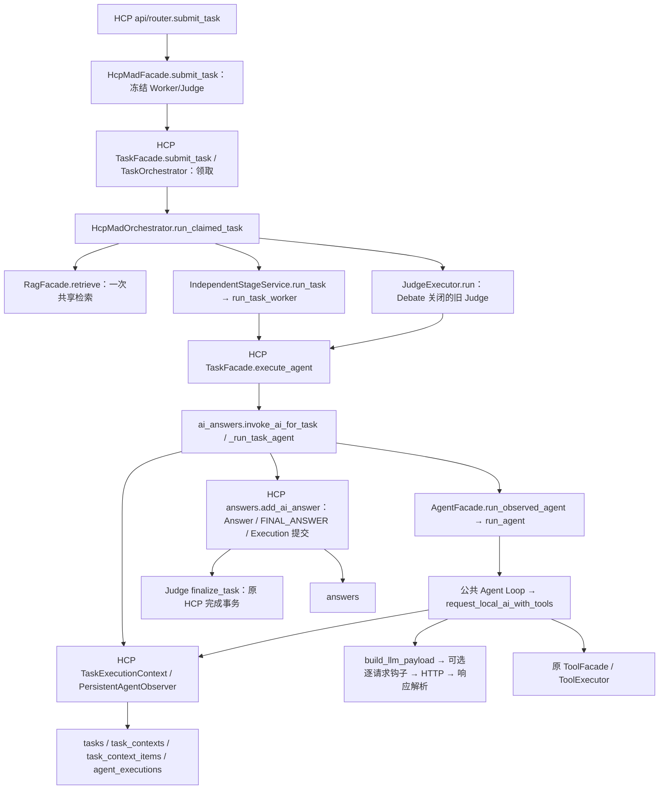

# HCP-MAD 调用故障与持久化边界修复记录

日期：2026-10-23。本文区分数据库实证、代码缺陷、已实施修复和未验证的外部原因；没有调用真实模型、工具、Embedding、Rerank 或 Milvus，也没有执行业务数据库写入、DDL 或数据清理。

## 1. 结论与证据边界

1. 失败任务是 `task-3860f2dd`。两个 Worker 已完成，Judge 在第 5 次 LLM 请求失败，没有提交 Judge 正式 Answer。历史响应没有保存 finish_reason、请求 ID 或原始结构，不能事后断言是输出预算耗尽或服务端临时空响应。
2. 确认存在 DeepSeek 工具续轮协议缺陷：原解析器丢弃 reasoning_content，Observer 又只重建公开字段。已改为只在当前 Loop 内存中保留，并仅恢复到同一 DeepSeek 执行的工具续轮请求；不作为答案，不写共享上下文、事件或数据库。
3. 原检索异常被上层统一压成 `RAG retrieval failed`，没有日志堆栈；历史 Embedding、Milvus、Rerank 的具体异常已无法恢复。本轮修复异常链与阶段诊断，保留现有明确降级规则，没有更换检索策略或关闭 RAG。
4. 数据库中那 13 条记录实际属于 `rag_tasks` 的旧版普通问答任务 `task-0ca737ad`（mode=normal），不是上述 HCP 任务。时间、Context、Execution 和父任务关联均已核对。没有证据支持“这次 HCP 串写 RAG Task 表”，因此没有杜撰错误导入或搬迁持久化。新增完整 HCP API → Provider → 入库的 SQL 边界测试。

## 2. 原始错误与逐字段解释

原始返回完整保留如下：

```json
{
  "hcp_mad": {
    "error": "RuntimeError: LLM response contains neither content nor tool calls",
    "stage": "failed",
    "debate": {
      "phase": "disabled",
      "enabled": false,
      "policy_version": "judge-trigger-v1",
      "schema_version": 1
    },
    "status": "failed",
    "use_rag": true,
    "judge_id": "ai-963456c4",
    "rag_error": "RAG retrieval failed",
    "started_at": "2026-10-22T14:51:39.726369+00:00",
    "worker_ids": ["ai-0c502a15", "ai-46f6102d"],
    "completed_at": "2026-10-22T14:55:25.779467+00:00",
    "failed_stage": "judging",
    "rag_hit_count": 0
  }
}
```

| 字段 | 实际含义与证据 |
| --- | --- |
| error | 原 `agent/llm_provider.py::_parse_tool_calling_response` 在 content 假值且没有有效 tool_calls 时抛出的 RuntimeError；当时未判断 finish_reason，也未保留诊断结构 |
| stage / status | HCP workflow 的失败终态；Task 本身也是 failed |
| failed_stage=judging | 旧 Judge 执行失败；不是 Worker、首次 Debate 分支评估或终局 Debate Judge |
| debate.phase / enabled | 本任务 Debate 关闭，没有进入阶段 4、5 的 turn/finalization 流程 |
| debate.policy_version / schema_version | 持久化协议版本，不表示已经启动辩论或模型版本 |
| use_rag=true | 本次要求尝试检索，不代表检索成功 |
| rag_error / rag_hit_count | 发生异常后沿现有规则无 RAG 继续；零命中本身不能区分成功零召回与检索失败，新增 rag_status 等字段解决此问题 |
| worker_ids / judge_id | 已冻结参与者；数据库记录与 Execution 的 ai_id 一致 |
| started_at / completed_at | UTC；间隔 226.053098 秒（约 3 分 46 秒）。对应本地 22:51:39–22:55:25，与那 13 条记录的本地 23:09:41–23:10:34 不同 |

只读数据库核查：Worker A/B 分别有 4/3 次 LLM 请求且 Execution completed；Judge 有 5 次请求、4 个 TOOL_CALL 上下文组、17 条 TOOL_RESULT 事件，Execution failed，没有 Judge FINAL_ANSWER。这些数量是现有事件记录数，不能把每条 TOOL_RESULT 都解释成一次独立外部工具执行。

## 3. 真实调用链与持久化归属



关键实现：

- `app/modules/hcp_mad/application/task/ai_answers.py` 创建 HCP 的 TaskExecutionContext，并把执行准备、提交和失败回调交给公共 Runner；没有导入 RAG Task 的 Store。
- `app/modules/hcp_mad/application/task/execution_context.py` 使用 HCP `infrastructure/execution_repository.py` 和 HCP ORM。
- `app/modules/agent/application/runner.py::run_observed_agent` 只调用上层显式提供的回调，不选择业务表；Agent Loop、Provider 没有默认 RAG Task Repository。
- `app/modules/hcp_mad/judge/executor.py::run` 使用同一 HCP TaskFacade，仍然由原正式答案提交逻辑完成 Task；未改 Answer 规则、聚合/评分入口或阶段 4、5 状态机。
- RAG Task 通过自己的 Facade、Observer、Repository 和 `rag_task_*` ORM 复用公共执行层。已有“同 ID 双工作流”测试验证上下文、答案、失败状态和实际 SQL 两向隔离。

### 13 条记录的实际归属

| 项目 | 只读查询结果 |
| --- | --- |
| 父任务 | rag_tasks.id = task-0ca737ad，mode=normal，status=failed，无 hcp_mad workflow metadata |
| Context | context-1db204fe64324ee59b16a97ae5a32a28，属于该 RAG Task |
| Execution | execution-cd4fba848d10404db6df799910add430，属于该 RAG Task，ai-0c502a15，5 次请求，failed |
| 内容类型数量 | USER_MESSAGE 1、TOOL_CALL 4、TOOL_RESULT 8，总计 13 |
| 时间 | 2026-10-22 23:09:41–23:10:34 |

当前仓库仍保留 `/rag-tasks/legacy/...` 普通问答兼容接口，其 mode=normal 的执行会写 RAG Task 独立表。这是现存架构，不等于 HCP 的父任务串表。仅凭 ai_id 相同不能确定工作流归属。

修复前后只读计数完全相同：HCP 五表分别为 tasks=18、answers=38、task_contexts=2、task_context_items=53、agent_executions=6；RAG Task 对应五表为 1、0、1、13、1。未清理任何记录，没有创建修复 SQL。

## 4. LLM 诊断、修复与限制

### 实际配置

| Agent | type | provider / model_name | 生成参数 |
| --- | --- | --- | --- |
| ai-0c502a15 / deepseek_fast | worker | deepseek / deepseek-flash | max_tokens=2048，temperature=0.2 |
| ai-46f6102d / deepseek_reasoning | worker | deepseek / deepseek-flash | max_tokens=6144，reasoning_effort=high |
| ai-963456c4 / deepseek_critic | judge | deepseek / deepseek-flash | max_tokens=6144，reasoning_effort=max |

三者 enabled/available 均为 1，均使用 bearer，URL 路径均为 `/v1/chat/completions`。模型名采用 model_name，而非展示名。未输出主机和凭证，未改数据库配置。

DeepSeek 当前官方说明：thinking 默认启用，携带 tools 的续轮需要回传对应 reasoning_content；这解释了现有“完全删除该字段”与 Provider 协议的不一致，但不能据此把历史空响应直接等同于官方描述的 HTTP 400。[Thinking Mode 官方说明](https://api-docs.deepseek.com/guides/thinking_mode/)

Judge 的高推理强度与输出上限可能导致输出耗尽；这是待验证假设。原响应未保存 length 信息，因此本轮没有擅自加大 token、降低推理强度或关闭 thinking。[Chat Completions API 参数与结束原因](https://api-docs.deepseek.com/api/create-chat-completion/)

### 已实施

- `LlmResponseError` / `LlmEmptyResponseError` 区分协议异常与真正空响应。诊断只记录 Provider、有效模型、字段名、finish_reason、工具数量、是否有推理和请求 ID；不记录响应正文或隐藏推理。
- 支持公开文本及 text parts；拒绝将任意 dict 或隐藏推理强制转成答案；拒答、过滤、截断、无效工具结构仍失败。HTTP、连接和 JSON 发送层异常不会变成“空响应”。
- 明确非流式请求；没有工具时不发送空 tools / auto tool_choice。
- 只在一次 Loop 的内存保存 DeepSeek 工具响应的 reasoning_content，按工具调用组恢复。Observer 重建和自定义 build_messages 仍只处理公开字段，事件与正式 Answer 不带隐藏字段。
- 最终 validate_request 检查的是恢复协议字段后的实际 messages，连同同一个 payload 的工具、有效模型和生成参数计入预算。构建和复核收到副本，不会改写最终发送内容。UTF-8 估算依然只是保守估算，不是精确 tokenizer。
- 仅对明确 stop、没有拒答、没有 reasoning_content 的空响应，最多重试 1 次，且仍受原 max_steps 限制。每次重试重新构建、复核、记录请求；已完成工具不会重复执行，正式答案仅在成功结束后提交。重试的 usage 计入同次执行。
- length、reasoning-only、未知 finish_reason、HTTP/网络错误不自动重试；持续空响应仍失败，不提交假答案。

历史 Judge 已经到第 5 次请求；本修复不会越过原 5 步上限。若类似任务持续需要更多工具轮次，这是另一个需要业务评估的上限策略，不在本次顺手放宽。

### 恢复边界

临时推理不落库，因此进程重启后无法恢复尚未完成的这段 Provider 私有状态；仍遵守现有未知 Execution 暂停、不自动接管语义。已持久化工具公开历史不能被当作含全部 DeepSeek 私有状态的可重放快照。本轮不增加跨进程自动续跑。

## 5. RAG 诊断与修复

真实默认链：

`RagFacade.retrieve → _resources / build_vector_store → build_rag_retriever → RerankedRetriever → HybridRetriever → EmbeddingService → OpenAICompatibleEmbeddingProvider → VectorStore.hybrid_search（Dense/BM25/RRF） → VllmReranker → 结果校验与映射 → format_context`。

只检查配置，未调用这些真实服务：Embedding=qwen3-embedding、dimension=1024、Rerank=qwen3-reranker、collection=heritage_chunks。服务基础 URL 路径为空，实际客户端会拼接 `/v1/embeddings`、`/v1/rerank`；仅凭此不能说配置错误。VectorStore 构建可能触发 ensure_collection，故没有通过真实初始化来做只读连通性探测。

原 HCP `application/orchestration.py` 与旧 `independent/stage_service.py` 的异常分支没有保留根异常日志。新增：

| 阶段 | 处理位置 |
| --- | --- |
| vector_store | RagFacade 资源建立 |
| retriever_configuration | RagFacade 内部策略装配 |
| embedding | HybridRetriever 查询向量生成 |
| hybrid_search | HybridRetriever 的向量/混合检索调用 |
| rerank | RerankedRetriever 的 Reranker 请求 |
| retrieval | 其余检索或结果校验；完整堆栈进一步定位 |
| context_format | HCP 对检索结果格式化 |

`RagRetrievalError` 用异常链保留原因；`retrieval_failure_details` 将脱敏堆栈写服务日志，业务 metadata 只增加安全 stage/type。不输出查询正文、鉴权头或密钥，不记录完整模型输出。

新增 workflow metadata：

- rag_status：disabled / retrieved / empty / failed。
- rag_error_stage / rag_error_type：仅失败时写入阶段和根异常类型。
- 原 rag_error / rag_hit_count 继续兼容；异常不会被标为 empty 或 retrieved。

现有规则明确允许“检索异常已记录后，无 RAG 回答”；本轮保留，继续写空证据失效项，禁止回退上次证据。失败会减少 Worker/Judge 输入证据，因此可能影响事实质量；没有证据表明它必然造成空响应。数据库另有 `task-63f6f375` 在同样检索失败情况下 Judge 正常完成，支持二者应分别排查。

## 6. 修改文件

以下只列相对本轮开始快照的修改，未覆盖其他历史未提交改动。

| 文件 | 原因 |
| --- | --- |
| app/modules/agent/tool_models.py | 私有响应字段仅内存保存，排除 repr |
| app/modules/agent/llm_provider.py | 请求兼容、响应结构校验、结束原因、类型化空响应和安全诊断 |
| app/modules/agent/tool_calling.py | 同执行 DeepSeek 工具续轮状态、最终预算和有限空响应重试 |
| app/modules/agent/execution_observer.py | 无工具 payload 的请求快照兼容 |
| app/modules/rag/application/retrieval_errors.py（新增） | 统一检索错误、根异常和脱敏堆栈 |
| app/modules/rag/application/facade.py | 公共异常契约与资源/装配/检索分阶段包装 |
| app/modules/rag/application/hybrid_retriever.py | 查询 Embedding 与混合检索分阶段异常链 |
| app/modules/rag/application/reranked_retriever.py | Rerank 请求异常链 |
| app/modules/hcp_mad/application/orchestration.py | 保留检索失败诊断、区分零召回与异常、保持原降级 |
| app/modules/hcp_mad/application/task/workflow.py | 原 metadata 事务中记录安全诊断字段 |
| app/modules/hcp_mad/application/task/facade.py | 转发可选安全诊断，不改状态转换 |
| app/modules/hcp_mad/independent/stage_service.py | 兼容入口补充检索异常堆栈 |
| tests/test_llm_response_failures.py（新增） | 真实 Provider/Loop 的响应协议、重试、usage、隐私与预算测试 |
| tests/hcp_mad/test_failure_diagnostics.py（新增） | 真实 API/Observer/Provider 与隔离数据库的异常、表隔离及检索链测试 |
| tests/test_llm_request_config.py | 明确 stream=false 后同步精确 payload 断言 |
| tests/rag/test_public_facade.py | 精确声明新增的两个公共错误契约，保留内部工厂和客户端边界断言 |
| docs/MODULE_PUBLIC_API.md | 新错误契约与私有协议状态边界 |
| docs/AGENT_EXECUTION.md | 澄清公开持久化字段和内存 Provider 协议字段的区别 |
| docs/HCP_FAILURE_DIAGNOSIS.md（新增） | 本诊断记录、实测与复验步骤 |

没有修改 ORM、SQL、数据库结构、正式 Answer 提交函数、Debate P/T/CAS/取消/未知执行暂停逻辑、RAG Task 众包业务或账号代码。

## 7. 验证记录

自动化测试只使用隔离 SQLite、离线工具和网络替身；保留真实 Facade、Agent Loop、Observer、Provider 解析和持久化，不以 Mock AgentFacade.run_agent 代替验证。

实际执行结果：

| 检查 | 结果 |
| --- | --- |
| 两份新增测试文件最终版本 | 48 项通过，6.47 秒 |
| 最终相关测试集（含旧 HCP、请求配置、Tool、RAG Facade） | 226 项通过，42.20 秒 |
| 完整 pytest | 1145 项通过，3 项失败，812.20 秒 |
| Ruff：app / tests / scripts / evaluation | 全部通过 |
| 相关 mypy | 104 个源文件通过 |
| 内存语法编译：app / tests / scripts / evaluation | 336 个 Python 文件通过，无字节码写入 |
| 与本轮开始快照比较 | 50 个受保护文件未变，包含 RAG Task、SQL、迁移及 HCP P/T/CAS/正式提交核心 |
| 真实 MySQL 只读复核 | 前后计数一致，13 条记录保留，归属仍为 task-0ca737ad |

完整 pytest 收集了当时 1148 项；此后只增补了空响应重试再次构建/复核、context_format 故障两项测试，未再修改业务代码。这两项包含在最终 48/226 项通过结果中，没有冒充在那次完整运行中执行过。

完整运行的 3 项失败与修改前的 `1099 passed, 3 failed` 基线相同：

1. `tests/rag_task/test_crowd_schema.py::test_new_sql_matches_all_four_orm_tables_and_existing_answer_alter`：现有 SQL 表选项与 ORM 编译 DDL 不一致。
2. `tests/rag_task/test_crowd_schema.py::test_published_stage_one_migration_is_unchanged`：已发布阶段 1 SQL 文件的现有 hash 与测试固定值不一致。
3. `tests/test_execution_architecture.py::test_incremental_sql_matches_all_new_orm_columns_indexes_constraints_and_defaults`：同类 SQL/ORM DDL 文本不一致。

本轮未修改这些 SQL、ORM 或断言；不能报告完整 pytest 全绿，也没有为了消除既有失败放宽迁移保护。

实际执行的主要命令（项目根目录 PowerShell）：

```powershell
# 最终相关测试：226 passed
.\.venv\Scripts\python.exe -B -u -m pytest -q -p no:cacheprovider --basetemp=.pytest_tmp/hcp-failures-20261023/targeted-final tests/test_llm_response_failures.py tests/hcp_mad/test_failure_diagnostics.py tests/test_llm_request_config.py tests/test_tool_contracts.py tests/rag/test_public_facade.py tests/hcp_mad/test_stage_pipeline.py

# 完整测试：1145 passed, 3 failed（见上述基线失败说明）
.\.venv\Scripts\python.exe -B -u -m pytest -q -p no:cacheprovider --basetemp=.pytest_tmp/hcp-failures-20261023/full

.\.venv\Scripts\python.exe -B -m ruff check app tests scripts evaluation
.\.venv\Scripts\python.exe -B -m mypy app/modules/agent app/modules/hcp_mad app/modules/rag/application/facade.py app/modules/rag/application/retrieval_errors.py app/modules/rag/application/hybrid_retriever.py app/modules/rag/application/reranked_retriever.py
```

语法检查使用 `compile(path.read_bytes(), str(path), 'exec')` 对上述四个目录全部 .py 在内存编译，未写 pyc；没有对生产库运行 pytest。测试覆盖真实 Provider payload、同执行私有工具续轮、Observer 不落隐藏字段、最终预算阻断网络、1 次重试/5 步上限、重试 usage、Provider 原异常、Judge 失败不建正式答案、HCP SQL 不触碰 RAG Task、Embedding/Hybrid/Rerank/资源/格式化异常及成功零召回。既有阶段 4、5 恢复与原子提交、双工作流隔离、众包流水线测试也在完整运行中通过。

## 8. 部署与数据库复验

没有必要的数据修复 SQL，也不要求修改 Agent 配置。正常重启应用即可加载代码；从项目根目录使用现有启动方式：

```powershell
.\.venv\Scripts\python.exe -m uvicorn app.main:app --host 127.0.0.1 --port 8000 --reload
```

真实服务行为需在隔离业务环境人工复验：提交一个新 `/hcp-mad/tasks` 请求，保存返回 task.id；关注服务日志中的 LLM response rejected 或 RAG retrieval failed（带阶段和脱敏堆栈），结合 Task metadata 判断具体失败，不依赖固定旧错误。原失败任务不自动重跑。

以下是只读核对示例；将占位 ID 替换为新测试任务 ID。应比较前后计数并按父任务核对，其他真实并发请求可能改变总计数，不能仅凭全表增量判断串表。

```sql
SELECT id, mode, status, metadata_json FROM tasks WHERE id = '<新 HCP task_id>';
SELECT id, task_id FROM task_contexts WHERE task_id = '<新 HCP task_id>';
SELECT ai_id, status, llm_request_count FROM agent_executions
WHERE task_id = '<新 HCP task_id>';
SELECT responder_id, execution_id FROM answers WHERE task_id = '<新 HCP task_id>';
SELECT i.item_type, i.ai_id, i.execution_id, COUNT(*) AS item_count
FROM task_context_items i JOIN task_contexts c ON c.id = i.context_id
WHERE c.task_id = '<新 HCP task_id>'
GROUP BY i.item_type, i.ai_id, i.execution_id;
SELECT id FROM rag_tasks WHERE id = '<新 HCP task_id>';
SELECT id FROM rag_task_agent_executions WHERE task_id = '<新 HCP task_id>';
SELECT i.id FROM rag_task_context_items i
JOIN rag_task_contexts c ON c.id = i.context_id
WHERE c.task_id = '<新 HCP task_id>';
SELECT c.task_id, COUNT(*) AS item_count
FROM rag_task_context_items i JOIN rag_task_contexts c ON c.id = i.context_id
WHERE c.task_id = 'task-0ca737ad' GROUP BY c.task_id;
```

预期新 HCP 记录只落 HCP 五表，RAG 同 ID 查询为空，原任务的 13 条保留。自动化 SQL 守卫另验证完整 HCP 工具链不查询或修改任何 rag_task 表；既有双工作流同 ID 测试继续验证反向隔离。

尚未验证：真实 Provider 当前是否仍空响应、历史 finish_reason、线上 Embedding/Milvus/Rerank 原始异常、生产部署下的 MySQL 并发。本轮只读查询验证真实历史归属与数据保留；隔离 SQLite 测试不等于真实 MySQL 并发或外部连通性验证。
