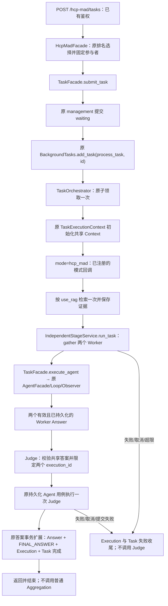

# HCP-MAD 第一阶段业务闭环

实现日期：2026-10-17。范围是用户提交 → 两个 Worker → 一次 Judge → 最终提交，成功或失败后结束。不实现 Debate、自动重试、备用模型、重新调度、评分分支或新的队列。

## 1. API 与运行条件

### 提交

`POST /hcp-mad/tasks`，沿用项目现有无 `/api` 前缀的 Router 约定，只注册一次。使用已有 Bearer 登录鉴权，用户 ID 取自 CurrentUser。

```json
{
  "question": "天坛主要用于什么？",
  "answer_format": "普通文本",
  "use_rag": true,
  "metadata": {"client": "example"}
}
```

- question 必填且不能全为空白；answer_format 默认“普通文本”，同样不能空白。
- use_rag 默认 true；false 时不检索，并失效可能残留的旧证据。
- 请求 DTO 继承现有 TaskCreateWithDocumentPayload。兼容字段 ai_ids 只能为空列表，worker_count 固定为 0；这里是人工名额，不是 AI Worker 数量。两个 AI Worker 与 Judge 由服务端选择，不能由请求伪造。
- 禁止额外请求字段，包括 user_id。用户 metadata 中的 hcp_mad 保留区由服务端重建，不能覆盖参与者或阶段。
- 需要两个已启用 type=worker 的 AI 和一个已启用 type=judge 的 AI。按已有信誉降序排名选择，并在提交时固定 ID；后台再次检查启用状态/类型，不在失败后换人。健康 available 标志不额外作为硬门槛，保持现有启用配置语义。

响应沿用 TaskCreateResponse，HTTP 200 表示已创建并登记后台执行，不表示模型已完成：

```json
{
  "task": {
    "id": "task-xxxxxxxx",
    "user_id": "当前登录账号",
    "question": "天坛主要用于什么？",
    "answer_format": "普通文本",
    "ai_ids": ["worker-a", "worker-b", "judge"],
    "required_worker_count": 0,
    "accepted_worker_ids": [],
    "status": "waiting",
    "answers": [],
    "final_result": null,
    "mode": "hcp_mad",
    "metadata": {"hcp_mad": {"stage": "queued", "status": "waiting"}}
  }
}
```

示例 metadata 为节选，实际还包含 worker_ids、judge_id、use_rag 及用户自定义数据。参数非法返回 422，未登录由原鉴权组件拒绝。角色数量不足或注册配置含旧/无效类型时返回 503，此时不创建 Task。

### 查询

使用同一账号轮询原 `GET /users/tasks/{task_id}`，返回原 `{"task": ...}`。成功后 status=completed，final_result 是 Judge 的正式回答；失败后 status=failed，metadata.hcp_mad 提供阶段摘要。其他账号查询仍返回 403。

## 2. 实际调用链



`main.py` 经 TaskFacade.register_workflow 注册 HCP 回调，Task 模块不反向 import HCP-MAD。TaskOrchestrator 的 HCP 分支领取后分派并直接返回；不会继续进入普通 AI gather、答案统计、聚合或评分。不存在第二个领取器或独立消费者。

HCP 的 run_claimed_task 只处理已经领取的任务。不要在业务层先 claim 再 process_task，也不要手动重复调用 HCP 回调。实际重复/并发投递由原 waiting 条件更新拒绝，已完成任务不会再次执行模型。

## 3. 复用的公共能力

| 模块 | 本阶段调用 | 真实职责 |
| --- | --- | --- |
| Account | get_current_user | 原 JWT、会话及账号身份校验 |
| AgentFacade | ranked_agents、get_agent、format_execution_error；底层 run_agent | 原角色配置、排名、脱敏及 Tool Calling Loop |
| TaskFacade | submit_task、register_workflow、record_workflow_progress、prepare_context、invalidate_rag_context、execute_agent、get_context、fail_task | 原提交、后台登记、执行生命周期与共享上下文 |
| RagFacade | retrieve、format_context | 默认线上检索策略、格式化一次得到的证据 |
| ToolFacade | 原 Task 执行内的 configured / from_catalog / execute | 原目录、Schema 校验、配置开关与执行器，不新建 Registry |
| Task ContextBuilder / Observer | 每轮 build_messages / on_event | 可见性、工具消息配对、阶段与请求尝试次数 |
| 原 Answer 服务 | add_ai_answer | 最终答案、Context 和 Execution 的既有事务与幂等 |

HCP 内没有 SQL、ORM Session、Milvus client、LLM HTTP 请求或第二套工具循环。旧 IndependentExecutor.run_worker 与 IndependentStageService.run 作为无 Task 调用兼容入口保留；正式业务使用 run_task/run_task_worker，经 TaskFacade 完整持久化。

## 4. Worker 与 Judge 的输入

固定角色指令集中在 hcp_mad/prompts.py。动态问题、回答格式、共享 RAG 和本执行工具历史由原 Task ContextBuilder 组装。

- Worker 默认 thinking 选择规则：共享问题、最新有效证据、自己的完整工具协议；不会看到另一个 Worker 的私有过程或最终回答。
- 两个 Worker 各有独立 Execution。阶段使用 gather 并发，普通业务失败相互隔离；但 HCP 必须两个都成功才继续。
- Judge 的 judge/context.py 校验结果和实际共享 Context：两个不同 Worker、有效答案、answer_id/execution_id 必须和已保存 FINAL_ANSWER 一致。缺少任一个真实共享答案时不发起 Judge 模型请求。
- Judge 使用 ContextSelectionPolicy.shared_reference_execution_ids 限定本次两个 Worker，shared_reference_types 只允许 FINAL_ANSWER。旧执行的共享答案、REVIEW、其他 Worker 私有工具或消息都不被引用。
- context_stage=aggregation 是已有 Builder 的“共享引用”选择标签，不是调用普通聚合服务。Judge 自己的工具历史仍按原协议重建，Execution 阶段仍使用 thinking/tool_calling/tool_executing/finalizing。
- Worker 和 Judge 复用同一份已存证据，不重复检索。检索失败沿用无 RAG 降级：记录 rag_error 并追加空证据失效项，不能重放旧资料。关闭检索或空命中同样清空旧证据，但不会错误标记 retrieval_failed=true。

只处理公开 message content、工具调用和工具返回，不增加隐藏推理持久化。

## 5. 持久化与终态

### 每个 AI 的执行

TaskFacade.execute_agent → 原 ai_answers.invoke_ai_for_task：原 prepare / create_execution / start → PersistentAgentObserver → AgentFacade.run_agent。每次请求前记录尝试次数；工具调用和返回保存 private ContextItem，保持所属 Task、AI、Execution、Context、序号和配对关系。

Worker 成功仍由原 add_ai_answer 同事务保存 Answer、shared FINAL_ANSWER、Execution completed。失败/取消/超限时保留原异常语义，记录 failed、结束时间与脱敏摘要，不生成失败者的正式 Answer。允许保留另一位成功 Worker 的真实答案用于审计。

### Judge 的最终提交

Judge 调用同一 TaskFacade.execute_agent，显式 finalize_task=true；普通任务不能使用该选项。提交服务持有原 Task → Execution → Context 锁顺序，核对配置 Judge、两个 Worker 正式答案及其 completed Execution，然后在同一次 commit 保存：

1. Judge 的正式 Answer。
2. 对应 shared FINAL_ANSWER。
3. Judge Execution 的 finalizing/completed、完成时间与请求统计。
4. Task.final_result=Judge Answer.content，Task.status=completed。
5. metadata.hcp_mad 的 completed_at、final_answer_id、judge_execution_id 和完成阶段。

任一写入或 commit 失败都回滚；已有 Worker 结果保留，Judge Execution 补记 failed，Task 结束为 failed，不留下“Task 已完成但 Judge 答案不存在”的状态。相同 Execution 重复提交返回原答案，不覆盖内容、不重复追加 FINAL_ANSWER。

现有 TaskTable **没有 completed_at 列**。完成时间使用现有 metadata.hcp_mad.completed_at（UTC ISO 字符串），Judge Execution 同时使用原 completed_at 字段，没有新建数据库字段。TaskMode.HCP_MAD 使用现有 ORM String(16) mode 列，长度兼容，没有 DDL 或 SQL 文件修改。

普通 aggregate_task_answers、score_task_answers、finish_task 会拒绝 HCP 任务，防止 API 手动 finish 或后台再次覆盖 Judge。Judge 成功之后不自动评分、重试、辩论或继续其他策略。

### 失败状态

- Worker 失败：等待 gather 收齐本轮结果并完成各自收尾；Task failed，failed_stage=workers，不调用 Judge。
- Judge 失败或其提交回滚：Judge Execution failed；Task failed，failed_stage=judging；final_result 保持 null，只保留真实 Worker 答案。
- 取消：执行和 Task 收尾后继续传播 CancelledError；不转换成成功，不运行备用路径。
- 排队登记失败：已创建任务被记录为 failed/queued 失败，不补偿执行、不重新登记。
- 角色配置在排队后失效：后台校验失败并结束 Task，不从其他 Agent 中重选。
- DB 本身不可用时不能保证失败状态落库；记录日志且不掩盖原始业务异常/取消，不声称拥有数据库故障补偿能力。

## 6. 文件修改清单

以本轮开始时文件哈希为基线：新增 **13** 个、修改 **21** 个、删除 **0** 个。用户原有暂存/未提交变更均保留。

| 类型 | 文件 | 职责/修改原因 |
| --- | --- | --- |
| 新增 | `tests/hcp_mad/test_stage_pipeline.py` | 隔离数据库下新 API、并发、错误、取消、工具、回滚和幂等验收 |
| 新增 | `docs/HCP_MAD_STAGE_ONE.md` | 当前实际调用链、验证与限制报告 |
| 新增 | `app/modules/task/application/workflow.py` | 利用现有 Task metadata 短事务保存进度和失败终态 |
| 新增 | `app/modules/hcp_mad/prompts.py` | 集中 Worker/Judge 固定指令 |
| 新增 | `app/modules/hcp_mad/judge/__init__.py` | Judge 组件包 |
| 新增 | `app/modules/hcp_mad/judge/executor.py` | 通过 TaskFacade 执行一次 Judge 并最终提交 |
| 新增 | `app/modules/hcp_mad/judge/context.py` | 校验真实共享 Worker 结果并限定引用范围 |
| 新增 | `app/modules/hcp_mad/application/__init__.py` | HCP 应用层包 |
| 新增 | `app/modules/hcp_mad/application/schemas.py` | 复用任务请求 DTO，限制客户端不能指定角色/身份 |
| 新增 | `app/modules/hcp_mad/application/orchestration.py` | 共享证据、两个 Worker、一次 Judge 和失败收尾 |
| 新增 | `app/modules/hcp_mad/application/facade.py` | 固定参与者、复用 Task 提交入队并委托已领取任务编排 |
| 新增 | `app/modules/hcp_mad/api/__init__.py` | HCP API 包 |
| 新增 | `app/modules/hcp_mad/api/router.py` | 鉴权提交请求并返回既有 TaskCreateResponse |
| 修改 | `tests/test_module_public_api.py` | 精确增加已实现的第七业务模块，保留深层依赖和无环约束 |
| 修改 | `tests/task/test_task_public_facade.py` | 公共清单增加真实新方法/类型，仍精确限制不暴露仓储 |
| 修改 | `README.md` | 增加鉴权提交、查询用法和角色配置说明 |
| 修改 | `docs/MODULE_PUBLIC_API.md` | 更新公共入口、HCP 模块和模式分派规则 |
| 修改 | `docs/AGENT_EXECUTION.md` | 从历史基础设施说明链接当前 HCP 完成事务 |
| 修改 | `app/modules/task/domain/models.py` | TaskMode 增加 hcp_mad；不改变 ORM 列定义 |
| 修改 | `app/modules/task/application/orchestration.py` | 原领取后按模式回调分派，HCP 不进入普通聚合；取消记录终态 |
| 修改 | `app/modules/task/application/facade.py` | 公开模式注册/阶段/失败/RAG失效与 Judge 执行选项及必要稳定 DTO |
| 修改 | `app/modules/task/application/execution_context.py` | Observer 支持现有引用阶段，RAG 失效区分失败与关闭 |
| 修改 | `app/modules/task/application/ai_answers.py` | 转发上下文选择阶段与 Judge 完成选项，校验 HCP 执行阶段 |
| 修改 | `app/modules/task/application/aggregation.py` | 拒绝对 HCP 任务运行普通聚合/评分 |
| 修改 | `app/modules/task/application/answers.py` | 在原最终提交事务内原子完成 HCP Task，保留幂等 |
| 修改 | `app/main.py` | 注册新 Router 与 Task 模式回调，保持模块依赖方向 |
| 修改 | `app/modules/task/application/context/policies.py` | 新增共享引用 execution_id 限定，只缩小信息范围 |
| 修改 | `app/modules/task/application/context/builder.py` | 现有共享引用选择按上述 ID 策略过滤 |
| 修改 | `app/modules/hcp_mad/orchestrator.py` | 原根入口显式兼容导出 Application 编排器 |
| 修改 | `app/modules/hcp_mad/independent/stage_service.py` | 修复异步选择器调用，新增两个正式 Worker 的持久化并发入口 |
| 修改 | `app/modules/hcp_mad/independent/selector.py` | 使用当前 type 枚举和原排名选择 Worker/Judge，配置异常受控报告 |
| 修改 | `app/modules/hcp_mad/independent/schemas.py` | Worker 结果增加 execution_id/answer_id；保留旧预留模型 |
| 修改 | `app/modules/hcp_mad/independent/executor.py` | 复用 Task 执行持久化；旧无 Task 执行保持兼容 |
| 修改 | `app/modules/hcp_mad/independent/context.py` | 说明旧兼容输入职责并清理未使用导入 |

SQL、migrations、数据库会话/初始化、Agent Provider/Loop、RAG 检索/Embedding/Rerank/Milvus、Tool Registry/Validator/Executor 和 ExecutionRepository 均没有被本轮修改。没有删除或跳过旧测试。

## 7. 测试与静态检查

- 修改前完整基线：418 passed。
- HCP 相关用例：当前 35 项全部随完整回归通过（包含原有无 Task Executor 测试），新增 34 个展开用例；此前专项验收命令为 34 passed，之后补齐旧调试接口的隔离验证。
- 最终完整回归：452 passed，0 failed，28.39 秒；新增最后一项接口隔离测试前，两轮完整回归均为 451 passed。
- Python 内存语法检查：app/evaluation/tests 共 219 个文件，通过；禁用 pyc 写入。
- Ruff：全 app、新 HCP 测试及两份必要公共契约测试通过。
- Mypy：30 个本轮核心源文件通过。
- 保留全部旧业务断言；架构测试仅增加已实现的第七业务模块，公共契约清单只增加实际新增方法/类型，没有放宽跨模块内部实现访问。

```powershell
.\.venv\Scripts\python.exe -B -m pytest -q -p no:cacheprovider --basetemp tmp/pytest-hcp-stage-baseline-20261017
.\.venv\Scripts\python.exe -B -m pytest tests/hcp_mad -q -x -p no:cacheprovider --basetemp tmp/pytest-hcp-stage-acceptance-20261017
.\.venv\Scripts\python.exe -B -m pytest -q -p no:cacheprovider --basetemp tmp/pytest-hcp-stage-full-20261017
.\.venv\Scripts\python.exe -B -m pytest -q -p no:cacheprovider --basetemp tmp/pytest-hcp-stage-verified-20261017
.\.venv\Scripts\python.exe -B -m pytest -q -p no:cacheprovider --basetemp tmp/pytest-hcp-stage-final-20261017
.\.venv\Scripts\python.exe -B -m ruff check app tests/hcp_mad tests/task/test_task_public_facade.py tests/test_module_public_api.py
.\.venv\Scripts\python.exe -B -m mypy --ignore-missing-imports --follow-imports=silent app/modules/hcp_mad app/modules/task/application/workflow.py app/modules/task/application/facade.py app/modules/task/application/answers.py app/modules/task/application/orchestration.py app/modules/task/application/ai_answers.py app/modules/task/application/execution_context.py app/modules/task/application/context app/modules/task/application/aggregation.py
```

覆盖真实 API 与现有查询、鉴权、创建后登记、Worker 同时进入模型、Worker/Judge 工具多轮、一次 RAG/关闭/降级、失败/空答案/参数非法/超限/取消、并发重复投递、最终提交整笔回滚、结果幂等、旧共享结果排除及普通 finish 拒绝。模型和工具用模拟实现，持久化使用临时 SQLite，并对真实引擎 connect 加拦截。

旧手动 invoke 接口也不能在 HCP workers 阶段另起 Worker：HCP 执行必须由角色工作流提供固定指令，旧调试接口无法传入该参数，返回 409；手动提交无 Execution 的答案同样被拒绝。此限制只作用于新 HCP 模式，普通 Task 行为保留。

测试开发中先修复了夹具缺少 chunk_index、工具 arguments 必须是 JSON 字符串等协议错误，没有为通过测试修改这些原协议。另一次初始排名夹具漏注入触发了配置库的只读查询；随后补齐 SessionLocal 注入并增加真实连接拦截，后续专项与完整验证隔离运行。**没有执行真实数据库 DDL 或业务数据写入。**

## 8. 部署前需确认的实际限制

1. 上述只读查询发现配置库存在旧 aggregator 值，与当前 worker/judge 代码契约不符。程序不自动迁移或写回；请由管理员确认连接目标并清理旧类型。现在会用受控 503 报告无效角色配置，而不是静默选用旧角色或假装任务已入队。
2. 运行需要至少两个已启用 worker 和一个已启用 judge，及有效的模型调用配置；RAG 服务可按 use_rag 使用或按既有规则降级。本轮未进行真实模型/Milvus/生产数据库端到端联调。
3. 依当前 ORM 的 mode String(16) 与 metadata JSON 接入；本轮未修改/迁移真实 Schema，也未重新核对所有线上列。没有 Task.completed_at 新列，完成信息位置如上。
4. 沿用进程内 BackgroundTasks，没有持久化投递、进程崩溃恢复、自动重试或重新调度。数据库提交和后台登记不是一个跨系统原子事务；可捕获的登记错误会标记失败，进程直接崩溃仍是已有基础设施限制。
5. 旧 JudgeResult 的 consistent/debate_context 数据模型作为用户原有预留代码保留，但本阶段不使用它，也没有 Judge 成功后的任何分支。
