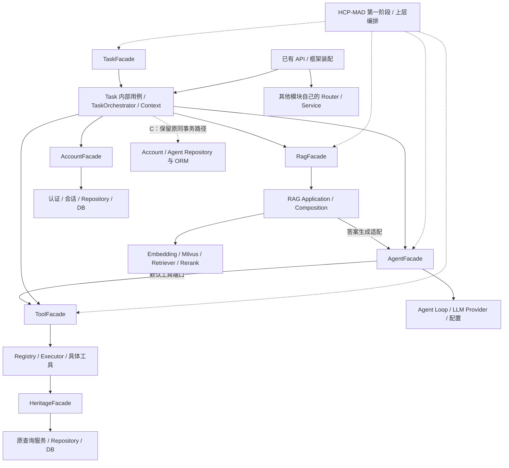

> 2026-10-23 当前众包列表、安全DTO、旧接口清理及验证见 [交付报告](RAG_CROWD_DELIVERY.md)。

# Module Public API

> Agent 选择归属：HCP-MAD 提交不要求 agent_id，Worker/Judge/论辩参与者由现有内部规则管理；继承的 ai_ids/worker_count 不在公开 Schema 展示。RAG Task 的聚合配置只在本模块聚合阶段校验，配置失败落库，不阻断 HCP 启动，也不调用 HCP 的 Judge 或 Debate。

> 2026-10-23 自动聚合恢复补充：按用户确认，未绑定聚合 AI 的 Job 由 RAG Task 复用 `AgentFacade.ranked_agents()` 选择已启用、可用（或尚未健康检查）且有 API 地址的 Judge；可用 `RAG_TASK_AGGREGATOR_AI_ID` 显式覆盖，已冻结的有效绑定不随排名变更。只复用 Agent 配置查询和公共 Runner，不调用 HCP Judge 业务。未领取的空绑定 pending Job 在消费时原子绑定真实 Execution；发布者也可通过现有 retry 入口安全补绑定。详见 [自动聚合故障与恢复](RAG_TASK_AUTO_AGGREGATION_FIX.md)。

> RAG Task 第二阶段：新增 `rag_task.application.facade.CrowdTaskFacade` / `crowd_task_facade`，提供 publish、list_tasks、accept、submit、snapshot、retry 和消费者装配；RagFacade 新增 prepare_text_ingestion / index_prepared_text。众包资源为 `/rag-tasks`，旧 `/rag-tasks/legacy` HTTP 路径已删除；历史通用查询/调用只归属 HCP，不再按 ID 跨模块回退。部署与事务契约见 [众包知识生产实施记录](RAG_TASK_CROWD_WORKFLOW.md)。

> 2026-10-22：现有 7 个业务模块为 Account、Agent、Heritage、RAG、RAG Task、Tool、HCP-MAD。下文历史 `task.application.facade` 指 HCP 内部 `hcp_mad.application.task.facade`；普通任务入口为 `rag_task.application.facade`，不再混用表或公开 Debate 接口。完整迁移表与公共 Runner 契约见 [执行层与任务隔离记录](AGENT_EXECUTION_SPLIT.md)。

## 当前执行入口与数据边界

| 需求 | 当前入口 | 数据所有权 |
| --- | --- | --- |
| 按 Agent ID 运行原 Loop 并返回 usage | `agent_facade.run_registered_agent` / `AgentRunner` Protocol | 仅 Agent 配置；无任务持久化 |
| 业务提供 Observer / 生命周期回调 | `agent_facade.run_observed_agent` | 业务决定提交；公共层无业务 ORM |
| 普通 / RAG 任务、回答、聚合评分 | `rag_task.application.facade.task_facade` | 独立五张 rag_task 表；不公开 Debate 用例 |
| HCP 提交与编排 | `hcp_mad.application.facade.hcp_mad_facade` | 原 tasks / answers / Context / Execution |
| HCP 内部执行、P/T、Debate 调度 | `hcp_mad.application.task.facade.task_facade` | 仅 HCP；聚合兼容方法直接拒绝 |
| 众包知识生产 | `rag_task.application.facade.crowd_task_facade` | 独立九张 RAG Task 表；不调用普通聚合评分或 HCP |
| 历史通用查询 / invoke 路径 | `app/api/task_routes.py` | 只归属 HCP；系统问答使用 /hcp-mad/tasks |

后文保留阶段 1～5 的历史接口说明；旧 `app.modules.task` Python 包已移除，不能按旧路径导入。

## 迁移前接口记录（按上表的新路径阅读）

这里的 API 指模块之间的 Python Application API，不是新增 HTTP 接口。本次梳理基于实际 import、服务调用、事务和现有测试，不改变数据库、SQL、RAG 算法、工具循环、执行状态机或答案提交规则。

迁移前有 **7 个已实现的业务模块**：Account、Agent、Heritage、RAG、Task、Tool、HCP-MAD。Debate 默认关闭时保留两 Worker 与旧 Judge 的原流程；服务端启用后支持首次 Judge 分支、串行 Debate、Worker 直接终局及上限终局 Judge（阶段 1～5）。详见 [Debate 执行契约](DEBATE_TURNS.md)与[实际实施记录](DEBATE_ORCHESTRATION_DESIGN.md)。此前基础设施整理记录见 [公共执行基础设施报告](PUBLIC_EXECUTION_INFRASTRUCTURE.md)。

## 入口索引

| 需求 | 优先入口 | 返回/完成的业务动作 |
| --- | --- | --- |
| 获取任务、问题、参与 AI、正式答案 | `task.application.facade.task_facade` | Task / Answer 领域对象 |
| 提交 HCP-MAD 第一阶段任务 | `hcp_mad.application.facade.hcp_mad_facade.submit_task` | 固定两个 Worker 和一个 Judge，创建并登记既有后台执行 |
| 执行业务 AI，并保存 Execution、Context、Answer | `TaskFacade.execute_agent` | 沿用完整持久化执行用例 |
| 执行一次 HCP-MAD 中间发言 | `TaskFacade.execute_agent_message` | 原子领取业务键，发布共享 AGENT_MESSAGE 并完成 Execution；不提交 Answer 或完成 Task |
| 执行已预约的 Debate turn | `TaskFacade.execute_debate_turn` | 校验公开控制输出；continue 仅共享发言，finish 由当前 Worker 原子提交正式终局；不启动/推进工作流 |
| 后台执行全部已分配 AI | `TaskFacade.process_task` | 沿用 TaskOrchestrator |
| 创建后登记既有后台执行 | `TaskFacade.submit_task(payload, scheduler)` | 提交 waiting 任务，再向宿主登记调用 |
| 调度已有任务 / 自管编排领取 | `TaskFacade.enqueue_task` / `claim_task` | 原后台入口 / 原子领取；不是新消息队列 |
| 读取共享 Context、执行结果、组装模型消息 | `TaskFacade` 的 Context/Execution 方法 | 不含 ORM / Session 的快照或消息列表 |
| 聚合、评分、最终完成、人工审核 | `TaskFacade` | 沿用原任务用例及事务 |
| 普通文本生成、无 Task 的工具循环、usage | `agent.application.facade.agent_facade` | 文本或现有 LLM 结果对象 |
| 公共知识检索、证据回答、任务 RAG 上下文、入库和附件 | `rag.application.facade.rag_facade` | 现有 RAG 领域结果 |
| 获得本次可用工具并执行 | `tool.application.facade.ToolFacade` | 工具描述及执行结果 |
| 查询工具 Schema、单独校验参数 | `ToolFacade.get_definition` / `validate_arguments` | 原工具定义 / 原 JSON Schema 校验 |
| 遗产正式名称详情查询 | `heritage.application.facade.heritage_facade` | HeritageSite 或 None |
| 注册、登录、登出、公开账号、排行榜 | `account.application.facade.account_facade` | 既有账号业务结果 |

所有 Facade 均有中文模块级说明和显式 `__all__`，没有通配符导出，也不通过函数内 import 隐藏依赖。Facade 方法动态委托现有服务，保留原错误、输入输出和测试注入点。

## app/modules/agent

### application/facade.py

- 模块职责：维护已注册 AI 配置，执行模型文本请求和多轮 Tool Calling。
- AI 类型：`worker`（任务回答）和 `judge`（聚合与评分），注册默认 `worker`；这里的 AI 角色与人工回答来源 `AnswerSource.WORKER` 是不同概念。
- 读取已有配置时，通过公开的 `stored_ai_type` 将历史 `business/aggregator` 分别转换为 `worker/judge`，不回写数据库；新注册仍仅接受规范角色。未知存储角色抛出公开的 `AiAgentConfigurationError`，不将 provider 或任意模型类型猜测为业务角色。
- 对外入口：`AgentFacade` / `agent_facade`。
- Facade 职责：统一配置读取、生成、工具循环、usage、原有失败脱敏及排名读取；隔离 Provider、Loop 和 Repository。
- 典型调用方：Task AI 执行与聚合、RAG 的答案生成适配器、回答评估；未来无 Task 持久化需求的上层编排。
- 内部依赖：`repository`、`mapper`、`llm_provider`、`tool_calling`、`request_config`，工具通过 ToolFacade 的目录/执行协议接入。

| 公开方法 | 解决的问题与返回 |
| --- | --- |
| `get_agent(ai_id)` | 读取已注册 Agent 配置；不存在时保留原 404 |
| `await generate_text(ai, user_prompt, system_prompt, timeout=None)` | 调用已有普通模型请求，返回 str |
| `await generate_text_with_usage(...)` | 同一生成入口，返回 LlmTextResponse，保留 usage 缺失语义 |
| `await run_agent(ai, *, messages, tool_registry=None, tool_executor=None, max_steps=5, observer=None)` | 运行原工具循环，返回最终 str；缺省时装配配置允许的工具 |
| `await run_agent_with_usage(...)` | 运行相同循环，返回原 ToolCallingAgentResult |
| `format_execution_error(ai, exc)` | 沿用原任务错误摘要和凭证脱敏，不负责保存失败状态 |
| `ranked_agents(*, session_factory=None)` | 在短会话内返回已有评分降序的 Agent 领域对象 |

外部不得直接调用 `llm_provider`、`tool_calling`、`request_config`、Agent Repository/Mapper 或选择 `AiAgentTable`。少量事务兼容例外见文档最后。

AgentFacade **不创建 Task、AgentExecution 或 Context**。需要正式业务执行记录时调用 TaskFacade.execute_agent，不能仅运行普通 Loop 后宣称完成了持久化。

额外公开 `AgentRequestInput` / `AgentRequestBuilder`：前者是 Provider 已解析输入的独立快照，后者提供逐请求 build_messages / validate_request。经可选 Observer.request_builder 安装后，首次和工具后续请求均在发送前构建及复核；运行方法本身无需新参数，默认 Observer 仍走原逻辑。HCP-MAD 适配通过 Task 的构建工厂注入，不由 Agent 反向访问 Task 或 HCP-MAD。

## app/modules/rag

### application/facade.py

- 模块职责：处理公共与临时文档、检索知识片段、组织参考上下文和基于证据回答。
- 对外入口：`RagFacade` / `rag_facade`。
- 错误契约：同一公开模块导出 `RagRetrievalError(stage, cause)` 与 `retrieval_failure_details(exc, task_id=...)`。前者通过异常链保留检索根因，后者记录脱敏堆栈并返回安全阶段/异常类型；业务层不导入具体 Retriever 或 HTTP 客户端来做诊断。
- Facade 职责：暴露业务动作，调用内部 composition 和服务，管理本次调用的 HTTP / 向量库资源。
- 典型调用方：TaskOrchestrator、任务附件上传路由、未来上层知识问答编排。
- 内部依赖：现有 `composition`、`task_context`、检索/问答/索引服务及临时文件存储。答案生成适配器通过 AgentFacade 调用 AI。

| 公开方法 | 解决的问题与返回 |
| --- | --- |
| `await retrieve(*, query, top_k=5, document_id=None)` | 运行默认线上策略，返回现有 VectorSearchHit 列表 |
| `await answer(*, query, ai_id, top_k=5, document_id=None)` | 检索后由指定 AI 回答，返回 RagAnswerResult |
| `await retrieve_context(task_id, question)` | 复用原任务适配器处理公共知识与附件，返回证据文本或 None |
| `await index_document(file_path)` | 复用预处理、Embedding、Milvus 入库，返回 document_id |
| `await save_task_document(*, task_id, file)` | 复用原上传校验和文件保存，返回 Path |
| `delete_task_documents(task_id)` | 复用原任务附件清理 |
| `format_context(hits)` | 把已经检索的 VectorSearchHit 格式化为证据文本，不调用检索 |
| `format_task_context(result)` | 格式化 CombinedRetrievalResult，保留公共/上传资料分区 |

检索、问答和公共入库在 Facade 内部创建并释放资源；`retrieve_context` 直接委托原任务资源适配器，不重复装配。默认 Hybrid / RRF / Rerank、临时余弦检索、TopK 和处理规则均保持原样。

外部不得依赖 Milvus client、具体 Dense/BM25/Hybrid Retriever、Reranker、Embedding Provider 或预处理实现。Facade 不提供用于实验的策略/trace/metadata 开关；受控评估例外见最后。

RAG 自己的 API 仍可使用本模块 Depends、Application Service 和 composition。这是模块内部协作，不必为形式改动原 HTTP 依赖图。

2026-10-23 故障修复补充：Agent 的公开消息、Observer 事件与持久化仍不包含隐藏推理；DeepSeek 工具续轮所需的 reasoning_content 仅留在当前 Loop 内存，发送前恢复到同一执行的 Provider 消息，并纳入最终 validate_request 预算。build_messages 继续只接收公开字段；不增加跨进程私有状态恢复。HCP 检索结果增加 retrieved/empty/failed/disabled 诊断，保留原失败降级、状态机和正式提交规则。详见 [故障修复记录](HCP_FAILURE_DIAGNOSIS.md)。

## app/modules/task

### application/facade.py

- 模块职责：管理任务、参与者、正式答案、业务 AI 的 Execution、共享 Context、聚合、评分和审核。
- 对外入口：`TaskFacade` / `task_facade`。
- Facade 职责：暴露完整用例、安全数据快照及只读 ContextBuilder / ContextHistoryGroup，不公开 SQL Session、ORM 或 ExecutionRepository。
- 典型调用方：未来 HCP-MAD 和其他上层业务编排；同模块 Router / TaskOrchestrator 仍可直接复用自己的服务。
- 内部依赖：`management`、`answers`、`ai_answers`、`aggregation`、`review`、`orchestration`、`queries`、现有 TaskExecutionContext / ContextBuilder。

| 公开方法 | 解决的问题与返回 |
| --- | --- |
| `create_task(payload, *, task_id=None, mode=NORMAL)` | 沿用参与者校验和任务创建，返回 Task |
| `submit_task(payload, scheduler, *, task_id=None, mode=NORMAL)` | 创建提交后登记原后台执行，返回 Task；调度登记失败不回滚已提交任务 |
| `enqueue_task(task_id, scheduler)` | 对已有任务登记 process_task 回调，不在登记时修改状态 |
| `claim_task(task_id)` | 沿用原子条件更新领取 waiting 任务，返回 Task 或 None；供自管编排 |
| `accept_task(task_id, worker_id)` | 沿用人工接单限制，返回 Task |
| `get_task(task_id)` | 获取问题、模式、参与者、状态及正式答案 |
| `await execute_agent(task_id, ai_id, rag_context=None, *, system_prompt=None, context_policy=None, context_stage='thinking', finalize_task=False, request_builder_factory=None)` | 自动创建 Execution、运行原 Loop、记录事件和原子提交 Answer；可在真实执行建立后注入逐请求构建器，未配置时保持默认行为；HCP Judge 可用 finalize_task 完成 Task |
| `await execute_agent_message(task_id, ai_id, *, round_no, stage, message_kind, system_prompt, context_policy=None, request_builder_factory=None, retry_failed=False)` | 独立中间发言用例，复用原 Loop/Observer；业务键含任务/轮次/AI/阶段，失败显式重试最多三次；详见 [中间发言契约](AGENT_MESSAGES.md) |
| `await execute_debate_turn(task_id, ai_id, *, binding, result_contract, request_builder_factory, system_prompt, retry_failed=False)` | 必须匹配服务端 Debate 预约；有效结果先私有准备，Worker 可直接原子终局；prepared 失败重放仅恢复数据库提交；详见 [Debate 单次执行](DEBATE_TURNS.md) |
| `prepare_agent_finalization(task_id)` | 仅核对原 limit_reached 预约及全部已完成 turn，返回固定 Judge/原 final_key/来源绑定；不新建 key 或执行 |
| `await execute_agent_finalization(task_id, ai_id, *, binding, result_contract, request_builder_factory, system_prompt, retry_failed=False)` | 固定 Judge 按原 final_key 模型前领取；复用原 Loop/Observer 与 private P；独立 T 原子提交正式 Answer/FINAL_ANSWER、Execution/Task/终局回执；不放宽旧 Judge 完成检查 |
| `get_debate_schedule(task_id, *, default_max_rounds=3)` | 核对已提交的首次评估，幂等初始化缺少调度字段的阶段 2 Debate，返回 DebateSchedule；不接管现有活动执行 |
| `reserve_debate_turn(task_id, *, debate_id, expected_turn_no, expected_revision, retry_failed=False)` | Task 锁内校验冻结身份及上限，CAS 预约固定下一 Worker；已记录 failed 的同键尝试可显式递增 generation 重试，返回真实预约绑定 |
| `prepare_agent_review(task_id, *, initial_answer_ids=None)` | 仅为服务端已启用的 HCP Task 冻结两份真实初始 Answer/FINAL_ANSWER/completed Execution，合法进入 judging/aggregating；返回 AgentReviewBinding，重放核对原引用 |
| `await execute_agent_review(task_id, ai_id, *, binding, result_contract, request_builder_factory, system_prompt, retry_failed=False)` | 独立首次 Judge 用例：同 review_key 模型前原子领取；有效 no_debate 原子正式完成，start_debate 原子发布 REVIEW/完成 Execution/开启讨论；有准备记录时只恢复提交，不运行 Debate Worker |
| `submit_worker_answer(task_id, worker_id, content)` | 沿用人工回答校验和提交流程 |
| `submit_ai_answer(task_id, ai_id, content, *, execution_id=None)` | 沿用正式 AI 答案提交、Execution 归属及重复提交检查 |
| `await aggregate_answers(task_id, rag_context=None)` | 只执行原答案聚合，返回 Task |
| `await score_answers(task_id, rag_context=None)` | 只执行原评分，返回 Answer 列表 |
| `await finish_task(task_id, rag_context=None)` | 原聚合→评分→完成流程，返回 `(Task, list[Answer])` |
| `review_result(task_id, final_result, reward_scale)` | 沿用最终审核和长期信誉分更新 |
| `await process_task(task_id)` | 运行已有 TaskOrchestrator，并发和失败隔离不变 |
| `prepare_context(task_id, rag_context=None)` | 用真实任务问题幂等准备已有 Context，可写入兼容 RAG 文本，返回 context_id |
| `invalidate_rag_context(task_id, *, retrieval_failed=True)` | 写入空证据失效项，区分检索失败与关闭/空命中，不重放旧证据 |
| `register_workflow(mode, handler)` | 供进程组合层注册扩展模式回调，不允许替换 NORMAL/RAG 内置流程 |
| `record_workflow_progress(task_id, stage, *, rag_hit_count=None, rag_error=None)` | 在现有 metadata 保存 HCP 阶段和开始时间，校验合法阶段迁移 |
| `fail_task(task_id, error_message)` | 保存失败状态；HCP 保存失败阶段、脱敏摘要和结束时间，不覆盖完成任务 |
| `build_task_prompts(task_id, rag_context=None)` | 返回原兼容任务模板 `(system_prompt, user_prompt)`，不触发检索或模型请求 |
| `get_context(task_id, *, execution_id=None, ai_id=None)` | 获取 ContextView；无上下文返回 None，默认只取共享项 |
| `get_execution_result(execution_id)` | 获取 ExecutionResult 及可选正式 Answer；不存在返回 None |
| `build_agent_messages(execution_id, *, system_prompt, stage='thinking', context_policy=None)` | 按现有 Builder 规则组装可见消息，可用策略缩小输入，不调用模型/RAG/工具，也不更新阶段 |

公开快照：

- `ContextView`：id、task_id、version、items。条目为 ContextItemView，metadata 深拷贝，不携带 Session。
- `get_context` 沿用 Builder 的执行/AI/可见性过滤。读取当前执行私有过程需同时指定 execution_id 与 ai_id，不把其他执行的私有过程混入。
- `ExecutionResult`：实际执行字段及独立复制的可选 Answer，不返回 AgentExecutionTable。
- `AgentExecutionScope` / `AgentRequestBuilderFactory`：真实执行创建后的只读绑定信息及可选构建工厂。Task 不导入 HCP-MAD；工厂返回 Agent 公共 `AgentRequestBuilder`，Provider 请求解析后逐次调用，预算错误不发送请求。工厂不能改变阶段与正式 Answer 提交规则。
- `AgentMessageKind` / `AgentMessageResult`：中间发言语义枚举与已提交结果快照；只有 initial_position / revised_position 标记为可引用立场，不存在隐式 Answer 转换。
- `AgentResultContract` / `ValidatedAgentResult` / `AgentResultDecision`：与具体 HCP 模型解耦的结果协议；`AgentResultIssue` / `AgentResultValidationError` 仅携带安全错误字段。
- `DebateTurnBinding` / `DebateTurnResult` / `DebateTurnCommitError`：当前服务端预约、包含可选正式 Answer 的已提交结果、有效结果提交未完成的安全异常。绑定不代表开启 Debate 的授权。
- `DebateSchedule`：task/debate ID、status、revision、next_turn_no、completed_turns、max_turns、可选 binding/reason/finalization；无 ORM/Session，活动绑定不授权接管未知执行。
- `AgentFinalizationBinding`：task_id、debate_id、final_key、固定 Judge ai_id、policy_version/schema_version、revision、last_turn_no、source_execution_id/source_item_id；final_key 来自阶段 4 的 finalization.key，不接受任意 metadata 修改来建立预约。
- `AgentFinalizationResult`：task/debate/final_key、真实终局 execution_id、共享 FINAL_ANSWER item_id、正式 Answer 和 reused。`AgentFinalizationCommitError` 只报告有效结果持久化未完成，是否可恢复须查 prepared 记录。
- `AgentReviewBinding` / `InitialAnswerReference`：固定 task_id、Judge ai_id、policy_version、review_key 和两份真实初始引用。只能匹配服务端冻结状态，不能通过自报绑定开启工作流。
- `AgentReviewContract` / `ValidatedAgentReview` / `AgentReviewDecision` / `AgentReviewDisagreement` / `AgentReviewEvidence`：通用评估结果与实际证据引用，不依赖 HCP Pydantic 模型。decision 为 no_debate/start_debate，evidence 为 item_id+label。
- `AgentReviewRequestBuilder` / `AgentReviewRequestBuilderFactory`：原逐请求协议加 evidence_refs()，只报告本次实际选中的输入；Task 注入 Schema/允许引用/安全反馈后仍调用其最终 validate_request，再登记该 Execution 的实际引用白名单。受信适配器必须实现有效预算复核，不能以空实现宣称保证。
- `AgentReviewResult` / `AgentReviewCommitError`：已提交的 decision、真实 execution_id/item_id、review_key、可选 Answer/debate_id、reused；有效结果提交未完成异常不代表 Debate 已启动，有 prepared 记录才可不调用模型恢复。
- Facade 的可选会话工厂用于快照/准备 Context、独立领取、聚合和评分的资源注入；既有创建/执行等用例仍使用原服务的 SessionLocal。它不是跨所有业务用例的全局数据库切换开关，新业务通常使用默认单例。

`TaskScheduler` 是只要求 `add_task(func, *args, **kwargs)` 的宿主协议，现有 FastAPI BackgroundTasks 可直接传入。任务持久化的等待条件仍是 `tasks.status=waiting`；后台登记在响应后执行，没有新增队列消费者、崩溃恢复或投递保证。`process_task` 会自行领取；手动 `claim_task` 后应自行调用 execute_agent/finish_task，不能再让 process_task 二次领取。人工接单仍用 `accept_task`。

Context 构建统一位于 `task/application/context/`：`builder.py` 负责既有筛选/消息及工具配对，`prompts.py` 负责固定指令与原模板，`policies.py` 定义不可变 ContextSelectionPolicy。旧 `application/context_builder.py` 显式兼容导出同一个类。策略只能减少 RAG、本执行历史和共享引用，不能扩大私有可见范围；执行持久化仍留在 execution_context.py。

不对外提供 `create_agent_execution`、`update_*_status`、`append_context_item`、Mapper、ORM 或原始 Session。Execution 创建、Observer 接入、事件写入和最终提交目前是一项完整的 `execute_agent` 用例。后续若需要新的分阶段执行业务，应先在 Task Application 定义明确用例，再经 Facade 暴露，而不是绕到仓储逐条操纵状态。

Context 仍归 Task；没有新建 ContextFacade、CommonFacade 或新的 Context 系统。

## app/modules/tool

### application/facade.py

- 模块职责：按配置提供遗产详情、联网搜索和网页提取工具，统一参数校验和工具执行。
- 对外入口：每次装配得到一个 `ToolFacade`，无导入时自动注册工具的全局运行实例。
- Facade 职责：以工具目录和执行端口隐藏原 Registry / Executor，不复制校验、注册或执行逻辑。
- 典型调用方：AgentFacade 默认工具装配、Task AI 执行、回答评估；未来需要独立工具动作的上层编排。
- 内部依赖：原 composition、ToolRegistry、ToolExecutor、具体工具和 Provider；遗产查询工具调用 HeritageFacade。

| 公开方法 | 解决的问题与返回 |
| --- | --- |
| `ToolFacade.configured()` | 按现有配置创建当前允许使用的工具运行实例 |
| `ToolFacade.from_catalog(catalog)` | 兼容原 Registry 注入；传入已有 ToolFacade 原样复用 |
| `list_definitions()` | 返回可供模型选择的 ToolDefinition 列表 |
| `get_definition(tool_name)` | 查询一个定义及参数 Schema，返回独立深拷贝，未知名称沿用 ValueError |
| `validate_arguments(tool_name, arguments)` | 复用原 ToolArgumentValidator，返回原校验后的 dict，不运行工具 |
| `await execute(tool_name, arguments)` | 通过原执行器校验并调用工具，返回 ToolExecutionResult |

公开协议为 `ToolCatalog`（查询定义）、`ToolRunner`（异步执行）。它们不暴露 `register_tool`、`get_tool`、Provider 或数据库实现。

新业务通常使用 `configured()`，或提供一组匹配的目录与执行端口。`from_catalog` 主要兼容既有 Registry 注入，不意味着任何只实现 list_definitions 的对象都能自行执行工具。Agent Loop 只改用目录协议类型，没有改变循环、校验、工具顺序或 max_steps。

内置工具运行实例只保存配置、目录和会话工厂；用户、任务、Execution、参数及消息均留在单次调用内。可并发复用当前内置实现，不能由此保证任意自定义有状态工具安全。list_definitions 保留原兼容返回行为，调用方应视工具定义为只读；需要自行修改 Schema 时使用 get_definition 的独立副本。

## app/modules/account

### application/facade.py

- 模块职责：账号注册、密码验证、JWT/Redis 会话、公开账号和信誉排名。
- 账号不含固定 role：发布和接取由同一登录身份执行，任务权限按发布者 ID 和参与记录判断。新 JWT 仅承载身份、过期时间及唯一 jti，不签发 role；历史 JWT 的多余 role 不授予权限。注册/登录拒绝额外字段，密码统一按 bcrypt 的 72 UTF-8 字节上限校验，详见 [统一账号说明](ACCOUNT_IDENTITY.md)。
- 对外入口：`AccountFacade` / `account_facade`。
- Facade 职责：复用认证流程，向其他业务返回不含密码哈希的账号对象。
- 典型调用方：Task 排行榜、未来账号相关应用编排；原账号 Router 同模块调用 service 合理保留。
- 内部依赖：原 service、repository、mapper、密码与会话实现。

| 公开方法 | 解决的问题与返回 |
| --- | --- |
| `register(username, password)` | 沿用注册，返回公开 Account |
| `login(username, password)` | 沿用登录，返回 `(Account, token)` |
| `logout(token)` | 沿用黑名单记录和原响应字典 |
| `get_public_account(account_id)` | 获取公开 Account，不存在返回 None |
| `ranked_accounts(*, session_factory=None)` | 按现有信誉分降序读取公开账号 |

不公开密码哈希 ORM、账号 Repository/Mapper 或 Redis 操作。Task Router 使用 `account.dependencies.get_current_user` 属于公开 HTTP 身份适配，不需要为了形式改成普通 Facade 方法。

## app/modules/heritage

### application/facade.py

- 模块职责：查询已有结构化文化遗产资料。
- 对外入口：`HeritageFacade` / `heritage_facade`。
- 公开方法：`find_detail_by_name(name, *, session_factory=None)`，内部短会话调用原正式名称精确查询，返回 HeritageSite 或 None。
- 典型调用方：HeritageDetailTool；将来确有详情查询需求的其他业务。
- 内部依赖：原 repository、ORM 和 mapper。
- 不公开 SQL、Session、Repository 或 Mapper；没有增加别名、模糊匹配或遗产写入能力。

可选会话工厂保留原工具的注入能力；工具仍在线程中执行同步查询，具体数据库会话由遗产模块持有。

## 跨模块调用规则

1. 同一业务模块内部可以使用自己的 Application Service、Domain、Infrastructure；不要求每次内部调用再绕自身 Facade。
2. 其他业务模块原则上只通过目标模块的 `application/facade.py` 调用业务能力。
3. 不允许新增跨业务模块直接调用 Repository 的路径；现有同事务例外逐项列在本文末尾。
4. 不允许新增跨业务模块直接调用 Mapper 的路径；公开数据模型不等于 Mapper 或 ORM。
5. 不允许跨模块直接操作其他业务数据或数据库会话；尤其不能把当前兼容事务例外当作 HCP-MAD 的调用范式。
6. 不允许跨模块直接调用具体 Infrastructure Provider、Milvus、模型 HTTP 客户端或 ToolExecutor 实现。
7. HCP-MAD 是上层编排，仅通过 Facade 复用 Task/Agent/RAG/Tool；Debate 阶段 1～5 已实现，不直接操作 Task ORM/Repository/Session。
8. Facade 只公开稳定业务动作，不等于导出模块全部内部能力，不新增规则或复制原业务逻辑。

允许显式复用少量稳定数据/协议契约，并保留原类型身份：Account、AiAgent/AiType、LLM 结果与 usage 数据、AgentLoopEvent/Observer、ToolDefinition/ToolExecutionResult，以及公开 ToolCatalog/ToolRunner。不能因此从混放模型文件中任意导入 ORM。

`main.py` 注册 Router、启动健康检查，`db/session.py` 注册 ORM，属于框架装配，不应改成业务 Facade。Facade 本身不是新增鉴权层，沿用原 Router 和用例的身份/归属检查。

## 整体架构



业务依赖方向为 Task → RAG → Agent → Tool → Heritage，以及 Task → Account；不存在 AgentFacade → TaskFacade 的反向边。Task 持久化 Observer 通过无数据库事件契约接入 Agent，Agent 不反向访问 Task。

HCP-MAD 向下依赖这些公共入口；Task 不导入 HCP-MAD。`main.py` 通过 register_workflow 接入 HCP-MAD 回调，原 process_task 领取一次后分派，HCP 分支返回后不运行普通聚合。

## app/modules/hcp_mad

### application/facade.py

- 对外入口：`HcpMadFacade` / `hcp_mad_facade`。
- 阶段 1 另外公开 `ContinueDebate` / `FinishWithAnswer` / `DebateOutputContract`，用于严格解析最终公开 content 并生成同源 Schema；不自动触发 Debate、不修改旧 Judge。
- 阶段 2 公开 `JudgeTriggerExecutor` / `JudgeTriggerContract` / `NoDebate` / `StartDebate` / `SubstantiveDisagreement` / `ReviewEvidence`，用于独立首次 Judge 评估。新 Schema 与 Worker 控制协议分开；严格结构校验不代表触发判断的事实正确性。
- `await submit_task(payload: HcpTaskCreateRequest, user_id: str, scheduler: TaskScheduler) -> Task`：使用现有信誉排名固定两个启用 Worker 和一个 Judge，复用 TaskFacade.submit_task，以 hcp_mad 模式入队。
- `await run_claimed_task(task: Task) -> AgentReviewResult | DebateRunResult | None`：仅供 Task 模式分派或明确恢复已领取的 HCP Task；准备共享证据、并发初始 Worker，再按持久化开关分支。no_debate 返回评估回执；start_debate 或已处于 debating/finalizing 时进入 DebateOrchestrator；旧路径返回 None。Task 查询是状态依据；恢复不重跑初始 Worker/首次 Judge，不扫描任务或接管未知执行。宿主保留原 HCP 分支直接 return。
- 未启用时，旧 Judge 仍通过 TaskFacade.execute_agent 执行，context_stage=aggregation 只表示共享引用选择；旧提示词、正式终局检查和提交事务保留，不调用普通 Aggregation。
- 启用时，`await JudgeTriggerExecutor(tasks, builder=None, budget=None).run(task_id, initial_answer_ids=None, retry_failed=False)` 通过 prepare_agent_review / execute_agent_review 完成首次评估。证据白名单来自原 DebateContextBuilder 的真实选中结果，首次和每次工具后续请求都预算复核。schema/prompt 来自同一 Pydantic 契约。
- no_debate：同一次 Judge Execution 原子正式完成，仍复用原创建规则和 _complete_hcp_task，不再次调用旧 Judge。start_debate 提交事务仅发布共享 REVIEW、完成 Judge Execution、冻结身份并切换 debating/answering；事务提交后 HCP handler 才调用 DebateOrchestrator 串行运行 Worker。
- 固定指令位于 hcp_mad/prompts.py；Judge 上下文校验与选择位于 judge/context.py，实际 messages 与工具历史仍由 Task ContextBuilder 组装。
- 完成时，Judge Answer、shared FINAL_ANSWER、Execution completed、Task.final_result/completed 及 metadata 中的结束时间/结果关联同事务提交。
- 独立上下文入口：从本 Facade 导入 `DebateContextBuilder`、`DebateState`、`DebateContextPolicy`、`DebateRole`、`TokenBudget` 等公开契约，调用 `builder.build(...) -> DebateContextResult`。通过 Task 公共读取接口构建 Worker / Judge 的有预算输入，不运行 Debate、不提交 Answer、不结束 Task。具体参数、隔离规则、估算限制及测试说明见 [Debate 上下文模块](DEBATE_CONTEXT.md)。
- 可选执行接入：`DebateRequestBuilderFactory` / `DebateRequestBuilder` 将已有观点绑定真实 Execution，并按 Provider 实际请求逐次构建及复核预算。默认关闭的新首次评估分支复用此适配器，旧 Judge 不变；普通中间发言和 Worker 直接终局仍使用各自 Task 用例。

阶段 3 新增的公共上下文契约均从本 HCP Facade 导入，Task Facade 和正式提交 API 本轮未改变：

- `DebateState.initial_positions=None`：默认保留旧 round 行为。严格 turn 模式必须显式提供两份冻结正式答案，positions 则是双方最新有效立场；不从新立场反推初始答案。
- `DebateTurnRef`：debate_id、turn_no、round_no、ai_id、execution_id、item_id、message_kind；round=(turn+1)//2，初始答案不占 turn。提供完整的已提交前序清单，再由策略/预算选择可选历史，所有引用需匹配真实 metadata/Execution/发布回执。
- `DebateInputSnapshot`：当前真实 Execution 的共享业务摘要、请求契约摘要及完成来源摘要；只读、不携带正文、不授权或预约 turn、不冻结全局 Context.version。
- `DebateContextBuilder.build(..., turn_binding=None, turn_history=(), shared_snapshot=None)`：传原 Task `DebateTurnBinding` 才启用严格 turn 语义，不与旧 history 混用。核对合法当前 Worker/轮次/预约、冻结初始答案、最新立场、首次 REVIEW 和同轮历史；其他 Execution 私有工具历史不进入。
- `DebateRequestBuilderFactory(..., turn_binding=None, turn_history=())`：新字段追加在原字段后，旧参数兼容。绑定真实 Scope 后，每个请求复用同一共享摘要，动态读取本 Execution 完整工具组，最终实际请求预算通过后再次复查快照。
- `DebateContextBuilder.check_turn_snapshot(snapshot)`：只读发送前复核，不提供状态修改/恢复能力。共享内容或执行来源变化则明确拒绝；私有工具事件导致的 Context.version 增长允许。
- `DebateContextPolicy.required_turn_nos=frozenset()`：可标记较旧的必需发言。当前轮前序发言自动必需；不能用 relevance/recent_rounds 静默排除。`DebateContextResult` 新增可选 turn_no/debate_id/shared_snapshot，`IncludedHistory` 新增可选 turn_no/debate_id，原字段与导入路径兼容。

严格 turn 模式把原始问题/格式、初始/当前立场、有效 REVIEW/分歧、服务端目标/同源 Worker Schema、同轮前序发言、必需证据和完整工具组作为不可删除输入。旧历史、非必需摘要、已解决议题和非关键 RAG 可按完整块压缩，必需内容仍超限抛 TokenBudgetExceeded。详见 [turn 上下文契约](DEBATE_CONTEXT.md#阶段-3基于-turn-的严格上下文2026-10-20-已实现)。

服务端配置为 HCP_MAD_DEBATE_ENABLED（默认 false）、HCP_MAD_DEBATE_POLICY_VERSION（默认 judge-trigger-v1）、HCP_MAD_DEBATE_MAX_ROUNDS（默认 3、1～16）。启用任务在创建时固化 max_rounds/max_turns=2*max_rounds，客户端 hcp_mad metadata 被覆盖。历史缺字段在首次合法调度中固化服务端默认值。模型需正整数 max_tokens；预算沿用 TokenBudget/UTF-8 估算，服务端可注入真实部署容量，不把估算当精确 token 数。

评估业务键为 hash([task_id,policy_version,固定顺序的两个初始 answer_id])；复用消息领取/三次显式尝试，绑定首次真实 Judge Execution。任务内部 prepared_results 服务由 Worker 终局与新评估共用：private REVIEW 准备后再原子提交；准备成功的数据库失败只重试提交，未可靠准备则阻塞，不自动重跑模型。HCP 和外层 TaskOrchestrator 保留已登记恢复点，取消仍向上传播。SQLite 测试不代表真实 InnoDB 并发已经验证，且 BackgroundTasks 没有持久化投递/扫描恢复能力。

`DebateOrchestrator(tasks, builder=None, budget=None).run_or_resume(task_id, retry_failed=False) -> DebateRunResult` 经 Task Facade 串行运行 A/B。阶段 5 自动消费 schedule.needs_finalization，结果通常为 completed/needs_retry/paused，Worker 响应丢失时也可能重新读到 ready。返回数量、下一 turn、安全 reason、最后 Worker 结果、最终 Answer ID 和可选 finalization_result。失败仅显式 retry_failed 重试；取消/未知执行不接管。未新增 HTTP 重试端点或持久化后台队列。

Task Facade 新增 `DebateSchedule`、`get_debate_schedule(task_id, default_max_rounds=3)` 和 `reserve_debate_turn(task_id, debate_id, expected_turn_no, expected_revision, retry_failed=False)`。前者受控初始化历史状态并核对回执，后者执行父 Task 锁下 CAS 预约，不暴露 metadata setter。真实 Execution 由 execute_debate_turn 的原领取事务绑定，发布事务同时写消息、Execution、turn receipt、positions、next_turn_no/revision 和终局投影。严格字段/恢复边界见 [阶段 4 实施记录](DEBATE_ORCHESTRATION_DESIGN.md#15-阶段-4-实际实现串行编排原子推进与恢复)。

阶段 5 另外公开 `FinalizationExecutor(tasks, builder=None, budget=None).run(task_id, retry_failed=False)`、`FinalizationRequestBuilderFactory`/`FinalizationRequestBuilder`、`FinalizationOutputContract`、`FinalizationContextResult`/`FinalizationInputSnapshot`。Builder 使用 `DebateContextBuilder.build_finalization(scope=真实Scope, binding=真实终局绑定, budget=..., tools=..., other_inputs=..., snapshot=None)` 与 `check_finalization_snapshot(snapshot)`；不伪造 active_turn。全部已提交 turn、初始/当前观点、首次分歧和当前有效共享 RAG 都为必需块，超预算拒绝发送。输出仅允许原 FinishWithAnswer 模型，不允许 continue；正式 Answer 只取 final_answer 正文。

**实现范围**：阶段 1～5 已实现。Worker 主动 finish 不调用终局 Judge；只有上限 continue 才消费原 final_key。同键最多三次显式模型尝试，prepared 只恢复提交，未知/取消执行暂停。终局提交不使用普通聚合/评分，旧 Judge 规则保持不变。人工审核先锁 Task，finalizing 中拒绝覆盖/奖励；完成后的人工审核保持原语义，后续终局重放检测结果冲突并保留人工修改。真实 InnoDB 并发和模型裁决正确性尚未验证，BackgroundTasks 不提供重启自动恢复。详见 [阶段 5 实施报告](DEBATE_ORCHESTRATION_DESIGN.md#16-阶段-5-实际实现终局-judge-原子提交与恢复)。

## 本次 import 分类与调整

| 分类 | 实际处理 |
| --- | --- |
| A：应改为 Facade | Task AI 对 Agent Repository/Provider/Loop/请求配置及 Tool composition 的依赖，改为 AgentFacade / ToolFacade |
| A | Task 聚合的普通 LLM 请求改为 AgentFacade；聚合选择器的同事务访问另归 C |
| A | Task 排名的外部 Repository / Mapper 访问改为 AccountFacade / AgentFacade，并传入原会话工厂保持原资源边界 |
| A | TaskOrchestrator 的任务 RAG 适配、上传路由的附件存储改为 RagFacade |
| A | RAG 答案生成适配器的 Agent 查询和生成改为 AgentFacade |
| A | 遗产工具对 Heritage Repository 的访问改为 HeritageFacade |
| A | 回答评估的 Agent 查询/生成/Loop 和 Tool 装配改为 Facade，具体 RAG 实验部分保留 |
| B：合理保留 | 同模块 API/服务/组合/仓储协作、公开数据与协议、FastAPI 身份依赖、框架装配、实现白盒测试 |
| C：暂时保留并说明 | Task 跨模块共享事务、受控 RAG 评估装配和底层诊断脚本，见文末 |

少量原有局部函数名继续作为明确兼容适配，例如 `ai_answers.build_tool_registry`、`aggregation.request_local_ai_raw`、`agent_answer_generator.get_ai_agent`。它们现在绑定 Facade 的业务方法，用于保留既有注入和测试；不再从具体实现跨模块 import。

## HCP-MAD 与后续业务从哪里找能力

| 未来需要的能力 | 入口 |
| --- | --- |
| 1. 获取任务 | `TaskFacade.get_task` |
| 2. 获取用户问题 | 上述 Task 的 question，不增加重复 getter |
| 3. 获取共享 Context | `TaskFacade.prepare_context` / `get_context` |
| 4. 获取 RAG 结果或证据 | `RagFacade.retrieve` / `retrieve_context` |
| 5. 调用 Agent | 持久化业务执行用 `TaskFacade.execute_agent`；单纯生成/工具循环用 AgentFacade |
| 6. 创建 AgentExecution | 包含在 `TaskFacade.execute_agent` 中 |
| 7. 执行 Agent Loop | AgentFacade 的 run 方法；业务持久化场景优先通过 execute_agent |
| 8. 使用 Tool | `ToolFacade.configured` + `list_definitions` / `execute`，或交由 AgentFacade 默认装配 |
| 9. 将 Agent 事件写入 Context | execute_agent 自动安装现有持久化 Observer，不直接调用 ExecutionRepository |
| 10. 获取正式 Answer | execute_agent 返回值、Task.answers、`get_execution_result` |
| 11. 提交正式 Answer | `submit_worker_answer` / `submit_ai_answer` |
| 12. 聚合多个答案 | 普通任务用 aggregate_answers/finish_task；HCP 由 Judge 的 execute_agent(finalize_task=True) 直接完成 |
| 13. 评分 | 普通任务用 score_answers/finish_task；HCP 第一阶段不运行普通评分 |

以下示例仅为普通任务手动执行；HCP 应经 HcpMadFacade.submit_task 和已注册模式回调运行，不能绕过阶段约束：

```python
from app.modules.task.application.facade import task_facade
from app.modules.rag.application.facade import rag_facade

task = task_facade.get_task(task_id)
hits = await rag_facade.retrieve(query=task.question)

# 单个业务 AI：内部自动建立 Execution、读取 Context、记录事件并提交 Answer。
updated_task, answer = await task_facade.execute_agent(task.id, ai_id)
execution = task_facade.get_execution_result(answer.execution_id)
context = task_facade.get_context(task.id)
```

执行整个后台链路使用 `process_task`，不要再重复手动触发其已负责的执行。HCP-MAD 默认仍为两个独立回答与旧 Judge 正式完成；服务端启用的首次评估可直接完成或停在 debating。只支持同业务键显式失败重试/准备结果提交恢复，尚无自动辩论、备用模型或动态调度。普通 aggregate_answers/score_answers/finish_task 继续拒绝 HCP 任务。

## 未创建 Facade 的目录

| 目录/能力 | 原因 |
| --- | --- |
| `app/core`、`app/db` | 配置、日志、会话缓存、数据库资源等技术基础设施 |
| 各模块的 domain、models、mapper、repository | 是模块内部数据/实现层，不是独立业务模块 |
| LLM、Embedding、Rerank、Milvus 等具体 Provider | 由所属业务 Facade 的内部实现适配 |
| Task Context / Execution | 目前属于 Task；公开能力归 TaskFacade，不重新拆业务模块 |
| `evaluation`、`scripts` | 离线评测与诊断工具，不是在线业务模块 |

## 验证与维护

- HCP-MAD 接入前基线 pytest：**418 项通过**；最终完整 pytest：**452 项通过**，包含 **35 项 HCP-MAD 用例**。
- 原业务回归断言保留；公开能力清单仅增加真实新增方法/协议；原 40ms 并发测试改用两次模型调用的同步屏障，保留并发、失败隔离和评分断言。
- 219 个 Python 文件语法检查通过；30 个核心源文件的 Mypy 检查通过。
- 全 `app` 及本轮测试 Ruff 通过；HCP 原有的未使用导入已在本次允许修改的范围内清理。
- SQL 和真实数据库未写入；RAG、LLM Provider、Tool Calling 和工具执行算法沿用。Judge 完成事务是在原 Answer 提交服务中最小扩展。
- `tests/test_module_public_api.py` 检查跨业务内部访问白名单、七个 Facade 的公开形式及业务依赖无环；原模块导入图测试仍保留。

新增公共方法时同步维护本文和最小契约测试。新增深入其他业务实现层的访问必须先调整职责或记录具体事务原因，不能把整层目录加入无条件白名单。

## 当前仍存在的跨模块内部依赖

以下是当前已知例外，不代表允许未来 HCP-MAD 直接沿用。

### C：Task 原有同事务兼容路径

| 调用方 | 仍依赖的其他模块内部实现 | 保留原因 |
| --- | --- | --- |
| `task/application/management.py` | Account Repository、Agent Repository | 创建/接单时复用任务会话校验账号和全部 AI ID，不改变当前查询与提交边界 |
| `task/application/answers.py` | Account Repository、Agent Repository | 在答案提交事务中读取参与者及信誉分快照，保持 Execution 最终提交和 Task 锁一致 |
| `task/application/review.py` | Account Repository、Agent Repository | Task 最终结果、账号/AI 长期评分和训练信号当前共用一个 commit，不能拆成各 Facade 独立提交 |
| `task/application/aggregation.py` | `AiAgentTable` 和 `ai_to_domain` | 在原 Session 选择首个已启用的 judge AI 并生成配置快照；模型请求已改为 AgentFacade |

后续若清理这些路径，应先设计明确的事务参与或工作单元 API，保证锁顺序和提交原子性；本轮没有新增这种机制，也没有为了收口而拆事务。架构测试仅允许上述具名文件和导入，不开放整层通行。

### B：公开契约与技术适配

- Task Router 使用 Account 的 `get_current_user`；Account/AiAgent/AiType 等作为跨模块数据契约；Task 的 Observer 使用 AgentLoopEvent；Agent 使用 Tool 数据及公开端口。这些不直接操作其他模块的数据。
- `main.py` 注册各 Router、健康检查，`db/session.py` 注册 ORM；属于进程装配。
- 同模块自己的 API/Service/Domain/Infrastructure 导入，不算跨业务模块穿透。

### C：离线评估与显式诊断

- `evaluation/runners/rag_retrieval_runner.py`、`answer_evaluation_runner.py` 保留 RAG composition，用于 Dense/BM25/Hybrid/Rerank 对照和共享资源。
- `evaluation/services/answer_variant_executor.py` 保留 RAG Retrieval 与上下文构造注入，控制变量和延迟测量；Agent/Tool 正常调用已改为 Facade。
- `scripts/` 中原有模型协议、工具 Schema、预处理、向量库、Embedding/Rerank 等诊断脚本仍可直接检查特定实现；它们不是 HCP-MAD 的业务调用范例。本轮未机械迁移诊断脚本。
