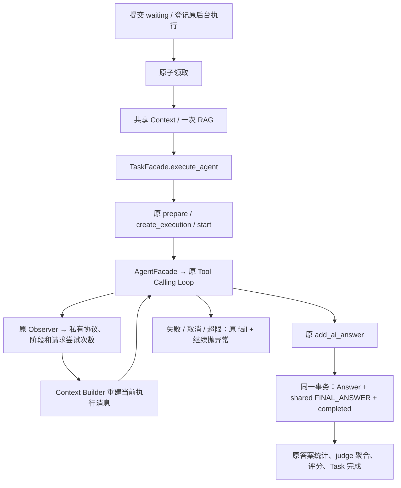

# 公共调用入口与通用执行基础设施交付报告

> 2026-10-22 路径更新：本文原 Task 持久化用例已归属 `app/modules/hcp_mad/application/task/`，原 ORM / Repository 分别位于 `hcp_mad/domain/` / `hcp_mad/infrastructure/`；公共执行与纯消息选择已抽至 Agent。普通/RAG 任务使用独立 `rag_task` 表，迁移和部署说明见 [执行层与任务隔离记录](AGENT_EXECUTION_SPLIT.md)。原有阶段行为与事务说明仍保留。

日期：2026-10-17。本轮只整理既有应用入口和上下文构建，不开发 HCP-MAD，不修改数据库结构、SQL 或真实业务数据。原有模型循环、RAG 策略、领取条件、并发隔离、答案幂等和最终提交事务均继续复用。

## A. 公共调用入口清单

6 个业务 Facade 共 46 个公开方法。表中的签名按实际源码核对；async 方法需要 await，省略 self/cls。内部组件只用于解释委托关系，不是其他业务的默认调用入口。

### TaskFacade

文件：[`app/modules/task/application/facade.py`](../app/modules/task/application/facade.py)。

| 参数与返回类型 | 内部委托与适用场景 |
| --- | --- |
| `create_task(payload: TaskCreateRequest, *, task_id: str \| None=None, mode: TaskMode=TaskMode.NORMAL) -> Task` | management.create_task；只提交 waiting 任务 |
| `accept_task(task_id: str, worker_id: str) -> Task` | management.accept_task；人工账号接单 |
| `submit_task(payload: TaskCreateRequest, scheduler: TaskScheduler, *, task_id: str \| None=None, mode: TaskMode=TaskMode.NORMAL) -> Task` | scheduling.submit_task；创建提交后登记后台执行 |
| `enqueue_task(task_id: str, scheduler: TaskScheduler) -> None` | scheduling.enqueue_task；向宿主登记原 process_task |
| `claim_task(task_id: str) -> Task \| None` | TaskOrchestrator.claim_task → 原 _claim_task；自管编排领取 |
| `get_task(task_id: str) -> Task` | queries.get_task；问题、参与者、状态及正式答案 |
| `async execute_agent(task_id: str, ai_id: str, rag_context: str \| None=None, *, system_prompt: str \| None=None, context_policy: ContextSelectionPolicy \| None=None) -> tuple[Task, Answer]` | ai_answers.invoke_ai_for_task；完整持久化执行 |
| `submit_worker_answer(task_id: str, worker_id: str, content: str) -> tuple[Task, Answer]` | answers.add_worker_answer；原人工答案校验和提交 |
| `submit_ai_answer(task_id: str, ai_id: str, content: str, *, execution_id: str \| None=None) -> tuple[Task, Answer]` | answers.add_ai_answer；原归属、幂等及原子完成事务 |
| `async aggregate_answers(task_id: str, rag_context: str \| None=None) -> Task` | aggregation.aggregate_task_answers；原 judge 聚合 |
| `async score_answers(task_id: str, rag_context: str \| None=None) -> list[Answer]` | aggregation.score_task_answers；原 judge 评分 |
| `async finish_task(task_id: str, rag_context: str \| None=None) -> tuple[Task, list[Answer]]` | aggregation.finish_task；聚合→评分→完成 |
| `review_result(task_id: str, final_result: str, reward_scale: float) -> Task` | review.review_final_result；原最终审核与信誉更新 |
| `async process_task(task_id: str) -> None` | 原 task_orchestrator.process_task；自行领取及并发编排 |
| `prepare_context(task_id: str, rag_context: str \| None=None) -> str` | TaskExecutionContext.prepare；幂等共享输入/RAG 注入 |
| `build_task_prompts(task_id: str, rag_context: str \| None=None) -> tuple[str, str]` | context.prompts.build_task_prompts；原兼容模板 |
| `get_context(task_id: str, *, execution_id: str \| None=None, ai_id: str \| None=None) -> ContextView \| None` | TaskExecutionContext + ContextBuilder.select_items；独立可见快照 |
| `get_execution_result(execution_id: str) -> ExecutionResult \| None` | 原执行/答案读取服务；无 ORM 的状态快照 |
| `build_agent_messages(execution_id: str, *, system_prompt: str, stage: str='thinking', context_policy: ContextSelectionPolicy \| None=None) -> list[dict[str, Any]]` | TaskExecutionContext + ContextBuilder；纯构建当前执行输入 |

### AgentFacade

文件：[`app/modules/agent/application/facade.py`](../app/modules/agent/application/facade.py)。

| 参数与返回类型 | 内部委托与适用场景 |
| --- | --- |
| `get_agent(ai_id: str) -> AiAgent` | repository.get_ai_agent；读取已有配置和角色 |
| `async generate_text(ai: AiAgent, user_prompt: str, system_prompt: str, timeout: float \| None=None) -> str` | llm_provider.request_local_ai_raw；普通生成 |
| `async generate_text_with_usage(ai: AiAgent, user_prompt: str, system_prompt: str, timeout: float \| None=None) -> LlmTextResponse` | 原带 usage 的 Provider；离线评估 |
| `async run_agent(ai: AiAgent, *, messages: list[dict[str, Any]], tool_registry: ToolCatalog \| None=None, tool_executor: ToolRunner \| None=None, max_steps: int=5, observer: AgentLoopObserver \| None=None) -> str` | 原 tool_calling 循环；无 Task 的 Agent 执行 |
| `async run_agent_with_usage(ai: AiAgent, *, messages: list[dict[str, Any]], tool_registry: ToolCatalog \| None=None, tool_executor: ToolRunner \| None=None, max_steps: int=5, observer: AgentLoopObserver \| None=None) -> ToolCallingAgentResult` | 原带 usage 循环；请求统计 |
| `format_execution_error(ai: AiAgent, exc: BaseException) -> str` | 原 request_config；错误摘要脱敏 |
| `ranked_agents(*, session_factory: Callable[[], Session] \| None=None) -> list[AiAgent]` | 原评分排序及 mapper；AI 排行榜 |

### ToolFacade

文件：[`app/modules/tool/application/facade.py`](../app/modules/tool/application/facade.py)。

| 参数与返回类型 | 内部委托与适用场景 |
| --- | --- |
| `configured() -> ToolFacade` | 原 composition；每次配置一个工具运行实例 |
| `from_catalog(catalog: ToolCatalog) -> ToolFacade` | 原 Registry 兼容适配；已有 Facade 原样复用 |
| `list_definitions() -> list[ToolDefinition]` | 原 catalog.list_definitions；模型工具目录 |
| `get_definition(tool_name: str) -> ToolDefinition` | 原 Catalog 定义查询；返回独立深拷贝 |
| `validate_arguments(tool_name: str, arguments: dict[str, Any]) -> dict[str, Any]` | 原 ToolArgumentValidator；只校验，不执行 |
| `async execute(tool_name: str, arguments: dict[str, Any]) -> ToolExecutionResult` | 原 ToolRunner/Executor；校验后执行工具 |

### RagFacade

文件：[`app/modules/rag/application/facade.py`](../app/modules/rag/application/facade.py)。

| 参数与返回类型 | 内部委托与适用场景 |
| --- | --- |
| `async retrieve(*, query: str, top_k: int=5, document_id: str \| None=None) -> list[VectorSearchHit]` | composition.build_rag_retriever；默认线上策略，保留 score/metadata |
| `async answer(*, query: str, ai_id: str, top_k: int=5, document_id: str \| None=None) -> RagAnswerResult` | 原 RagAnswerService；基于证据回答 |
| `async retrieve_context(task_id: str, question: str) -> str \| None` | 原 task_context 资源适配；公共知识和任务附件 |
| `format_context(hits: list[VectorSearchHit]) -> str` | 原 build_rag_context；复用已检索命中 |
| `format_task_context(result: CombinedRetrievalResult) -> str` | 原 build_combined_rag_context；复用已有分组证据 |
| `async index_document(file_path: str \| Path) -> str` | 原 IndexingService；公共文档入库 |
| `async save_task_document(*, task_id: str, file: UploadFile) -> Path` | 原 temporary_storage；上传校验与保存 |
| `delete_task_documents(task_id: str) -> None` | 原 temporary_storage；附件清理 |

### AccountFacade

文件：[`app/modules/account/application/facade.py`](../app/modules/account/application/facade.py)。

| 参数与返回类型 | 内部委托与适用场景 |
| --- | --- |
| `register(username: str, password: str) -> Account` | service.register_service；注册账号 |
| `login(username: str, password: str) -> tuple[Account, str]` | service.login_service；验证密码并创建会话 |
| `logout(token: str) -> dict[str, str]` | service.logout_service；沿用登出 |
| `get_public_account(account_id: str) -> Account \| None` | repository + mapper；公开账号查询 |
| `ranked_accounts(*, session_factory: Callable[[], Session] \| None=None) -> list[Account]` | 原信誉排序查询；排行榜 |

### HeritageFacade

文件：[`app/modules/heritage/application/facade.py`](../app/modules/heritage/application/facade.py)。

| 参数与返回类型 | 内部委托与适用场景 |
| --- | --- |
| `find_detail_by_name(name: str, *, session_factory: Callable[[], Session] \| None=None) -> HeritageSite \| None` | 原 repository.find_by_name；正式名称精确查询 |

### 公共协议、上下文快照及异常

- `TaskScheduler.add_task(func, *args, **kwargs) -> None`：宿主负责在既有时机调用回调；FastAPI BackgroundTasks 可直接使用。
- `ToolCatalog.list_definitions` 与 `ToolRunner.execute`：保持原协议。HCP 的现有 fake/catalog 和双端口注入形态不需要调整。
- `ContextView`、`ContextItemView`、`ExecutionResult`：独立数据快照，不返回 ORM 或 Session。metadata 和正式 Answer 继续深拷贝。
- `ContextSelectionPolicy`：不可变，只能减少 RAG、本执行工具历史、本执行公开消息及 FINAL_ANSWER/REVIEW 引用；不能提升私有可见性或引入其他执行历史。
- 任务/AI 不存在、未分配、重复完成等沿用原 HTTPException；上下文构建缺少执行或 Context 时沿用 LookupError；阶段/策略/空自定义 system_prompt 非法时 ValueError。
- 独立工具校验沿用 ToolArgumentValidationError，未知工具沿用 ValueError，无效工具 Schema 沿用 RuntimeError。模型和工具异常不由新 Facade 统一包装。
- 部分既有方法保留可选会话工厂，仅供原注入/资源边界兼容；不向外传递实际 Session。TaskFacade 的工厂用于 Context/快照/独立领取/独立聚合评分，原创建和执行服务仍使用各自 SessionLocal。

## B. 能力盘点与实际调用链

### 修改前的能力盘点

| 能力 | 既有实现与入口 | 本轮公开入口及处理 |
| --- | --- | --- |
| 提交任务 | management.create_task；路由先提交 | 保留 create_task，新增 submit_task 组合已有步骤 |
| 进入执行队列 | waiting 状态 + 路由 BackgroundTasks.add_task | enqueue_task 委托同一个 process_task；无第二套队列 |
| 领取任务 | TaskOrchestrator._claim_task → Repository 条件更新 | claim_task 公开包装；原私有名保留 |
| 创建共享 Context | TaskExecutionContext.prepare | 保留 prepare_context |
| 构建 messages | 原 ContextBuilder + ai_answers/aggregation 模板 | 集中 context/；旧导入及函数名保留 |
| 获取 RAG 证据 | RagFacade.retrieve/retrieve_context | 保留检索；新增两种已有结果的纯格式化 |
| 获取工具目录 | ToolFacade.list_definitions | 保留；补定义查询和原参数校验 |
| 工具调用循环 | AgentFacade.run_agent + 原 Loop | 原实现直接复用 |
| 记录执行事件 | PersistentAgentObserver + TaskExecutionContext.record | 继续内部短事务，不公开逐条状态操纵 |
| 提交正式 Answer | answers.add_ai_answer | 保留 Facade 方法及原子完成事务 |

### 任务提交、后台登记和领取

`TaskFacade.submit_task` → `scheduling.submit_task` → 原 management.create_task 提交 waiting → scheduler.add_task(原 process_task, task.id)。

已有 HTTP 路由保留身份校验、附件保存/失败清理、create_task 注入点和响应模型；仅将后台登记改经 TaskFacade.enqueue_task。HTTP 响应后仍由本进程的 BackgroundTasks 执行。没有新增持久化消息、扫描消费者或崩溃续跑机制。

`process_task` → public claim_task → 原 _claim_task → 原 Repository 的 waiting 条件更新并提交 → 准备共享 Context → 按需 RAG → gather 并发 AI → 依据真实 answers 统计结果 → 原聚合与评分。

`claim_task` 是自管编排的入口：成功后应自行调用 execute_agent / finish_task；不能再调用会自行领取的 process_task。人工接单属于 accept_task，两个“领取”含义不同。

创建提交和后台登记仍不是一个数据库事务；登记失败不会回滚已提交的 waiting 任务。这是原路由就有的边界，不虚构“可靠投递”。

### Context、Prompt 和 messages

```text
app/modules/task/application/context/
├── __init__.py   # 明确的构建入口及策略类型
├── builder.py    # 原筛选、顺序、私有隔离和完整工具轮次配对
├── policies.py   # 只缩小输入的不可变策略
└── prompts.py    # 固定 System Prompt、任务/聚合/评分模板
```

旧 application/context_builder.py 显式导出同一个 ContextBuilder 类。旧 ai_answers._build_task_prompts、aggregation.build_*_prompt / build_rag_reference_section 仍可调用，内部委托新目录。

固定指令与模板在 prompts；动态共享问题/RAG、执行历史和阶段引用由 Builder 组装；数据库及 Observer 保留在 execution_context。旧直接文本生成与持久化 Builder 本来有换行差异，按各自原输出保留，不借重构合并文案。重构前捕获的 8 个 Prompt/messages golden SHA256 均保持一致。

公开 `build_agent_messages` 和完整 `execute_agent` 可显式传 context_policy；execute_agent 还可传自定义 system_prompt。默认不增加额外 observer 参数，不改变旧替身、消息顺序或返回类型。策略影响模型可见输入，不删除已持久化证据和审计事件。

### RAG 和 Tool

公共 retrieve 继续返回原 VectorSearchHit（包含内容、来源、分数、metadata）；默认策略仍由 RAG composition 决定。任务 retrieve_context 继续组合公共知识与附件。

已有 TaskOrchestrator 每任务检索一次 → TaskExecutionContext.prepare 写共享 RAG_CONTEXT → 多 AI、聚合与评分复用。外部已取得 hits 时可 format_context 后 prepare_context；格式化本身不检索、不持有网络或数据库资源。不要同时让同一次 Task 编排再做一遍相同检索。

ToolFacade.configured → 原 Registry/Executor；list_definitions/get_definition 提供 Schema；validate_arguments 只调用原 Validator；execute 仍由原 Runner/Executor 执行。AgentFacade.run_agent 复用同一原循环，通过目录/执行协议调用工具。

内置 Facade/工具实例不保存可变的用户、Task、Execution 或 messages。新增并发测试验证共享运行实例不会混用本次参数；任意自定义有状态工具的安全性仍取决于其实现。旧 list_definitions 返回行为保留，应按只读使用；get_definition 提供可修改的独立副本。

### 执行事件、Answer 与收尾



Task → Execution → Context 锁顺序、attempt_no、sequence_no、幂等、短事务与最终原子提交实现未替换。模型或工具 await 期间不持有这些数据库事务。发生错误时沿用凭证脱敏；本轮仅补足错误格式化本身失败时的通用脱敏摘要，仍抛原始业务异常，不提交虚假 Answer。

AgentFacade 的普通 run_agent 本身不具有 Task/Execution 归属，也不隐式回写 Task。这与 TaskFacade.execute_agent 的完整持久化用例必须区分。

## C. 文件修改清单

以下以本轮开始时的文件哈希为基线：**新增 8 个、修改 15 个、删除 0 个**。没有把用户原有工作区改动计入本轮。

| 类型 | 文件 | 原因 |
| --- | --- | --- |
| 新增 | `tests/task/test_public_task_dispatch.py` | 提交/调度边界、原子领取和 Facade 契约测试 |
| 新增 | `tests/task/test_context_public_api.py` | 旧导入身份、golden 文本、策略与可见性/工具配对测试 |
| 新增 | `docs/PUBLIC_EXECUTION_INFRASTRUCTURE.md` | 本轮类型签名、能力盘点、调用链、清单和验收报告 |
| 新增 | `app/modules/task/application/scheduling.py` | 封装原创建后登记后台执行的组合，定义宿主调度协议 |
| 新增 | `app/modules/task/application/context/__init__.py` | 集中构建入口、协议与策略导出 |
| 新增 | `app/modules/task/application/context/prompts.py` | 集中固定指令及原模板，保留原字节输出 |
| 新增 | `app/modules/task/application/context/policies.py` | 不可变 ContextSelectionPolicy，不添加角色算法 |
| 新增 | `app/modules/task/application/context/builder.py` | 承载原纯内存筛选/工具配对/消息构建，增加只缩小输入的可选策略 |
| 修改 | `tests/test_agent_tool_facades.py` | 工具查询/独立校验及共享实例参数隔离测试 |
| 修改 | `tests/task/test_task_public_facade.py` | 公共方法与协议清单增加本轮真实能力，保留精确限制 |
| 修改 | `tests/task/test_agent_execution.py` | 可选输入仍完整持久化及错误摘要回退测试；并发测试改同步屏障保留全部断言 |
| 修改 | `tests/rag/test_public_facade.py` | 纯格式化不检索及原结果不变测试，方法清单增加真实入口 |
| 修改 | `docs/MODULE_PUBLIC_API.md` | 更新公共方法、Context 目录和调度/共享边界 |
| 修改 | `docs/AGENT_EXECUTION.md` | 补充本轮公共入口及 Context 目录说明 |
| 修改 | `app/modules/tool/application/facade.py` | 查询独立定义及复用原参数校验 |
| 修改 | `app/modules/rag/application/facade.py` | 纯格式化已检索证据 |
| 修改 | `app/modules/task/application/ai_answers.py` | 模板委托、可选固定指令/策略；格式化失败时保留原异常 |
| 修改 | `app/modules/task/application/aggregation.py` | 原模板函数兼容委托、固定指令移常量，不改查询或计分 |
| 修改 | `app/modules/task/api/user_router.py` | 后台登记经 TaskFacade，保留原创建/权限/附件/注入行为 |
| 修改 | `app/modules/task/application/facade.py` | 新增提交/登记/领取/模板入口，公开可选构建策略 |
| 修改 | `app/modules/task/application/execution_context.py` | 只调整构建入口及 Observer 可选策略转发，持久化逻辑不变 |
| 修改 | `app/modules/task/application/context_builder.py` | 旧路径兼容导出同一个 Builder/协议 |
| 修改 | `app/modules/task/application/orchestration.py` | 原领取逻辑加公共包装，私有方法保留 |

`app/modules/hcp_mad/` 和 `tests/hcp_mad/`：本轮新增/修改/删除均为 **0**，包括现有字节码缓存，25 项文件/目录逐项核对一致。开始时 Git 已显示这些目录有用户自己的暂存/未提交改动（A/AM），这些原有改动全部保留；“本轮零修改”不等于将用户工作区重置为 Git 干净状态。SQL、数据库映射、Provider、Agent Loop、Retriever、ToolExecutor、ExecutionRepository 和 Answer 提交服务也未被本轮修改。

## D. 测试与静态检查

基线命令：

```powershell
.\.venv\Scripts\python.exe -B -m pytest -q -p no:cacheprovider --basetemp tmp/pytest-execution-infra-baseline-20261017
```

基线：**357 passed，0 failed**。使用 Mock 和隔离 SQLite，不调用真实模型、Milvus 或业务数据库。所有 Python 检查禁用字节码写入；基线测试后 app/modules/hcp_mad 与 tests/hcp_mad 包括缓存在内的目录/文件哈希与开始时一致。

实际执行及结果：

| 检查 | 命令/范围 | 结果 |
| --- | --- | --- |
| 基线完整回归 | 上述 baseline 命令 | 357 passed / 0 failed |
| 首次重构后完整回归 | `python -B -m pytest -q -p no:cacheprovider --basetemp tmp/pytest-execution-infra-final-20261017` | 416 passed / 2 failed，均为原 40ms 并发时序测试 |
| 并发验证复核 | `python -B -m pytest tests/task/test_agent_execution.py -q -k test_orchestration_shares_context_and_preserves_failure_isolation_and_scoring -p no:cacheprovider --basetemp tmp/pytest-execution-infra-concurrency-20261017` | 2 passed / 0 failed，19 deselected |
| 最终完整回归 | 下列 verified 命令 | **418 passed / 0 failed，11.87 秒** |
| Python 语法 | 对 app/evaluation/tests 的 197 个非 HCP `.py` 文件执行内存 `compile` | 全部通过，不写 pyc |
| 本轮静态规则 | `ruff check app --extend-exclude hcp_mad`；另对 6 个修改/新增测试文件执行 Ruff | 全部通过 |
| 全 app 静态规则 | `ruff check app --output-format json` | 原有 3 个 F401，全部在只读 HCP 的 context.py / schemas.py；未修复 |
| 类型检查 | 下列 Mypy 命令 | 13 个源文件通过 |
| Prompt 兼容 | 重构前保存的 8 项输出 SHA256；既有选择与协议方法 AST 比较 | 全部相同 |
| 目录保护 | app/modules/hcp_mad + tests/hcp_mad 的完整文件/目录/缓存哈希 | 25 项一致，本轮零变更 |

以上表中简写 `python` 均实际使用项目 `.venv/Scripts/python.exe` 且带 `-B`。最终命令：

```powershell
.\.venv\Scripts\python.exe -B -m pytest -q -p no:cacheprovider --basetemp tmp/pytest-execution-infra-verified-20261017
.\.venv\Scripts\python.exe -B -m ruff check app --extend-exclude hcp_mad
.\.venv\Scripts\python.exe -B -m ruff check tests/test_agent_tool_facades.py tests/rag/test_public_facade.py tests/task/test_agent_execution.py tests/task/test_task_public_facade.py tests/task/test_public_task_dispatch.py tests/task/test_context_public_api.py
.\.venv\Scripts\python.exe -B -m mypy --ignore-missing-imports --follow-imports=silent app/modules/task/application/facade.py app/modules/task/application/scheduling.py app/modules/task/application/orchestration.py app/modules/task/application/ai_answers.py app/modules/task/application/execution_context.py app/modules/task/application/context_builder.py app/modules/task/application/context app/modules/task/application/aggregation.py app/modules/tool/application/facade.py app/modules/rag/application/facade.py
```

语法检查实际使用：

```powershell
.\.venv\Scripts\python.exe -B -c @'
from pathlib import Path
paths = [p for root in ['app', 'evaluation', 'tests'] for p in Path(root).rglob('*.py') if 'hcp_mad' not in p.parts and 'hcp-mad' not in p.parts]
for path in paths:
    compile(path.read_bytes(), str(path), 'exec')
print('Syntax check passed:', len(paths), 'files; HCP-MAD excluded')
'@
```

并发测试的修正没有减少、跳过或放宽原断言：用两次模型请求均已进入的同步屏障代替 40ms 猜测。若执行串行，第一请求会等待超时，测试仍会失败；生产执行代码未因此调整。最终 418 项相对基线新增 61 项，包含新增 Facade、Context、调度和执行持久化验证，以及原有 HCP Executor 测试。

## E. 保留的边界与未完成事项

1. 现有跨模块共用事务例外不拆分：Task 的 management/answers/review 仍读取 Account/Agent Repository，aggregation 仍在原会话选择 judge 配置。详见 MODULE_PUBLIC_API.md，未来业务不应照搬内部访问。
2. 没有数据库等待任务消费者、持久化投递、崩溃自动恢复；后台登记与数据库提交不原子，保留原机制。
3. 原编排取消可能留下 Task answering/aggregating；人工先接单会把 waiting 改为 answering，使原 AI 后台领取跳过；自动聚合不等待人工名额。本轮不修改这些既有业务规则。
4. HCP-MAD 所有源码、测试及配置严格只读。现有独立 Executor 的 Facade 方法名、字符串返回、工具双端口注入均保持兼容。其现有调用没有 Task/Execution ID 或 Observer，不能在不改 HCP 的情况下猜测持久化归属。
5. 只读检查发现 HCP 的 stage_service 调用异步 select_workers 后未 await 就切片，selector 又访问当前 AiAgent 没有的 role/is_aggregator。现有唯一 HCP Executor 测试使用 fake Facade，不能证明 Stage/Selector 实际组合可用；正常 Facade 适配无法安全修复未 await。本轮仅记录，不编辑 HCP 或其测试，不新增 Worker/Judge 策略。
6. 本轮没有需要用户先批准才能继续的接口设计；遗留行为按范围约束保持原状。

