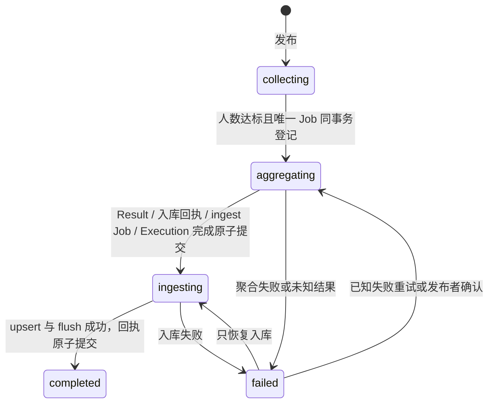

# RAG Task 众包知识生产实施记录

> 2026-10-23：当前公共/个人GET列表、安全DTO与旧API删除情况见 [RAG众包交付报告](RAG_CROWD_DELIVERY.md)。以下旧路由/权限描述属于历史实施记录，不代表当前可调用API。

本阶段实现人工资料收集、知识聚合与公共 RAG 入库，不触发 HCP-MAD Judge 或 Debate。没有执行生产 SQL，也没有访问真实模型或 Milvus。以下区分实际实现、离线验证及尚未验证的边界。

## 后续修复：Agent 选择与 HCP-MAD 隔离

重新检查实际代码后，未发现 HCP-MAD 的提交入口新增必填 agent_id。截图中的 ai_ids/worker_count 来自 HcpTaskCreateRequest 继承的普通任务 DTO；原代码已禁止非空 ai_ids 和非零 worker_count，但 Swagger 自动示例仍可能生成 ai_ids=["string"]，造成误导。

修复仅在 `hcp_mad/application/schemas.py` 使用 SkipJsonSchema 隐藏这两个内部字段并提供明确业务示例，保持空列表/0 的旧请求兼容与非法值拒绝。HCP 的 WorkerSelector、Worker/Judge、Debate、终局与持久化代码均未变。提交现在只展示：

```json
{"question":"天坛主要用于什么？","answer_format":"普通文本","use_rag":true,"metadata":{}}
```

RAG Task 原先在 CrowdTaskFacade.publish 读取并校验聚合 Agent，未配置时返回 503，过早阻断资料收集。本次改为发布只记录专属服务端配置；由 `rag_task/application/aggregation_agent.py` 在聚合阶段校验 ID、数据库记录、启用状态和请求地址，通过公共 AgentFacade 执行，绝不按信誉/角色选择备用 AI。

配置失败将 RAG Task 与 aggregate Job 标记 failed，last_error 为 `rag_aggregator_not_configured`、`invalid_id`、`not_found`、`invalid_record`、`disabled` 或 `missing_api_url`（均带 rag_aggregator_ 前缀），不调用模型、不自动重试。ID 缺失/超长时不创建伪造 Execution；已记录的失败 Execution 保留。状态 API 返回 200 的失败快照，而不是在发布阶段返回 503。

修复服务端配置后，发布者调用原 retry 接口，只有本次明确的配置失败且没有 P 时才重新绑定配置 ID；当前未知结果和已有准备结果仍保留原绑定，入库失败仍只重试入库。Settings 不再对该专属 ID 做全局长度拒绝，长度约束移入 RAG 聚合业务，防止无效 RAG 配置阻断 HCP 应用启动。无需新增 SQL 或修改 Runner。

RAG Task 的状态、答案、知识结果与 Job 仍只写自身九表；HCP 可以继续复用公共 `rag` 检索服务，但不依赖 `rag_task` 众包业务或其聚合配置。

### 本次修复文件

| 文件 | 修复内容 |
| --- | --- |
| `app/modules/hcp_mad/application/schemas.py` | 仅修复 Swagger 展示与业务请求示例，保留内部字段旧空值校验 |
| `app/core/config.py` | 聚合 ID 的长度校验移至 RAG 业务，不作为全局启动条件 |
| `app/modules/rag_task/application/aggregation_agent.py`（新增） | 专属 ID/记录/启用/地址校验与明确错误码，不排名、不选备用模型 |
| `app/modules/rag_task/application/facade.py` | 发布不提前读 Agent；显式配置失败重试传入当前服务端配置 |
| `app/modules/rag_task/application/crowd_service.py` | 记录可空配置，仅针对尚未执行的配置失败重绑 ID |
| `app/modules/rag_task/application/crowd_processing.py` | 聚合阶段校验；配置错误记录为终止失败，等待明确重试 |
| `app/modules/rag_task/infrastructure/processing_repository.py` | 无合法 ID 时仅领取 Job，不造假 Execution；支持明确终止失败 |
| `tests/hcp_mad/test_stage_pipeline.py` | 无 RAG 配置/无外部 Agent ID 的真实 HCP 链、公开 Schema 与非法指定拒绝 |
| `tests/rag_task/test_crowd_workflow.py` | 七类配置失败/修复重试、只用绑定 Agent、同 ID 的 HCP 任务不受影响 |
| `tests/rag_task/test_crowd_schema.py` | HCP 对 RAG Task 配置和业务的反向依赖检查；原 SQL 摘要断言保留 |
| `README.md`、`docs/MODULE_PUBLIC_API.md`、本文 | 明确 API 示例、配置归属和阶段错误处理 |

### 本次验证

定向命令：

```powershell
.\.venv\Scripts\python.exe -B -u -m pytest tests/rag_task/test_crowd_workflow.py tests/rag_task/test_crowd_schema.py tests/hcp_mad/test_stage_pipeline.py -q -p no:cacheprovider --basetemp=.pytest_tmp/agent-selection-fix-20261022/focused
.\.venv\Scripts\python.exe -m ruff check .
.\.venv\Scripts\python.exe -m mypy app/modules/agent app/modules/hcp_mad app/modules/rag_task app/api
```

定向结果：102 passed，1 failed。唯一失败是保留的历史 SQL 摘要校验。修复前快照中第一阶段 SQL 摘要为 3990faaebe02263b58d55e8077ea5af18b109396dad31dfa2710b0c7d4bca3e8；验证期间文件变为 7151dad561bb52eac26d0f845f6c2e51e0fc36e441f212ee67b0ab78d89895ee，五张 RAG 表的建表选项被另行改为 ENGINE=InnoDB DEFAULT CHARSET=utf8mb4 COLLATE=utf8mb4_unicode_ci。本修复未写入或回退 SQL，也未更新摘要或放宽 DDL 断言来掩盖变化。

完整回归：**1012 passed，2 failed in 317.25s**，相对修复前新增 14 项验证。两项失败均为上述 SQL 文件变化，具体为：

- `tests/rag_task/test_crowd_schema.py::test_published_stage_one_migration_is_unchanged`
- `tests/test_execution_architecture.py::test_incremental_sql_matches_all_new_orm_columns_indexes_constraints_and_defaults`

HCP Worker/Judge/Debate/终局、RAG 执行业务与公共 Agent 执行层用例均通过。没有删除、跳过或放宽原测试；本轮不替未审定的 SQL/ORM 排序规则差异作迁移决策。

```powershell
.\.venv\Scripts\python.exe -B -u -m pytest -q -p no:cacheprovider --basetemp=.pytest_tmp/agent-selection-fix-20261022/full
.\.venv\Scripts\python.exe -m mypy app evaluation scripts
```

Ruff 通过，相关 mypy 141 个源文件通过；全项目 mypy 检查 285 个源文件，仍为 4 文件、6 个已知错误，无新增。app 244 个、tests 47 个 Python 文件语法检查通过。HCP 除本次请求 Schema 展示外，与修复前源码摘要一致；公共 Agent、HCP ORM、调度与持久化均未修改，也没有执行数据库迁移。以下第 8 节保留第二阶段原始验证记录，不应视为本次修复的最新结果。

未验证真实 MySQL/模型/Milvus 联调或浏览器当前运行服务的热重载；测试使用隔离 SQLite 与模型网络替身。重启 API 并刷新/重置 Swagger 后，应只看到上面的四个 HCP 业务字段，其中只有 question 必填。

## 1. 修改文件与职责

相对本阶段开始时的工作区比较，保留此前未提交工作。未修改 `app/modules/hcp_mad/`、公共 Agent Loop / Provider、旧知识整理映射和第一阶段迁移 SQL。

### 新增

| 文件 | 职责 |
| --- | --- |
| `app/modules/rag_task/domain/crowd_models.py` | 参与者、正式知识、入库回执、处理任务的 ORM 与约束 |
| `app/modules/rag_task/infrastructure/crowd_repository.py` | 短事务、InnoDB 检查、父任务锁、有效提交查询与输入快照 |
| `app/modules/rag_task/infrastructure/processing_repository.py` | 原子领取、数据库时间租约、续约、代际围栏、准备/发布与恢复 |
| `app/modules/rag_task/application/crowd_service.py` | 发布、接取、不可变幂等提交、进度与发布者重试 |
| `app/modules/rag_task/application/crowd_processing.py` | 聚合、入库、消费者、心跳与取消处理 |
| `app/modules/rag_task/api/crowd_router.py` | 众包 API、现有 JWT 鉴权、输入校验 |
| `app/modules/rag/application/text_ingestion.py` | 经原预处理链生成并恢复固定切片计划 |
| `sql/20261022_add_rag_task_crowd_workflow.sql` | 四表及独立回答表增量迁移 |
| `tests/rag_task/test_crowd_workflow.py` | 隔离数据库闭环、并发、恢复和生命周期测试 |
| `tests/rag_task/test_crowd_schema.py` | ORM/DDL、唯一约束、隔离、MySQL 语句及现有 Milvus upsert 契约 |
| `docs/RAG_TASK_CROWD_WORKFLOW.md` | 本实施和部署记录 |

### 修改

| 文件 | 修改原因 |
| --- | --- |
| `app/modules/rag_task/domain/models.py` | crowd 模式、collecting/ingesting 状态；Answer 增加可空 participant_id、自有外键与唯一约束 |
| `app/modules/rag_task/application/facade.py` | 独立 CrowdTaskFacade；普通 TaskFacade 用例保留 |
| `app/modules/rag_task/api/router.py` | 普通 QA 接口迁入 `/rag-tasks/legacy`，组合众包 API |
| `app/modules/rag_task/api/user_router.py`、`api/ai_router.py` | 在专属命名空间注册普通查询与 AI 调用 |
| `app/api/task_routes.py` | 通用历史查询/调用仅归属 HCP，去除混合分派与 RAG 回退 |
| `app/modules/rag_task/task_utils.py` | 普通 QA 读取/修改入口拒绝 crowd，避免暴露工人原始正文或绕过流程 |
| `app/modules/rag_task/application/management.py`、`ai_answers.py`、`answers.py`、`aggregation.py`、`review.py` | 防止普通接取、AI 调用、回答、聚合、审核修改 crowd 任务 |
| `app/modules/rag_task/application/orchestration.py` | 普通编排器不领取 crowd |
| `app/modules/rag_task/infrastructure/queries.py` | 普通大厅、消息及排名相关任务查询排除 crowd |
| `app/modules/tool/application/facade.py` | 复用现有空工具目录装配；不改 ToolExecutor |
| `app/modules/rag/application/preprocessing_service.py` | 原链增加可选固定 document_id、source、metadata |
| `app/modules/rag/application/indexing_service.py` | 抽出共用 index_chunks，原文件入口仍走相同 Embedding/VectorStore 代码 |
| `app/modules/rag/application/facade.py` | 公开 prepare_text_ingestion / index_prepared_text |
| `app/core/config.py`、`.env.example` | 聚合 Agent、消费者、轮询、租约、重试配置 |
| `app/db/session.py` | 注册新增 ORM，仍不执行启动 DDL |
| `app/main.py` | lifespan 按开关启动和关闭消费者 |
| `tests/test_application_startup.py` | 注册表清单增加四表，保留禁止启动 DDL 的断言 |
| `tests/conftest.py` | 离线测试强制关闭消费者，防止继承本机 .env 中的生产开关；生命周期测试显式注入替身后再开启 |
| `tests/test_execution_architecture.py` | 原迁移契约分离本阶段 Answer 新字段，由新增测试核对增量 SQL |
| `tests/test_task_route_composition.py` | 验证专属路由、HCP 不回退与无重复注册 |
| `tests/rag/test_public_facade.py`、`tests/rag_task/test_rag_task_public_facade.py` | 公开能力清单增加明确的新入口 |
| `README.md`、`docs/AGENT_EXECUTION_SPLIT.md`、`docs/MODULE_PUBLIC_API.md` | 第二阶段入口、路由与部署指引；保留历史记录 |

## 2. 最终数据表

| 表 | 处理 | 保存内容与约束 |
| --- | --- | --- |
| `rag_tasks` | 复用 | 问题、格式、发布者、required_worker_count、状态；mode=crowd；metadata.crowd 冻结标题/聚合 AI ID |
| `rag_task_answers` | 复用并扩展 | 工人正文 source=worker；participant_id 可空且唯一；旧普通 Answer 保持 NULL |
| `rag_task_contexts` | 复用 | 聚合执行上下文 |
| `rag_task_context_items` | 复用 | 公开模型事件/私有执行过程，不代替独立回答和正式知识 |
| `rag_task_agent_executions` | 复用 | 真实聚合 Execution、状态和请求统计 |
| `rag_task_participants` | 新增 | UNIQUE(task_id,worker_id)，accepted/submitted 及时间，不存正文 |
| `rag_task_results` | 新增 | UNIQUE(task_id)，正文、聚合 AI/Execution、回答数、version=1、来源 Answer ID |
| `rag_task_knowledge_ingestions` | 新增 | task_id/result_id 分别唯一；状态、来源、文档 ID、切片数、尝试数、固定计划与错误 |
| `rag_task_processing_jobs` | 新增 | UNIQUE(task_id,phase)；状态、尝试上限、到期时间、owner/lease/generation、输入快照、私有准备结果 |

共享账号与配置沿用 accounts、ai_agents，不增加认证体系。新增外键只指向 RAG Task 自有表和 accounts，聚合 AI ID 由应用校验。没有 contributions 表，不复制旧数据，不复用 `crowd_task_participants` / `task_knowledge_ingestions`；HCP 原五表保持原样。

有效人数联查 submitted 参与者、source=worker 和对应 Answer。参与者唯一与每参与者 Answer 唯一共同保证按不同人工账号计数，AI 不计入门槛。失败提交全部回滚；相同正文重复提交只重放回执，改变正文返回 409。已经进入后续阶段时相同正文仍可幂等返回，不接受新普通提交。

## 3. 手动 SQL 与部署顺序

1. 第一阶段未部署时，先执行 `sql/20261022_add_rag_task_tables.sql`；已执行则不要重复执行。
2. 执行 `sql/20261022_add_rag_task_crowd_workflow.sql`：创建四张新表，再给 rag_task_answers 增加 participant_id、唯一约束与外键。
3. 核对九张 RAG Task 表均为 InnoDB、字符集与账号外键兼容，部署代码并配置聚合 AI。
4. 配置并验证现有 Embedding/Milvus 后启用消费者。

以上 SQL 只提供，未执行。MySQL DDL 隐式提交，增量文件不是可以任意重复执行的幂等迁移，应按数据库发布流程核验。没有 DROP、数据清空、跨 HCP 迁移或启动 create_all。旧 Answer 的 participant_id 保持 NULL，不编造参与记录。

## 4. 最终 API 与示例

### 众包 API

全部复用 `Authorization: Bearer <登录 token>`。项目只有普通账号，没有单独 Worker 角色；接取/提交使用当前账号，重试要求发布者。请求不能指定他人身份。

| 方法 | 路径 | 请求 | 正常响应 |
| --- | --- | --- | --- |
| POST | `/rag-tasks` | question、worker_count、answer_format（可省略）、title（可选） | 201，快照 |
| POST | `/rag-tasks/{id}/accept` | 无正文 | 200，快照 |
| POST | `/rag-tasks/{id}/answers` | content | 200，快照及 submission_reused |
| GET | `/rag-tasks/{id}` | 无 | 200，任务、进度及正式结果 |
| GET | `/rag-tasks/{id}/status` | 无 | 200，与详情相同的进度快照 |
| GET | `/rag-tasks/{id}/result` | 无 | 200，task_id/status/result/ingestion |
| POST | `/rag-tasks/{id}/retry` | `{}`；未知模型结果需 acknowledge_unknown=true | 200，重新排队后的快照 |

发布示例：

```json
{
  "title": "故宫建筑与保护资料",
  "question": "整理故宫建筑特点、历史背景与保护要求，标明来源及不确定点。",
  "worker_count": 2,
  "answer_format": "主题、知识正文、冲突与不确定点、来源"
}
```

发布响应示例，标识为占位值：

```json
{
  "task_id": "rag-task-<uuid>",
  "publisher_id": "<登录账号>",
  "question": "整理故宫建筑特点、历史背景与保护要求，标明来源及不确定点。",
  "title": "故宫建筑与保护资料",
  "answer_format": "主题、知识正文、冲突与不确定点、来源",
  "status": "collecting",
  "required_worker_count": 2,
  "accepted_worker_count": 0,
  "valid_worker_count": 0,
  "aggregation_status": "pending",
  "jobs": [],
  "result": null,
  "ingestion": null
}
```

接取后提交 `{"content":"独立整理的公开资料及来源……"}`。最后一个有效提交返回 status=aggregating、valid_worker_count=2、aggregate job=pending、submission_reused=false。HTTP 不等待模型和入库；人数未达标没有聚合 Job，不自动调用全部 AI。

完成后的 result 响应示例：

```json
{
  "task_id": "rag-task-<uuid>",
  "status": "completed",
  "result": {
    "id": "result-<uuid>",
    "content": "# 故宫建筑与保护资料\n\n## 知识正文\n……",
    "aggregator_ai_id": "<配置的 AI ID>",
    "execution_id": "<真实 Execution ID>",
    "answer_count": 2,
    "version": 1,
    "source_answer_ids": ["answer-<uuid1>", "answer-<uuid2>"],
    "created_at": "2026-10-22T08:00:00"
  },
  "ingestion": {
    "status": "succeeded",
    "document_id": "<确定性 SHA256>",
    "source_id": "rag-task://rag-task-<uuid>/results/result-<uuid>",
    "chunk_count": 3,
    "attempt_count": 1,
    "last_error": null
  }
}
```

聚合尚未提交时 result=null；入库失败时正式知识仍可查询，同时返回 failed 入库回执，不能当作已入库。详情的 jobs 含 phase/status/attempts/next_run_at/lease_expires_at/last_error，不返回工人原始正文和私有准备文本。

错误码：401 未登录；403 未接取或非发布者重试；404 无此众包任务；409 重复接取、容量满、阶段不符、修改已提交答案、已完成重试或未确认未知结果；422 空文本、非法人数或额外身份字段。聚合 Agent 配置错误在后台聚合阶段记录为 failed 和明确 last_error，不拒绝发布。基础设施故障作为服务错误返回，不伪造业务成功。

回答按现有 MySQL TEXT 限制最多 65535 个 UTF-8 字节，超出返回 422，不截断。工人数为严格整数 1～1000；问题/格式/标题分别最多 10000/2000/200 字符。

### 普通 QA API 的最终路由

原普通路径整体加 `/rag-tasks/legacy`，字段和原业务语义保留：

| 方法 | 路径 |
| --- | --- |
| POST | `/rag-tasks/legacy/users/tasks` |
| POST | `/rag-tasks/legacy/users/tasks/rag`（原 multipart payload/file） |
| GET | `/rag-tasks/legacy/users/{user_id}/messages` |
| GET | `/rag-tasks/legacy/users/tasks/{task_id}` |
| POST | `/rag-tasks/legacy/users/tasks/{task_id}/final-review` |
| GET | `/rag-tasks/legacy/workers/hall` |
| GET | `/rag-tasks/legacy/workers/scoreboard` |
| POST | `/rag-tasks/legacy/workers/tasks/{task_id}/accept` |
| POST | `/rag-tasks/legacy/workers/tasks/{task_id}/answers` |
| GET | `/rag-tasks/legacy/workers/tasks/{task_id}` |
| GET | `/rag-tasks/legacy/ais/scoreboard` |
| POST | `/rag-tasks/legacy/ais/{ai_id}/tasks/{task_id}/invoke` |
| POST | `/rag-tasks/legacy/ais/tasks/{task_id}/answers` |
| POST | `/rag-tasks/legacy/tasks/{task_id}/aggregate` |
| POST | `/rag-tasks/legacy/tasks/{task_id}/score` |
| POST | `/rag-tasks/legacy/tasks/{task_id}/finish` |

普通发布仍提交 `{"question":"……","answer_format":"普通文本","ai_ids":["ai-id"],"worker_count":0,"metadata":{}}` 到专属路径，响应为原 TaskCreateResponse；普通工人回答仍是原 responder_id/content 契约，详见专属路径 OpenAPI。

`/hcp-mad/...` 原样保留。历史 `GET /users/tasks/{id}`、`POST /ais/{ai}/tasks/{id}/invoke` 现在只归属 HCP，不回退 RAG。客户端须迁移至上表专属路径。旧 QA 权限边界沿用原实现，没有在本阶段完成额外权限治理。旧 QA 入口拒绝 crowd 任务，不能绕过众包规则。

## 5. 聚合配置与实际调用链

显式设置 `RAG_TASK_AGGREGATOR_AI_ID=<ai_agents.id>` 时优先采用该配置；未绑定的 Job 在聚合阶段复用 `AgentFacade.ranked_agents()`，按现有分数顺序选择 type=judge、enabled 且可用（或未健康检查）、有 API 地址的 Agent。沿用现有 Mapper 的历史 aggregator→judge 兼容，不新增 SQL，不导入 HCP WorkerSelector/JudgeExecutor。没有合格 Judge 则记录配置失败，不退回任意 Worker。URL、凭据、模型和 generation_config 沿用 AiAgent/Provider，不硬编码；显式指定 worker/judge 也只是模型配置，不执行 HCP Judge 语义。

发布记录可空的专属 AI ID，聚合阶段才校验；空绑定 Job 在真实调用前选择并原子冻结 AI ID 与 Execution。已配置任务按绑定 ID 读取当前启用配置。仅明确配置失败的人工重试或从未领取的空绑定 pending Job 可以补绑定；其余恢复保留原 ID。任务问题、格式、标题、按 worker/id 排序的有效 Answer ID/作者/正文被冻结到聚合 Job，恢复不重新混入答案。模型配置本身未做历史版本快照。

```text
POST /rag-tasks → CrowdTaskFacade.publish → CrowdService.publish
accept / answers → CrowdService → Task 行锁、参与者/Answer、唯一 aggregate Job
lifespan → CrowdConsumer → CrowdProcessor.process_one
  → ProcessingRepository.claim（已有绑定则创建真实 RAG AgentExecution）
  → 空绑定时 select_aggregation_agent_id / AgentFacade.ranked_agents
  → ProcessingRepository.bind_aggregation_agent（同租约围栏下冻结绑定和真实 Execution）
  → AgentFacade.get_agent → AgentFacade.run_agent_with_usage
  → 原 runner / Tool Calling Loop / Provider
  → 私有 prepared_text 准备 P → commit_aggregation 原子发布 T
  → 唯一 ingest Job
  → RagFacade.prepare_text_ingestion
  → ParserFactory / TextParser → 原 Cleaner → 原 Splitter → 固定计划落库
  → RagFacade.index_prepared_text → 原 IndexingService.index_chunks
  → 原 EmbeddingService → 原 VectorStore.upsert → MilvusClient.upsert / flush
  → commit_ingestion → completed
```

知识整理 prompt 明确工人资料不可信、禁止执行注入指令，去重、保留事实/限定条件/来源 ID，冲突列为待核实，不编造裁决；输出公开 Markdown。它是提示词约束，不等于事实正确性保证；本地只验证非空且不超过 200000 字符，未强校验章节。

聚合复用原 Loop，空工具目录、max_steps=1，不调用外部工具。仅记录事件的 Observer 适配器保留 PersistentAgentObserver 持久化，避免普通 ContextBuilder 覆盖冻结输入。消费公开 content，不保存 reasoning_content。正式结果是独立知识记录，不创建 Answer/FINAL_ANSWER，不写 Task.final_result，不调用普通 finish_task/评分。原工人 Answer 保留；普通 QA 和 HCP 正式提交规则不变。

## 6. 状态、事务与恢复



Job：pending → running → succeeded；已知失败 retry 并记录 next_run_at，耗尽次数后 failed；未知聚合结果 uncertain。Task=failed 时 Job 仍可能在自动退避 retry，应同时显示二者。入库回执单独区分 pending/running/succeeded/failed。

### 并发与事务

- 修改先锁 Task，再锁 Participant/Job/Execution。MySQL 使用 READ COMMITTED 和 SELECT FOR UPDATE，避免等待父锁前的旧快照误计数。每次事务核对九表存在且为 InnoDB，否则拒绝。
- 接取人数、提交、人数达标和唯一聚合 Job 均在父锁下处理，唯一索引再次保护。消费者先扫描 ID，短事务重新加锁核验领取条件；扫描本身不构成领取。
- owner 随机值、递增 generation、数据库 UTC 时间和心跳控制提交权，旧 owner 不能准备或提交结果。模型、预处理、Embedding 和向量 I/O 不持有这些事务；心跳另用短事务。
- 新 Job 的 next_run_at 显式使用同一数据库 UTC 时钟，不依赖会话时区下的 CURRENT_TIMESTAMP 默认值；避免非 UTC 数据库把新任务错误延后数小时。created_at/updated_at 仍沿用现有数据库时间展示约定，不参与租约比较。
- 多实例可开消费者；SQLite BEGIN IMMEDIATE 只验证隔离逻辑，不等于真实 MySQL 并发验证。

### 聚合准备 P / 发布 T

公开输出先单独保存 Job.prepared_text（私有 P），再用一个 T 创建 Result、入库记录、唯一 ingest Job，完成 Execution 并推进 Task/aggregate Job。T 任意步骤失败全部回滚；有 P 时只恢复 T，不再调模型。T 重试也有上限，失败后需人工重试。

模型已开始但崩溃、网络结果未知、取消或输出未可靠保存 P 时，进入 uncertain，不自动重复模型调用。Provider 包装的 urllib 网络异常沿异常链识别。发布者需 `{"acknowledge_unknown":true}` 才授权新尝试；远端可能仍执行/计费，数据库租约不提供跨服务 exactly-once。已知返回失败允许有限重试，也不能据此承诺远端未消耗资源。

### 固定入库计划

来源 URI=`rag-task://<task_id>/results/<result_id>`；document_id=SHA256(source + 正文)。首次复用原解析/清洗/切片链并持久化完整计划，然后 Embedding。重试恢复同一组 chunk_id，不重新切片。

计划含完整切片、摘要、清洗/切片配置与版本、Embedding 模型/维度/归一化/端点摘要、Milvus 目标摘要/collection，不含 API Key。摘要错误或配置漂移在写入前拒绝，需恢复原配置或另行显式迁移，不能静默换库。计划增加了 MySQL 中正文存储量。

现有 Milvus schema 使用非自动 chunk_id 主键，适配器执行 upsert 后 flush。相同计划重放覆盖相同主键；部分写入、向量成功但 MySQL 回执失败时可恢复，不新增逻辑重复切片。只有明确成功回执且文档/切片数与计划一致，才原子提交 ingestion=succeeded、Job=succeeded、Task=completed。提交成功但响应丢失不会被 fail 回退。

入库失败保留 Result/计划，只重试 ingest。Embedding 网络错误是可重试入库错误，不要求未知聚合确认。source URI 保存到现有 Milvus source，可随 Hybrid/RRF/Rerank 命中追溯任务；source_type/task_id/result_id 保存在计划元数据，当前 Milvus 不持久化任意动态 metadata，不宣称它们均成为独立可过滤列。

现有向量链没有跨 MySQL/Milvus 事务或发布门禁，部分切片可能在 Task completed 前被检索。本次解决固定主键重放，没有实现向量原子可见性、跨来源语义去重或自动事实核验。

## 7. 消费者启动、配置和重试

```dotenv
RAG_TASK_AGGREGATOR_AI_ID=
RAG_TASK_CONSUMER_ENABLED=false
RAG_TASK_POLL_SECONDS=2
RAG_TASK_LEASE_SECONDS=120
RAG_TASK_MAX_ATTEMPTS=3
RAG_TASK_RETRY_SECONDS=10
```

完成手动 SQL 和现有模型/Embedding/Milvus 配置后设开关 true，正常启动 FastAPI。每个启用实例一个串行消费者，空队列仅轮询 MySQL，不周期调用 LLM。不使用内存 BackgroundTasks 承载众包链；重启从持久化 Job 续行，不全量重跑历史任务。

默认每阶段三次尝试、退避十秒，心跳为租约三分之一周期。POST retry 只重新排当前失败阶段，在累计 attempts 基础上增加一个有界重试窗口，不抹掉次数、不重开 succeeded；completed 返回 409，非发布者 403。正常请求正文 `{}`，uncertain 需显式确认。

2026-10-23 补充：从未领取的 aggregate pending Job（attempts/generation=0、无 Execution/租约/外部调用/准备结果），发布者可用同一 retry 入口补全空绑定；重新核对三份有效 Answer 与原冻结输入，保留原 Job ID/次数/时间，不执行模型、不重建答案。已有有效绑定不更换。当前已存在的未绑定 pending Job 通常只需开启消费者、重启即可自动选择 Judge 并继续，无需故意先执行失败再重试。部署开关与实测边界见 [故障修复记录](RAG_TASK_AUTO_AGGREGATION_FIX.md)。

停机取消本地处理并记录状态；已开始但无 P 的聚合保守暂停，入库可重放。数据库不可用导致失败记录未保存时，租约到期恢复。失败原因保存受控阶段/异常类型码，不保存可能含凭据或原始模型正文的异常文本。

当前没有接取超时释放/替换、运维队列界面或总输入 Token 预算。大量资料超出模型上下文可能失败，不会静默截掉工人资料。每任务仅一个正式知识版本，不能任意覆盖重算完成结果。

## 8. 验证结果和风险

保留真实 Facade、Agent Loop、PersistentAgentObserver、Repository、Parser/Cleaner/Splitter、EmbeddingService、IndexingService、Hybrid/Rerank；替换模型/Embedding 网络、向量后端和 reranker。隔离 SQLite 开启外键，不调用生产数据库/模型/Redis/Milvus。

覆盖人数与鉴权、重复/并发提交、AI 不计数、数据隔离、唯一领取、续约/围栏/过期恢复、P/T 回滚、提交回执丢失、未知执行与确认重试、重试上限、部分向量写入、固定计划重放、配置漂移、检索来源、启动开关与取消。静态契约检查增量 SQL/ORM 一致、原迁移摘要、InnoDB 与 FOR UPDATE、现有 Milvus upsert/flush。

实际执行命令（PowerShell，项目虚拟环境）：

```powershell
.\.venv\Scripts\python.exe -B -u -m pytest -q -p no:cacheprovider --basetemp=.pytest_tmp/rag-crowd-20261022/release-full
.\.venv\Scripts\python.exe -m ruff check .
.\.venv\Scripts\python.exe -m mypy app/modules/rag_task app/modules/rag/application/text_ingestion.py app/modules/rag/application/facade.py app/modules/rag/application/indexing_service.py app/modules/rag/application/preprocessing_service.py app/main.py
.\.venv\Scripts\python.exe -m mypy app evaluation scripts
```

新增两份测试文件共 55 项，完整回归 **1000 passed in 409.20s**（第一阶段基线 945 项）。没有删除或跳过已有测试；路由迁移和新增公开 API 的契约断言按本阶段明确要求更新，SQL 的原结构和增量结构分别校验。

额外将 `RAG_TASK_CONSUMER_ENABLED=true` 设置为测试进程环境变量，验证本机生产开关不会让离线测试启动真实消费者：众包两份测试与应用启动测试 **65 passed in 46.03s**。对应命令如下；生命周期测试仍在注入消费者替身后显式验证开关开启路径。

```powershell
$env:RAG_TASK_CONSUMER_ENABLED='true'
.\.venv\Scripts\python.exe -B -u -m pytest tests/rag_task/test_crowd_workflow.py tests/rag_task/test_crowd_schema.py tests/test_application_startup.py -q -p no:cacheprovider --basetemp=.pytest_tmp/rag-crowd-20261022/consumer-env-guard
```

Ruff 全仓通过；相关 mypy 43 个源文件通过。全项目 mypy 检查 284 个源文件，仍有 4 文件、6 个既有错误，已在本阶段修改前快照中复现（快照为 277 个源文件），没有借本阶段修复无关代码：

- `app/modules/rag/domain/vector_store.py:18`：抽象方法缺少返回。
- `scripts/build_rag_hard_eval.py:457`：categories 缺类型注解。
- `evaluation/services/answer_variant_executor.py:227/252/260`：usage 类型不匹配，共三项。
- `evaluation/runners/rag_retrieval_runner.py:607`：Retriever 变量类型不匹配。

内存 compile 语法检查覆盖 app 243、tests 47、evaluation 17、scripts 24 个 Python 文件，全部通过，未生成字节码。与本阶段基线比较共新增 11、修改 31 个文件；101 个受保护的 HCP/Agent 源码与原 SQL 文件摘要一致。

尚未验证真实 MySQL 行锁/死锁与多进程重启、实际增量 SQL 执行、真实 Embedding 和 Milvus 版本下的写入/flush/可见性。上线前需在隔离 MySQL/Milvus 复测，不能将 SQLite/Mock 描述为生产并发保证。
