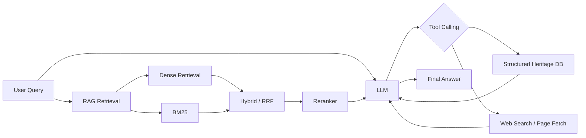

# Cultural Heritage AI — Evaluation Summary

> This document summarizes the final V1 evaluation of the project's RAG and Tool-Calling pipeline.  
> The purpose is to verify whether retrieval, private-knowledge augmentation, structured tools, and web tools provide measurable and explainable value beyond a standalone LLM.

## 1. System Overview

The project uses a unified LLM as the generation core and adds external capabilities through RAG and tools.



RAG pipeline:

```text
Dense Vector Retrieval
        +
BM25 Lexical Retrieval
        ↓
RRF Hybrid Fusion
        ↓
Rerank
        ↓
Final Top-K Context
        ↓
LLM
```

Key retrieval parameters used in V1:

| Parameter | Value |
|---|---:|
| Final Top-K | 5 |
| Candidate Top-K | 20 |
| RRF k | 60 |
| HNSW ef | 64 |
| HNSW efConstruction | 200 |
| HNSW M | 16 |

---

## 2. Retrieval Evaluation

A dedicated hard benchmark of 30 queries was used to compare Dense, BM25, Hybrid, and Hybrid + Rerank retrieval.

| Strategy | Chunk Hit@1 | Avg. Latency |
|---|---:|---:|
| Dense | 70.0% | 70.6 ms |
| BM25 | 63.3% | 8.9 ms |
| Hybrid (RRF) | 80.0% | 63.9 ms |
| Hybrid + Rerank | **90.0%** | **454.0 ms** |

### Findings

- Dense retrieval handles semantic paraphrases better than pure lexical matching.
- BM25 is extremely fast and remains useful for exact terms, names, and keyword-heavy queries.
- Hybrid retrieval improves robustness by combining semantic and lexical evidence.
- Reranking further improves top-rank quality, but introduces a significant latency cost.
- Therefore, the system treats Hybrid retrieval as a strong quality/latency baseline and uses reranking when answer quality is more important than retrieval latency.

The evaluation also exposed an important limitation: reranking is not guaranteed to improve every single query. A reranker can occasionally demote an originally correct Hybrid result, so it should be evaluated rather than assumed to be universally beneficial.

---

## 3. End-to-End Answer Evaluation

The final answer-level benchmark contains 40 cases and four controlled variants:

| Variant | RAG | Tools |
|---|---:|---:|
| LLM Only | No | No |
| LLM + RAG | Yes | No |
| LLM + Tool | No | Yes |
| LLM + RAG + Tool | Yes | Yes |

The same DeepSeek Flash model, system prompt, temperature, and generation configuration were used across variants. Only RAG and Tool availability changed.

Benchmark composition:

```text
40 Cases
├── 10 Control
├── 10 RAG
│   ├── Public-domain knowledge
│   └── Private-KB knowledge
├── 10 Tool
│   ├── Structured database queries
│   └── Dynamic web information
└── 10 RAG + Tool
    ├── Knowledge + structured data
    └── Private knowledge + structured data
```

V1 produced **159 valid answer runs out of 160 planned runs**. One LLM-only run repeatedly failed because the upstream model response did not contain a valid `choices[0].message.content`; it is recorded as an infrastructure failure rather than a wrong answer.

No post-hoc repair or selective rerun was used to improve the benchmark outcome.

---

## 4. Main Conclusions

### 4.1 RAG is most valuable for non-parametric and private knowledge

For common public cultural-heritage questions, a strong LLM can often answer correctly without retrieval. In this setting, RAG mainly improves grounding and alignment with the project's knowledge base rather than creating a large correctness gap.

To test real knowledge augmentation, the benchmark therefore also contains project-private evaluation records such as:

```text
CH-EVAL-017
BATCH-2026-A3
CAVE-DIGITAL-01
P1 / P2 / P3
```

These values do not exist in the base model's public knowledge.

On these cases:

```text
LLM Only
→ cannot reliably access the private fields

LLM + RAG
→ retrieves and answers the private fields correctly
```

The practical conclusion is:

> RAG is not simply a mechanism for making an LLM answer public trivia better. Its strongest value is giving the model controlled access to knowledge outside model parameters.

---

### 4.2 Structured tools and RAG solve different problems

The structured heritage tool returns exact database fields such as:

```text
city
dynasty
built_year
heritage_category
```

A RAG document may mention related information but does not guarantee the exact structured field value.

Conversely, the structured database does not contain private evaluation documents.

This produced a clear ablation pattern in combined cases:

| Variant | Private KB | Structured DB |
|---|---:|---:|
| LLM Only | ✗ | ✗ / model prior only |
| LLM + RAG | ✓ | ✗ |
| LLM + Tool | ✗ | ✓ |
| LLM + RAG + Tool | ✓ | ✓ |

Therefore:

> RAG is used for unstructured/private knowledge access, while tools are used for structured systems and external data access.

---

### 4.3 Dynamic information requires tools

Questions about current opening hours, reservations, temporary closures, construction notices, or recent official announcements cannot be reliably answered from a static RAG corpus.

The web-enabled agent can perform:

```text
web_search
    ↓
fetch_webpage
    ↓
read official source
    ↓
summarize current information
```

This demonstrates why static retrieval and real-time tools should not be treated as interchangeable components.

---

### 4.4 More capabilities do not automatically mean a better execution path

Tool-enabled variants occasionally invoked unnecessary tools even when RAG already contained enough information.

Observed examples showed that a RAG-only answer could require approximately:

```text
1 LLM request
0 tool calls
~4K tokens
~15 s
```

while an over-active RAG + Tool path for a similar knowledge question could grow to roughly:

```text
4 LLM requests
6 tool calls
~21K tokens
~38 s
```

Web-heavy cases could consume tens of thousands of tokens and reach tens of seconds of latency.

This exposes the next engineering problem clearly:

> Agent quality is not only about whether it can call tools. It is also about deciding when not to call them.

For production systems, tool routing, stopping rules, context compression, and budget control are as important as adding more capabilities.

---

## 5. Engineering Lessons

The evaluation changed several design assumptions:

1. **Do not evaluate RAG only with public knowledge.**  
   A strong model may already know the answer, making the benchmark measure model memory instead of retrieval value.

2. **Separate retrieval quality from answer quality.**  
   The project evaluates the retriever independently before evaluating final LLM answers.

3. **Separate unstructured knowledge from structured data access.**  
   Vector search is not a replacement for a transactional/structured database API.

4. **Treat tool calls as a costed resource.**  
   Additional tool calls increase LLM rounds, prompt size, latency, and token usage.

5. **Record infrastructure failures separately from model failures.**  
   The evaluation runner uses retries, per-case error isolation, checkpoints, and resume support.

---

## 6. Evaluation Infrastructure

The evaluation harness records:

- retrieved chunk IDs and retrieved contexts
- tool-call name, arguments, result, success, and error
- answer latency
- input/output/total tokens
- per-request LLM usage traces
- LLM request count
- run errors
- checkpoint state for resumable experiments

The runner supports bounded retries and continues evaluating later cases even when an individual model request fails.

This makes the evaluation reproducible and prevents a single API failure from invalidating an entire benchmark run.

---

## 7. Final V1 Assessment

V1 demonstrates that the project has moved beyond a simple “LLM + vector database” demo.

The system has been evaluated at two levels:

```text
Retrieval Level
Dense / BM25 / Hybrid / Rerank
        ↓
measure retrieval quality and latency

Answer / Agent Level
LLM Only / RAG / Tool / RAG + Tool
        ↓
measure capability boundaries, data-source complementarity,
tool behavior, latency, and token amplification
```

The most important result is not that every query should use every capability.

The result is the opposite:

> **RAG, structured tools, and web tools have different capability boundaries. A practical AI application should route requests to the minimum set of external capabilities required to answer reliably.**

### V1 Status

**Evaluation V1 is frozen and concluded.**

The current benchmark is retained as an engineering evaluation artifact.  
No exact end-to-end “accuracy improvement percentage” is claimed because V1 intentionally ends with behavioral ablation and systems-level evidence rather than introducing an additional LLM-as-Judge scoring layer.
