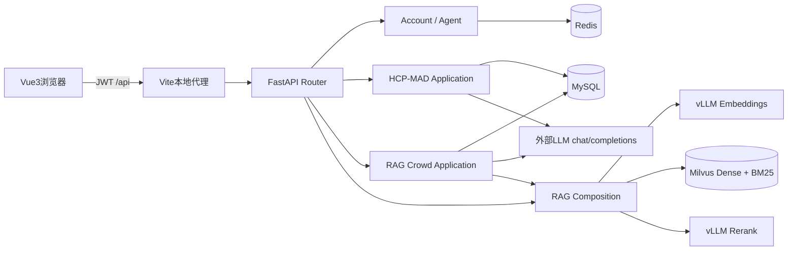
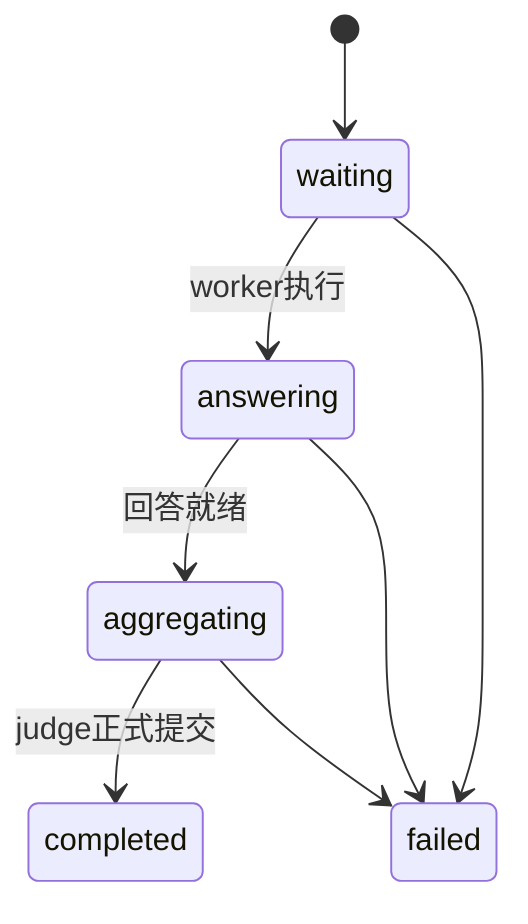
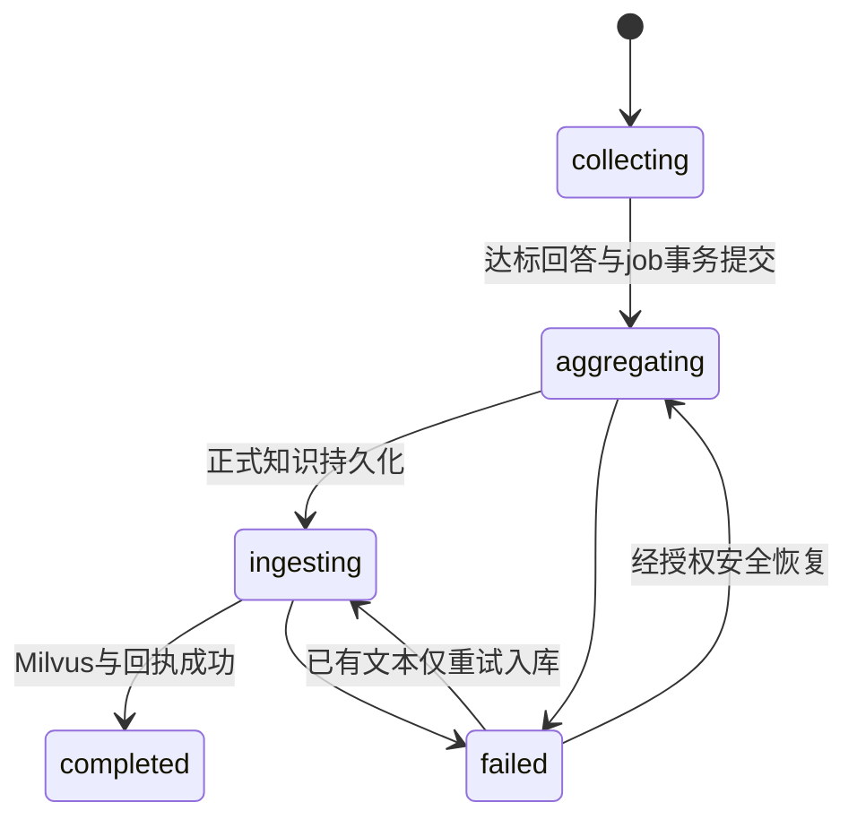

# 系统设计

## 整体架构

前端负责表单、分页、Header、状态恢复、轮询和错误展示；后端负责权限、状态转换、并发一致性、模型调用和持久化。前端缓存不能替代数据库授权或正式结果。

app/modules按account、agent、hcp_mad、rag_task、rag分离。Router处理HTTP；Application/Facade编排用例；Domain提供实体和契约；Infrastructure实现仓储、解析、向量和模型适配。composition.py统一HTTP与任务的默认Hybrid+Rerank策略。

## 数据与实体关系

| 表组 | 表名 |
|---|---|
| 基础 | accounts、ai_agents、heritage_sites |
| HCP | tasks、answers、task_contexts、task_context_items、agent_executions |
| RAG核心 | rag_tasks、rag_task_answers、rag_task_contexts、rag_task_context_items、rag_task_agent_executions |
| 众包流程 | rag_task_participants、rag_task_results、rag_task_processing_jobs、rag_task_knowledge_ingestions |
| 历史保留 | crowd_task_participants、task_knowledge_ingestions |

任务user_id关联账户，参与按task_id/worker_id唯一；参与至多一个回答；正式结果按task_id唯一；job按task_id/phase唯一；上下文项按context_id/sequence_no唯一。入库记录关联正式结果与任务。不是每个逻辑ID都有物理外键，以SQL为准。

MySQL保存事务性业务事实，Redis负责会话与注销，Milvus保存可重建检索片段。开发模式Redis可内存降级，不能用/health或登录成功断言真实Redis可用。health_check.py直接PING，绕过降级。

## HCP状态

最小配置为两个可用worker和一个judge；可选Debate有版本与轮数上限。Execution状态waiting/running/completed/failed独立于任务，stage记录thinking/tool_calling/tool_executing/finalizing等公开协议阶段。

HTTP创建使用FastAPI BackgroundTasks，持久prepare/commit不等于后台请求自动跨进程续跑；需按记录确认恢复条件，不能盲目重复不确定的外部调用。

## 众包状态与一致性

参与状态accepted/submitted，job与ingestion各有自己的状态。详情分别显示回答、正式知识和入库状态，不能只看final_result宣告入库完成。

提交锁定父任务并检查参与、阈值与终态。唯一约束防止重复参与、结果和阶段job。消费者使用租约与generation fencing，旧执行失去租约后不能提交。模型文本先prepared再正式提交；Milvus使用稳定文档/片段ID和持久计划。MySQL与Milvus之间是可恢复步骤，不声称跨库ACID。外部开始后失联保留不确定性，恢复时需明确确认可能重复调用。

## Milvus设计

字段：chunk_id(VARCHAR128主键)、document_id(VARCHAR128)、content(VARCHAR65535、jieba analyzer)、source(VARCHAR1024)、chunk_index(INT64)、embedding(FLOAT_VECTOR1024)、sparse(SPARSE_FLOAT_VECTOR)。content_bm25函数产生sparse。

Dense HNSW/COSINE，M=16、efConstruction=200；Sparse SPARSE_INVERTED_INDEX/BM25、DAAT_MAXSCORE。已有集合不匹配报告错误，不自动drop。初始化复用现有Milvus适配器。

## 模型协议和安全

Embedding POST /v1/embeddings；Rerank POST /v1/rerank；LLM使用Agent api_url指定的完整chat/completions地址。三类model_name不可混用。

JWT验证签名、过期、注销和账户存在；众包查询按公开标记与参与/发布者权限裁剪。accounts没有管理员角色。/ais和/admin/rag/documents尚无管理员鉴权，Agent任意URL有SSRF风险。默认交付仅绑定回环，公网发布前须补权限、TLS、网关限制和出站网络策略。
